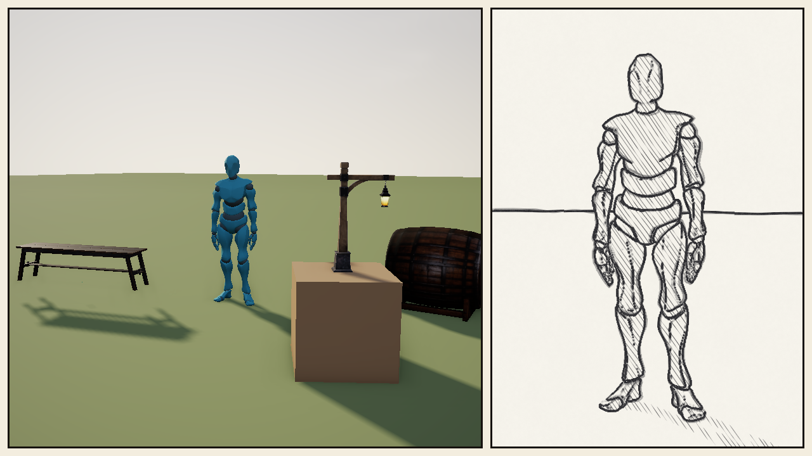

# Comic Panels

A comic page tells one beat in several pictures at once: a wide shot beside a
close-up, the live world in one panel and the drawn world in the next. A
scene's `[panels]` table lays the frame out that way. Each panel is a share of
the frame with its own camera and, if it names one, its own look.



*`examples/comic_panels.scene.toml`: the clearing as it is on the left, and on
the right the same moment, framed from the dancer and traced in pencil.*

```toml
[panels]
gutter = 12                        # points between panels and round the page
gutter_color = [0.95, 0.93, 0.88]  # the page
border = 3                         # points of ink round each panel
border_color = [0.09, 0.07, 0.06]

[panels.panel.wide]
rect = [0.0, 0.0, 0.6, 1.0]        # x, y, width, height as shares of the page, y down

[panels.panel.close]
rect = [0.6, 0.0, 0.4, 1.0]
follow = "dancer"                  # position and target are from its world origin
position = [1.5, 1.05, 2.9]
target = [0.0, 0.92, 0.0]
fov = 38
look = "rotoscope"                 # laid over the scene's [post_process], this panel only
```

## What a panel takes

| Key | What it does |
|---|---|
| `rect` | Where the panel is: `[x, y, width, height]` as shares (0 to 1) of the page, y down. Required. |
| `order` | Drawing order, lower first, ties by name. Where panels overlap, a later one covers an earlier one, so an inset gets `order = 1`. |
| `position`, `target`, `fov` | The panel's camera. A key left out is the frame camera's: a panel with none of them shows what the frame camera sees, at the panel's shape. |
| `follow` | An entity by name. `position` and `target` are then measured from its world origin, and `target` defaults to it, so a close-up stays on its subject wherever it goes. |
| `look` | A look (`rotoscope`, `graphite`, a `styles/<name>.look.toml`) laid over the scene's `[post_process]` for this panel alone, as `flint render --look` lays one. |
| `post_process` | `[post_process]` keys over that, for this panel alone: `[panels.panel.close.post_process.styles.pencil]`. |

A panel with neither `look` nor `post_process` draws with the frame's
post-processing as it stands, F4's edits and scripts' overrides included.

The page is the frame less half a gutter all round, and each panel is its share
of the page less half a gutter. So two panels side by side have one gutter
between them, and the frame's edge has one too. The border is drawn inside
the panel's share. Gutters and borders are in points, so a page looks the same
on any display.

## Each panel is the whole frame, drawn again

A panel isn't a crop. The renderer draws each panel's camera into a picture
of the panel's size, with the full post chain at that size: shadows, SSAO,
bloom and every style. A style in a panel sees the panel's size, depth, style
mask and camera, and a style with history keeps it per panel. Then the panels
are laid on the page, texel for texel, over the gutter, each inside its ink.

So a panel costs a frame at its size. Meshes, textures and pipelines are
shared between panels, and each panel's targets are made once and kept for
the scene. What a panel draws each frame is its own shadow pass, grass, culling
and post chain.

The HUD still draws over the whole page. Captions, speech balloons and a
hand-drawn border are `on_draw_ui`'s, as always.

## Cutting between layouts

A sequence cuts between pages from a script. Each call queues a command, and
the next frame is drawn as the new page:

<!-- script-api:begin module:panels -->
<!-- Generated by `flint script api --book` from the engine's declarations (crates/flint-script/src/api/, or the ScriptModule of a feature that owns its module): edit the doc there, not here. CI's headless job runs --check-book. -->

| Function | Returns | Description |
|---|---|---|
| `set_panels(layout: map)` | — | Lay the frame out as comic panels: a map shaped like the scene's \[panels\] table (gutter, border, and panel: a map of panels by name). |
| `set_panel(name: str, keys: map)` | — | Set one panel's keys (rect, position, target, fov, follow, look, `post_process`, order); a new name adds a panel. |
| `remove_panel(name: str)` | — | Take one panel off the page; with the last gone the frame is one view again. |
| `clear_panels()` | — | Draw the frame as one view again, with no panels. |

<!-- script-api:end -->

```rhai
// One panel, then two: the wide shot, then the close-up beside it
set_panels(#{ gutter: 12, panel: #{ wide: #{ rect: [0.0, 0.0, 1.0, 1.0] } } });

set_panels(#{ gutter: 12, panel: #{
    wide: #{ rect: [0.0, 0.0, 0.6, 1.0] },
    close: #{ rect: [0.6, 0.0, 0.4, 1.0], follow: "dancer",
              position: [1.5, 1.05, 2.9], target: [0.0, 0.92, 0.0], look: "rotoscope" },
} });

// One panel more, the others as they are
set_panel("overhead", #{ rect: [0.03, 0.56, 0.26, 0.41], order: 1,
                         follow: "dancer", position: [0.0, 9.0, 0.6], look: "graphite" });

remove_panel("overhead");
clear_panels();   // one view again
```

`set_panels` replaces the whole layout, including the page's own keys, which go
back to their defaults where the map leaves them out. `set_panel` merges keys
into one panel, and a new name adds one. A layout the engine can't read (a
`rect` outside 0 to 1, a key it doesn't know) is warned about and the page
stays as it was. Each panel's views are kept by name while the scene lasts, so
cutting back to a layout makes nothing new and draws at once.

`examples/scripts/comic_panels.rhai` cuts from one panel to two, then to three
with an overhead inset, and back to one, every ten seconds of game time. A
`flint-player --frame-step` capture of it is byte-identical run to run.

## Checking a page headlessly

`flint render` draws panels too, so a page can be checked without a window:

```bash
flint render examples/comic_panels.scene.toml --anim-time 1.2 --no-grid -o page.png
flint render examples/comic_panels.scene.toml --scripts --time 1,3.5,6.5,9 --no-grid -o beat.png
```

`flint render` draws no HUD, so captions show only in the player.

## What a panel shares with the frame

- **Motion on twos is the frame's.** The poses held by `[post_process]
  motion_hold` follow the scene's own setting, so a panel's look can't hold
  poses the frame doesn't (its post time does follow the panel).
- **ASCII's `temporal = "reproject"`** remembers one last camera for the whole
  renderer, so with two panels it reprojects from the other panel's camera.
  Plain per-cell history is per panel.
- **One submission a panel.** Each panel's uniforms have to land before the
  next panel writes its own, so N panels are N GPU submissions. A scene without
  `[panels]` is still one.

The decision and what it rules out: [ADR 0120](https://github.com/chrischaps/Flint/blob/main/docs/adr/0120-comic-panels-as-views-swapped-into-one-renderer.md).
