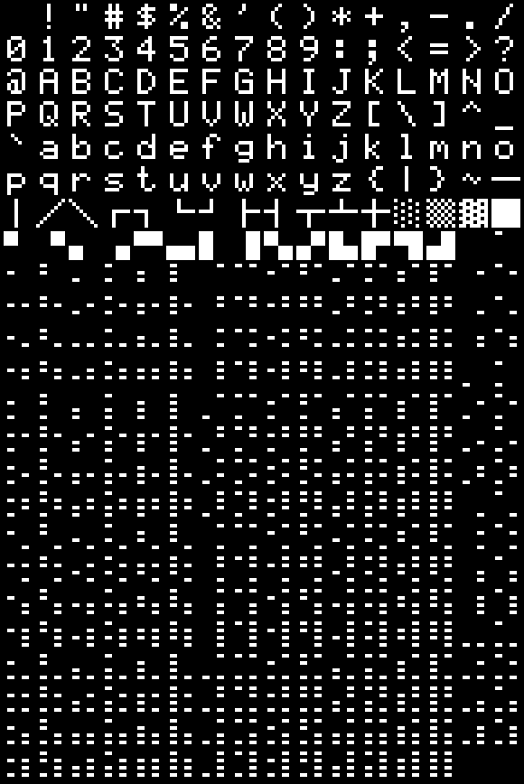
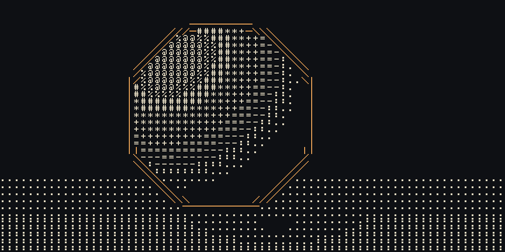
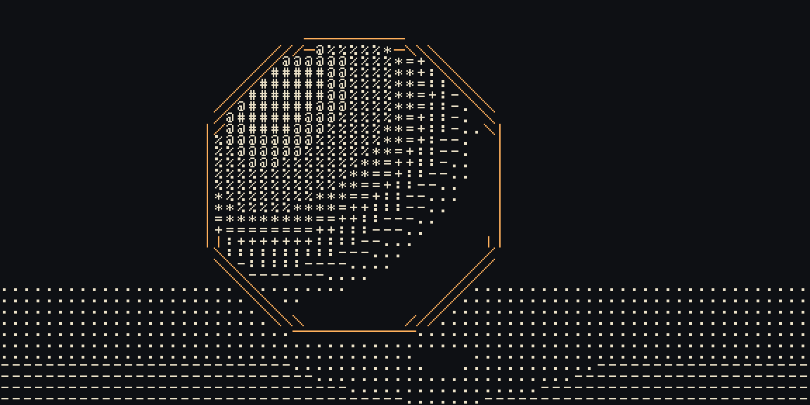
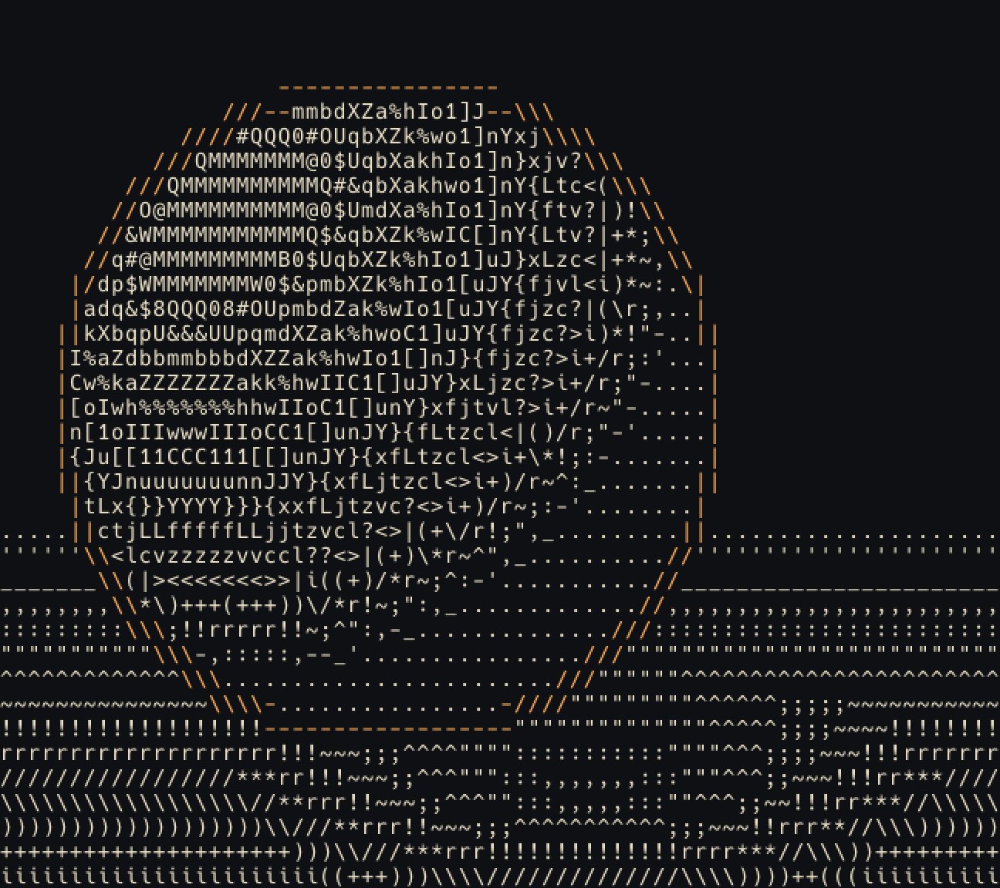
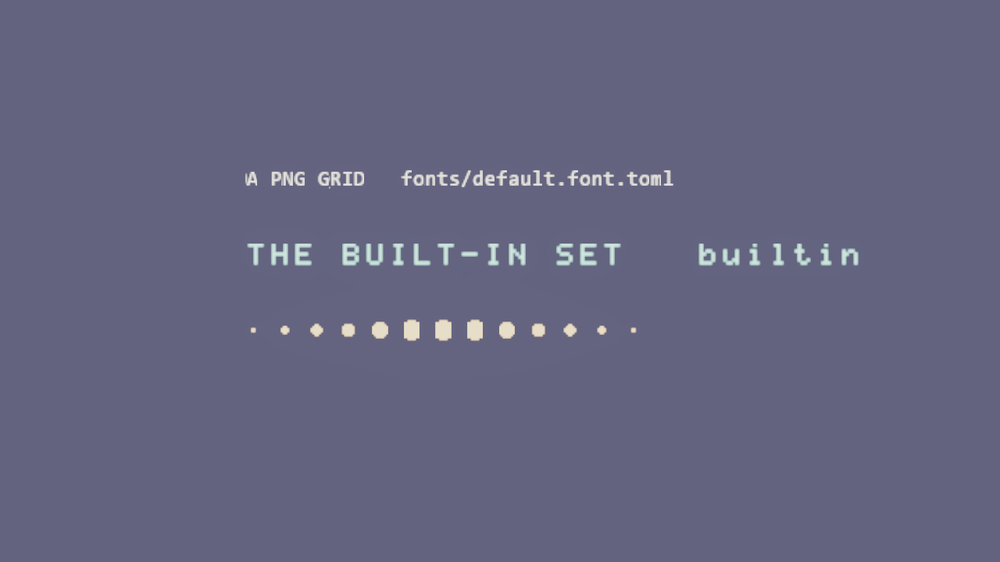

# Glyph Atlas

Every ASCII look needs glyphs on the GPU. `flint_render::glyph_atlas` rasterizes a monospaced font into one coverage texture and pairs it with the data a style reads: **ramps**, glyphs ordered from no ink to the most, and **edge glyphs** for silhouettes. The full-screen and per-entity ASCII styles of epic #260 build on it, and so can any later text-based look.



*The built-in set, 4x: printable ASCII, the box-drawing edge glyphs `─ │ ╱ ╲` and the shade blocks `░ ▒ ▓ █`, each in an 8x8 cell with a one-pixel gutter.*

## The pieces

| Type | What it is |
|---|---|
| `GlyphAtlas` | Equal cells in an 8-bit coverage image (0 paper, 255 ink), 16 cells a row, one-pixel gutters. Lookups: `index_of`, `uv_rect`, `cell_origin`, `sample`, and `coverage` (each glyph's measured mean ink, 0..1). |
| `GlyphRamp` | Named glyphs from least ink to most. `pick(luminance)` maps 0..1 onto equal bands, or for a calibrated ramp onto the glyph whose measured ink is nearest; `atlas_indices()` is what a shader's ramp buffer holds, `coverage()` each step's ink, `bounds()` where each step's band starts, `inversions()` the neighbours that step backwards in ink. |
| `EdgeGlyphs` | `horizontal`, `vertical`, `diagonal`, `antidiagonal`; `for_angle(radians)` picks one from an edge's direction on screen. |
| `GlyphSet` | An atlas with its ramps, a default ramp and edge glyphs, loaded from a `*.glyphs.toml`. |
| `GlyphSetCache` | Sets by name, each loaded once. |
| `GpuGlyphAtlas` | The atlas uploaded once as an `R8Unorm` texture: sample `.r` for ink. |
| `GpuGlyphStack` | Several atlases stacked top to bottom in one `R8Unorm` texture, atlas `i` at row `tops[i]` (#335). Each atlas keeps its gutter on every side, so no glyph reads into the next. ASCII uses it to draw more than one font a frame. |

An atlas comes from one of four sources:

- **The built-in set** (`GlyphSet::builtin()`), a hand-drawn 8x8 font made for the engine (`crates/flint-render/src/glyph_atlas/builtin_8x8.txt`, editable as text) with no font licence attached. Built once per process.
- **A TTF or OTF**, rasterized with `ab_glyph` at a line height in pixels. The cell is the line height by the widest advance, and each glyph sits on the baseline, centred in its cell.
- **A bitmap grid image** (PNG or JPEG), cut into cells left to right, top to bottom.
- **Pixel text** (`.txt`), cells drawn by hand in the built-in set's format: `== c` starts a glyph, then a row of `#` ink and `.` paper per pixel row. Give the cell, `cell = [w, h]`, under `[font]`. `demo/fonts/halftone.txt` is one: a dot screen in 8x12 cells.

## Built-in ramps

| Ramp | Glyphs | Order |
|---|---|---|
| `classic` (default) | ` .:-=+*#%@` | as written |
| `blocks` | ` ░▒▓█` | as written (0, 25, 50, 75, 100% ink) |
| `minimal` | ` .oO@` | as written |
| `detailed` | Paul Bourke's 70-glyph ramp | sorted by measured coverage |



*The `glyph_atlas` example lights a sphere on the CPU, picks a glyph per cell from the `classic` ramp and outlines the silhouette with the edge glyphs. Because the built-in edge glyphs fill their cells, the outline joins into one line.*

## A glyph set file

A project's sets live in `fonts/` as `<name>.glyphs.toml`, beside the TTFs the HUD already uses:

```toml
default_ramp = "rain"       # top level, so it goes before the first [table]

[font]
file = "Hack-Regular.ttf"   # beside this file; omit [font] for the built-in 8x8 set
size = 16                   # TTF line height in pixels (default 16)
# A bitmap grid instead:
# file = "crt.png"
# cell = [8, 12]            # the grid's cell in pixels
# first_char = 32           # cell 0 holds this character...
# chars = " !\"#$%..."      # ...or name each cell's character in order
# invert = false            # true for dark ink on light paper

[ramps.rain]
glyphs = " .|!lI"

[ramps.dense]
glyphs = "@#. *+=%"
sort = "coverage"           # re-order by each glyph's measured ink in this font

[ramps.even]
glyphs = " .:-=+*#%@"
map = "coverage"            # luminance picks the glyph whose measured ink is nearest

[edges]                     # each defaults to - | / \
horizontal = "~"
```

- A TTF atlas holds printable ASCII plus every glyph the set's ramps and edges name. A glyph the font lacks is an error that names it (`the font has no glyph for '漢'`).
- A set with no `[ramps]` gets the built-in ramps that its font can draw, re-sorted by coverage in that font.
- Unknown keys are errors, so a misspelled `glyph =` fails loudly rather than being ignored.
- A ramp in a project's set that steps backwards in ink in its font (a later glyph with less than the one before) is logged when the set loads, naming the pairs: `ramp `x` gives a brighter input less ink in its font at ':' > '-'`. The built-in `classic` is left as written on purpose and isn't reported.

## Calibrated ramps

A ramp written for one font rarely rises evenly in another. In the built-in 8x8 font the classic ramp's ink goes 0, .063, **.125**, .078, **.156**, .141, .172, **.313**, .203, .281: `:` out-inks `-`, `=` out-inks `+`, and `#` out-inks both `%` and `@`, so on equal bands a brighter pixel can get less ink. On the sphere below, the bright cap draws `%` and `@` inside a ring of denser `#`.

`map = "coverage"` (#281) calibrates a ramp instead. Each glyph's measured coverage is normalised to the ramp's own range (least ink 0, most 1), the steps are put in that order, and a luminance draws the glyph whose normalised ink is nearest: each band runs between the midpoints of its neighbours. The result is monotone by construction, and its bands are as wide as the font's own spacing, so a glyph that adds little ink over the one before holds only a narrow band. In the 8x8 font the calibrated classic ramp runs ` .-:+=*%@#`, with bands starting at 0, .1, .225, .325, .425, .475, .525, .6, .775 and .95.

`sort = "coverage"` fixes the order but keeps equal bands; `map = "coverage"` fixes both. In code, `GlyphRamp::calibrated()` gives the calibrated copy of any ramp and `GlyphRamp::mapped` builds one directly.




*The same sphere, classic ramp. Above: as written, on equal bands; the highlight is ringed by `#`, the densest glyph. Below: calibrated; ink rises all the way to the highlight, and the floor's gradient reaches `-`.*

On the GPU the ASCII style packs each step's band start beside its glyph in the ramp table (`ramp_tone` in the uniform, four to a `vec4`), and `ramp_step` in `ascii_common.wgsl` binary-searches it, at most seven reads for a 128-step ramp. A ramp on equal bands stores `-1` at its first step and takes the old `floor(t * n)`, so every existing ASCII frame is byte-identical. Hysteresis, dither and tone bands still count in steps, and calibrated steps are ordered by ink, so they keep their meaning. With `ground = "inverse"` the ramp runs backwards as before, so ink still falls monotonically as the cell brightens.



*A set loading Hack at 16 px (9x16 cells), drawn through the coverage-sorted `detailed` ramp. The ASCII edge glyphs don't fill their cells, so the outline reads as strokes, not a line.*

## Naming a set

`GlyphSetCache::get(name)` resolves:

- `builtin` (or an empty name) to the built-in set;
- a path ending `.glyphs.toml` against each search directory, then as given;
- a bare name such as `terminal` to `<dir>/fonts/terminal.glyphs.toml`, searching the scene's folder and then its parent, the same rule the player uses to find `fonts/`.

Failures are cached too, so a bad name warns once rather than every frame.

**Hot reload** (#323). Natively, `GlyphSetCache::poll` checks the modified times of every file a cached set depended on: its `.glyphs.toml`, the font file that names, and the candidates searched ahead of it (absent ones too). When one changes it clears the cache, the next `get` reads the set again, and the ASCII style, which polls a few times a second, uploads the new atlas. So a ramp edited with `flint edit` or `flint play` open redraws the frame within a second, and a name that failed (a typo, a missing font file) loads once the file is there. On the web the bundle is fixed and nothing is polled. `demo/ascii_tidepool.scene.toml` names `demo/fonts/tidepool.glyphs.toml` to try it on.

## Sprite text

`ui_text` sprites draw from the same atlases ([ADR 0113](https://github.com/chrischaps/flint/blob/main/docs/adr/0113-one-glyph-atlas-for-text.md), #283), so a HUD can use the font its ASCII look draws in. `ui_text.font` names:

- `builtin`, the 8x8 set;
- a set, by name or `.glyphs.toml` path, resolved as above: a TTF, a PNG grid or pixel text;
- a `.font.toml`, the older format, kept for compatibility:

```toml
[font]
texture = "fonts/default_font.png"  # a PNG grid, found as an image texture is
glyph_width = 8
glyph_height = 16
columns = 16
first_char = 32                     # default 32
char_count = 95                     # default 95
spacing = 1.0                       # advance as a multiple of the cell width
# glyphs = "terminal"               # or a glyph set in place of the grid, keeping spacing
```

`flint_render::BitmapFont` is the layout over the atlas. `BitmapFont::resolve(spec, scene_dir)` builds it, the grid PNG going through `GlyphAtlas::from_grid_image`. The scene loader calls `SceneRenderer::load_ui_font` once per name, which uploads the atlas as white RGBA with the coverage as alpha (`font:<name>` in the texture cache). After that each `ui_text` is just sprites in the sprite2d pipeline. A font that fails warns once and draws nothing. Every grid now has the atlas's one-pixel gutter, so a linearly filtered glyph no longer picks up its neighbour's edge.



## Web and bundles

Every read goes through `flint_core::vfs`: the TOML through `vfs::read_to_string`, fonts through `vfs::read`, grid images through `flint_render::open_image`. A game bundle served on the web loads a set exactly as the disk does. `flint bundle` packs `fonts/` and fails if a `*.glyphs.toml` names a font file that isn't packed.

## Looking at a set

```bash
cargo run -p flint-render --example glyph_atlas -- out/                                # the built-in set
cargo run -p flint-render --example glyph_atlas -- out/ fonts/terminal.glyphs.toml
```

This writes `<set>_atlas.png` (4x, nearest), `<set>_coverage.json` and `<set>_<ramp>.png` (the sphere specimen above), plus `<set>_<ramp>_calibrated.png` for each ramp that isn't calibrated already. The JSON holds each glyph's ink and, per ramp, its glyphs, `map`, coverage, band starts (`bounds`), `inversions`, its calibrated order and bands, and a 101-point ink `curve`: `luminance`, `as_mapped` (the ink each luminance gets from the ramp as it is) and `calibrated`.
