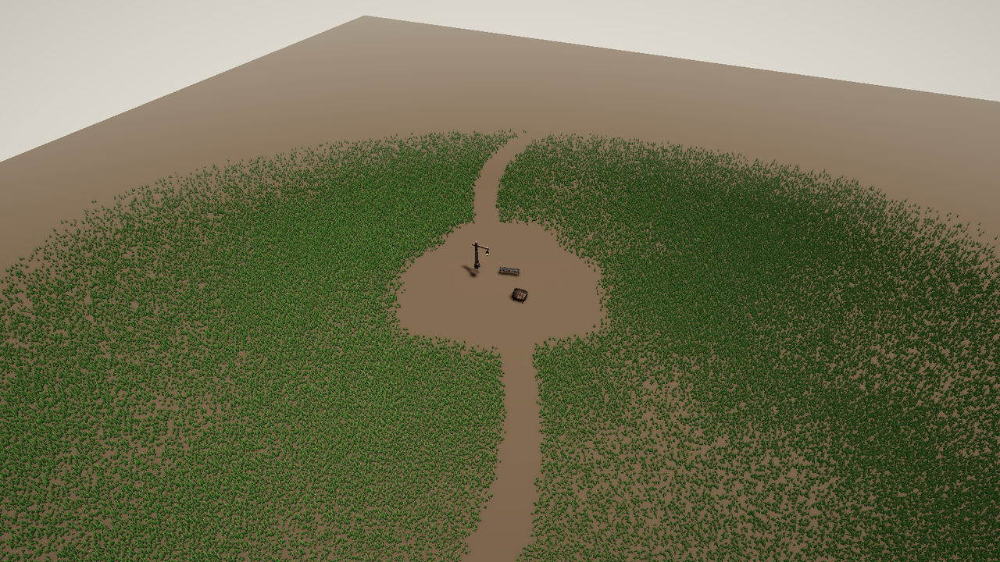

# Grass on Any Ground

The [terrain](terrain.md#grass) grows grass from its own heightmap and splat map. A game whose ground is something else, such as a mesh it builds itself, a level made of boxes or a race track, can give the grass pass its own ground instead (ADR 0089). That ground is two things over a world-space rectangle:

- **a density mask.** One byte per texel: 0 grows no grass and 255 grows full density.
- **a height.** Either level ground at one `y`, or a heightmap of world `y` values.

Everything else is the same grass: the same blades, wind, bend, colours and shadows, tuned by the same `grass.*` fields.



*The Mesh Meadow demo. The ground is one box. The mask leaves the path and the clearing bare and thins the field toward its rim. Grass grows only within `max_distance` (70 m here) of the camera, so the far side is bare.*

## From a scene

A `grass_ground` component puts grass on level ground with no code. The entity's `x` and `z` are the rectangle's minimum corner, and its `y` is the ground's height:

```toml
[entities.meadow]
[entities.meadow.transform]
position = [-48, 0, -48]

[entities.meadow.grass_ground]
mask = "mesh_meadow/mask.png"     # grayscale; pixel (0,0) at the corner, rows toward +Z
width = 96.0
depth = 96.0
scale_by_mask = true
"grass.density" = 40.0
"grass.max_distance" = 70.0
"grass.blade_height" = 0.45
```

| Field | Type | Default | Description |
|-------|------|---------|-------------|
| `mask` | string | | Grayscale PNG, relative to the scene file. It stretches over the whole rectangle, whatever its resolution |
| `width` | f32 | 64.0 | World X extent the mask covers |
| `depth` | f32 | 64.0 | World Z extent the mask covers |
| `scale_by_mask` | bool | true | Grey thins the field in proportion. When `false`, anything over `grass.density_threshold` grows at full density, as a terrain's splat layer does |
| `grass.*` | | | As on the [terrain](terrain.md#grass). `grass.enabled` defaults to `true` here; `density_layer` and `density_source` don't apply |

A scene has one grass field. A `grass_ground` replaces a terrain's grass, with a warning. The **Grass Debug** panel (`F3`) works on it as on a terrain, and commits its changes back to the `grass_ground` component. `flint render` draws it too.

Try it with `flint play demo/mesh_meadow.scene.toml`.

## From Rust

A game that builds its own world sets the ground from a `PlayerExtension`, through `ctx.gpu` (an `ExtensionGpu`), whenever its world changes:

```rust
use flint_player::{GrassConfig, GrassGround, GrassHeight};

let Some(gpu) = ctx.gpu.as_mut() else { return };

let config = GrassConfig {
    enabled: true,
    density: 30.0,
    max_distance: 90.0,
    fade_start: 70.0,
    ..GrassConfig::default()
};
let ground = GrassGround {
    origin: [-2000.0, -2000.0],   // minimum corner, world X and Z
    size: [4000.0, 4000.0],
    mask: &mask,                  // width × height bytes, row by row toward +Z
    mask_width: 2048,
    mask_height: 2048,
    scale_by_mask: true,
    height: GrassHeight::Flat(0.0),
};
if let Err(e) = gpu.set_grass_ground(&config, &ground) {
    tracing::warn!("grass: {e}");
}
```

- **`set_grass_ground`** uploads the mask and height, and replaces any grass already loaded. Call it again to repaint: a road laid, a lot built on, a field cleared. It returns `Err` only when a slice doesn't match its stated size. On a device without compute shaders it does nothing.
- **`set_grass_config`** retunes the grass without uploading the ground again. If the new config needs more instances than the buffer holds, the buffer grows before the next frame.
- **`clear_grass`** removes it.

`GrassHeight::Map { heights, width, depth }` gives the ground a shape. It's a grid of world `y` values over the same rectangle, sampled nearest. The heights are world units, unlike a terrain's heightmap, which is scaled by `height_scale`.

The same calls are on `SceneRenderer` (`set_grass_ground`, `set_grass_config`, `unload_grass`) for code that drives the renderer directly. A scene transition clears the grass.

## Only the reach of the camera

The compute pass covers only the grid cells within `max_distance` of the camera, on X and Z, clipped to the ground. The instance buffer holds what that disc can grow, plus 10%, or half the ground's area if that's smaller. So the cost follows the grass near the camera, not the size of the ground. A 3 km ground at density 40 needs a 21 MB buffer. Sizing it by area, as before, would have needed 5.7 GB.

Each cell keeps its place in the whole grid, so a blade doesn't move as the window follows the camera. Terrain grass gets the same windowing, and grows exactly as it did before.

## Only what the camera sees (ADR 0092)

Within that window, the compute pass keeps a blade only if its root is inside the camera frustum. The planes are pushed out first, so nothing visible is lost at the frame's edges. They move out by the tallest blade, which covers a blade leaning in from just outside. With shadows on, they move out further, by as far as a blade's shadow reaches along the ground: its height over the tangent of the sun's elevation, capped at eight blade heights for a sun near the horizon. A blade just off screen whose shadow falls on screen is still drawn into the shadow cascades.

The pass counts the blades it keeps into a `DrawIndexedIndirect` buffer, and the main pass and both shadow cascades draw from it with `draw_indexed_indirect`. The CPU never waits for the count. The compute pass runs before the shadow pass, so the cascades cast the blades of the frame they shadow. The F2 overlay's blade count comes from a small read-back that is mapped without waiting, so it lags the frame by one or two.

**Cost.** Measured on an RTX 4070 at 1600×900, uncapped, with the builds from before and after culling run alternately. The grass's cost is the frame time with grass minus the frame time without it.

| Scene | Before culling | Culled to the view |
|---|---|---|
| Mesh Meadow demo (density 40, 70 m reach), looking into the field | ~111k blades, 1.3 ms | ~83k blades, 0.9 ms |
| Standing in an unbroken field (same density and reach) | ~507k blades, 3.8 ms | ~125k blades, 1.1 ms |

With the grass still (`wind_strength` 0), a frame from either build is identical to the pixel, shadows included.
