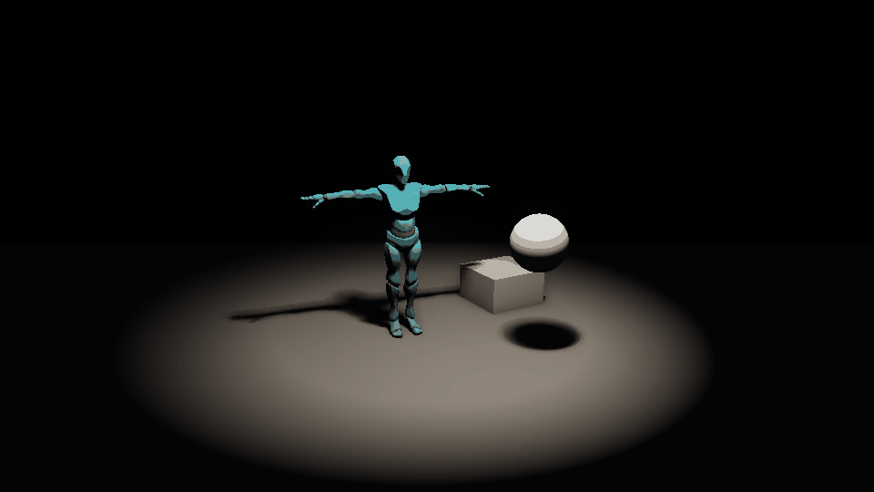
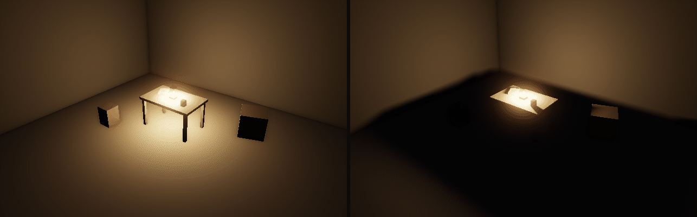
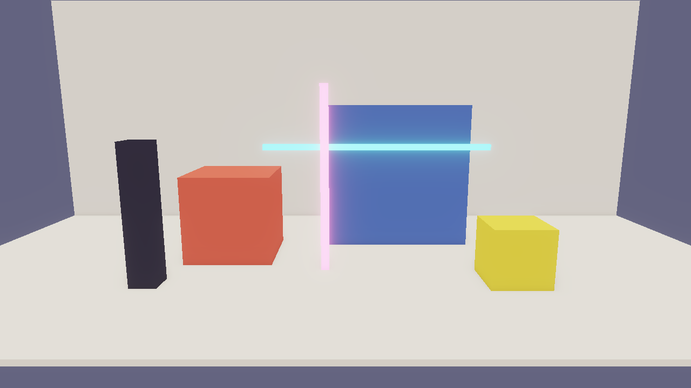
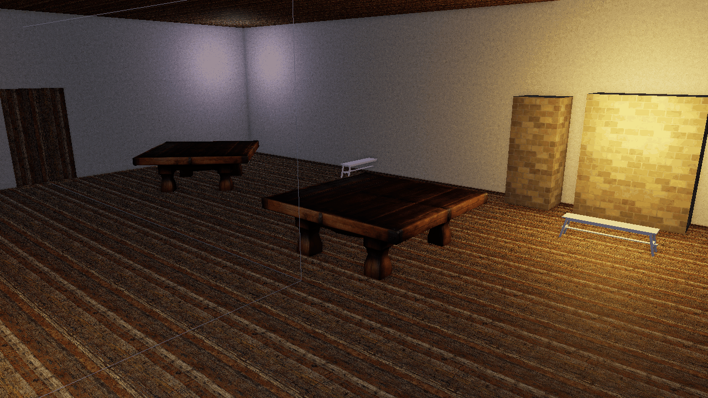
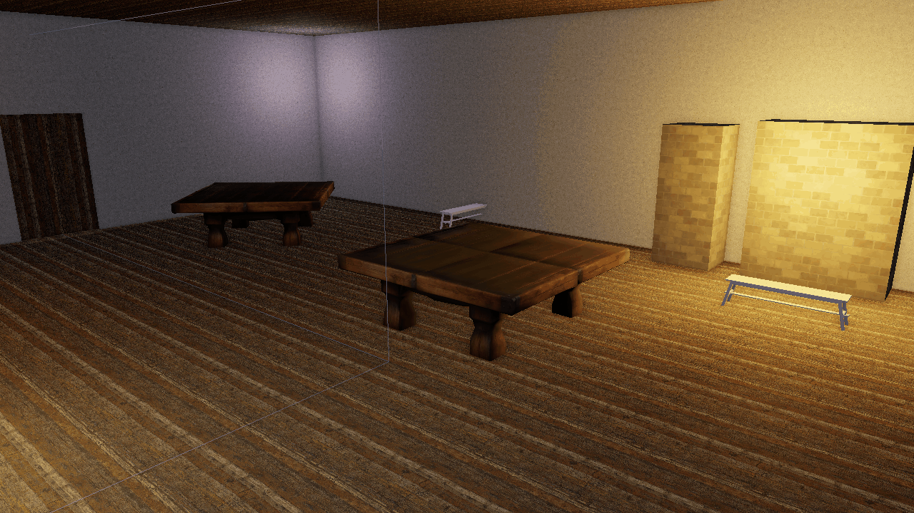

# Lighting

Lights in Flint are ordinary entities with a `light` component. The renderer reads them every frame, sorts them by name so the shadow-casting sun is stable across reloads, and feeds them to the PBR shader alongside a set of scene-wide shading levers authored in the `[environment]` block. This page owns all of that: the light component, cascaded and contact-hardening shadows, area lights, and the "clay look" levers.

## The Light Component

```toml
[entities.sun.light]
type = "directional"
direction = [0.5, 1.0, 0.3]        # points toward the light
color = [1.0, 0.98, 0.95]
intensity = 3.0
angular_size = 0.5                 # degrees; drives PCSS penumbra

[entities.lantern.light]
type = "point"
color = [1.0, 0.7, 0.4]
intensity = 8.0
range = 12.0
source_radius = 0.15               # meters; softens the specular hotspot

[entities.spot.light]
type = "spot"
direction = [0.0, -1.0, 0.0]       # the way it shines; leave it out to follow the entity's rotation
color = [1.0, 1.0, 1.0]
intensity = 20.0
range = 15.0
inner_angle_deg = 17               # degrees, like every other angle in a scene
outer_angle_deg = 28
source_radius = 0.1
```

Point and spot lights sit at their entity's world position, so they follow transform hierarchies and animation like any other entity. Directional lights ignore position.

**Direction follows rotation when it isn't written** (#682). A light with no `direction` shines down its entity's own -Y axis, turned by the entity's rotation and every parent's: a spot light under a hand, a car or a swinging lamp turns with it. Unturned, a spot points straight down and a directional light is a sun overhead. A `direction` that is written is world space and stays put whatever the entity does, as it always has. [`flint-examples/swinging_lamp.scene.toml`](https://github.com/chrischaps/flint-examples/blob/main/swinging_lamp.scene.toml) hangs a lamp on an arm a script swings, and its beam sweeps the yard with it.

```toml
[entities.arm.transform]
position = [0, 4, 0]
rotation = [0, 0, 40]              # degrees: the beam swings toward +x

[entities.torch]
parent = "arm"

[entities.torch.light]
type = "spot"                      # no direction: it shines down the arm's -Y
intensity = 40
range = 14
inner_angle_deg = 14
outer_angle_deg = 23
```

| Field | Applies to | Type | Default | Description |
|-------|-----------|------|---------|-------------|
| `type` | all | string | directional, warned | `directional`, `point` or `spot`. Any other value lights nothing and says so by entity name; left out, the light is directional and that is said once too |
| `color` | all | [f32; 3] | `[1, 1, 1]` | Linear RGB |
| `intensity` | all | f32 | `1.0` | Radiance multiplier |
| `direction` | directional, spot | [f32; 3] | the entity's -Y, turned | World space. For directional lights this points **toward** the light; for spots it is the cone axis, the way the light shines. Unset: the light shines down its entity's own -Y and turns with it (above) |
| `angular_size` | directional | f32 | `0.0` | Apparent size of the source in degrees (sun about 0.5, softbox 2--5). 0 keeps hard 3x3 PCF shadows ([ADR 0056](https://github.com/chrischaps/Flint/blob/main/docs/adr/0056-source-radius-area-lights.md)) |
| `range` (alias `radius`) | point, spot | f32 | `10.0` | Falloff distance in world units |
| `source_radius` | point, spot | f32 | `0.0` | Physical radius of the emitter in meters; 0 = punctual ([ADR 0056](https://github.com/chrischaps/Flint/blob/main/docs/adr/0056-source-radius-area-lights.md)) |
| `inner_angle_deg` | spot | f32 | about 17.2 | Full-intensity cone half-angle, degrees (0 to 90). Wins over `inner_angle` |
| `outer_angle_deg` | spot | f32 | about 28.6 | Cone edge half-angle, degrees (0 to 90). Wins over `outer_angle` |
| `inner_angle` | spot | f32 | `0.3` | The older form, radians; read when `inner_angle_deg` is unset |
| `outer_angle` | spot | f32 | `0.5` | The older form, radians; read when `outer_angle_deg` is unset |
| `cast_shadows` | spot, point | bool | `false` | The light casts a shadow from a shadow map of its own (a cube of six for a point light), softened by `source_radius`; one spot and one point light cast, the first of each by name that asks ([Spot light shadows](#spot-light-shadows), [Point light shadows](#point-light-shadows)) |
| `volumetric_intensity` | directional | f32 | `0.0` | God-ray strength for this light; see [Post-Processing](post-processing.md#volumetric-lighting-god-rays) |
| `volumetric_color` | directional | [f32; 3] | light color | Tint of the shafts |

The same fields are the engine's `light` schema (`schemas/components/light.toml`), so `flint schema light` prints them from a terminal, with each fallback in its description. Only `color` and `intensity` carry a schema default: a default is written into the component at load, so `range` given one would beat an authored `radius`, and `type` given one would hide a light that forgot it.

### Angles are degrees

Every angle a scene writes is in degrees: transforms, joints, a directional light's `angular_size`, and a spot's cone as `inner_angle_deg` and `outer_angle_deg` (#682). The radian keys `inner_angle` and `outer_angle` are the older spelling and still read exactly as before, so no scene changes its look; write the `_deg` keys in anything new. Where both are written the degrees win, and the light says so once (`two-forms`). A radian key holding more than a quarter turn (1.5708) is almost surely degrees in the wrong key: `flint validate` reports it as out of range, and the renderer says which key to use:

```text
WARN warning[out-of-range] entity 'torch' light.outer_angle: 30 is past a quarter turn, and `outer_angle` is in radians (for 30 degrees, write `outer_angle_deg = 30`)
```

### When a light can't be drawn

The renderer reads each light through a typed view ([Diagnostics while the game runs](schemas.md#diagnostics-while-the-game-runs)), so what it can't use is said once per entity, by name, with the reason, and not just at load: a `type` a script sets is checked too.

```text
WARN error[bad-enum-value] entity 'lamp' light.type: "spott" is not a light type, so this light is off (did you mean `spot`? a light is directional, point or spot)
WARN 1 light entity but none the renderer can use: the built-in key and fill light the scene (each light's problem is above)
WARN warning[light-cap] entity 'lamp_01' component 'light': the shader takes 16 point lights, the nearest the camera, and this one is not among them; it is off while it isn't (fewer point lights, or merge near ones into one stronger light)
```

The second line matters most: a scene whose only light is misspelled used to come out lit by the built-in pair with nothing said, which looks like a working scene.

**A light is the `light` table and no other.** Nothing reads `[entities.sun.directional_light]` or `[entities.lamp.point_light]`: a scene whose only lights are spelled that way is lit by the built-in key and fill described below, and looks plausible enough that the mistake can live for a long time (about forty of the engine's own examples carried it until #681). To turn one into a real light, name the table `light`, add `type = "directional"`, and check `direction`: it points *toward* the light, so a sun written as the way its rays travel, `[-0.5, -0.6, -0.3]`, becomes `[0.5, 0.6, 0.3]`.

Limits: the shader takes 4 directional, 16 point and 8 spot lights. Past that, it keeps the strongest directional lights by `intensity`, and the point and spot lights **nearest the camera**, chosen again each frame (and for each [comic panel](comic-panels.md)'s camera), so a street of lamps lights the stretch you're looking at; each light left out is named once a scene (`light-cap`, above). Under the cap every light is drawn in name order, exactly as before. Only one directional light casts cascaded shadows: the one with the highest `intensity`, with entity-name order breaking ties ([ADR 0045](https://github.com/chrischaps/Flint/blob/main/docs/adr/0045-deterministic-shadow-caster-order.md)), so a fill light can never steal the sun's shadows because of how it was named. If no scene light exists at all, the renderer falls back to a built-in warm key light and cool fill, unless the scene says `default_lights = false` in [`[environment]`](#the-environment-block).

### Grass and water

Point and spot lights reach [grass](grass-ground.md) and the [ocean](ocean.md) as they reach meshes and terrain (#1048): a lantern in a meadow lights the blades around it, and a lamp over a harbour lays its light on the water. Before, both shaders read only the sun, so the pool of a lamp stopped at the grass line and the waterline. Each takes the same falloff, `source_radius` distance, cone and casting spot's shadow as a mesh, and shades in its own look:

- **Grass**: a wrapped diffuse (light from low beside a blade still reaches it, as light through a blade would), divided by pi like the ground's, so a pool runs on from the ground into the grass at the brightness it has on the ground, plus the glow of tips with the lamp behind them, as the sun's backlight does.
- **Water**: the sun's cel glint from each lamp, inside a wider band of the lamp's colour, so its reflection breaks into a streak of hard sparkles on the swell; the lamp's light scattered in the surface (the water's own colour, foam brightest) and glowing through the wave flanks facing the eye. The glint is weighted by Fresnel, as the sun's is, and laid over the sky's reflection.

With no point or spot light in a scene, grass and water draw exactly what they drew before. [`flint-examples/woozy_grove_grass.scene.toml`](https://github.com/chrischaps/flint-examples/blob/main/woozy_grove_grass.scene.toml)'s lantern now lights the grass under it.

## Area Lights

`source_radius` on point and spot lights, and `angular_size` on directional lights, turn punctual lights into small area sources ([ADR 0056](https://github.com/chrischaps/Flint/blob/main/docs/adr/0056-source-radius-area-lights.md)). The specular lobe uses the representative-point approximation: effective roughness widens by `source_radius / (2 * distance)` and shading distance never falls inside the source, so the hotspot on a glossy floor becomes a soft disc instead of a pinprick. Diffuse lighting is unaffected. A value of 0 takes the original code path exactly.

## Shadows

Directional lights cast shadows through cascaded shadow maps: several cascades cover increasing distance bands from the camera, giving crisp shadows nearby and broad coverage far away. One spot light can cast too ([below](#spot-light-shadows)). Shadows can be disabled per launch with `--no-shadows`, toggled at runtime in the Rendering & Effects menu (F4), and turned off for a whole scene with `[environment] shadows = false` (below).

**A dark sun casts nothing.** When the shadow-casting directional light has `intensity = 0` (and no `volumetric_intensity`, whose god rays read the maps), or there is no directional light at all, the shadow pass is skipped with every caster in it (#627). Nothing it drew could have darkened a pixel, so the frame is byte-identical; the stats line's `in shadows` reads 0. The tavern with its sun at 0 went from 166,884 shadow triangles a frame to 0.

**Resolution.** `--shadow-resolution` defaults to 2048 texels per cascade. Before [ADR 0049](https://github.com/chrischaps/Flint/blob/main/docs/adr/0049-upload-shadow-texel-size-per-resolution.md) the shader hardcoded a 1/2048 texel size, so any other resolution filtered incorrectly and the flag was effectively decorative. The texel size is now uploaded with the cascade uniforms, so 512, 1024 and 4096 are real choices; the F4 menu's Shadows section rebuilds the shadow pass when you pick one.

**Contact hardening (PCSS).** When the shadow-casting directional light has a non-zero `angular_size`, the shader switches from a fixed 3x3 PCF kernel to percentage-closer soft shadows ([ADR 0057](https://github.com/chrischaps/Flint/blob/main/docs/adr/0057-pcss-contact-hardening-shadows.md)): a Vogel-disk blocker search estimates the average occluder depth, the penumbra width grows with the occluder-to-receiver distance and `tan(angular_size)`, and the filter kernel is sized to match. Shadows are sharp where an object touches the ground and soften as it lifts away. `angular_size = 0` takes the legacy PCF path verbatim, which keeps existing renders byte-identical.

**Skinned casters.** Skinned meshes cast shadows through a dedicated `vs_skinned_shadow` entry point that applies bone transforms before the depth write.

**One lighting for every surface.** Meshes, skinned meshes and terrain shade through the same BRDF and the same loop over the scene's lights (#738), so everything on this page applies to all three alike: area lights, the clay levers below, the cascades' normal offset, the spot's shadow. The ocean takes the same cascades, PCSS included, with no normal offset; grass and the god rays read the same light uniforms. Until #738 each shader had its own copy and they had drifted: skinned characters ignored `diffuse_wrap`, `oren_nayar`, sheen and `source_radius`, terrain ignored all of those and took its shadows without the normal offset, and the ocean's shadows stayed hard under a sun with an `angular_size`.

**Turning casting off.** Every mesh casts by default, transparent ones included: the shadow pass writes depth only, so a sheet at `opacity = 0.02` casts as dark a shadow as a wall. Set **`material.cast_shadows = false`** ([ADR 0100](https://github.com/chrischaps/Flint/blob/main/docs/adr/0100-entity-can-opt-out-of-shadows.md)) on anything that shouldn't, like mist, glass, spray or a smoke card:

```toml
[entities.valley_mist.material]
opacity = 0.3
cast_shadows = false
```

- **Where it applies:** imported, runtime, skinned and procedural (`bounds`) meshes, opaque or transparent. An entity with no value of its own takes its parent's, so a GLB expanded into child nodes stops casting as one.
- **It's read every frame**, so a script or extension can turn it on and off. It costs nothing: the draw just stays out of the cascades. The mesh still takes shadows from everything else.
- **Terrain and grass** don't read it: terrain chunks always cast, and grass casts into the two nearest cascades.

### Spot light shadows

A spot light with **`cast_shadows = true`** casts a shadow of its own (#504, [ADR 0124](https://github.com/chrischaps/Flint/blob/main/docs/adr/0124-one-spot-shadow-as-a-layer-of-the-shadow-map-array.md)). It is the case the cascades can't serve: one key light over one subject on a dark floor. A sun placed along the key to get its shadow floods the whole floor and erases the pool the key makes; the spot's own shadow keeps the pool and gives the subject its contact with the ground.

```toml
[entities.key.transform]
position = [0.6, 4.2, 1.4]

[entities.key.light]
type = "spot"
direction = [-0.14, -1.0, -0.33]
intensity = 34.0
range = 9.0
outer_angle_deg = 34.0
source_radius = 0.3      # softens the shadow: sharp at contact, wider as caster and floor part
cast_shadows = true
```



*[`flint-examples/spot_shadow.scene.toml`](https://github.com/chrischaps/flint-examples/blob/main/spot_shadow.scene.toml): the only light is the spot. The figure's feet meet their shadow; the ball, a metre up, casts a wider and softer one.*

- **One spot casts**: the first by entity name that asks. Another spot that asks lights without a shadow and says so once (`shadow-cap`). It must be among the 8 spots the frame draws, and give light.
- **It works with or without a sun.** The spot's map is the last layer of the cascades' texture, drawn from the light down its axis out to its `range`, and covering its cone up to 80 degrees from the axis. A wider cone is shadowed out to 80 degrees and lit past it.
- **Softness is `source_radius`**, the size of the lamp in metres, as `angular_size` is the sun's: a blocker search finds how far the caster is from what it shadows, and the penumbra widens with that gap (PCSS). The kernel turns a little each pixel, so its edge is a fine grain rather than rings. `source_radius = 0` is a hard 3x3 PCF shadow.
- **What it shadows**: meshes, skinned meshes, terrain, grass and the ocean receive it (grass and water since #1048, [Grass and water](#grass-and-water)); grass doesn't cast into it.
- **Off** the same ways as every shadow: `--no-shadows`, F4, `[environment] shadows = false`, the quality tier's `shadows`. `material.cast_shadows = false` keeps a mesh out of the spot's map as it does out of the cascades.
- **Cost**: one more depth pass over the casters in the spot's view, the filter on the pixels the spot lights (it is skipped outside the cone and past `range`), and one more layer of the texture (16 MB at the default 2048 texels, allocated whether or not a scene uses it). [`flint-examples/spot_shadow.scene.toml`](https://github.com/chrischaps/flint-examples/blob/main/spot_shadow.scene.toml) at 1920 x 1080 on an RTX 4070 (debug build, `--gpu-time 240`, p50): the depth pass 0.024 ms, the scene pass 0.075 ms without the shadow and 0.316 ms with it, so about 0.26 ms a frame. A scene with no spot asking draws exactly what it drew before.
- **Point lights cast too**, from a cube ([Point light shadows](#point-light-shadows), next). The strongest directional light casts the cascades whatever `cast_shadows` says, and a `false` on it is said once.

### Point light shadows

A point light with **`cast_shadows = true`** casts a shadow every way at once (#1112, [ADR 0132](https://github.com/chrischaps/Flint/blob/main/docs/adr/0132-one-point-light-shadow-as-a-cube-atlas-layer.md)): a lantern on a table throws the table's shadow onto the floor on every side of it, and the cup beside the lantern throws its own across the tabletop. A spot can't stand in for that: whatever falls outside its cone goes unlit.

```toml
[entities.lantern_light.transform]
position = [0.0, 0.94, 0.0]

[entities.lantern_light.light]
type = "point"
color = [1.0, 0.72, 0.42]
intensity = 9.0
range = 9.0
source_radius = 0.03     # a small flame: sharp near what casts, softer further off
cast_shadows = true

# The lantern's own glass and cap would shadow the whole room: keep them out
[entities.lantern_cap.material]
cast_shadows = false
```



*A lantern on a table, with and without `cast_shadows`: the table top hides the floor around it on every side; the stool, in the table's shadow line, goes dark; the crate's top, just outside it, stays lit.*

- **One point light casts**: the first by entity name that asks. Another point light that asks lights without a shadow and says so once (`shadow-cap`). It is a budget of its own: one spot and one point light can both cast. It must be among the 16 point lights the frame draws, and give light.
- **The lamp's own body casts too.** A light inside a mesh (a lantern's glass, a bulb's shade) is shadowed by it everywhere. Give those parts `material.cast_shadows = false`; what's within a few centimetres of the light (its near plane, `range * 0.004`, at least 2 cm) is never drawn into the map.
- **Six faces in one layer.** The map is a cube, one perspective down each axis out to the light's `range`, laid side by side in one more layer of the shadow texture, each face a third of `shadow_resolution` wide (682 texels at the default 2048). Each face reaches a little past its quarter turn, so a soft shadow that crosses from one face to the next has no seam.
- **Softness is `source_radius`**, as for a spot: PCSS, the kernel turned a little each pixel; `0` is a hard 3x3 PCF shadow.
- **What it shadows**: meshes, skinned meshes, terrain, grass and the ocean receive it; grass doesn't cast into it.
- **Off** the same ways as every shadow: `--no-shadows`, F4, `[environment] shadows = false`, the quality tier's `shadows`.
- **Cost**: one more pass over the casters near the lamp, each drawn once for each face it falls in, the filter on the pixels inside the light's `range`, and one more layer of the texture (16 MB at the default 2048 texels, allocated whether or not a scene uses it). The lantern above at 1920 x 1080 on an RTX 4070 (debug build, `--gpu-time 240`, p50): the depth pass 0.011 ms, the scene pass 0.089 ms without the shadow and 0.518 ms with it, about 0.43 ms a frame, since every pixel is within the lamp's `range` (a spot's filter runs only inside its cone). A scene with no point light asking draws exactly what it drew before.

## The `[environment]` Block

Scene-wide shading lives in `[environment]`, next to the skybox path. Every lever here follows the same convention: absent or zero means the exact original shading, so scenes that never set them look the way they always did.

```toml
[environment]
skybox = "textures/dusk.hdr"
ambient_sky = [0.12, 0.13, 0.18]
ambient_ground = [0.06, 0.05, 0.04]
diffuse_wrap = 0.3
oren_nayar = 0.7
sheen_color = [1.0, 0.9, 0.8]
sheen_strength = 0.15
```

| Field | Type | Default | Description |
|-------|------|---------|-------------|
| `skybox` | string | none | Equirectangular panorama for the sky |
| `ambient_sky` | [f32; 3] | `[0.12, 0.13, 0.18]` | Hemisphere ambient, upper half (linear RGB) |
| `ambient_ground` | [f32; 3] | `[0.06, 0.05, 0.04]` | Hemisphere ambient, lower half |
| `diffuse_wrap` | f32 | `0.0` | Softens the diffuse terminator; 0.2--0.5 reads as matte or faintly subsurface |
| `oren_nayar` | f32 | `0.0` | Blend from Lambert toward the Fujii Oren-Nayar approximation, 0--1. Roughness supplies sigma; this only blends ([ADR 0048](https://github.com/chrischaps/Flint/blob/main/docs/adr/0048-clay-lighting-levers-oren-nayar-and-sheen.md)) |
| `sheen_color` | [f32; 3] | `[1, 1, 1]` | Charlie-sheen rim tint |
| `sheen_strength` | f32 | `0.0` | Rim strength. No energy compensation, so keep it at or below about 0.3 ([ADR 0048](https://github.com/chrischaps/Flint/blob/main/docs/adr/0048-clay-lighting-levers-oren-nayar-and-sheen.md)) |
| `shadows` | bool | `true` | `false`: the scene casts no shadows, whatever the quality tier or F4 say; they keep their own setting for the next scene (#627) |
| `default_lights` | bool | `true` | `false`: a scene with no light entities is lit by its ambient (and emission) alone, not the built-in key and fill (#627) |

Fog is **not** here; it lives in `[post_process]`.

### Unlit and ambient-only scenes

A scene lit by its ambient alone, or by nothing but what glows, needs no dummy light and no script (#627):

```toml
[environment]
shadows = false
default_lights = false
ambient_sky = [0.95, 0.9, 0.82]
ambient_ground = [0.32, 0.28, 0.3]

[entities.neon.material]
color = [1.0, 0.18, 0.55, 1.0]
unlit = true
emissive_scale = 3.0
```

**`material.unlit = true`** draws a mesh's base colour (texture and vertex colour included) times its `emissive_scale`, plus its emission, straight into the HDR target: no lights, ambient or shadows reach it, so unlit neon can stand among lit props, and above 1 it blooms. It is read every frame and inherited from the parent, on imported, skinned and procedural (`bounds`) meshes. It still casts a shadow unless `cast_shadows = false`, and post-processing (SSAO, fog, the grade) still applies, as it does to emission.



*[`flint-examples/unlit_ambient.scene.toml`](https://github.com/chrischaps/flint-examples/blob/main/unlit_ambient.scene.toml): props lit by the ambient alone, no shadow pass, and three unlit bars, two of them blooming.*

How they combine in the shader: hemisphere ambient interpolates between the two colors by the surface normal's Y. Diffuse wrap replaces the raw `n·l` term; Oren-Nayar scales the diffuse magnitude; the Charlie sheen adds a rim lobe on top. The three are orthogonal, and when all are zero the shader takes the original code path. The wrap and Oren-Nayar values ride the `w` components of the ambient uniforms encoded as `1 + value`, which is why a stale or default uniform (w = 0) still means "off".

### The clay look

[ADRs 0042](https://github.com/chrischaps/Flint/blob/main/docs/adr/0042-clay-look-research-spike.md) through 0052 grew these levers to give a scene a soft, sculpted, matte "clay" reading without touching materials. A recipe that works on the tavern showcase:



*The tavern with default shading: Lambert diffuse, sharp terminator, neutral grade.*



*The same frame with Oren-Nayar 0.7, sheen 0.15, and a warm grade gain.*

```toml
[environment]
diffuse_wrap = 0.25
oren_nayar = 0.7
sheen_color = [1.0, 0.9, 0.8]
sheen_strength = 0.15

[post_process]
ssao_samples = 16
grade_lift = [0.03, 0.02, 0.015]
grade_gain = [1.04, 1.0, 0.94]
film_grain = 0.02
```

The same levers are available headlessly, and CLI values win over the scene block:

```bash
flint render scene.toml --oren-nayar 0.7 --sheen-strength 0.15 --sheen-color 1,0.9,0.8 \
    --set post.grade_gain=1.04,1,0.94 --set post.ssao_samples=16
```

## Runtime Control

The Rendering & Effects menu's **Lighting** section exposes all six `[environment]` levers with a Reset button, plus shadow enable and resolution under **Shadows**. In code, `SceneRenderer` offers `set_ambient` / `reset_ambient`, `set_diffuse_wrap`, `set_oren_nayar`, `set_sheen`, `set_shadow_resolution`, and `lighting_levers()` to read the current state back for seeding UI.

Scripts do not currently have bindings for these levers; they are a per-scene look, not a per-frame effect. For per-frame mood changes use the sticky post-process overrides on the [Post-Processing](post-processing.md#from-scripts) page.

## Further Reading

- [Rendering](rendering.md) --- the PBR pipeline these lights feed
- [Post-Processing](post-processing.md) --- volumetric shafts, grade and grain
- [Sky](sky.md) --- the procedural sky, which carries its own `ambient_sky` / `ambient_ground` on the `sky` component, distinct from the `[environment]` keys here
- [File Formats](../formats/overview.md) --- the `[environment]` block reference
