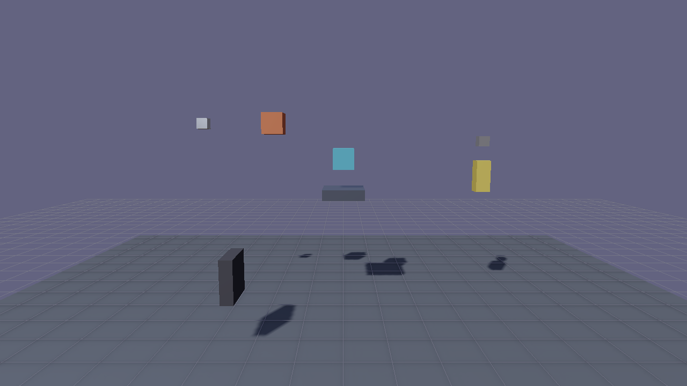
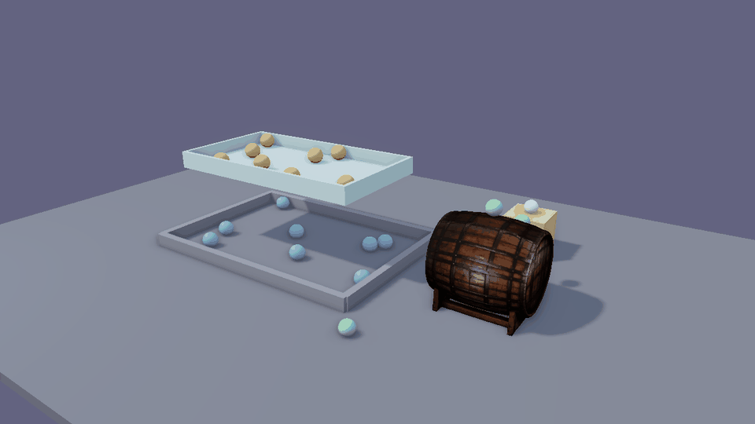

# Physics and Runtime

> **Package:** `engine`: every game has it. Its physics is grouped in the engine's manifest as the package it becomes in a later phase, with no switch yet ([Packages](packages.md)).

Flint's runtime layer transforms static scenes into interactive, playable experiences. The `flint-runtime` crate provides the game loop infrastructure, and `flint-physics` integrates the Rapier 3D physics engine for collision detection and character movement.

## The Game Loop

The game loop uses a **fixed-timestep accumulator** pattern. Physics simulation steps at a constant rate (1/60s by default) regardless of how fast or slow the rendering runs. This ensures deterministic behavior across different hardware.

The loop structure:

1. **Tick the clock** --- advance time, accumulate delta into the physics budget
2. **Process input** --- read keyboard and mouse state into `InputState`
3. **Fixed-step physics** --- while enough time has accumulated, step the physics simulation
4. **Character controller** --- apply player movement based on input and physics state
5. **Update audio** --- sync listener position to camera, process trigger events, update spatial tracks
6. **Advance animation** --- tick property tweens and skeletal playback, write updated transforms to ECS, upload bone matrices to GPU
7. **Run scripts** --- execute Rhai scripts (`on_update`, event callbacks), process deferred commands (audio, events)
8. **Render** --- draw the frame with the current entity positions, HUD overlay (crosshair, interaction prompts)

Scripts, audio, animation and particles implement the `RuntimeSystem` trait: `initialize()` when a scene is entered and `update()` once a frame. Nothing holds a list of them: the player calls each by its type, in the order above, and skips one the game state pauses (see [Game states](scripting.md#game-state-machine-api)). Physics is stepped at the fixed rate instead, by `PhysicsSystem::fixed_update(world, dt, events)`. Optional parts of the player, such as living props, are its subsystems ([ADR 0117](https://github.com/chrischaps/Flint/blob/main/docs/adr/0117-player-subsystems-and-one-game-step.md)).

The frame's events live in one `EventBus`, which the player owns. Each fixed physics step pushes its collisions and triggers onto it, and player extensions, style changes and scripts' `fire_event` push their own; the frame hands the whole batch to scripts and audio before `on_update`. Clearing physics at a scene transition doesn't touch it: a script's event fired as it leaves reaches the next scene's scripts, and only the old scene's contacts are dropped.

## Physics with Rapier 3D

The `flint-physics` crate wraps Rapier 3D and bridges it to Flint's TOML-based component system:

- **PhysicsWorld** --- manages Rapier's rigid body set, collider set, and simulation pipeline
- **PhysicsSync** --- reads `rigidbody` and `collider` components from entities and creates corresponding Rapier bodies. Static bodies for world geometry (walls, floors, furniture), kinematic bodies for the player.
- **CharacterController** --- kinematic first-person movement with gravity, jumping, ground detection, and sprint

## Physics Schemas

Four component schemas define physics properties:

**Rigidbody** (`rigidbody.toml`) --- determines how an entity participates in physics:
- `body_type`: `"static"` (immovable world geometry, the default), `"dynamic"` (simulated), or `"kinematic"` (script-controlled; `"kinematic_velocity"` for a velocity-based one). A misspelt value fails `flint validate`
- `mass`, `gravity_scale`, `linear_damping`, `angular_damping`
- `mode_2d`: lock to the XY plane (Z = 0, Z rotation only)

**Collider** (`collider.toml`) --- defines the collision shape:
- `shape`: `"box"`, `"sphere"`, `"capsule"`, `"cylinder"` (Y axis, `size = [diameter, height]`), `"sprite"` (auto-sized from the `sprite` component), `"mesh"` (the triangles of the entity's model) or `"convex"` (their hull); see [Mesh and convex colliders](#mesh-and-convex-colliders)
- `size`: dimensions of the collision volume, before the entity's scale
- `model`: the model a `mesh` or `convex` takes its triangles from, when not the entity's own `model.asset`
- `friction`, `restitution`: surface response
- `is_sensor`: detect overlaps without producing contacts
- `offset`, `rotation`: collider pose relative to the entity (added to the `bounds` centre; `rotation = [0, 0, 90]` lays a cylinder on its side as a wheel)
- `layer`, `mask`: the collision layer it is on and the layers it meets; see [Collision layers](#collision-layers)

**Joint** (`joint.toml`) --- attaches this entity's body to another with a Rapier impulse joint (see [Joints](#joints)):
- `type`: `"hinge"`, `"prismatic"`, `"spherical"`, or `"fixed"`
- `parent`: entity name to attach to; empty uses the transform parent
- `anchor`, `axis`: pivot and axis in this entity's local frame
- `limits`: `[min, max]` in degrees (hinge/spherical) or metres (prismatic); `min >= max` means free
- `motor_target`, `motor_stiffness`, `motor_damping`, `motor_max_force`, `motor_model`: a position motor that scripts retarget each frame
- `motor_axis`: which angular axis a spherical joint's motor and limits act on
- `contacts_enabled`: let the two jointed bodies collide

**Character Controller** (`character_controller.toml`) --- first-person movement parameters:
- `move_speed` (5), `jump_force` (6), `sprint_multiplier` (1.6, while `sprint` is held)
- `start_yaw`: the facing the scene starts with, degrees about +Y (0 faces +Z, 90 faces +X)
- `look_sensitivity` (0.172 degrees per unit of raw mouse motion) and `pitch_limit` (80 degrees from level)
- `gravity_scale` (1, times the physics world's gravity), `step_height` (0.5, the tallest ledge walked up; 0 turns it off), `snap_to_ground` (0.2; 0 turns it off)
- `height` (the eye sits at 0.85 of it). The capsule is the entity's `collider`, and the camera is first person: the `radius` and `camera_mode` fields went in #1212, and a scene that still writes one is told so (`unknown-field`, with why)

**One player.** The player is the first entity by name with a `character_controller`; another one's controller is never read. A scene with two says so at load and in `flint check`:

```text
warning[second-player] entity 'zed' component 'character_controller': `hero` is the player (the first entity by name with a `character_controller`), so this one's controller is never read
```

A character a script walks needs no controller: `move_character(id, dx, dy, dz)` moves any entity's collider and slides it along what it meets.

**The actions it reads** are `move_forward`, `move_backward`, `move_left`, `move_right`, `sprint` and `jump`. A game binds its own keys and pads to them in its input config ([Input Configuration Files](#input-configuration-files)); the names themselves are fixed ([ADR 0134](https://github.com/chrischaps/Flint/blob/main/docs/adr/0134-the-character-controller-stays-in-physics-with-fixed-action-names.md)).

Mouse look and the jump press are taken once a frame, and the walk once a fixed step. So a turn is the same at 30, 60 or 144 frames a second, and a jump pressed on a frame that runs no physics step still jumps at the next one.

The **player** archetype (`player.toml`) bundles these together with a `transform` for a ready-to-use player entity.

**A collider needs a rigidbody.** Colliders are given to the physics world as part of their entity's rigidbody, so a `collider` on an entity with no `rigidbody` collides with nothing. For scenery, add `[entities.<name>.rigidbody]` with `body_type = "static"`. The player says so when it finds one:

```
WARN warning[needs-component] entity 'wall' component 'collider': a collider with no rigidbody collides with nothing (add a `rigidbody` to the entity, `body_type = "static"` for scenery, or remove the collider)
```

**A value the physics cannot read is reported, then defaulted.** An unknown `body_type` makes a static body, an unknown `shape` a box and an unknown joint `type` a hinge, each with one warning naming the entity, the allowed values and the nearest one; a value of the wrong type (`friction = "low"`) takes the field's default the same way. Whole numbers are fine wherever a number is read: `move_speed = 8` is 8. See [Diagnostics while the game runs](schemas.md#diagnostics-while-the-game-runs).

## Adding Physics to a Scene

To make a scene playable, add physics components to entities:

```toml
# The player entity
[entities.player]
archetype = "player"

[entities.player.transform]
position = [0, 1, 0]

[entities.player.character_controller]
move_speed = 6.0
jump_force = 7.0

# A wall with a static collider
[entities.north_wall]
archetype = "wall"

[entities.north_wall.transform]
position = [0, 2, -10]

[entities.north_wall.collider]
shape = "box"
size = [20, 4, 0.5]

[entities.north_wall.rigidbody]
body_type = "static"
```

Then play the scene:

```bash
flint play my_scene.scene.toml
```

## Joints

Joints ([ADR 0069](https://github.com/chrischaps/Flint/blob/main/docs/adr/0069-physics-joints-and-world-space-bodies.md)) connect a **dynamic** body to a parent body so that Rapier
supplies the secondary motion --- overshoot, settle, bounce --- while scripts
keep authoring the primary motion. The intended pattern is a hybrid: the root
and most nodes stay kinematic and script-posed, and a few nodes (a folding
rear section, a hydraulic piston, a driver pod on a gimbal) become dynamic
bodies jointed to their kinematic parent. The script writes the joint's
`motor_target` from its own state; physics supplies the rest.

```toml
[entities.rig]
[entities.rig.transform]
position = [0, 3, 0]
[entities.rig.rigidbody]
body_type = "kinematic"          # posed by script with rotate_local()
[entities.rig.collider]
shape = "box"
size = [1.2, 0.3, 1.2]

[entities.piston]
parent = "rig"                   # authored in the rig's local frame
[entities.piston.transform]
position = [0, 1, 0]
[entities.piston.rigidbody]
body_type = "dynamic"
[entities.piston.collider]
shape = "box"
size = [0.6, 0.6, 0.6]
[entities.piston.joint]
type = "prismatic"
axis = [0, 1, 0]
limits = [-0.5, 0.5]
motor_stiffness = 200.0
motor_damping = 10.0
```

```rhai
// each frame: spring the piston toward the script's stroke, in metres
set_joint_target(piston, stroke);
let actual = get_joint_position(piston);   // simulated slide, metres
```

Rules that follow from the implementation:

- **Bodies live in world space.** A rigidbody on a parented entity (including
  the `root__Node__Child` entities a multi-node glTF model expands into) is
  placed from its world matrix, and a dynamic body's simulated pose is written
  back as a local `position` and `rotation_quat` against the parent's world
  matrix. Kinematic bodies follow their world matrix every fixed step, so a
  script posing the root drags jointed children along.
- **Scale is the collider's.** A body is rigid, so an entity's world scale
  (its own and its ancestors') stretches its collider and its collider's
  `offset`, and a dynamic child of a scaled parent is written back in the
  parent's scaled frame. A joint's `anchor` stays metres along the entity's
  axes, its scale not applied; a scaled jointed body is warned about once.
  See [Scaled colliders](#scaled-colliders).
- **Units are degrees and metres in TOML.** Hinge and spherical targets and
  limits are degrees, prismatic ones metres; the engine converts to Rapier's
  radians internally. `motor_target = 0` is the rest pose the joint was
  created in.
- **The joint is created once**, when both bodies exist (a body added later is
  picked up on the next fixed step), and retargeted in place afterwards: field
  writes to `joint.*` are compared against the last push and only differences
  reach Rapier. Removing either entity removes the joint.
- **Script writes land next frame.** Scripts run after the fixed-physics loop,
  so a target written this frame is applied on the next step.
- `flint render` and the scene viewer do not simulate physics; a `joint`
  component is inert there and the authored rest pose is what renders.

[`flint-examples/joint_test.scene.toml`](https://github.com/chrischaps/flint-examples/blob/main/joint_test.scene.toml) is the reference bench: a hinged pendulum, a
sprung prismatic slider on a yawing kinematic base, a gimballed pod with a
driven spherical motor, and a cylinder wheel.



## Scaled colliders

A collider is the size its entity is drawn: `size` is multiplied by the
entity's world scale, and so are `offset` and the `bounds` centre (points in
the entity's frame). A crate drawn at `scale = [3, 3, 3]` with
`size = [1, 1, 1]` is a 3 m box.

A uniform scale is exact for every shape. A non-uniform one is exact for a
box with no `collider.rotation`, a capsule or cylinder scaled alike in x and
z (and unrotated), and any `mesh` or `convex`. For the rest (a stretched
sphere, a rotated box) the shape takes the nearest it can, the largest axis
for a sphere, and the engine warns once for the entity. A sheared matrix is
still placed by its rotation alone, with a warning.

A scale that changes later is heard at the next physics step (#1221): a
script's `set_scale` on a growing crate, or on a parent of the collider's
entity, remakes the collider at the new size, its `offset` too, and wakes
the body, so a ball resting on a crate that doubles is lifted onto its new
top. A change under a part in a thousand from the size the shape was made
at keeps the shape, and a `mesh` or `convex` remade at a scale another
entity of its model already has takes that entity's shape.

## Mesh and convex colliders

`shape = "mesh"` makes the collider from the triangles of the entity's
model, from TOML alone:

```toml
[entities.ruin.model]
asset = "ruin_wall"

[entities.ruin.rigidbody]
body_type = "static"

[entities.ruin.collider]
shape = "mesh"
```

The player reads the model's file (the same search the renderer uses,
`flint asset where models ruin_wall`) without its textures, places every
mesh node's triangles where they draw, takes only the nearest level of
detail, and hands them to physics before the bodies are made. A model of
several nodes, which the renderer expands into children, gives all of them.
Several entities of one model and one scale share one shape.

- **`convex`** is the triangles' hull: what a dynamic body should use.
  Rapier makes no contacts between two triangle meshes, so a dynamic body's
  `mesh` is made `convex`, with a warning.
- **`collider.model`** names a different model for the triangles, such as a
  low-poly collision model beside a detailed drawn one, or one for an entity
  that draws nothing.
- **A procgen model** (a `specs/<name>.procgen.toml` names it) gives the
  triangles its spec generated, the ones it draws, ahead of a file of the
  same name. One the frame-budgeted queue makes later
  (`ProcGenMode::Deferred`) is a box of `size` until it is made, without a
  warning, and its collider is made again from it on the next frame.
- **A runtime mesh** (`model.runtime = true`, from a game binary's
  `upload_mesh_with(.., MeshOptions { ray_target: true })`) gives the
  triangles the renderer keeps for ray targets, so `raycast()`, a body and
  `raycast_meshes` all meet what draws. The game uploads after the scene's
  bodies are made, so the collider is a box of `size` until the upload and
  is made again on the frame after each one. A mesh uploaded without
  `ray_target` keeps no triangles: the collider stays as it was, with a
  warning.
- **No triangles** (no model, a file that isn't found) is a box of `size`,
  with a warning naming the entity.
- `collider.offset` and `rotation` move and turn the triangles, and the
  entity's scale stretches them, exactly.
- `get_collider_extents(id)` gives a mesh's or hull's box:
  `#{shape: "mesh", half_x, half_y, half_z, centre_x, centre_y, centre_z}`.

Terrain and swept splines make their own triangle colliders and need none of
this.

## Collision layers

A game names its layers once, in its `flint.toml`:

```toml
[project.physics]
layers = ["world", "player", "enemy", "pickup", "bullet", "trigger"]
```

`default` is always the first layer, so 31 more fit. A collider is on one
layer (`collider.layer`, `default` when unsaid) and meets the layers in its
`mask` (every layer when unsaid). Two colliders touch, and a sensor fires,
only when **each one's mask holds the other's layer**, so one side's mask is
enough to keep two apart:

```toml
# The player walks through pickups and never fires its own bullets' contacts
[entities.player.collider]
shape = "capsule"
size = [0.6, 1.8, 0.6]
layer = "player"
mask = ["default", "world", "enemy", "trigger"]

# Bullets hit the world and enemies, and pass through triggers and each other
[entities.bullet.collider]
shape = "sphere"
size = [0.1, 0.1, 0.1]
layer = "bullet"
mask = ["world", "enemy"]
```

A collider that names no layer is on `default` and meets everything, as
every collider did before layers. A name that is no layer is read as
`default` in `layer`, or left out of a `mask`, and is `bad-enum-value` with
the nearest layer named. `flint check` and `flint validate` find it before
the game runs, and the player says the same once when the body is made:

```text
error[bad-enum-value] entity 'hero' collider.layer: "playr" is not a collision layer
    hint: did you mean `player`?; it is read as `default`
error[bad-enum-value] entity 'hero' collider.mask[1]: "pikcup" is not a collision layer
    hint: did you mean `pickup`?; it is left out
```

A project with no `[project.physics]` has only `default`, so a collider
naming any other layer is told the line to add to `flint.toml`. Terrain and spline colliders are on `default`, or on the layer their
entity's `collider` table names.

A layer or mask can change while the game runs, from the next physics
step (#1221): a power-up that lets the player walk through walls, a corpse
that stops blocking bullets. `set_collision_layer(id, "ghost")` and
`set_collision_mask(id, ["world"])` write the collider's `layer` and
`mask`, and a name that is no layer is a script error at the call; a
`set_field(id, "collider", "layer", ..)` is heard too, and a bad name in it
is reported once, as in the scene. A body at rest is woken, so it falls
through what it no longer meets.

```rhai
fn on_trigger_enter(other) {
    // The ghost potion: walls stop holding the player
    set_collision_mask(get_entity("player"), ["default", "pickup"]);
}
```

A step where nothing was written costs less than before: each collider's
entity, and its ancestors, carry a write stamp (`FlintWorld::write_stamp`),
and a collider whose stamps haven't moved isn't read at all. A dynamic
body's own pose, written back each step, doesn't count.

[`flint-examples/collision_layers.scene.toml`](https://github.com/chrischaps/flint-examples/blob/main/collision_layers.scene.toml) is the bench: a glass tray on `glass`
whose mask meets only `default` holds the amber balls while the blue ones, on
`ghost`, fall through it; beside it, green balls land on a barrel's
`shape = "mesh"` collider where its staves are drawn and roll off the curve,
and a white ball rests on a crate drawn at 0.45 scale.



The character controller and a script's `move_character` meet what the
character's collider meets: a player whose mask leaves out `pickup` walks
through pickups. `move_character(id, dx, dy, dz, mask)` moves against the
layers of `mask` instead.

## Raycasting

The physics system provides raycasting for line-of-sight checks, hitscan weapons, and interaction targeting. `PhysicsSystem::raycast()` casts a ray through the Rapier collision world and returns the first hit, and `raycast_masked()` meets only the colliders on a layer of a `LayerMask` (`PhysicsSystem::layer_mask(&["world", "enemy"])`):

```rust
pub struct EntityRaycastHit {
    pub entity_id: EntityId,
    pub distance: f32,
    pub point: [f32; 3],
    pub normal: [f32; 3],
}
```

The function resolves Rapier collider handles back to Flint `EntityId`s through the collider-to-entity map maintained by `PhysicsSync` (a map each way, so a hit or a contact finds its entity at once). An optional `exclude_entity` parameter lets callers exclude a specific entity (typically the shooter) from the results. A ray is on every layer: a collider's own mask doesn't keep it from a ray, only the ray's mask does.

Raycasting is exposed to scripts via the `raycast()` function, whose eighth argument is a mask: a layer's name or an array of names (`raycast(x, y, z, dx, dy, dz, 50.0, ["world", "enemy"])`; an unknown name is a script error naming the nearest). `collision_layers()` lists the names. See [Scripting: Physics API](scripting.md#physics-api) for the script-level interface and examples.

## Navigation

A script can ask for the way from one point of a scene to another and walk it (#969, [ADR 0130](https://github.com/chrischaps/Flint/blob/main/docs/adr/0130-navigation-is-a-lazy-grid-of-floors.md)). `find_path` answers with points on the floor, round walls and up ramps and steps; `move_along_path` walks an entity along them:

```rhai
let path = [];

fn on_update() {
    let me = self_entity();
    if path.is_empty() {
        let p = get_position(me);
        let to = get_position(get_entity("lantern"));
        path = find_path(p.x, p.y, p.z, to.x, to.y, to.z);
    }
    let step = move_along_path(me, path, 2.5);   // metres a second
    if step.arrived {
        path = [];
    }
}
```

**What is walkable** is read from the fixed colliders: the tops of static bodies, terrain and spline roads that face up no steeper than the agent's slope, with room above them for the agent. The scene is a grid of columns, 0.25 m square by default, and a column holds every floor an agent fits on there, so a deck and the road under it are both walkable. A floor is joined to its neighbour's when the two are within a step of each other. Anything with no collider, or with a kinematic or dynamic body (a door, a lift, a crate that can be pushed, another agent), is not on the grid: a path goes straight through a closed door, and agents don't avoid each other.

**The agent** is 0.8 m across and 1.8 m tall, climbs 0.35 m steps and stands on slopes up to 45 degrees. An opts map as the seventh argument describes another: `find_path(x, y, z, tx, ty, tz, #{ radius: 0.25, height: 1.0 })` for a small creature. Its keys are `radius`, `height`, `step` (metres), `max_slope` (degrees), `cell` (the grid's, which must be under the agent's diameter; left out, it follows a small radius down) and `max_nodes` (how many columns a search may visit, 40 000 by default). Settings that make no grid (a negative radius, a cell as wide as the agent) are a script error; an unknown key is ignored with a warning, as in every opts map.

**Where a point stands**: on the highest floor no more than a step above it and no more than the agent's height below, so an entity's feet, its middle or its eyes all find the floor under it. A point with no floor under it (inside a wall's margin) takes the nearest within about a metre. The path's first point is where `from` stands and its last where `to` does; between them are only the corners, and the foot and top of each ramp, since a straight leg is kept only while the floor under it stays within 0.1 m of its height. `[]` means no way: either point is on no floor, nothing joins them, or the search visited `max_nodes` columns first.

**Walking**: `move_along_path(entity, path, speed)` moves the entity `speed * delta_time()` metres along the path, keeping the height above it the entity started at (an entity whose middle is 0.75 m up stays 0.75 m above the path, up a ramp too). It sets the position and doesn't collide: the path already keeps it off what is fixed. It returns `#{x, y, z, dir_x, dir_z, next, remaining, arrived}`: where it is, the way it went this frame (for turning a model: `atan2(dir_x, dir_z)` is its yaw), the index of the point it walks to (draw the rest of the way from there), the metres left, and whether it is at the end. Hand it a new path and it starts again from that path's second point.

**What it costs**: the grid is baked a 16 x 16 tile at a time, when a search first reaches it, and baked again when a static collider comes or goes. In a release build a room or garden's first search costs a few milliseconds, and later ones well under one; in a debug build the first can take most of a second. A scene that would rather pay at load asks once in `on_init`. A search round a wall hundreds of metres long needs a larger `max_nodes`, or a coarser `cell`.

[`flint-examples/nav_lamplighter.scene.toml`](https://github.com/chrischaps/flint-examples/blob/main/nav_lamplighter.scene.toml) is the whole of it: a lamplighter walks round two hedges and up a terrace's ramp to light four lanterns, drawing the way ahead with `draw_world_line`, and passes `flint playtest` when the last is lit.

<!-- script-api:begin module:nav -->
<!-- Generated by `flint script api --book` from the engine's declarations (crates/flint-script/src/api/, or the ScriptModule of a feature that owns its module): edit the doc there, not here. CI's headless job runs --check-book. -->

| Function | Returns | Description |
|---|---|---|
| `find_path(from_x: num, from_y: num, from_z: num, to_x: num, to_y: num, to_z: num)` | `array`: \[`#{x, y, z}`, ...\] on the floor, the first where \`from\` stands and the last where \`to\` does; \[\] when either is on no floor, no way joins them, or there is no physics | The way from one point to another over the floors the scene's fixed colliders make, for an agent 0.8 m across and 1.8 m tall that climbs 0.35 m steps and 45-degree slopes. |
| `find_path(from_x: num, from_y: num, from_z: num, to_x: num, to_y: num, to_z: num, opts: map)` | `array`: \[`#{x, y, z}`, ...\] on the floor, the first where \`from\` stands and the last where \`to\` does; \[\] when either is on no floor, no way joins them, or there is no physics | \``find_path`\` for the agent \`opts\` describes: \`radius\`, \`height\`, \`step\` (metres), \``max_slope`\` (degrees), \`cell\` (the grid's, metres, under the agent's diameter) and \``max_nodes`\` (the most cells a search visits). |
| `move_along_path(id: entity, path: array, speed: num)` | `map`: `#{x, y, z, dir_x, dir_z, next, remaining, arrived}`: where it is now, the way it went this frame (0, 0 once arrived), the index of the point it walks to, metres of path left, and whether it is at the end | Walk the entity \`speed\` metres a second along a path from \``find_path`\`, keeping the height above it it started at; a new path starts again from its second point. |

<!-- script-api:end -->

## Input System

The `InputState` struct provides a config-driven, device-agnostic input layer. It tracks keyboard, mouse, and gamepad state each frame and evaluates logical **actions** from physical bindings.

### How It Works

All input flows through a unified `Binding` model:

- **Keyboard keys** (`Key { code }`) --- any winit `KeyCode` name (e.g., `"KeyW"`, `"Space"`, `"ShiftLeft"`)
- **Mouse buttons** (`MouseButton { button }`) --- `"Left"`, `"Right"`, `"Middle"`, `"Back"`, `"Forward"`
- **Mouse delta** (`MouseDelta { axis, scale }`) --- raw mouse movement for camera look
- **Mouse wheel** (`MouseWheel { axis, scale }`) --- scroll wheel input, in lines (notches) this frame, up and right positive; a touchpad's pixel scroll counts 50 px to a line. Bind it to an `axis1d` action (`type = "mouse_wheel"`, `axis = "y"`) and read it with `action_value`. A wheel turned over egui doesn't reach it
- **Gamepad buttons** (`GamepadButton { button, gamepad }`) --- any gilrs button name (e.g., `"South"`, `"RightTrigger"`)
- **Gamepad axes** (`GamepadAxis { axis, gamepad, deadzone, scale, invert, threshold, direction }`) --- analog sticks and triggers with full processing pipeline

Actions have two kinds:
- **Button** --- discrete on/off (pressed/released). Any binding value >= 0.5 counts as pressed.
- **Axis1d** --- continuous analog value. All binding values are summed.

### Input Configuration Files

Bindings are defined in TOML files with a layered loading model:

```toml
version = 1
game_id = "doom_fps"

[actions.move_forward]
kind = "button"
[[actions.move_forward.bindings]]
type = "key"
code = "KeyW"
[[actions.move_forward.bindings]]
type = "gamepad_axis"
axis = "LeftStickY"
direction = "negative"
threshold = 0.35
gamepad = "any"

[actions.fire]
kind = "button"
[[actions.fire.bindings]]
type = "mouse_button"
button = "Left"
[[actions.fire.bindings]]
type = "gamepad_button"
button = "RightTrigger"
gamepad = "any"

[actions.look_x]
kind = "axis1d"
[[actions.look_x.bindings]]
type = "mouse_delta"
axis = "x"
scale = 2.0
[[actions.look_x.bindings]]
type = "gamepad_axis"
axis = "RightStickX"
deadzone = 0.15
scale = 1.0
gamepad = "any"
```

### Config Layering

Configs are loaded with deterministic precedence (later layers override earlier):

1. **Engine built-in defaults** --- hardcoded WASD + mouse baseline (always present)
2. **Game default config** --- the first of: the scene's `[scene] input_config`; the file `flint.toml`'s `[project] input` names, from the project root; `config/input.toml`. The first and the last are paths found by the engine's [one search](assets.md#where-the-engine-looks-for-a-file): from the scene's directory, then each directory above it up to the project root. A scene's `input_config` that isn't found is a warning with every path tried
3. **User overrides** --- per-player remapping, written at runtime. The first that exists of:
   - `<project root>/.flint/input.user.toml` (project-local, for development; for one release a `.flint/input.user.toml` beside the scene is still read when the root has none)
   - `<config>/flint/input_{game_id}.toml`, where `<config>` is the OS config directory (`%APPDATA%` on Windows, `~/Library/Application Support` on macOS, `~/.config` on Linux)
   - `<config>/flint/input.user.toml`, shared by games with no `game_id` of their own (or `game_id = "flint"`)
4. **CLI override** --- `--input-config <path>` flag (one-off testing/debugging)

A scene's `input_config` replaces the game default for that scene; it is not a fifth layer.

### Default Action Bindings

When no config files are present, the built-in defaults provide:

| Action | Default Binding | Kind |
|--------|----------------|------|
| `move_forward` | W | Button |
| `move_backward` | S | Button |
| `move_left` | A | Button |
| `move_right` | D | Button |
| `jump` | Space | Button |
| `interact` | E | Button |
| `sprint` | Left Shift | Button |
| `weapon_1` | 1 | Button |
| `weapon_2` | 2 | Button |
| `reload` | R | Button |
| `fire` | Left Mouse Button | Button |

Games can define any number of custom actions in their config files. Scripts access them with `is_action_pressed("custom_action")`.

### Escape

With nothing bound to it, Escape is the player's: it releases a captured cursor, and otherwise closes the window. Bind it to any action and it becomes the game's (#639). The press reaches the game like any other key, so `back` in a menu or `pause` can be Escape, and the window stays open. A captured cursor is still let go, so the menu Escape opens can be clicked. Alt+F4 and the window's close button still quit.

```toml
[actions.pause]
kind = "button"
[[actions.pause.bindings]]
type = "key"
code = "Escape"
```

[`flint-examples/showcase_crucible.scene.toml`](https://github.com/chrischaps/flint-examples/blob/main/showcase_crucible.scene.toml) binds it this way through [`flint-examples/input_showcase.toml`](https://github.com/chrischaps/flint-examples/blob/main/input_showcase.toml), and Escape opens its pause screen. An Escape from `--input-script` never quits the player, bound or not.

A game that takes Escape takes its player's way out with it, so it offers its own: an EXIT row on the title screen and the pause menu that calls `quit_game()` (#659). The run ends as closing the window ends it, with saves flushed and exit code 0. The crucible's pause screen reads Q for it:

```rhai
fn on_draw_ui() {
    // on_draw_ui runs while a "paused" state holds the scripts; on_action doesn't
    if is_action_just_pressed("pause") {
        if paused { pop_state(); paused = false; } else { push_state("paused"); paused = true; }
    } else if paused && is_action_just_pressed("quit") {
        quit_game();
    }
}
```

On the web a page has no window to close: `quit_game()` leaves full screen and the pointer lock and goes back to the list of games where the page has one. A game can hide its EXIT row there with `gpu_info().platform == "web"`.

### Debug Keys

The player's debug keys (F1 to F11, backquote and backslash: the list is on [Debug Panels](../guides/debug-panels.md#keys)) are a table, and any input config layer can change it with a `[debug_keys]` block (#717). Each key has an action name; give it another key, `"none"` to unbind it, or turn the whole table off:

```toml
[debug_keys]
enabled = false            # a release build: every key goes to the game
stats = "F10"              # the stats overlay moves to F10, and F2 is the game's
living_pick_next = "Shift+F7"
music_force_fail = "none"
```

Key names are the ones bindings use (`F5`, `Backquote`, `KeyK`), with `Shift+` the one modifier. Layers merge as the rest of the config does: a later layer's `enabled` and each action it names win. A name no debug key has, or two actions on one key, is said once in the console when the scene comes up.

**A key the game binds is the game's.** When any action binds a debug key's key, the debug action stands aside and the game gets the press, as Escape already worked; nothing needs turning off to bind F5 to a quicksave or backquote to a console. **A debug key is the debug key's alone**: a press the table takes, and its repeats and release, never reach `is_action_pressed` or the game's key state. And a subsystem's keys exist only in a scene that has it: with no living props or charted music session, F5 to F9, backquote and backslash are ordinary keys.

`flint play <scene> --list-keys` prints the table after the scene's input layers (`--json` for agents), and F1 shows it over a running game, dimming the keys whose owner isn't in the scene.

### Gamepad Support

Gamepad input is handled via the [gilrs](https://gitlab.com/gilrs-project/gilrs) crate. The player polls gamepad events each frame and routes them through the same binding system as keyboard/mouse:

- **Buttons** are matched by gilrs `Debug` names: `South`, `East`, `North`, `West`, `LeftTrigger`, `RightTrigger`, `DPadUp`, etc.
- **Axes** support deadzone filtering, scale, invert, and optional threshold for button-like behavior
- **Multi-gamepad** is supported via `GamepadSelector::Any` (first match) or `GamepadSelector::Index(n)` (specific controller)
- Disconnected gamepads are automatically cleaned up
- **Rumble**: a script's `rumble(pad, strength, seconds)` buzzes both motors of a pad, or every pad with `-1` ([Scripting](scripting.md#input-and-cursor-api)). It goes through gilrs's force-feedback server, so lengths are whole 50 ms ticks; a music session's haptics are a separate, clock-stamped path in `flint-input-capture`, and own the motors while a session runs

The backend lives in `flint-runtime` (`flint_runtime::pad`), beside `InputState`: gilrs with the `gamepad` feature, or a stand-in that never finds a backend without it, so a headless build has no gamepad code to cut around. Read pads through it, never `gilrs` directly. The player's ordinary pad polling and rumble don't touch the rhythm crates; `flint-input-capture` reads pads through the same module for its 1 kHz capture thread.

### Runtime Rebinding

Bindings can be remapped at runtime from Rust (scripts have no rebinding function): `InputState::rebind_action` sets a binding directly, and the player captures one from the next input:

1. Call `PlayerApp::begin_rebind_capture(action, mode)` to enter capture mode
2. The next physical input (key press, mouse click, or gamepad button/axis) becomes the new binding
3. The mode determines conflict resolution:
   - **Replace** --- clear all existing bindings, set the new one
   - **Add** --- append to the binding list (allows multiple inputs for one action)
   - **Swap** --- remove this binding from any other action, assign to target
4. User overrides are automatically saved to `<config>/flint/input_{game_id}.toml`, or back to the project-local `.flint/input.user.toml` if that's the one that was loaded. The user override is looked up once the game default has set `game_id`, so a game's rebinds are found on the next start

## Runtime Physics Updates

The physics system handles several runtime updates beyond the core simulation:

- **Sensor flag updates** --- when game logic marks an entity as dead, its collider can be set to a sensor (non-solid) so other entities pass through it
- **Kinematic body sync** --- script-controlled transforms (world matrix, `rotation_quat` honoured) are pushed to Rapier kinematic bodies each fixed step; dynamic bodies write back both `position` and `rotation_quat`
- **Joint retargeting** --- changed `joint.motor_target` / gains / limits are pushed into the live impulse joint each fixed step and the child body is woken
- **Collision event drain** --- the `ChannelEventCollector` collects collision and contact events each physics step; these are drained and dispatched as script callbacks (`on_collision`, `on_trigger_enter`, `on_trigger_exit`)

## Further Reading

- [Scripting](scripting.md) --- Rhai scripting system for game logic
- [Audio](audio.md) --- spatial audio with Kira
- [Animation](animation.md) --- property tweens and skeletal animation
- [Rendering](rendering.md) --- the PBR rendering pipeline
- [Schemas](schemas.md) --- component and archetype definitions including physics schemas
- [CLI Reference](../cli-reference/overview.md) --- the `play` command and player binary
