# Post-Processing

> **Package:** `engine`, the kernel: every game has it ([Packages](packages.md)).

Flint includes an HDR post-processing pipeline that transforms the raw scene render into polished final output: bloom, SSAO, fog, volumetric lighting, depth of field, a painterly Kuwahara filter, color grading, film grain, tonemapping, vignette, FXAA, and the frame's tear, which the reality styles and styled props show through.

## How It Works

Instead of rendering directly to the screen, the scene is drawn to an intermediate **HDR buffer** (`Rgba16Float` format) that can store values brighter than 1.0. A series of fullscreen passes then process this buffer:

```
Scene render        Depth       Kuwahara     Contour      SSAO       Volumetric   Bloom chain    Composite pass        FXAA
(PBR, skinned,  ->  resolve  -> (optional -> (optional -> depth-  -> shadow-   -> downsample  -> DoF, AO, god rays  -> (optional
 billboard,         (MSAA       painterly    ink          based      based        upsample       bloom, fog, exposure    edge AA)
 particles,         sample 0)   pre-pass)    lines)       AO         god rays                    ACES, grade, desat,
 sky, ocean,                                                                                     vignette, grain,
 terrain, grass)                                                                                 dither
     |                 |            |            |           |           |            |                |                   |
 Rgba16Float       depth       filtered     inked        AO         vol          bloom          sRGB surface or       sRGB
 HDR buffer        texture     HDR          HDR          texture    texture      texture        FXAA intermediate     surface
```

All scene pipelines --- PBR, skinned mesh, billboard sprite, particle, skybox, sky, ocean, terrain and grass --- render to the HDR buffer when post-processing is active. The PBR shader's built-in tonemapping is automatically disabled so it outputs linear HDR values for the composite pass to process. Kuwahara and FXAA resources are only allocated when their effect is enabled. Kuwahara is a [stylize pass](stylize-passes.md); stylize passes of the display stage (such as `invert`) run after the composite and before FXAA.

## Bloom

Bloom creates the soft glow around bright light sources --- emissive materials, fire particles, bright specular highlights. The implementation uses the technique from Call of Duty: Advanced Warfare:

1. **Threshold** --- pixels brighter than `bloom_threshold` are extracted
2. **Downsample** --- a 5-level mip chain progressively halves the resolution using a 13-tap filter
3. **Upsample** --- each mip level is upsampled with a 9-tap tent filter and additively blended back up the chain
4. **Composite** --- the final bloom texture is mixed into the scene at `bloom_intensity` strength

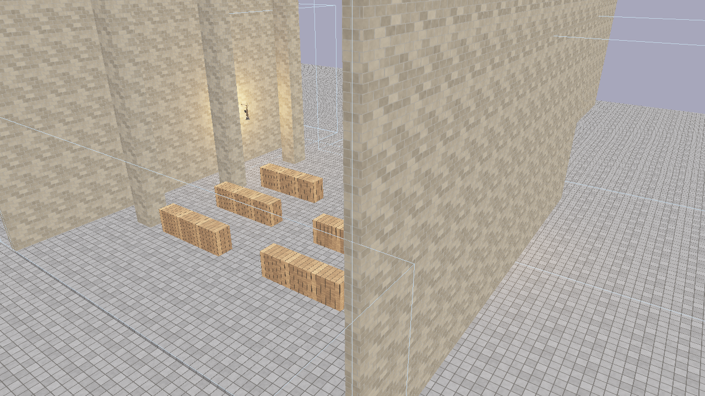

*Post-processing enabled: bloom creates halos around emissive surfaces and bright lights.*

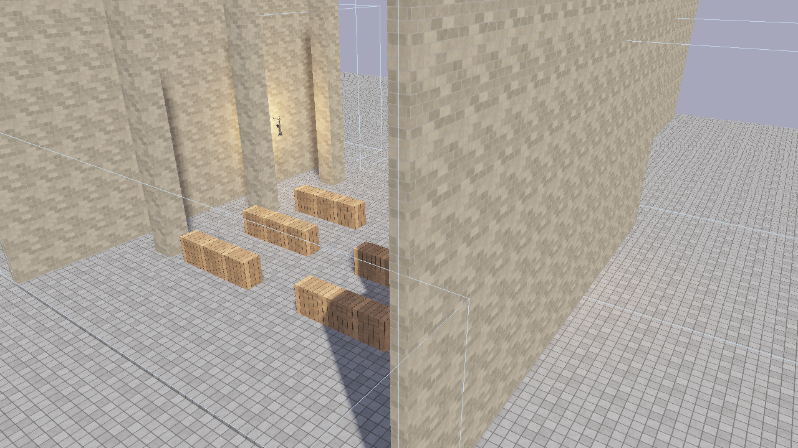

*Post-processing disabled: the same scene rendered with shader-level tonemapping only.*

| Field | Type | Default | Description |
|-------|------|---------|-------------|
| `bloom_enabled` | bool | `true` | Enable bloom |
| `bloom_intensity` | f32 | `0.04` | Mix strength of the bloom texture |
| `bloom_threshold` | f32 | `1.0` | Minimum brightness extracted into the bloom chain |

The mip chain depth is calculated as `floor(log2(min(width, height))) - 3`, capped at 5 levels, ensuring the smallest mip is at least 8x8 pixels.

## SSAO (Screen-Space Ambient Occlusion)

SSAO darkens crevices, corners, and areas where surfaces meet, adding depth and realism to a scene without requiring extra light sources. The implementation samples the depth buffer around each pixel to estimate how much ambient light would be blocked by nearby geometry.

| Field | Type | Default | Description |
|-------|------|---------|-------------|
| `ssao_enabled` | bool | `true` | Enable SSAO |
| `ssao_radius` | f32 | `0.5` | Sample radius in world units (larger = wider darkening) |
| `ssao_intensity` | f32 | `1.0` | Occlusion strength (higher = darker crevices) |
| `ssao_samples` | u32 | `64` | Hemisphere samples per pixel, 1--64 ([ADR 0052](https://github.com/chrischaps/Flint/blob/main/docs/adr/0052-authorable-ssao-sample-count.md)) |

SSAO is the heaviest per-pixel pass in the post stack. The sample kernel is strided, so lower counts keep full radius coverage; `ssao_samples = 16` is usually indistinguishable on soft matte scenes and roughly four times cheaper. The clay-look demo scenes use 16.

An SSAO depth bias (default `0.025`) is exposed in the Rendering & Effects menu but has no scene key.

## Depth of Field

Depth of field defocuses everything outside a focus band. The composite pass computes a circle of confusion per pixel from the depth buffer and gathers a CoC-weighted disc from the HDR source, so in-focus foreground does not bleed into defocused regions.


*Focus plane at 3 m: the foreground is sharp and the room behind it falls away.*

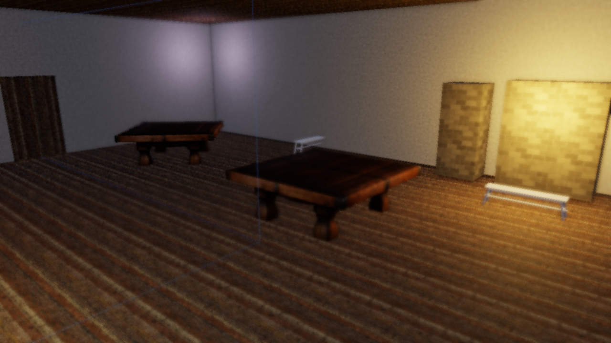

*Focus plane at 12 m: the same frame with the focus pushed back.*

| Field | Type | Default | Description |
|-------|------|---------|-------------|
| `dof_strength` | f32 | `0.0` | 0 = off/sharp, 1 = full defocus |
| `dof_focus_distance` | f32 | `10.0` | Distance of the focus plane in world units |
| `dof_focus_range` | f32 | `5.0` | Half-width of the sharp band around the focus plane |

Distances are plain view-space meters. Earlier builds linearized depth with the OpenGL `[-1, 1]` convention, which made focus values drift with the far plane; [ADR 0055](https://github.com/chrischaps/Flint/blob/main/docs/adr/0055-wgpu-zero-to-one-depth-convention.md) moved every depth consumer to wgpu's `[0, 1]` convention, so `dof_focus_distance = 10` now means ten meters from the camera.

In the scene viewer, the Rendering & Effects menu offers **DoF follow**: the focus plane tracks the last selected entity, which is a fast way to find a focus distance by eye.

## Fog

Distance-based fog blends a configurable fog color into the scene based on pixel depth. A layer of height fog can be added to it, thick low down and thinning with altitude, and an aerial tint can turn far things toward a second colour. Fog is applied in linear HDR space, before tonemapping.

| Field | Type | Default | Description |
|-------|------|---------|-------------|
| `fog_enabled` | bool | `false` | Enable distance fog (and the height fog and tint below) |
| `fog_color` | [f32; 3] | `[0.7, 0.75, 0.82]` | Fog color (linear RGB) |
| `fog_density` | f32 | `0.02` | Exponential density factor |
| `fog_start` | f32 | `5.0` | Distance where fog begins |
| `fog_end` | f32 | `100.0` | Distance where fog reaches full opacity |
| `fog_height_enabled` | bool | `false` | Add the height fog layer |
| `fog_height_density` | f32 | `0.0` | Height fog's density at `fog_height_origin`; 0 adds none |
| `fog_height_falloff` | f32 | `0.1` | How quickly height fog thins with altitude (density falls by e every `1/falloff` m) |
| `fog_height_origin` | f32 | `0.0` | World Y where height fog has `fog_height_density` |
| `fog_tint_color` | [f32; 3] | `[0.42, 0.50, 0.65]` | Aerial tint colour (linear RGB) |
| `fog_tint_strength` | f32 | `0.0` | How much of the tint the farthest things take; 0 is off |
| `fog_tint_start` | f32 | `100.0` | Distance where the tint starts to come in |
| `fog_tint_end` | f32 | `1000.0` | Distance where it reaches `fog_tint_strength` |

**Height fog** ([ADR 0101](https://github.com/chrischaps/Flint/blob/main/docs/adr/0101-height-fog-layer-and-aerial-tint.md)) is a layer of air whose density is `fog_height_density` at `fog_height_origin` and falls exponentially above it (and rises below it). The composite integrates that density exactly along each view ray, from the camera to the pixel, and adds it to the distance fog's optical depth: `fog = 1 - exp(-(fog_density * max(d - fog_start, 0) + height_depth))`. So a view low in the layer goes milky at a short distance, a view across it from above sees only the hollows fill, and the layer lies round the camera too (it isn't held off by `fog_start`). The layer is one horizontal slab across the whole scene: for mist that keeps to valleys at different heights, use the ground fog below. Before [ADR 0101](https://github.com/chrischaps/Flint/blob/main/docs/adr/0101-height-fog-layer-and-aerial-tint.md), height fog took `max(distance fog, exp(-falloff × h) × distance fog)`, which is never more than the distance fog, so it did nothing on screen. `fog_height_density` defaults to 0, so a scene that turned height fog on then looks as it did.

**The aerial tint** ([ADR 0101](https://github.com/chrischaps/Flint/blob/main/docs/adr/0101-height-fog-layer-and-aerial-tint.md)) mixes `fog_tint_color` over each drawn pixel by `fog_tint_strength × smoothstep(fog_tint_start, fog_tint_end, d)`, before the fog is mixed in. Far land turns blue (aerial perspective), while the farthest of it still runs into `fog_color` and, with a fog the colour of the sky's horizon, into the sky with no line. Like the fog, the tint is light in the air, not a surface colour: keep it with the hour, darker at night, as you would `fog_color`. It leaves the sky alone.

### Ground fog

**Ground fog** ([ADR 0106](https://github.com/chrischaps/Flint/blob/main/docs/adr/0106-ground-fog-on-own-floors.md)) is fog that lies on floors of its own, so a mist can fill hollows at many heights where the height fog is one level layer. The game gives it a map over a world rectangle, `GroundFog { origin, size, width, depth, texels }`, each texel a `[floor, amount]`: the floor a world Y (the ground's, usually) and the amount 0 to 1. Over a texel the density is `amount × ground_fog_density` at the floor, falling by e every `1 / ground_fog_falloff` metres above it and holding at the floor's under it. Set the map with `SceneRenderer::set_ground_fog(device, queue, &fog)` (`ExtensionGpu::set_ground_fog` from an extension), once and again when the ground changes; `clear_ground_fog` removes it, and so does a map with no fog on it. The look is on the post-process config and can change every frame:

| Field | Type | Default | Description |
|-------|------|---------|-------------|
| `ground_fog_density` | f32 | `0.0` | Density per metre at a floor where the amount is 1; 0 is off |
| `ground_fog_color` | [f32; 3] | `[0.8, 0.82, 0.86]` | Its colour (linear RGB). It isn't lit: give it the hour's |
| `ground_fog_falloff` | f32 | `0.5` | It falls by e every `1/falloff` m over the floor |
| `ground_fog_steps` | u32 | `24` | Steps each view ray marches, 1 to 64 |

The composite marches each view ray through the box the fog can lie in: the map's rectangle, from the lowest floor up to where the fog over the highest has thinned to e⁻⁷. The march ends at what the depth buffer says the ray meets, or runs on through the sky. Its steps lengthen with distance from the eye, in proportion, so they're fine near it wherever the march begins. The map is read at the ends of each step, so each read serves two, at the mip level the step spans, so a long step sees the fog averaged over what it crosses. Along a step the height over the floor runs straight from one end's to the other's, so on a slope the floor follows the ground, and the falloff is integrated along it exactly: a ray that dips into a thin layer between two reads still meets it. The ends are moved along the ray by a hash of the pixel, so what's left of the steps reads as fine grain, not bands. The mist is mixed over the scene before the aerial tint and the fog, which take it with what lies behind it. It rides `enabled`, not `fog_enabled`. The map is stored as half floats, each floor over the lowest, so keep its range of floors to a few hundred metres for centimetre steps.

A texel's value is at the middle of its cell, and the fog blends the four round a point, so give a texel with no fog the ground's height too: its floor still shapes the fog at its edges. Its cost is the march over every pixel whose ray crosses the box, `ground_fog_steps + 2` reads each; at 1080p with 24 steps it was within the noise of a frame without it in The Capitol's wilds.

Fog reaches **everything drawn, at any distance** ([ADR 0078](https://github.com/chrischaps/Flint/blob/main/docs/adr/0078-fog-reaches-everything-drawn.md)). The sky and skybox never write depth and the scene clears it to exactly 1.0, so the composite treats a pixel as sky only when its depth is 1.0; any geometry inside the camera's far plane is fogged. Set `far` to what the scene draws, not larger. SSAO, volumetric lighting and depth of field use the same sky test. Before [ADR 0078](https://github.com/chrischaps/Flint/blob/main/docs/adr/0078-fog-reaches-everything-drawn.md) the cut was depth ≥ 0.9999, which with a 1 m near plane is about 2.9 km at `far` = 4 km and never more than 10 km, so a ground running to the horizon ended in an unfogged band.

**Translucent draws are fogged at their own depth** ([ADR 0125](https://github.com/chrischaps/Flint/blob/main/docs/adr/0125-translucent-draws-fogged-at-their-own-depth.md)). Blended meshes, living props' echoes and particles write no depth, so the depth buffer holds what lies behind them. Fogging their pixels by that depth fogged a near echo as the far floor behind it (gone into the fog) below the floor's edge and as unfogged sky above it, with a hard line across the echo at the horizon. While the fog or the ground fog is on and a translucent draw is in view, the frame keeps a copy of the picture as it stood before the first translucent draw, and draws every translucent draw once more into a *fog veil*: its weight, its depth and how much of what's behind it hides. The composite then fogs each pixel the veil reaches as two layers: what still shows of the picture behind, at the scene's depth as before, and the translucent draws' own light, at theirs, each taking the fog's colour by its share of the pixel. A draw that only adds light (additive, an echo's `lighten`) is fogged at its depth and hides nothing. Several translucent layers in one pixel are fogged as one, at their weighted depth, the nearest counting most. A frame with no fog or no translucent draw in view is drawn as it was, with nothing extra. Bench: [`flint-examples/fog_veil.scene.toml`](https://github.com/chrischaps/flint-examples/blob/main/fog_veil.scene.toml) (`flint render flint-examples/fog_veil.scene.toml --time 2`).

## Volumetric Lighting (God Rays)

Volumetric lighting simulates light scattering through participating media (dust, fog, haze), producing visible shafts of light (god rays). The effect ray-marches from each pixel toward the camera, sampling the shadow map at each step to determine whether that point in space is lit or in shadow.

### How it works

1. For each screen pixel, reconstruct its world position from the depth buffer
2. March `volumetric_samples` steps along the view ray from the pixel back toward the camera
3. At each step, project the position into shadow-map space and sample the cascaded shadow map
4. Accumulate light contribution where the sample is not in shadow, applying exponential decay
5. The resulting volumetric texture is additively blended into the scene during the composite pass

Because volumetric lighting depends on the shadow map, it requires at least one directional light with shadows enabled. The effect is disabled when shadows are off.

### Per-light configuration

Each directional light can control its volumetric contribution independently via its `light` component (see [Lighting](lighting.md) for the full component):

```toml
[entities.sun.light]
type = "directional"
direction = [0.4, 0.6, 0.05]
color = [1.0, 0.92, 0.75]
intensity = 6.0
volumetric_intensity = 4.0               # god ray brightness (0 = no rays)
volumetric_color = [1.0, 0.88, 0.6]      # tint for the light shafts
```

| Light field | Type | Default | Description |
|-------------|------|---------|-------------|
| `volumetric_intensity` | f32 | `0.0` | Per-light god ray strength (0 = disabled for this light) |
| `volumetric_color` | [f32; 3] | light color | Tint color for the shafts from this light |

### Global scene settings

The `[post_process]` block controls the overall volumetric pass:

| Field | Type | Default | Description |
|-------|------|---------|-------------|
| `volumetric_enabled` | bool | `false` | Enable volumetric lighting |
| `volumetric_samples` | u32 | `32` | Ray-march steps per pixel (higher = smoother, more expensive) |
| `volumetric_density` | f32 | `1.0` | Scattering density multiplier |
| `volumetric_max_distance` | f32 | `100.0` | Maximum ray-march distance from camera |
| `volumetric_decay` | f32 | `0.98` | Exponential decay per step (closer to 1.0 = shafts extend further) |

### Example: dungeon window

```toml
[post_process]
volumetric_enabled = true
volumetric_samples = 64
volumetric_density = 30.0
volumetric_max_distance = 15.0
volumetric_decay = 0.998
exposure = 2.5

[entities.sun.light]
type = "directional"
direction = [0.4, 0.4, 0.05]
color = [1.0, 0.92, 0.75]
intensity = 6.0
volumetric_intensity = 4.0
volumetric_color = [1.0, 0.88, 0.6]
```

High `volumetric_density` with a short `volumetric_max_distance` and `decay` close to 1.0 produces thick, concentrated shafts --- good for dusty interiors. For outdoor haze, use lower density and longer distance.

## Kuwahara (Painterly Filter)

The anisotropic Kuwahara filter turns the HDR image into flat, brush-like patches that follow local edge direction. It runs as a pre-pass on the HDR buffer before SSAO and bloom, so lighting effects stay crisp on top of the painted surface. Three shaders cooperate: a structure-tensor pass, a tensor blur, and the sector filter itself.

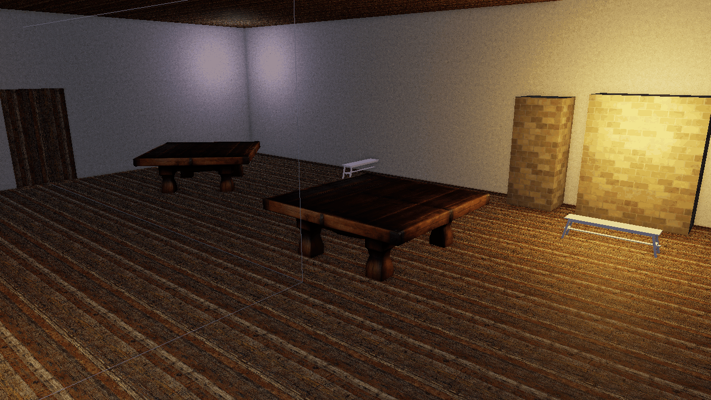

*The tavern showcase with the Kuwahara pre-pass disabled.*

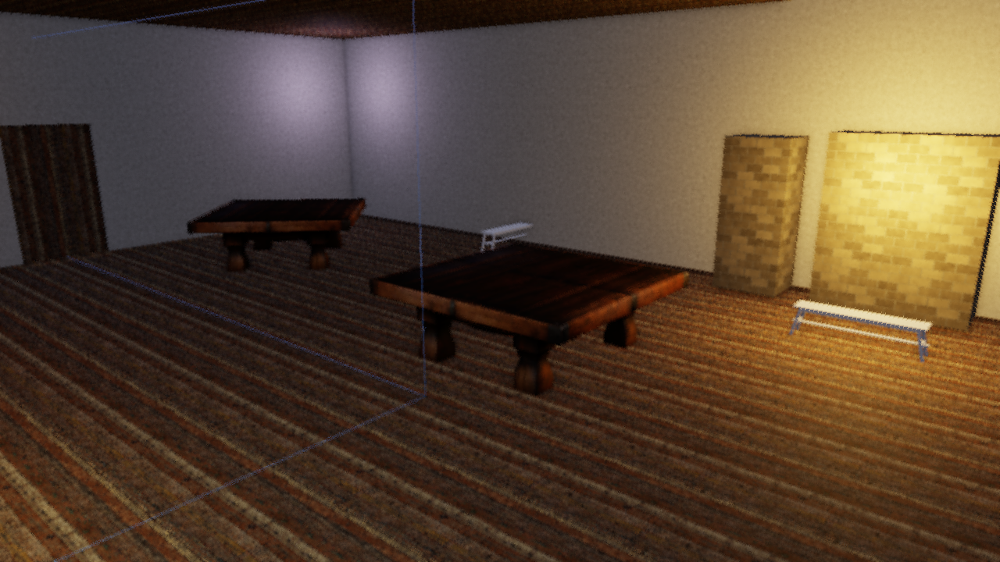

*The same frame with the anisotropic Kuwahara filter, radius 4.*

Its settings are a [style table](stylize-passes.md), like every other style's. A table switches it on unless it says `enabled = false`:

```toml
[post_process.styles.kuwahara]
radius = 4          # whole pixels
sharpness = 6.0
hardness = 4.0
```

In a scene with a `[wooze]` table its paint can also boil: `boil` moves the kernel and turns the strokes a little on each drawing. See [Shading boil](#shading-boil).

| Key | Default | Menu range | Description |
|-----|---------|------------|-------------|
| `radius` | `4` | 1--8 | Kernel radius in scene pixels, rounded to a whole pixel; larger = broader strokes |
| `sharpness` | `8.0` | 1--16 | How strongly the lowest-variance sector wins |
| `hardness` | `8.0` | 1--16 | Edge hardness between sectors |
| `anisotropy` | `1.0` | 0--2 | 0 = isotropic disc, 1 = sectors stretch fully along the local edge direction |
| `boil` | `0.0` | 0--1 | With a `[wooze]` table, how far each drawing moves the paint, as a share of the radius |

Scenes written before the table used `kuwahara_enabled`, `kuwahara_radius`, `kuwahara_sharpness`, `kuwahara_hardness`, `kuwahara_anisotropy` and `kuwahara_boil` directly in `[post_process]` (the tavern showcase still does). They still work: on load each one moves into the table, so `kuwahara_enabled = true` with `kuwahara_radius = 4` renders the same bytes as the table above with `radius = 4`. A key the table also sets is the table's, and the old keys without `kuwahara_enabled = true` leave the filter off, as they always did.

The filter's textures and pipelines are allocated the first time it is enabled, so scenes that never use it pay nothing. Kuwahara is the first [stylize pass](stylize-passes.md): it runs through the same framework as every later style, in its HDR stage.

## Contour (Ink Lines)

The contour style draws ink lines in screen space. It finds silhouettes as breaks in depth, and the edges between fills as breaks in luminance. It's one full-screen draw, so its cost doesn't grow with the scene. It's an HDR-stage [style](stylize-passes.md) registered after every other built-in, so it runs after the Kuwahara filter: paint sits under the ink and never smears it. A table's `order` can move it, and a [user style](stylize-passes.md#user-authored-styles) at the HDR stage comes after it unless its `order` says otherwise.

Its silhouettes are the [shared edges](stylize-passes.md#shared-edges)' depth steps (#743; until then its own second difference of 1 / distance), which leave out a plane however steep the view, so a floor seen at a grazing angle draws no lines. `width` is how far it looks for the strongest step, and `threshold` is against the step's share of the distance. With contour the only style reading them, the shared pass draws the steps alone.

```toml
[post_process.styles.contour]
width = 1.5
fade = 26.0
```

| Key | Default | Menu range | Description |
|-----|---------|------------|-------------|
| `width` | `1.25` | 0.25--5 | Half a line's width, in pixels at 1080p. Scaled with the frame, and never under a pixel's reach |
| `threshold` | `0.08` | 0.01--0.5 | How strong an edge must be before it starts to ink. Lower draws more |
| `strength` | `0.9` | 0--1 | How dark the ink goes |
| `luma` | `0.5` | 0--2 | How much edges in luminance count against edges in depth. 0 is silhouettes only |
| `color` | `[0.015, 0.012, 0.02]` | | The ink's colour as the HDR scene holds it (linear); `"#rrggbb"` works too |
| `fade` | `30.0` | 0--200 | Metres at which a line has faded by half, so distant foliage doesn't go solid with ink. 0 never fades |
| `boil` | `0.0` | 0--2 | With a `[wooze]` table, how far each drawing moves the lines, and how much it changes their width and pressure |

Being a style, it also takes `blend` and `order` and turns up in F4's Styles editor, `--style contour:width=2` and `flint render --list-styles`. `--set contour.<key>=<value>` sets a key without turning the ink on.

Scenes written before #599 used `contour_enabled`, `contour_width`, `contour_threshold`, `contour_strength`, `contour_luma`, `contour_color`, `contour_fade` and `contour_boil` in `[post_process]`. They still load, each moving into the table as Kuwahara's old keys do, and without `contour_enabled = true` they leave the ink off, as they always did. [`flint-examples/shading_boil.scene.toml`](https://github.com/chrischaps/flint-examples/blob/main/shading_boil.scene.toml) renders the same bytes in either spelling.

Its pipeline is built the first time it is enabled, so scenes that never use it pay nothing. It costs about 0.07 ms at 1080p on an RTX 5070 Laptop GPU, or 0.14 ms boiling.

## Shading Boil

In a scene with a [`[wooze]` table](procgen.md#the-wooze-field), paint and ink can re-decide themselves on the field's beat, the way every frame of a rotoscoped film was redrawn. Each *drawing* moves the Kuwahara filter's kernel and turns its strokes, and moves the contour's lines, changes their width and lifts the pen in places. The scene under them stays where it is.


*[`flint-examples/shading_boil.scene.toml`](https://github.com/chrischaps/flint-examples/blob/main/shading_boil.scene.toml), in which nothing moves.*

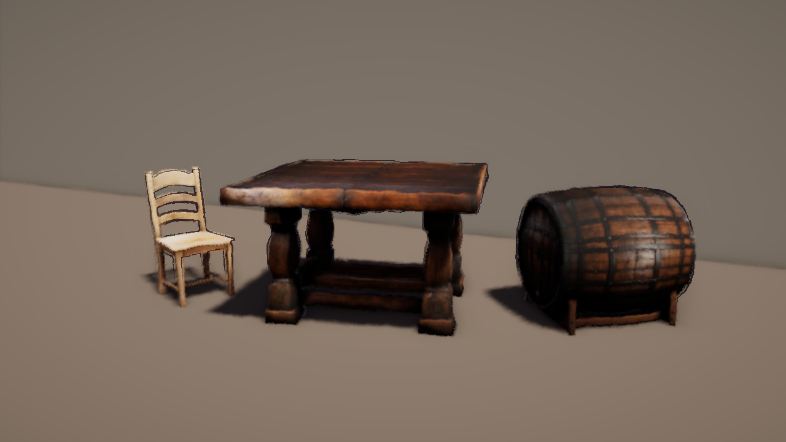

*The same frame half a second later.*

```toml
[wooze]
preset = "linklater"

[post_process]
boil_on = 1

[post_process.styles.kuwahara]
boil = 0.5

[post_process.styles.contour]
boil = 1.0
```

Each style's `boil` is its own amount; how long each drawing is held is one `[post_process]` key the two share:

| Field | Type | Default | Description |
|-------|------|---------|-------------|
| `boil_on` | u32 | `2` | Film frames each drawing is held: 1, 2 or 3 |

The shading boil's drawings are held on the wooze field's beat. To hold the motion under the lines too, so poses and positions change on the same ticks as a style's `boil`, see [Motion on twos](stylize-passes.md#motion-on-twos) and `[post_process] motion_hold`.

A beat of the field's `step` is six film frames, which ones, twos and threes all divide, so a drawing always lands on the beat. The `linklater` preset's half second is therefore 12 frames a second, and on ones a drawing lasts 1/12 s. Leave `boil_on` at its default with that preset and a drawing lasts 1/6 s, which reads as a throb. [`flint-examples/shading_boil.scene.toml`](https://github.com/chrischaps/flint-examples/blob/main/shading_boil.scene.toml) gets the same 1/12 s from a quarter-second step on twos. The clock runs on game time, not frames, so a drawing lasts as long at 30 fps as at 144, and it stops when animation does. A change of `step` bends it from where it stands.

The field's `jitter` sets how hard it boils: both styles' `boil` values are multiplied by it, so a preset or zone with `jitter = 0` holds still, and `amplitude` has no say, so a zone can hold its trees still and go on boiling their lines. The field is sampled once a frame where the camera is, since the passes are full-screen. A zone boils when you're in it, and not when you're looking at it from outside.

With either `boil` at 0, or no `[wooze]` table, that pass renders byte for byte as if boil didn't exist. The contour still draws in a scene with no field; its lines just hold still.

To check the cadence, capture one film frame per frame. In a scene where nothing else moves, consecutive pairs are byte for byte the same on twos, and each pair differs from the next:

```bash
flint-player flint-examples/shading_boil.scene.toml \
  --frame-step 0.0416666666666667 --screenshot out/f.png --screenshot-every 0.0416666666666667 --exit-after 2
```

Headless, `--boil-time <seconds>` picks the drawing: the same value gives the same pixels.

## Color Grade, Film Grain and FXAA

Three finishing controls from [ADR 0050](https://github.com/chrischaps/Flint/blob/main/docs/adr/0050-color-grade-film-grain-and-fxaa.md) sit at the end of the composite pass.

**Color grade** is an ASC-CDL-shaped lift/gamma/gain applied right after ACES tonemapping, so it grades the display-referred image: `pow(max(color * gain + lift, 0), 1 / gamma)`. The grade is skipped entirely while all three are neutral.

**Film grain** is hash noise on pixel coordinates, luma-weighted so highlights stay clean, and time-quantized to 24 Hz. It reads the shared post time, which `flint render` fixes at 0 unless you pass `--grain-time`, so headless renders stay deterministic.

**FXAA** is a separate fullscreen pass after composite. It is off by default because the headless pixel-diff gates run without it.

| Field | Type | Default | Description |
|-------|------|---------|-------------|
| `grade_lift` | [f32; 3] | `[0, 0, 0]` | Per-channel add after ACES (neutral = 0) |
| `grade_gamma` | [f32; 3] | `[1, 1, 1]` | Per-channel midtone curve (neutral = 1) |
| `grade_gain` | [f32; 3] | `[1, 1, 1]` | Per-channel multiply (neutral = 1) |
| `film_grain` | f32 | `0.0` | Grain intensity; 0 = off, 0.02--0.05 is subtle |
| `fxaa` | bool | `false` | Run the FXAA pass on the final composite |

## Desaturation, Chromatic Aberration and Radial Blur

These three are the "feel" levers scripts reach for most; see the script notes below for which ones are sticky.

| Field | Type | Default | Description |
|-------|------|---------|-------------|
| `desaturate` | f32 | `0.0` | Mix toward a darkened ash grey (0 = full color, 1 = drained). Applied after the grade, before the vignette ([ADR 0021](https://github.com/chrischaps/Flint/blob/main/docs/adr/0021-ladder-visuals-through-the-post-stack.md)) |
| `chromatic_aberration` | f32 | `0.0` | Splits the red and blue channels radially from the screen center |
| `radial_blur` | f32 | `0.0` | 8-tap blur that grows toward the screen edges while the center stays sharp |

Desaturation mixes toward `luma * 0.62` rather than neutral grey on purpose: it matches the disintegration ladder of the music-session harness, so the language of "the world draining" reads the same in both.

## Vignette, Exposure and Dither

| Field | Type | Default | Description |
|-------|------|---------|-------------|
| `exposure` | f32 | `1.0` | Multiplier applied before ACES |
| `vignette_enabled` | bool | `false` | Darken screen edges |
| `vignette_intensity` | f32 | `0.3` | Vignette strength |
| `vignette_smoothness` | f32 | `2.0` | Falloff exponent from center to edge |
| `dither_enabled` | bool | `false` | 8x8 Bayer ordered dither to reduce banding |
| `dither_intensity` | f32 | `0.03` | Dither strength. Style 0: linear light (0.02--0.05 for the retro crosshatch). Styles 1 and 2: display levels, where `0.004` (one 8-bit step) hides banding |
| `dither_style` | u32 | `0` | Where the dither is added: `0` linear light, `1` Bayer in display levels, `2` triangular noise in display levels |

### Dither against banding

The original dither (`dither_style = 0`) is added in linear light, before the target's sRGB encode, so its size on screen follows the encode's slope: near black a linear offset becomes about 13 times as many display levels as it does in the midtones. Any intensity small enough to vanish in the midtones is a visible 8x8 crosshatch over a dark sky or floor, and one that hides the dark's banding vanishes everywhere else. It stays the default, since a scene may be built on that look.

Styles 1 and 2 add the dither where the 8-bit quantization happens, in display levels (#503): the composite encodes to sRGB, adds the dither, and decodes again for the target to encode. `dither_intensity` is then levels over 255 at every brightness, so `0.004` is one step. Style 1 is the same Bayer matrix, ±half a step at one step's intensity: the pattern is evenly faint from black to white. Style 2 is triangular noise (Roberts' R2 sequence remapped to a triangular distribution), ±one step at one step's intensity, the textbook amount that leaves no banding and no error that follows the image, with no tile for the eye to find. For a dark scene with soft gradients:

```toml
[post_process]
dither_enabled = true
dither_style = 2
dither_intensity = 0.004
```

[`flint-examples/dark_stage.scene.toml`](https://github.com/chrischaps/flint-examples/blob/main/dark_stage.scene.toml) is the bench: a near-black stage under one soft pool of light. `flint render flint-examples/dark_stage.scene.toml --sweep post.dither_style=0,1,2` draws the three side by side (raise the intensity to see each pattern; at one step, styles 1 and 2 show none).

## MSAA

The scene passes can run with 4x multisample anti-aliasing ([ADR 0058](https://github.com/chrischaps/Flint/blob/main/docs/adr/0058-opt-in-4x-msaa-for-scene-passes.md)). Post-processing, shadow and blit passes stay single-sample; depth consumers such as SSAO, fog and DoF read a sample-0 depth resolve.

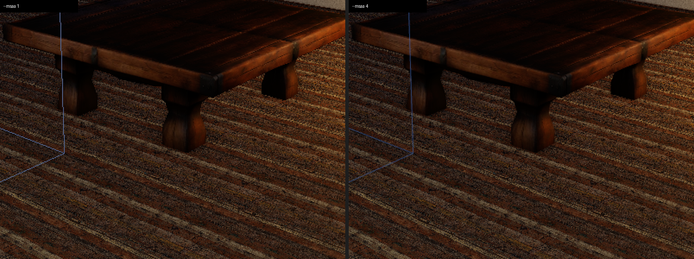

*Left: single-sample. Right: `--msaa 4`. Geometry edges smooth out; post effects are unchanged.*

MSAA is a launch option, not a scene key: `flint render --msaa 4`, `flint-player --msaa 4`, or `RendererConfig::sample_count` in code. Valid values are 1 and 4; anything else is clamped to 1 with a warning. The default stays 1 so headless pixel gates remain single-sample.

## Scene Configuration

Add a `[post_process]` block to your scene TOML to configure per-scene settings:

```toml
[post_process]
bloom_enabled = true
bloom_intensity = 0.04
bloom_threshold = 1.0
ssao_enabled = true
ssao_radius = 0.5
ssao_intensity = 1.0
ssao_samples = 16
fog_enabled = true
fog_density = 0.02
fog_color = [0.7, 0.75, 0.82]
volumetric_enabled = false
dof_strength = 0.4
dof_focus_distance = 8.0
dof_focus_range = 4.0
grade_lift = [0.03, 0.02, 0.015]
grade_gamma = [1.0, 1.0, 1.0]
grade_gain = [1.04, 1.0, 0.94]
film_grain = 0.03
fxaa = false
vignette_enabled = true
vignette_intensity = 0.3
exposure = 1.0
```

All fields are optional --- omitted values use their defaults. The full key list with defaults is in [File Formats](../formats/overview.md), and `flint render --list-effects` prints it from the engine itself (below).

A key that is no field is ignored, so its field keeps its default, and the load warns with the file and the closest known name (#354). It stays ignored under a look: the scene's `look = "..."`, a script's `set_look`, F4's Look and a comic panel lay the scene's keys over the look without it, so that warning is the only message about it (#896). The scene still loads, and `flint validate` shows the same line:

```text
WARN levels/demo.scene.toml: [post_process] has no field 'bloom_intensty', did you mean 'bloom_intensity'? (ignored)
```

### Listing the keys

Every key above belongs to one built-in effect (bloom, SSAO, fog, the grade...), and each is declared once, in the effects' descriptors (`flint_schema::post_effects`, #741): its kind, default, the range the effect is tuned for, the F4 widget and its help. Everything else is made from that one line: the scene's parse, the renderer's config and the copy between them, the `[table.post_process]` schema (`flint schema post_process`), `--set post.<key>` and `--sweep post.<key>`, the F4 menu's sections and this list:

```bash
flint render --list-effects           # by effect: key, kind, default, range, help
flint render --list-effects --json    # the same, for an agent
```

```text
bloom  (Bloom): Bright areas bleed light
  bloom_enabled            bool true                              Whether bright areas bleed light
  bloom_intensity          f32  0.04               0..1           How much bloom is added
  bloom_threshold          f32  1                  0..4           The brightness above which a pixel blooms
  bloom_soft_threshold     f32  0.5                0..1           How softly blooming starts below the threshold: 0 is a hard cut
```

A value outside its key's range still draws, as a style value past its range does (#355), and says so: the load, `flint validate` and `flint check` warn with `post-range` and name the range. A look's value, or a `--sweep post.<key>` value, past its range is refused instead, as a style value there is (a scene's value laid over a look is still the scene's: it draws, and only the load warns):

```text
warning[post-range] [post_process] bloom_intensity: bloom_intensity=3 is outside its range 0..1
```

`bloom_soft_threshold` and `ssao_bias` became scene keys with the descriptors; they had been the renderer's (F4 and scripts) alone. Adding a key to an effect is its line in the descriptors, its field in the composite's uniform struct and the WGSL that reads it.

When the pipeline is disabled (`--no-postprocess` or the menu checkbox), most effects are zeroed: bloom, vignette, fog, dither, desaturate, film grain, DoF, the tear and grade. Two are not: `chromatic_aberration` and `radial_blur` predate the gate and stay live even with post-processing off.

The scene viewer applies the scene's `[post_process]` block on load ([ADR 0046](https://github.com/chrischaps/Flint/blob/main/docs/adr/0046-viewer-applies-scene-post-process.md)). The Rendering & Effects menu can swap between the authored block and the viewer's default look.

## CLI Flags

`flint render` sets any `[post_process]` key with `--set post.<key>=<value>`, spelled as the scene would write it. It repeats, and the last word for a key wins. A vector is comma-separated (`--set post.fog_color=0.7,0.75,0.82`) and a bool is `true` or `false`. A style's keys are `--style <name>:<key>=<value>,...`, which also turns the style on, or `--set <style>.<key>=<value>`, which sets the key and leaves the style on or off as the scene had it.

```bash
# Disable all post-processing
flint render scene.toml --no-postprocess

# Bloom and exposure (bloom_intensity alone leaves bloom off in a scene that turned it off)
flint render scene.toml --set post.bloom_intensity=0.08 --set post.bloom_enabled=true \
    --set post.bloom_threshold=0.8 --set post.exposure=1.5

# SSAO, with the cheap sample count
flint render scene.toml --set post.ssao_radius=0.5 --set post.ssao_intensity=1.0 --set post.ssao_samples=16

# Fog, and height fog
flint render scene.toml --set post.fog_enabled=true --set post.fog_density=0.02 --set post.fog_color=0.7,0.75,0.82 \
    --set post.fog_height_enabled=true --set post.fog_height_falloff=0.1

# Volumetric lighting
flint render scene.toml --set post.volumetric_enabled=true --set post.volumetric_density=1.0 \
    --set post.volumetric_samples=32

# Depth of field
flint render scene.toml --set post.dof_strength=0.6 --set post.dof_focus_distance=10 --set post.dof_focus_range=5

# Kuwahara
flint render scene.toml --style kuwahara:radius=4,sharpness=8,hardness=8,anisotropy=1

# Ink, and a drawing of the shading boil in a scene with a [wooze] table
flint render scene.toml --style contour:width=1.5,boil=1 --set kuwahara.boil=0.5 --set post.boil_on=2 --boil-time 0.5

# Grade, grain, FXAA, MSAA
flint render scene.toml --set post.grade_lift=0.03,0.02,0.015 --set post.grade_gain=1.04,1,0.94 \
    --set post.film_grain=0.03 --set post.fxaa=true --msaa 4
```

The lists are in the binary, so they can't go stale:

| Command | Lists |
|---------|-------|
| `flint render --list-effects` | Every `[post_process]` key by effect, with its kind, default and tuned range (`--json` for a document) |
| `flint render --list-styles` | Every style and its keys |
| `flint render --look help` | Every look and the sweeps that tune it |
| `flint render --help` | Every flag, grouped by heading |

A value past a key's tuned range still draws, with a warning. The scene's block comes first, then `--look`, then each `--set` in the order given, then `--style`, so the command line wins over the scene's TOML.

A few flags stay flags, because they are not `[post_process]` keys:

| Flag | Description |
|------|-------------|
| `--no-postprocess` | Disable the entire post-processing pipeline |
| `--no-shadows` | Disable shadow mapping (also disables volumetric) |
| `--msaa <1\|4>` | Scene-pass MSAA sample count (default 1) |
| `--boil-time <f64>` | Seconds of the wooze field to run, which picks the drawing |
| `--grain-time <f32>` | Post time for grain and mode animation (default 0) |
| `--render-mode <1-6>`, `--mode-mix`, `--mode-params` | Deprecated (#746), for one release: [the old render modes](#the-old-render-modes) |
| `--oren-nayar`, `--sheen-strength`, `--sheen-color` | Lighting levers, documented in [Lighting](lighting.md) |

## The Rendering & Effects Menu (F4)

There are no longer per-effect function keys. [ADR 0053](https://github.com/chrischaps/Flint/blob/main/docs/adr/0053-one-rendering-and-effects-menu-on-f4.md) consolidated every render and post-process debug control into one egui window, opened with **F4** in both the player and the scene viewer. Every toggle above appears there with its non-binary parameters, and changes write straight through to the renderer.

The effect sections are drawn from the effects' descriptors (#741), one a built-in effect in `--list-effects` order, each key its widget over the range it is tuned for, with its help on hover; a value a scene set past the range shows as written until the slider moves.

| Section | Controls |
|---------|----------|
| Post chain | Post-processing on/off. Player only: **Freeze script post overrides**, so a running script cannot fight your edits |
| Exposure, Vignette, Lens, Bloom, SSAO, Depth of field, Fog, Volumetric light, Grade, Dither, FXAA, Shared edges, Held drawings, Tear | Every key of the effect (`flint render --list-effects`). Fog adds ground fog's density, colour, falloff and steps (the game's, ADR 0106); Grade adds a Neutral grade button; Held drawings adds what the wooze field says now (step, jitter and the drawing) |
| Styles | A section per registered style (Kuwahara and Contour among them, the shading boil's amounts in their `boil`), drawn from its declaration, with Defaults, Authored, Copy TOML and Commit to scene |
| Shadows | Enabled, resolution (512 / 1024 / 2048 / 4096; rebuilds the shadow pass) |
| Lighting | Ambient sky, ambient ground, diffuse wrap, Oren-Nayar, sheen color, sheen strength, Reset lighting |
| Camera | Vertical FOV |
| Debug mode | Shading combo over all eight [debug modes](rendering.md#debug-visualization) |

The scene viewer adds two entries of its own: a toggle between the scene's authored `[post_process]` block and the viewer's default look, and **DoF follow**. In the player the menu is compiled in with the `debug-hud` feature (on by default) and F3 deliberately leaves it alone: F3 toggles the scene-component panels (ocean, grass, time of day, and so on), F4 owns this one.

When the pipeline is toggled off, the PBR shader's built-in ACES tonemapping and gamma correction are automatically restored, so the scene always looks correct regardless of the pipeline state.

## Shader Integration

When the post-processing pipeline is active, the engine sets `enable_tonemapping = 0` in the PBR uniform buffer, forcing shaders to output raw linear HDR values. The composite pass then applies, in this order:

1. **Radial blur** --- 8-tap gather from the HDR source, edges only
2. **Depth of field** --- CoC-weighted disc gather from the same source
3. **Chromatic aberration** --- radial red/blue channel split. Red and blue are read through the same radial blur and depth of field as green, at their offsets, so the split never separates a blurred channel from a sharp one (an emissive edge out of focus stays its own colour, #1156). With neither blur on it is two plain reads; with depth of field on it is the gather three times
4. **SSAO** --- multiplies by the AO texture
5. **Volumetric** --- adds the god-ray texture
6. **Bloom** --- adds the bloom texture at `bloom_intensity`
7. **Fog** --- blends fog color by depth and optional height falloff, still in linear HDR
8. **Exposure** and **ACES tonemapping** --- maps HDR to displayable range
9. **Color grade** --- lift/gamma/gain on the display-referred image
10. **Desaturation** --- mix toward ash grey
11. **Vignette** --- edge darkening
12. **Film grain** --- 24 Hz hash noise, before dither because grain is signal
13. **Dither** --- 8x8 Bayer or triangular noise, in linear light or display levels (`dither_style`), always last inside composite

The composite is the same for every game: no game's look lives in it (#746). The looks that once did are [the reality styles](#the-reality-styles), display styles after it.

The composite output stays linear; the sRGB render target applies gamma encoding in hardware. If FXAA is on, composite renders into an intermediate texture and the FXAA pass resolves it to the surface.

When post-processing is disabled (via `--no-postprocess` or the menu), the shader handles tonemapping and gamma internally. This dual-path design ensures backward compatibility with scenes that don't use post-processing.

## The Reality Styles

Five whole-frame [styles](stylize-passes.md) make the world visibly stop being itself for a while: `matrix`, `blood`, `drunk`, `tron` and `underwater`. They were render modes 1--5 of the composite until #746, one game's looks (Float's reality tears and its submerged eye) wired into every game's composite pass, tuned by four numbers whose meaning changed per mode. Each is a display style now, with named params and ranges, so `--style`, `--sweep`, `--list-styles`, F4 > Styles and `set_post_style_param` reach them as they reach every other style, and a game that never asks for one never builds it.

They run first of the display chain, where the composite drew them, so a prop's ASCII or pencil in a tear reads the code, the blood or the wire world they made. A display style runs after the vignette, so each draws its look through the frame's vignette and reads the picture with it undone: on the A/B against the old modes, blood moved no pixel more than 5 levels, underwater no more than 21, and matrix, drunk and tron at most 0.11%, 0.16% and 0.11% of pixels by more than 48 (their luminance reads the finished picture, not the raw HDR).

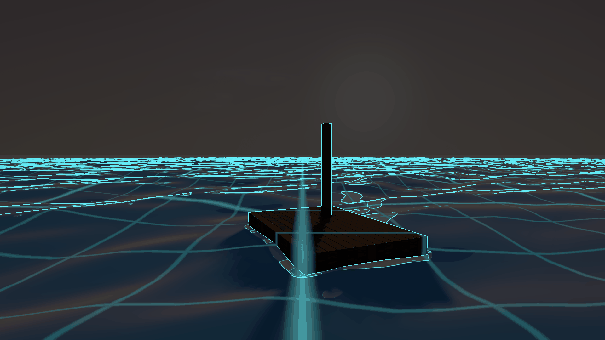

*`tron` on [`reality_tears`](https://github.com/chrischaps/flint-examples/blob/main/reality_tears.scene.toml): depth and luminance edges glowing over a dimmed scene, and a world-space grid rebuilt from depth that rides the swells. The swells' crests draw as lines all the way out to the horizon.*

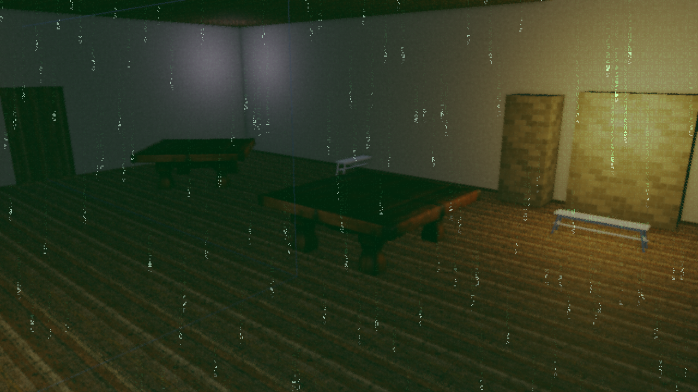

*`matrix`: dot-matrix glyphs whose brightness and density track the picture's luminance, with a rain head falling down each column.*

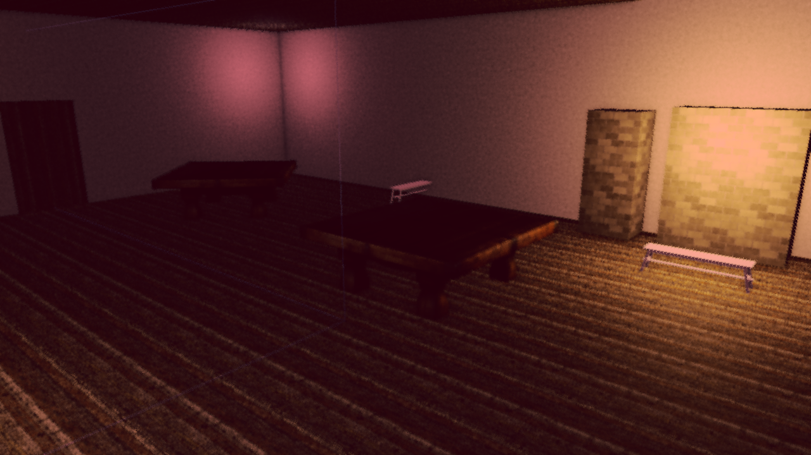

*`blood`, with the ocean's own `tint`: the sea is a different sea rather than a red filter over a blue one.*

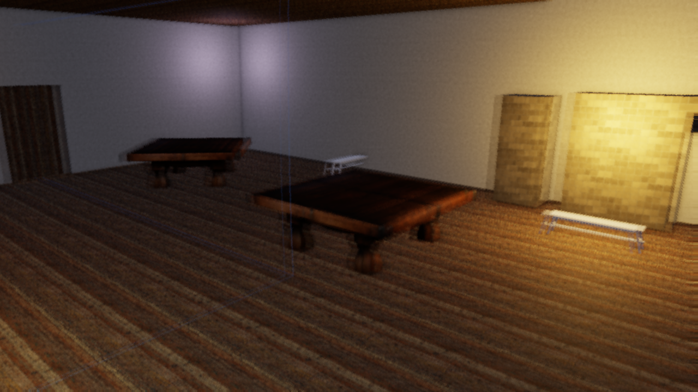

*`drunk`: the frame sways and sees double.*


*`underwater`: masked by the waterline, with banded absorption, light shafts and a foam lip on the line.*

| Style | What it does | Its settings (`flint render --list-styles`) |
|---|---|---|
| `matrix` | Glyph cells lit by the picture's luminance, rain heads falling | `cell_w`, `cell_h` (points), `rate` (rerolls a second), `fall`, `ink`, `ground`, `head`, `glow` |
| `blood` | A crimson key that keeps luminance and spares what's already red | `strength`, `tint`, `shadow`, `knee`, `spare_red` |
| `drunk` | Sway and a drifting double; its `blend` is how drunk | `sway`, `ghost`, `speed` |
| `tron` | Glowing edges and a world grid over a ghost of the scene | `glow`, `edges`, `dim`, `sky_dim`, `grid`, `spacing` (m), `pulse`, `reach` (m) |
| `underwater` | The eye under the sea, below a waterline `depth` metres over it; its `blend` is how far under | `depth` (m, + = under), `churn`, `daylight`, `glow`, `sway` |

`tron`'s silhouettes are where the depth bends, not where it changes (#1181): it takes the second difference of 1 / distance, which is zero across any plane however steeply its depth climbs, so a road or a floor seen at a grazing angle stays wire to the horizon and keeps its grid. Until then it read that climb as a silhouette at every pixel, and a flat ground filled with solid glow from a few tens of metres out. A step of 5% of the distance still reads as a full edge, as it always did. Its grid's lines are as wide as a pixel's footprint allows: they thin as they recede and fade to their average once a pixel spans most of a cell, rather than breaking into dashes.

`drunk` and `underwater` draw their own `blend`, since their sway grows with it; the other three mix by the framework's. The sea's half of the old blood and underwater modes is the `ocean` component's [`tint`](#the-oceans-tint).

Demo: [`flint-examples/reality_tears.scene.toml`](https://github.com/chrischaps/flint-examples/blob/main/reality_tears.scene.toml), a sea at dusk its script walks through all five.

### The tear

`[post_process] tear` (0--1) is a mask of holes the frame tears open in: fbm patches that spread from scattered holes to the whole frame as it rises, or with `tear_iris = true` a wobbling circle from the centre; `tear_scale` (default 3) is how many patches span the frame's height. It has no look of its own. A whole-frame style whose table says `blend_source = "tear"` shows only inside the holes (its blend times the mask at each pixel), and so does a prop whose style component or `style_mask` says it ([A blend that follows the tear](stylize-passes.md#a-blend-that-follows-the-tear)), so the two tear together. With no tear, such a style is left out of the chain, byte for byte. A reveal (`reveal_*`) is not drawn on a style that follows the tear.

```toml
[post_process]
tear = 0.55

[post_process.styles.matrix]
blend_source = "tear"
rate = 6.0
```

```bash
flint render scene.toml --style matrix:blend_source=tear --set post.tear=0.55
flint render scene.toml --style tron:blend_source=tear --set post.tear=0.45 --set post.tear_iris=true
```

### The ocean's tint

The `ocean` component's `tint` (0--1) moves its whole palette toward another before any use, so bands, subsurface, foam and reflections agree, and after a script's palette lands, so it can't race one: `tint_deep_color`, `tint_shallow_color`, `tint_sss_color`, `tint_foam_color`, `tint_sky` (what the sky's reflection is multiplied by), `tint_ramp_steps`, `tint_band_wobble`, `tint_pools` (world-anchored pools that spread with the tint; 0 tints evenly), `tint_keep_light` (scaled by the palette's own brightness, so a night sea stays dark) and `tint_below` (only the surface seen from below). `flint schema ocean` lists them.

A tint names the colours it moves toward. With no preset, a colour it leaves out is the sea's own (`deep_color`, `shallow_color`, `sss_color`, `foam_color`), and every other setting changes nothing (`tint_sky` white, no bands of its own, no wobble, no pools, light not kept), so `tint = 0.5` alone draws the sea it was (#1041):

```toml
[entities.sea.ocean]
tint = 0.6                                   # a storm greying the sea, in pools
tint_deep_color = [0.05, 0.07, 0.09, 1.0]
tint_shallow_color = [0.22, 0.27, 0.30, 1.0]
tint_sky = [0.6, 0.65, 0.7, 1.0]
tint_pools = 0.05
tint_keep_light = true
```

`tint_preset` names a tint the fields fall back on instead: `blood` (the crimson tide: night-dark pools that spread with the tint) or `underside` (the surface seen from under it: murk blues and flat foam panes, below only). A written field still wins over its preset. So a game that shows both looks switches between them with one field and drives `tint` alone, and its scripts need no colours (#1035):

```rhai
let sea = get_entity("ocean");
set_field(sea, "ocean", "tint_preset", "underside");   // the eye went under
set_field(sea, "ocean", "tint", 1.0);
```

The `tint_*` fields and `tint_preset` carry no schema default for this reason: a scene load writes a field's default into the component, where it would beat the preset (or, for `tint_preset`, name one the scene never asked for). Give the fields one writer: a second script writing `tint` races the first, since scripts run in no set order. Float's `seat_camera.rhai` owns them, drawing the underside while the eye is under and the blood tear's tint (which `reality.rhai` publishes) otherwise.

Before #1041 an unwritten preset was `blood`, so a scene that set `tint` alone drew a sea of blood; it now draws its own sea, and names the palette or preset it wants.

### From scripts

```rhai
set_post_style("matrix", true);
set_post_style_param("matrix", "blend_source", "tear");
set_post("tear", 0.6);                      // held until set again
set_post("tear_scale", 3.0);
set_post("tear_iris", false);
set_post_style_param("drunk", "blend", 0.4);
set_field(get_entity("ocean"), "ocean", "tint", 0.7);
```

Unlike the old render mode, these hold until changed, as every other post override does. A script that wants a dead script to heal the world sets them back itself, or sets them every frame from an envelope that ends at 0.

### The old render modes

`--render-mode N --mode-mix M --mode-params x,y,z,w` and Rhai's `set_render_mode(mode, mix)` / `set_render_mode_params(x, y, z, w)` are deprecated shims for one release (#746), mapped onto the above by `flint_render::render_mode`. As before, a mode shows only the frames a script asks for it: the shim puts back what it overwrote the frame no script asks.

| Mode | Is now |
|------|--------|
| 1 Matrix | `matrix` with `blend_source = "tear"`, `tear` = mix, `tear_scale` = x, `tear_iris` = y >= 0.5, `rate` = z (0 reads as 6) |
| 2 Blood | `blood` following the tear, and the ocean's tint at the mix (`tint_preset = "blood"`, `OceanTint::blood`) |
| 3 Drunk | `drunk` at `blend` = mix |
| 4 Tron | `tron` following the tear |
| 5 Underwater | `underwater` at `blend` = mix, `depth`, `churn`, `daylight`, `glow` = x, y, z, w, and the ocean's tint on its underside (`tint_preset = "underside"`, `OceanTint::underside`) |
| 6 Tear | the tear alone |

The golden `render-mode-shim-matrix` holds `--render-mode 1` to the style and the tear pixel for pixel.

## Design Decisions

- **Rgba16Float** for the HDR buffer provides sufficient precision for bloom extraction without the memory cost of Rgba32Float
- **Progressive downsample/upsample** (rather than a single Gaussian blur) produces wide, natural-looking bloom cheaply
- **1x1 black fallback texture** when bloom is disabled avoids conditional bind group creation
- **Lazy allocation** --- Kuwahara, contour and FXAA pipelines and textures are created on the first frame they are enabled, however the config was set (scene load, a hot reload, the debug menu, a script), so the default path pays nothing for them
- **Gate-safe defaults** --- MSAA, FXAA and film grain default off, and grain time is pinned at 0 headlessly, so `flint render` output stays byte-stable for pixel-diff gates
- **Resize handling** --- `PostProcessResources` are recreated on window resize since the HDR texture and bloom mip chain are resolution-dependent
- **Extended shadow depth** --- the shadow frustum's depth range is extended beyond the camera frustum so off-screen casters (ceilings, walls behind the camera) are captured in the shadow map, which is critical for correct volumetric shafts in enclosed spaces

## Further Reading

- [Rendering](rendering.md) --- the PBR pipeline that feeds into post-processing
- [Lighting](lighting.md) --- the light component, shadows, and the clay-look shading levers
- [Headless Rendering](../guides/headless-rendering.md) --- using post-processing flags in CI
- [CLI Reference](../cli-reference/overview.md) --- full command options
- [File Formats](../formats/overview.md) --- the `[post_process]` scene block
