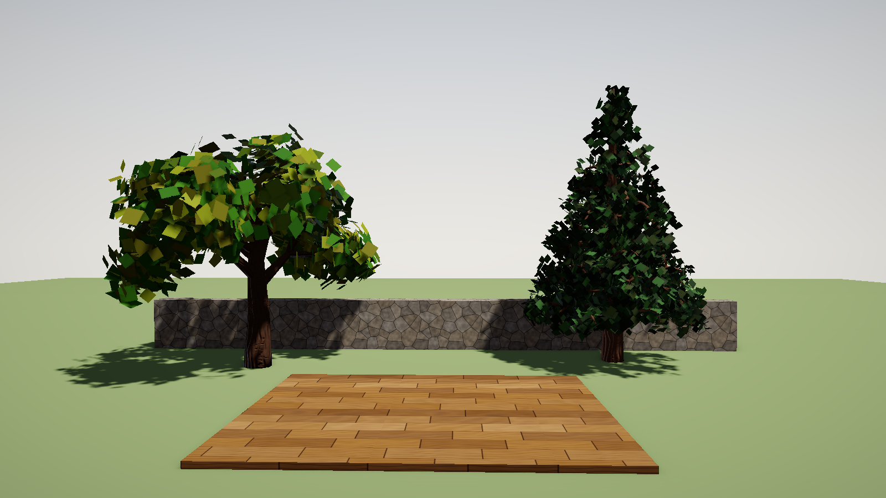
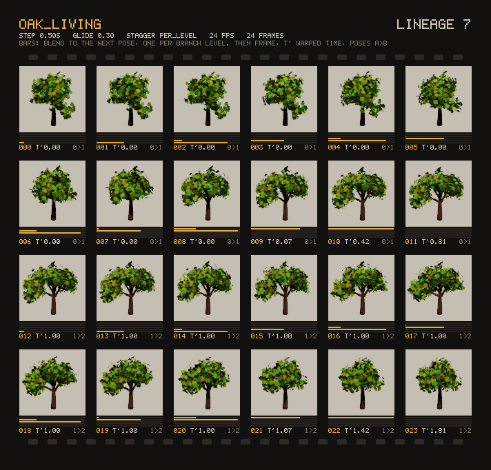
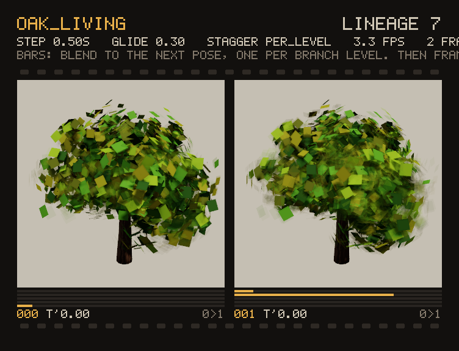
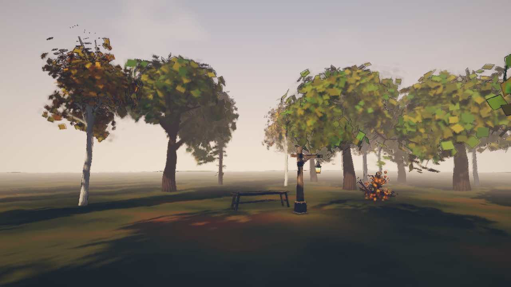
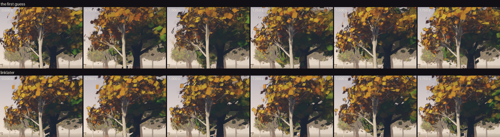
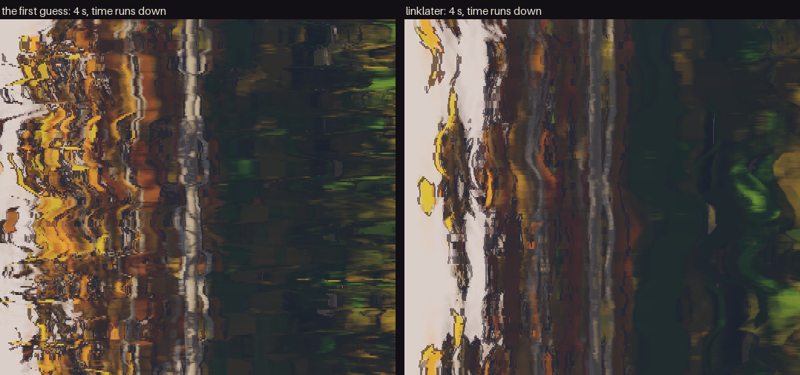
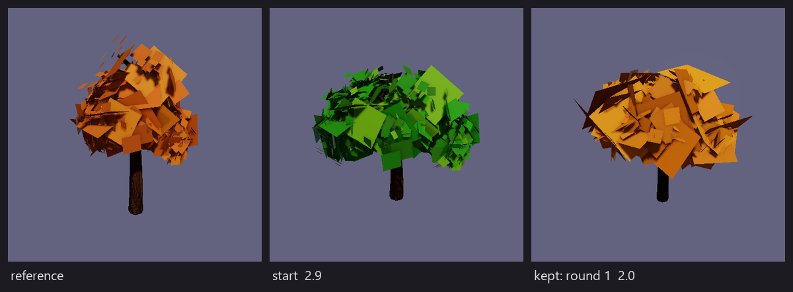

# Procedural Generation

The `flint-procgen` crate produces game-ready assets from small TOML specs: trees as glTF meshes with LOD chains, PBR texture sets from pattern parameters or a node graph, and skinned creatures from a bone hierarchy. Generation is deterministic (same spec, same seed, same bytes), runs from the CLI with `flint gen`, previews live in `flint edit`, and resolves on demand inside the player so a scene can reference a spec by name as if it were a file on disk.

Procgen is the offline, rule-driven half of asset creation; [AI asset generation](ai-generation.md) is the other half. They share the content store and the provenance sidecars.

## A Spec

A spec is a `*.procgen.toml` file with four parts: which generator, metadata, how to seed, and the generator's parameters.

```toml
generator = "tree_v1"

[meta]
name = "oak_tree_01"
description = "A sturdy oak with spreading branches"
version = "1.0.0"
tags = ["tree", "vegetation", "oak"]

[seed]
mode = "fixed"
value = 42

[params]
trunk_height = 4.5
trunk_radius_base = 0.35
branch_method = "lsystem"
lsystem_iterations = 5
crown_radius = 3.5
leaf_style = "billboard"
leaf_color_base = "#2D8C0D"
bark_color_base = "#573214"

[[lod]]
level = 0
target_triangles = 8000

[[lod]]
level = 1
target_triangles = 2000
```

| Section | Field | Description |
|---------|-------|-------------|
| top | `generator` | Registered generator type name |
| `[meta]` | `name` | Unique name. This is what scenes and the resolver look up |
| | `description`, `version`, `tags` | Search and provenance metadata |
| `[seed]` | `mode` | `fixed` (use `value`), `random` (fresh seed every run), `derived` (hash `derive_from`) |
| `[params]` | | Opaque table; each generator defines and validates its own keys |
| `[[lod]]` | `level`, `target_triangles` | Optional decimation targets; `level` is the LOD's index, 0 the most detailed |

Every generator publishes a JSON Schema for its `params` table, which is what the previewer uses to build its parameter editor and what `flint gen` checks a spec against before it runs (`flint_procgen::lint_params`). A key the generator would silently ignore is a warning: one that isn't in the schema (usually a typo, so the nearest key is suggested), or one that only applies in another mode. A schema marks those with `"x-when": { "pattern": ["voronoi_brick"] }` (the texture's patterns) or `"x-when": { "branch_method": ["space_colonization"] }` (the tree's growth methods); the previewer hides such fields and leaves them out when it saves. A key marked `"deprecated": true` is warned about with its reason. `--strict` turns these warnings into an error. Every key carries a one-line `description`, which the previewer shows when you hover the field.

The check reaches inside nested tables too. Each `[[params.ops]]` entry of a texture pipeline is held to its op type's own schema (`flint_procgen::op_schema`: the op's knobs plus `type`, `id` and `inputs`), and so are a `color_ramp`'s stops and a creature's `[params.materials.<name>]` tables. The warning names the key by its path:

```
warning: stone_wall.procgen.toml: `mortar_treshold` is not a parameter of this generator (did you mean `mortar_threshold`?)
warning: stone_wall.procgen.toml: `cell_count` is ignored: it only applies when pattern is "voronoi_brick", and this spec has pattern = "perlin_organic"
warning: tavern_brick.procgen.toml: `ops[0].colums` is not a parameter of the brick_grid op (did you mean `columns`?)
```

## Examples

Five commented specs in `specs/examples/` are the place to start: each opens by saying how its generator thinks, and notes every key that isn't obvious.

| Spec | Makes | Shows |
|------|-------|-------|
| `oak_tree` | A broad oak, three LODs | `tree_v1` with the built-in L-system |
| `oak_living` | The same oak as a [living prop](#living-props) | A `[living]` table |
| `pine_tree` | A Scots pine, three LODs | `tree_v1` with space colonization in a `cone` crown |
| `stone_wall` | Fieldstone in mortar, three tiling maps | `texture_v1`, the `voronoi_brick` pattern |
| `wood_plank` | Oak floorboards, three maps | `texture_v1`, a pipeline of ops |



*The four examples together, from `flint gen` and `flint render`. The trees were generated without their `[[lod]]` tables, because a GLB's LOD levels currently all draw at once ([#193](https://github.com/chrischaps/Flint/issues/193)).*

The crate's [README](https://github.com/chrischaps/Flint/blob/main/crates/flint-procgen/README.md) holds the full parameter catalog, generated from the schemas, and its [CONTRIBUTING guide](https://github.com/chrischaps/Flint/blob/main/crates/flint-procgen/CONTRIBUTING.md) builds a new generator from scratch.

## Generators

### `tree_v1`

Trunk, branches, leaves and bark in one pass. The trunk is a noise-displaced tapered tube (`trunk_height`, `trunk_radius_base`, `trunk_radius_top`, `trunk_segments`, `radial_segments`, `trunk_curve_noise`): it leaves the ground vertically at the origin and sways with a wavelength of about 0.6 of its height, `trunk_curve_noise` metres at most; a sway that would bend the tube tighter than its radius is scaled down until it fits. Branches come from one of two methods: `branch_method = "lsystem"` with `lsystem_iterations` and `lsystem_angle_variation`, its limbs reaching `crown_radius` from where they leave the trunk, or `"space_colonization"`, which grows toward attractor points filling a crown of `crown_shape` (`sphere`, `ellipsoid`, `hemisphere`, `box`, or `cone` for conifers: `crown_radius` wide at its floor, narrowing to a point `crown_radius * crown_height_ratio` above it), `crown_radius` and `crown_height_ratio`. Either way limbs leave the trunk all the way from `branch_start` (a fraction of its height, default 0.6) up to the tip: the L-system spreads its scaffold limbs over that stretch, biggest lowest, and space colonization may sprout from any of it, its crown resting on that height. A side limb is at most 0.7 of the trunk's thickness where it leaves; only the limb carrying on from the tip may match it. Its growth is set by `num_attraction_points`, `influence_distance` (how far a point pulls), `kill_distance` (how close a branch must come to consume it) and `step_size`. Branch radii follow the pipe model, `r_parent^n = sum(r_child^n)`, with `n = branch_pipe_exponent` (2 is da Vinci's rule; around 3 keeps twigs sturdier). `cargo run -p flint-procgen --example colonization_gallery` grows one tree per crown shape. With the L-system, `lsystem_iterations` (the branching depth), `branch_angle_min/max`, `lsystem_angle_variation`, `branch_length_falloff` and `branch_radius_falloff` shape the hierarchy; with either method `branch_radial_segments` sets the sides of the thickest limbs. `branch_levels` is deprecated: nothing ever read it. Segments that carry on from one another are swept as one tube per limb, so bends share a ring and the bark runs unbroken through them; each tip tapers and is capped, thinner limbs get fewer sides (down to three), and the bark map wraps once around a limb's base with square texels along it, as on the trunk. Leaves are `leaf_style = "billboard"` quads facing along their branch, or `"mesh"` diamonds tilted off it, placed `leaves_per_tip` at a `leaf_density` fraction of the branch tips plus `leaf_along_branch_density` along branches deeper than `leaf_along_branch_min_depth`, with `leaf_size`, `leaf_size_variation` and `leaf_spread_radius`. Each leaf is a two-sided card (a back face with its own normal), so it shows from both sides under back-face culling. Leaves come in `leaf_shades` shades (default 4, at most 8), each its own material: `leaf_color_base` tinted by `leaf_season` (0 the base colour, 0.4 yellow, 0.7 orange, 1.0 red), with the shades spread `leaf_season_variation` either side of it so a tree turns unevenly, and `leaf_color_variation` apart in lightness. Every leaf wears one shade. Bark gets a generated normal map (`bark_color_base`, `bark_roughness`, `bark_normal_strength`, `bark_normal_resolution`): vertical furrows crossed by short horizontal cracks, tiling around the trunk once at the base and repeating up it with square texels. The GLB embeds it as the bark material's `normalTexture` (`bark_normal`). With `[[lod]]` levels the output is a mesh chain, exported to one GLB: LOD *n* is the `[[lod]]` with `level = n`, reduced from the full tree to its `target_triangles` (LOD 0 too, when it has an entry; without one it is the full tree). Bark and leaves are reduced apart, each keeping its share of the budget: the bark through quadric edge collapse, the leaves by dropping whole cards evenly through every cluster and growing the survivors to cover the same area. Every level keeps the bark material and the leaf shades.

#### L-system grammars

With `branch_method = "lsystem"`, the crown can also be written as a grammar in the notation of *The Algorithmic Beauty of Plants*. Name a built-in one with `lsystem_preset` (`fractal_plant`, `weed`, `stochastic_plant`, `bush`), or write your own with `lsystem_axiom` and `lsystem_rules`:

```toml
branch_method = "lsystem"
lsystem_axiom = "X"
lsystem_rules = ["X -> F[+X][-X]FX", "F (0.7) -> FF", "F (0.3) -> F"]
lsystem_iterations = 5
lsystem_angle = 25.0
lsystem_size = 4.0      # crown reach from the trunk tip, metres
lsystem_tropism = 0.2   # bend toward the ground per step; negative bends up
```

Rules sharing a predecessor are picked per occurrence by weight, from the spec's seed. The turtle reads `F`/`G` (draw), `f` (move), `+ -` (yaw), `^ &` (pitch), `/ \` (roll), `|` (turn around), `[ ]` (branch) and `!` (thin); any other symbol only steers rewriting. Symbols take arguments, as in `F(2, 0.1)` or `+(137.5)`. Each `[` scales the step by `branch_length_falloff` and the radius by `branch_radius_falloff`, starting from `trunk_radius_top`. `lsystem_step` fixes the step length instead of scaling the crown to `lsystem_size`. `specs/weeping_willow.procgen.toml` is a worked example, and `cargo run -p flint-procgen --example lsystem_gallery` grows the presets.

### `texture_v1`

Produces an image set, by default albedo, normal and roughness (`output_maps`), at `width` by `height`. Two routes:

**Patterns.** `pattern` (default `voronoi_brick`) selects a base-shape producer whose per-pixel field (cell ids, heights, edge distances) is turned into PBR maps by shared derivation parameters: `base_color`, `color_variation`, `mortar_color`, `mortar_threshold`, `roughness_base`, `roughness_variation`, `roughness_mortar`, `normal_strength`, `detail_scale`, `detail_strength`.

The three maps agree with each other. Each cell gets its own shade of `base_color`: lightness moves by up to `color_variation` and saturation by half that, in sRGB, while the hue stays the same, so a grey-brown wall stays grey-brown. Mortar colour and roughness blend in where `distance_to_edge` falls below `mortar_threshold`. The default threshold fills the bottom half of a Voronoi or grid groove, or draws thin strata lines on organic bands. One detail field serves all three maps: a tiling FBM with `detail_scale` lattice cells across the texture, `detail_octaves` octaves (any finer than 4 px are dropped), scaled to unit RMS. It makes the albedo brighter or darker by about `detail_strength` (0.1 means ±10%), adds relief to the normal map, and makes low spots rougher, so a dent is dark, rough and shaded in the same place. Normals come from a 3×3 Sobel kernel taken per UV unit, so the relief at 1024² matches 512².

| Pattern | Good for | Its parameters |
|---------|----------|----------------|
| `voronoi_brick` | Stone walls, cobbles, cracked earth | `cell_count`, or `cell_size` in pixels (overrides it); `mortar_width` (the groove's full width, as a fraction of the texture); `regularity` or `irregularity`; `height_variation` |
| `perlin_organic` | Layered rock, dirt, bark, natural surfaces | `noise_type` (`perlin`, `simplex`), `frequency`, `octaves`, `lacunarity`, `persistence`, `height_bands` |
| `tiling_grid` | Manufactured tiles, bricks, panels | `columns`, `rows`, `gap_width`, `jitter`, `height_variation`, `noise_strength` |

With `seamless = true` (the default) every pattern tiles: Voronoi distances wrap round the tile, the grid's jittered tiles spill over one edge and return on the other, and organic noise repeats exactly. Seamless Perlin gives each octave a whole number of lattice cells per tile, so a fractional `frequency` is rounded (at least 1); seamless simplex cross-fades the noise with copies of itself shifted one tile across.

**Pipeline.** `pattern = "pipeline"` switches to a composable node graph: an ordered `[[params.ops]]` list where each op reads named fields and writes named outputs. The ops replace the derivation, so a pipeline reads only `width`, `height`, `output_maps`, `seamless` and `ops`; colours and roughness are set on the ops themselves.

A pipeline tiles too, with `seamless = true` (the default). Every op that samples noise or repeats a pattern rounds its frequencies to a whole number of cycles per tile, on each axis and for each octave: `noise_layer`, `musgrave_texture`, `voronoi_texture`, `wave_texture` (an even count along `diagonal`), `checker_texture` (an even count of squares), the distortion inside `wave_texture` and the displacement and mask noise of `edge_erode`. Perlin, value and Worley noise wrap their lattice, so a fractional `frequency` or a `scale_x` that differs from `scale_y` is rounded rather than refused; simplex cross-fades with copies of itself shifted one tile across. The grid ops already wrap, and `blur`, `sharpen`, `edge_detect` and `derive_normal` read across the edge. `gradient_texture` is a ramp and never tiles. `seamless = false` keeps the unwrapped fields.

```toml
[params]
pattern = "pipeline"
width = 512
height = 512

[[params.ops]]
type = "voronoi_texture"
output = "membrane"
scale = 8.0
feature = "smooth_f1"

[[params.ops]]
type = "map_range"
input = "membrane"
output = "veins"
from_min = 0.0
from_max = 0.3
interpolation = "smootherstep"
```

The op set: `brick_grid`, `voronoi_grid`, `domain_warp`, `cell_height`, `cell_bulge`, `noise_layer`, `blend`, `mortar_groove`, `cell_color`, `mortar_color`, `derive_normal`, `cell_roughness`, `math`, `map_range`, `color_ramp`, `checker_texture`, `gradient_texture`, `wave_texture`, `white_noise`, `voronoi_texture`, `musgrave_texture`, `invert`, `brightness_contrast`, `hsv_adjust`, `gamma`, `clamp`, `blur`, `sharpen`, `edge_detect`, `edge_erode`. Each op has its own parameter schema; the texture pipeline editor exposes them all.

### `creature_v1`

A skinned mesh from a data-driven skeleton. Everything anatomical is in the spec; the generator only knows bones, shapes and chains.

- `[[params.bones]]`: `name`, optional `parent`, `position`, `rotation`.
- `[[params.body_parts]]`: a `shape` (for example `ellipsoid`) with `dimensions`, attached to a `bone`, using a named `material`.
- `[[params.limb_chains]]`: `name`, `parent_bone`, `attach_offset`, segment definitions, and `mirror = true` to generate the bilateral twin. Chains create their own bones.
- `[params.materials.<name>]`: colour and PBR values referenced by body parts.
- `symmetry = "bilateral"` mirrors across X.

The output is a skinned GLB with a skeleton the [animation](animation.md) system can drive.

## Determinism and Seeds

All randomness flows through a `SeededRng` forked by name per stage (`"pattern"`, `"pipeline"`, and so on), so adding a stage never disturbs the numbers an earlier one draws. A `fixed` seed reproduces the asset bit for bit; `derived` hashes a string so a spec can be reseeded by, say, an entity name; `random` is for variants. `flint gen --seed N` overrides whatever the spec says, and `--batch N --seed-start S` writes N sequential-seed variants with the seed inserted into each filename.

Generators are stateless and `Send + Sync`; parameters live in the spec and randomness in the RNG.

## Living Props

A living prop keeps drifting between versions of itself and stays recognisably the same thing. Topology can't be interpolated, so its generator splits it in two with a pair of seeds:

- The **lineage seed** fixes the structure: the trunk, the branch segments with their stable ids and parents, and every leaf card, each bound to its nearest segment. This is the prop's identity, and for a tree it's exactly the tree `flint gen --seed <lineage>` bakes.
- Each **shape seed** gives a pose: a rotation, length scale and radius scale per segment, relative to the structure. A pose regrows only the branches, on the lineage's trunk, so limbs stay attached and the trunk holds still.

A generator opts in by implementing `LivingGenerator` next to `Generator`:

```rust
fn structure(&self, spec: &ProcGenSpec, lineage_seed: u64) -> Result<LivingSkeleton>;
fn rig(&self, spec: &ProcGenSpec, lineage_seed: u64) -> Result<LivingRig>;
fn full_pose(&self, spec: &ProcGenSpec, skeleton: &LivingSkeleton, shape_seed: u64) -> Result<LivingPose>;
```

`pose` is `full_pose` held to the spec's variance. `LivingSkeleton::posed_segments` and `posed_leaf_mesh` turn a pose back into geometry. `tree_v1` supports the built-in L-system only, where every seed grows the same segments in the same order. Space colonization grows a different structure for each seed, a stochastic text grammar does too, and a fixed grammar grows the same tree for every seed, so all three report themselves unsupported.

A spec declares it with a `[living]` table. Only `lineage_seed` is required:

```toml
[living]
lineage_seed = 7          # the prop's identity
pose_ring = 8             # poses to keep ready, at least 2
step = 0.5                # seconds between pose targets
glide = 0.3               # how much of a step is spent easing, 0 (snap) to 1 (never holds)
stagger = "per_level"     # none | per_level | per_branch
drift = { amplitude = 0.35, params = ["branch_angle", "lsystem_tropism", "trunk_curve"] }
jitter = { amplitude = 0.05, targets = ["leaf_cards"], step = 0.125, glide = 0.0 }
variance = { amount = 0.35, steady = 0.8, keep_size = true }
echoes = { count = 6, spread = 0.9, alpha = 0.2 }
```

These are the defaults. `pose` applies `variance`. `step`, `glide` and `stagger` drive the contact strip below and the player's blending, and in a scene with a [wooze field](#the-wooze-field) its `step` and `glide` take over. `jitter` drives the leaf cards' boil, `echoes` draws the faint copies ([below](#echoes)), and `drift` is checked and carried. The rest arrives through [epic #206](https://github.com/chrischaps/Flint/issues/206).

`variance` is what keeps the silhouette. A freshly grown pose is a different-looking tree, so each segment is pulled back toward the lineage's own shape, keeping only this share of its difference:

```text
w = amount × ((1 − steady) + steady × (depth / max_depth)^1.3)
```

- `amount` is how much is left overall.
- `steady` is how much of that is held back from the trunk side: 0 is even, 1 puts it all at the tips.
- `keep_size` then gives every segment's length one shared scale, so the box around the branches and leaves is as far over on its longest side as it is under on its shortest. One scale keeps the tree's proportions and its limbs on the trunk, so the sides can't all match exactly.

On the example oak at the defaults, first-level limbs turn 4° on average and the twigs 29°, and across an 8-pose ring each pose's box stays within 3 to 5% of the base on every side (6 to 12% without `keep_size`, up to 25% at full variance).

`variance = { amount = 1, steady = 0, keep_size = false }` undoes all of it and gives each pose exactly as its shape seed grew it. Leave `keep_size` on with `amount = 1, steady = 0` and you get the same angles at a held size.

The player keeps both forms of each pose in its rings and holds them again with `LivingSkeleton::with_variance` when a knob moves, with no regrowing ([Debug Panels](../guides/debug-panels.md#living-props-f3)).

`flint gen --dry-run` refuses a malformed table, naming the bad key, and reports the skeleton's size. If the spec can't live, `flint gen` warns that `[living]` would be ignored, and `--strict` makes that an error. A plain `flint gen` still bakes one still tree from `[seed]`.

### The skinned rest mesh

Otherwise `flint gen` writes the lineage's rest mesh as a skinned GLB. It's the same geometry as the still tree `flint gen --seed <lineage>` bakes without a `[living]` table, plus joints and weights, so it holds still until something poses it. It grows from `lineage_seed`, so `[seed]` plays no part, and `--seed` or `--batch` pick the lineage instead.

- **Bones.** Bone 0, `trunk`, holds the trunk still. Then each segment gets a bone, `seg_0042` for segment 42, at its start with +Y along it. The renderer's limit is 256 bones (`MAX_SKINNED_BONES`), and the player keeps the last 12 for leaf jitter, so a tree with more than 243 segments folds its shortest twigs into their parents' bones, from the tips in. `LivingRig::segment_bones` says which bone moves a segment.
- **Weights.** A ring where a limb carries on from one segment to the next is shared half and half by the two bones, and a limb's first and last rings belong to their own segment. Rings are single vertices, so a joint can't tear. A leaf card rides the bone of its segment, whole.
- **Poses.** `LivingRig::palette` turns a pose into bone matrices, ready to upload, and `skinned_mesh` applies them on the CPU. All of a pose's scale lives in those matrices: glTF's parent-child transforms can't carry a stretch without shearing the children, so the GLB's skeleton holds none.

A skinned rest has one level: `[[lod]]` doesn't apply, and `flint gen --validate` warns if it's over the spec's level-0 target. Two bones sharing a ring also pinch it when they turn far apart, keeping `cos(turn / 2)` of its width in the plane of the bend. An undamped pose has joints close to half a turn, and the default `variance` keeps the oak's above about 70% of their width. A held pose's `keep_size` scale reaches the bones too, so a leaf card stretches with its segment by that much, up to about 10% along it. In a scene, an entity draws this mesh skinned only if it has a [`living_prop`](#in-a-scene-the-living_prop-component); without one, nothing would move its bones, so it draws as the still tree it is.

To try it, pose a bone by hand:

```bash
flint gen specs/examples/oak_living.procgen.toml -o oak.glb
flint edit oak.glb --pose-bone seg_0001:0,0,55 --show-skeleton
```

### Seeing it move: the contact strip

Motion can't be judged from a still, so `flint gen --strip` renders one prop over time as a labelled sheet, a frame per cell:

```bash
flint gen specs/examples/oak_living.procgen.toml --strip --frames 48 --fps 24 -o strip.png
# --columns N (default: whatever makes a 4:3 sheet), --cell-size PX (default 240)
# --dry-run prints the clock and the sheet's size without a GPU
```



Each frame evaluates the hold-and-glide clock on the CPU, blends the two poses either side per segment, rebuilds the whole mesh and renders it. With [echoes](#echoes) on, which is the default, it instead sends the rest mesh up once and draws each frame from bone palettes, through the same skinned draw as the player, with the prop and each echo a palette of its own. The camera is fixed and frames every frame's bounds, so what changes between cells is the prop. The same spec gives a byte-identical PNG on the same machine and driver.

The clock is the design's warped time, with `s` for `step` and `g` for `glide`:

```text
t' = floor(t/s) + ease(clamp((frac(t/s) - (1 - g)) / g, 0, 1))
```

`ease` is smoothstep. The whole part of `t'` is a pose, and since a pose's index is its shape seed, the stream of poses has no end. The fraction is how far the prop has blended toward the next. `stagger` puts each segment's clock ahead by a phase: 0.15 of a step per branch level for `per_level`, and an even spread by segment id for `per_branch`.

Under each cell are a bar for how far the blend has gone (one per branch level under `per_level`, trunk side on top), the frame number, `t'`, and the two poses. So `glide = 0` shows empty bars and a hard cut on each beat, while `glide = 1` shows bars that rise steadily and a tree that never stops moving.

`-o strip.gif` writes the same frames as an animation instead of a sheet, at `--fps` (up to 50). To see a whole scene over time, or to compare settings at one moment, use [`flint render --time` and `--sweep`](../guides/headless-rendering.md#a-chosen-moment).

A strip reads `[living]` and ignores `[seed]`, so `--seed` doesn't apply, and it takes no run mode that writes something else (`--batch`, `--validate`, `--register`, `--format`). `--strict` still refuses unknown params. A spec with no `[living]` table, or one that can't live, is an error.

To look at a lineage's poses as files, `cargo run -p flint-procgen --example living_poses -- specs/examples/oak_living.procgen.toml --out poses` writes the skinned mesh, then each pose twice as a GLB: `poseN.glb` rebuilt from scratch and `poseN_skinned.glb` moved by its bone matrices. It also prints how far each box moved, how far each level turned and how far the pose deforms the mesh. `--amount`, `--steady` and `--keep-size` override the spec.

### In a scene: the `living_prop` component

An entity becomes a living prop with a `living_prop` component, on a model whose asset names a spec with a `[living]` table:

```toml
[entities.oak_07.transform]
position = [12.0, 0.0, -4.0]

[entities.oak_07.model]
asset = "oak_living"

[entities.oak_07.living_prop]
lineage_seed = 9           # which tree this is. Unset: the spec's lineage_seed
# pose_ring = 8            # how many poses to keep ready. Unset: the spec's
# phase_offset = 0.25      # how far into its step cycle it runs, 0 to 1. Unset: from the entity's name
# stagger = "per_branch"   # none | per_level | per_branch. Unset: the spec's
```

An entity's lineage says which tree it is, and its name says which way it moves: its shape seeds come from the name and the step index, never from an entity id or the wall clock. So two props of a lineage are the same tree moving differently, a prop looks the same on every run, and a slow frame can only change when a pose is ready, not which pose it is.

What a prop costs:

- **One mesh a lineage.** The rest mesh goes up once, as `<spec>@<lineage>` (`oak_living@9`), through the same path as a skinned GLB. The player rewrites the entity's `model.asset` to that name when it loads. It takes the oak about 25 ms to build, in a release build, and there's no disk tier for it yet.
- **One bone buffer a prop.** That's the prop's own skeleton instance, and it's written only on a frame something in it has moved.
- **One ring a prop.** Poses are kept a few steps ahead of the prop's clock, which stops when the game pauses, plus one spare, so that a beat leaves the ring full. A ring is raised to whatever the prop's stagger can reach.

At load the player builds every lineage and fills every ring, so the first frame finds them full: 40 oaks on 5 lineages take about 500 ms. `--procgen-defer` shows a placeholder under each lineage's name instead and does the same work on the queue, one lineage a frame and then the poses.

In play, each frame fills the emptiest rings first with whatever the asset queue left of the frame budget (`runtime_max_generation_ms_per_frame`, 4 ms by default). A pose of the oak takes about 1.2 ms in a release build, and a grove needs `props / step` of them a second, so 40 oaks at a 0.5 s step need about 1.3 a frame at 60 fps. Poses have their own cache, apart from the meshes: a grove makes 80 a second, and they'd push the meshes out. It keeps 8 MB, so coming back to a scene doesn't regenerate them. A pose can't be cut short, so the budget is a soft cap: the fill stops when the slowest recent pose wouldn't fit, and a pose slower than that still runs over, on a frame or two a minute. A debug build is far slower, so it gets one pose a frame and overruns the budget.

A prop whose spec can't live, or whose component has a bad field, stays a still model, with a warning saying why. A catalog entry for the same name wins, as it does anywhere.

`--exit-after` reports how the rings fared. The numbers below are 40 oaks over 65 s, from `demo/living_props.scene.toml` with its echoes off:

```
[living] 40 props on 5 lineages, 8 poses a ring: 3900 of 3900 frames ended full, never more than 0 short, 0 frames missing a pose in use
[living] 5200 poses made, 0 from cache, 0 failed: avg 1.30 ms/frame, worst 4.57 ms, budget 4 ms, over it on 1 frames
[living] blending and upload: avg 0.351 ms/frame, worst 1.03 ms, over 1 ms on 1 frames, 37.7 bone writes a frame, 0 kept their last bones for want of a pose
[living] 240 skinned draws this frame
```

Headless `flint render` doesn't run the resolver, so it doesn't draw living props; use `flint-player --screenshot`, with `--frame-step` and `--screenshot-every` for a sequence that comes out the same every time.

### The warped clock

Each frame, every part of every prop reads its own place on the hold-and-glide clock, picks the two poses either side, and blends them per segment: rotation by nlerp the short way round, scales by lerp. `LivingRig::palette` turns the result into bone matrices, and they go up to the prop's own bone buffer. It all happens on the CPU, so no new shader is involved, and the strip uses the same blend, so what it shows is what the bones draw.

```text
t' = floor(t / step) + ease(clamp((frac(t / step) - (1 - glide)) / glide, 0, 1))
```

- **Glide 0** holds for the whole step and snaps on the beat. Between beats nothing moves and nothing is written.
- **Glide 0.3** holds for 70% of the step and eases into the next pose over the rest.
- **Glide 1** never holds.

`stagger` offsets each part's phase. `per_level` puts each branch level 15% of a step ahead of the one before it, and `per_branch` spreads the segments around the cycle by id. `none` moves the whole prop at once. Each prop also starts at its own phase, from its name, so a grove never moves in step.

A prop whose pose isn't ready keeps its last bones for that frame, and the report counts it. That takes a budget running behind, or poses still coming in under `--procgen-defer`, where a prop can jump once from its rest pose when its ring first fills. The bench below never does it.

The clock reads `step` and `glide` from the spec, or from the [wooze field](#the-wooze-field) in a scene that has one. A prop counts its clock in beats and moves it on by `dt / step` each frame, so a new step changes how fast it runs from here and never where it is.

A scene's `[living]` table says what its props' shadows follow:

```toml
[living]
shadows = "blended"   # blended | drift
echoes = { count = 0 }   # over each spec's, a field at a time: count, spread, alpha
```

A bad value here gets a warning and means its default. A misspelt key fails the scene's load.

### Leaf jitter

The fast layer boils the leaf cards on a clock of its own, `jitter.step` and `jitter.glide`, snapping by default. Its values are pure functions of the prop's name, the channel and the step, so they cost no generating and come out the same on every run.

- **Card rotation.** Each card turns about its own centre and normal, up to 4 radians per unit of `amplitude` (about 11° either way at the default). A card takes one of 4 channels and a share of its turn from its index, so neighbours don't turn together. Each channel has three axis bones at the end of the palette, which hold only an offset, and a card's vertices weight them by `n x r`, so the turn fits in the skinning sum with no new shader or vertex data. These weights don't sum to 1, so they go up only to the renderer: the GLB `flint gen` bakes stays valid glTF.
- **Tint.** Each leaf shade moves toward warm or cool, by up to 2 times `amplitude` (10% at the default). A shade is a sub-mesh with its own draw, so this is per shade and not per card. It takes one of 9 levels, so the whole grove shares a few materials, made once.

`amplitude = 0`, or leaving `leaf_cards` out of `targets`, turns the layer off. It only reaches the player: `flint gen --strip` draws the slow layer.

### Shadows

A tree's shadow follows what's drawn by default, stagger and leaf jitter included, at no extra cost. Whether a whole shadow boiling reads as life or as noise is a question for each scene, so `[living] shadows = "drift"` gives the shadow bones of its own: a slower pose at half the speed, with no stagger and no jitter. It adds about 0.05 ms a frame for 40 oaks.

### Echoes

Every living prop draws faint copies of itself in its own colours, each sampled a little before or after now on its clock, so they drift with it. It's a moving version of Pep Ventosa's layered tree photographs: one tree, with where it's just been and where it's about to go showing softly around its edge.



```toml
[living]
echoes = { count = 6, spread = 0.9, alpha = 0.2 }   # the default; count = 0 turns them off
```

- **`count`** copies, up to 16. They come in pairs, one behind now and one ahead. An odd count's spare is behind.
- **`spread`** is how far the farthest copy is from now, in steps of the clock, up to 1.82. The pairs bunch toward now: six at 0.9 sit at about ±0.25, ±0.56 and ±0.9.
- **`alpha`** is the opacity a copy would have at now. Each is drawn at `alpha × (1 − |offset| × 0.55)`, so at the defaults they run from 0.17 down to 0.10.

Each echo is the prop's own blend, at its own place on the clock: every part with its stagger, and every leaf card with its bones and its turn. It keeps the prop's current tints. Its bones have a buffer of their own, written only on a frame they move. A ring's window starts as far behind now as the farthest echo, so it spans the same number of poses a little earlier, and echoes make no more poses than the prop would.

They draw after everything opaque, tree by tree from the back, with each tree's farthest offset first. They test against depth and don't write it, so they can't hide each other and the part of a copy behind its own tree stays hidden. Only front faces are drawn: a two-sided leaf card would otherwise count twice and muddy the crown. They cast no shadow, and debug shading views leave them out.

`count = 0` costs nothing and draws nothing. Against the build before echoes existed, the bench is pixel for pixel the same, and a strip is byte for byte the same.

Each echo is another palette and a draw per part, so what count does is worth knowing. 40 oaks, uncapped at 1600 x 900 on an RTX 5070 laptop, two alternating runs of each:

| Echoes per tree | Frame | Blending and upload | GPU | Draws | Triangles |
|---|---|---|---|---|---|
| 0 | 2.0 to 4.1 ms | 0.3 to 0.6 ms | 1.5 ms | 241 | 0.5 M |
| 2 | 3.1 to 7.0 ms | 1.0 to 1.7 ms | 1.8 ms | 721 | 1.6 M |
| 4 | 4.8 to 7.6 ms | 1.8 to 2.4 ms | 2.2 to 2.5 ms | 1201 | 2.6 M |
| 6 | 5.7 to 7.8 ms | 2.3 to 3.0 ms | 2.5 to 3.2 ms | 1681 | 3.7 M |
| 12 | 10.9 to 12.5 ms | 4.9 to 5.6 ms | 3.5 to 4.2 ms | 3121 | 6.8 M |

At the default six, a 60 s run at the display's rate held 60 fps, with 1 frame in 3480 over 1.5x the median. Most of what echoes add is CPU: nearly every palette moves on nearly every frame under `per_level` stagger, about 260 writes of 16 KB, or some 250 MB/s up to the GPU. Off-screen props still blend and draw. Dropping echoes by distance is the first thing to reach for if a scene needs the room. `--exit-after` prints how many echoes and draws a scene has.

### The wooze field

Once anything in a scene drifts, anything that holds still looks wrong, so how woozy a place is belongs to the world and not to each prop. A scene with a `[wooze]` table has one function of position and time that everything reads: `flint_core::wooze::WoozeField::sample(position, time)` returns `{ amplitude, step, glide, jitter }`.

```toml
[wooze]
preset = "linklater"     # a set of knobs to start from
glide = 0.4              # any global knob beats the preset

[[wooze.zone]]
name = "pocket"
shape = "sphere"
center = [0, 0, -30]
radius = 10
falloff = 16             # metres past the edge to fade out over; 0, the default, is a hard edge
glide = 0.8              # dreamier in here

[[wooze.zone]]
name = "hush"
shape = "box"
center = [48, 0, -30]
size = [18, 40, 24]      # full width on each axis
falloff = 6
amplitude = 0.2
step = 1.5
jitter = 0
```

| Knob | Range | Means |
|------|-------|-------|
| `step` | 0.01 s and up | Seconds between pose targets |
| `glide` | 0 to 1 | How much of a step is spent easing: 0 holds and snaps, 1 never rests |
| `amplitude` | 0 to 1 | How much of a prop's slow drift shows: 1 is what its spec authored, 0 is its rest pose |
| `jitter` | 0 to 4 | How much of a prop's fast jitter shows: 1 is what its spec authored, 0 is none |

The value at a point is the global one with the zones laid over it in the order they're written, each by how far inside it the point is, along a smoothstep through its `falloff`. A knob a zone doesn't name passes through what's below. The field knows nothing about any one consumer, so `step` and `glide` are the same seconds and shares everywhere, and `amplitude` and `jitter` are shares of what each consumer was authored with.

In a scene with a table, the field decides `step` and `glide` for every prop, whatever its spec says. A bare `[wooze]` opts in with amplitude 1, step 0.5, glide 0.3 and jitter 1. A scene with no table has no field: nothing samples it and props keep to their specs.

| Preset | Step | Glide | Amplitude | Jitter | |
|--------|------|-------|-----------|--------|---|
| `linklater` | 0.5 | 0.6 | 0.5 | 1 | The sweet spot between the two below: the crown wanders, and the leaves and lines keep it drawn. [How it was found](#the-sweet-spot-linklater) |
| `boil` | 0.125 | 0 | 0.6 | 1.5 | Small, fast and snapping |
| `morph` | 1 | 1 | 1 | 0 | Slow, and never rests |
| `calm` | 1.5 | 0.6 | 0.35 | 0.25 | Barely there |

**No change pops.** A new step bends each prop's clock from wherever it stands, at once. A new glide or amplitude can't do that, since either one would move a pose that's on screen, so each part of a prop reads them when its own cycle begins and finishes the cycle it's in. Under stagger, a tree takes a change one level at a time. A new amplitude is the one thing that waits a little longer: the pose already on its way arrives as it was promised, and the cycle after it heads for the new value, so a change of amplitude reaches a prop within two steps. Leaf tints keep to the same 9 levels wherever a prop stands, so a grove still shares a few materials.

**From a script.** The field changes at run time through three functions, each of which can take a last argument of seconds to get there over. See the [Wooze API](scripting.md#wooze-api).

```rust
set_wooze(#{ step: 0.25 });                                  // the whole world, now
set_wooze(#{ preset: "calm" }, 4.0);                         // come down over 4 s
set_wooze_zone("pocket", #{ glide: 0.15 }, 2.0);             // change a zone
set_wooze_zone("spot", #{ shape: "sphere", center: [0, 0, 0], radius: 5.0, glide: 1.0 }, 1.0);  // a new one fades in
remove_wooze_zone("spot", 1.0);                              // and out
```

**Checking it.** `flint validate` fails on a malformed table, naming the zone: `wooze zone 'pocket': radius = -6 must be more than 0 metres`. It checks what the field itself needs, such as a sphere having a radius, and then `schemas/components/wooze.toml`, which `flint schema wooze_zone` prints and a game's own schemas can tighten. The player goes on without a bad zone, with a warning, so that a look lab doesn't refuse to start over one knob. A misspelt global key fails the scene's load, the same as in `[living]`.

`--exit-after` adds a line saying how far apart the field has put the props:

```text
[wooze] 2 zones over 13 props: step 0.25..1.50, glide 0.30..0.80, amplitude 0.20..1.00, jitter 0.00..1.00
```

Bench: `demo/wooze_field.scene.toml`, a row of oaks through a dreamy sphere and a calm box, whose script changes the step at 12 s.

**Paint and ink read it too.** The [shading boil](post-processing.md#shading-boil) runs the Kuwahara filter and contour lines on the field's beat, as hard as its `jitter` says, where the camera stands.

### Saved presets

The F3 [Living Props panel](../guides/debug-panels.md#living-props-f3) saves a look as a file that a `[wooze]` table can name. `preset = "misty"` looks for `wooze/misty.wooze.toml` beside the scene, then one level up for a scene in `levels/`, and then for a built-in, so a file can stand in for a built-in of its name.

```toml
# wooze/misty.wooze.toml
[wooze]
amplitude = 0.8
step = 0.3
glide = 0.65
jitter = 2.5

[living]
stagger = "per_branch"
echoes = { count = 3, spread = 1.2, alpha = 0.35 }
variance = { amount = 0.8, steady = 0.3, keep_size = false }

[boil]
enabled = true
kuwahara = 0.6
contour = 1.4
on = 3
```

The first two tables are the shapes a scene's own take, so they can be pasted either way: a scene's `[living]` table also takes `stagger` and `variance` now, over each spec's, a field at a time. Every key is optional.

Whatever a scene says itself still beats its preset, as with a built-in: `glide = 0.4` beside `preset = "misty"` means 0.4, and the panel lists those keys when it saves. There are two exceptions. `stagger` from the scene or a preset beats an entity's own `living_prop` stagger too, since a preset has to look as it did when it was saved. And `[boil]` beats `[post_process]`, whose `kuwahara_boil`, `contour_boil` and `boil_on` have no way to say they weren't set. Whether the passes themselves are on stays with `[post_process]`, and zones stay with the scene, since they belong to a place.

A file holds numbers as briefly as they read back to the same bits, so what you saved is what you get: a run tuned to these values and a fresh run that names the file drew 0 of 518,400 pixels differently at each of 12 moments over 6 s.

`flint validate` fails on a preset file with a misspelt key or a value out of range, naming the preset. The player warns and goes without it, and `flint bundle` packs `wooze/`.

### Shallow wooze

A hand-made bench next to a boiling tree looks pasted in, and a mesh with no skeleton has no poses to drift between. Shallow wooze gives it a little of the same drift: each vertex moves through world-space noise on the field's clock.

```toml
[wooze]                         # the scene has to opt in
glide = 0.4

[entities.bench.shallow_wooze]
amplitude = 0.03                # metres at full swing, times the field's amplitude here
wavelength = 0.8                # metres between swells
```

It covers the entity and everything below it, so a bench built from boards, or a GLB expanded into nodes, needs one component at the top. The topmost component holds the clock for its whole group, read where it stands, so a group crossing the edge of a zone can't drift apart. One further down changes its own branch's settings, and `amplitude = 0` opts the branch out.

| Field | Default | |
|---|---|---|
| `amplitude` | `0.03` | Metres at full swing on each axis, times the field's amplitude where it stands |
| `wavelength` | `1.0` | Metres between swells, at least `0.05`. Well above the mesh's size it moves whole; near its size it changes shape |

**In step.** The clock counts beats the way a prop's does, from the same field on the same `dt`, so a bench keeps the tempo of the tree beside it through any change of step, and takes a new amplitude on its next beat without a pop. It has no phase offset of its own, unlike a prop. Two meshes in the same place are on the same target with the same weight, and the noise is a function of world position, so they're displaced by one continuous field: what touches stays touching, if they share a wavelength. Each target is the noise from somewhere else in its domain, so holding and gliding between them is the blend a prop does between poses.

**Shadows.** The shadow pass displaces by the same function on the same numbers, so a shadow stays attached. A draw's frustum bounds grow by its amplitude.

**What it costs.** Nothing, in a scene that doesn't use it. Woozy draws have their own vertex stages (`wooze_vertex.wgsl`, `wooze_shadow_shader.wgsl`) paired with the fragment stages already compiled, and those pipelines aren't built until the first woozy draw exists. Ordinary draws run today's shaders with no new uniform or branch: the drift rides in padding each draw's uniform slot already had. On a 270-entity scene, 268 of them woozy, it adds about 0.6 ms a frame.

**What it doesn't do.**

- A mesh moves only at its vertices. A long box has them only at its corners, so its faces stay flat and two boards can slide a centimetre across each other, which tends to read as hand-drawn. A denser mesh bends.
- Normals aren't bent. At a few centimetres over a metre that's a degree or two of shading.
- A plain `flint render` shows the mesh at rest. `--time` and `--sweep` draw it, as the player does at that moment. The wireframe debug view draws the rest pose.
- Collision and picking use the rest pose.
- A prop's [echoes](#echoes) don't take it, if a living prop has both.
- With no `[wooze]` table in the scene it does nothing, and the player warns once at load.

`--exit-after` prints `[wooze] shallow: 15 entities on 5 clocks`. Bench: `demo/shallow_wooze.scene.toml`, a woozy set and a still set under the same oaks.

### Woozy Grove

The benches each test one thing from a fixed camera. `demo/woozy_grove.scene.toml` puts them together in a place to walk through, since the look can only be judged by eye, from inside it:

```bash
flint play demo/woozy_grove.scene.toml
```



It's 38 living trees in four species, from `demo/specs/`: an oak, a cypress, a birch and a gnarled thorn. A bench and a lantern share one `shallow_wooze`, and three zones change the dial as you walk:

| Zone | Where | Field | What it's for |
|------|-------|-------|---------------|
| None | The clearing | `preset = "linklater"` | [The look the epic is after](#the-sweet-spot-linklater) |
| `hush` | Left, among the cypress | step 1.6, glide 0.6, amplitude 0.2, jitter 0.15 | How little movement still reads as alive |
| `drowse` | Far right, oaks and birch | step 1.1, glide 0.9, amplitude 1, jitter 0.4 | The morph end of the dial, which never rests |
| `shiver` | Near right, thorn and birch | step 0.125, glide 0, amplitude 0.7, jitter 2.2 | The boil end of the dial, which never eases |

`demo/woozy_grove_walk.txt` walks the same route through all of them, for `flint-player --input-script`. With `--frame-step 0.0166667` it's the same walk every time. Don't step coarser than 1/60: the character reads mouse look once per physics step, so a frame of two steps turns it twice as far.

A few things the grove had to work around, which any scene like it will meet:

- **Every species is the built-in L-system with no `[[lod]]`.** The conifer is a cypress and not a fir because the rule makes too few scaffold limbs for whorls, and space colonization can't live at all.
- **A trunk's collider is a sibling, not on the tree.** Physics assumes unit scale, and the trees are scaled. Trunks hold still, so they can be solid. Limbs drift, so they aren't.
- **The floor is a `texture_v1` spec covering the ground once.** A box's UVs are in metres, so `texture_scale = 1 / width` fits it, which is also the only way to avoid seams while pipeline noise doesn't tile.
- **A character always starts facing +Z,** so a scene's way in has to be laid out along it.
- **Lights are `[entities.x.light]` with a `type`,** and a directional light's `direction` points toward the light. No system reads a `directional_light` table, and `flint validate` lets one through, so a scene with only that has the renderer's default light and no warning.

### The sweet spot: `linklater`

The grove exists to find one setting that reads as alive and not jerky. The setting it found:

```toml
[wooze]
preset = "linklater"     # amplitude 0.5, step 0.5, glide 0.6, jitter 1

[post_process]
boil_on = 1              # at that step, a new drawing 12 times a second
```

The strip shows why. Both rows are the same crown at the same moments. In the first guess (amplitude 1, step 0.25, glide 0.3, on twos) the limbs change place between frames and the outline of the crown keeps breaking. In `linklater` the limbs stay about where they were, and the foliage is what re-decides itself.



A strip can't show motion, and motion is the question. This one comes closer: one row of pixels through that crown, stacked over 4 s with time running down. A lurch is a jag, a hold is a straight line and a glide is a curve.



The first guess is a zigzag four times a second. `linklater` is long curves carrying a fine stair-step, which is the slow layer gliding and the fast layer snapping, as the design asked for.

**What moved it.** Measured over 4 s at 60 fps from the walker's start, at 960 x 540 and with speeds scaled to 1080p. *Speed* is how far the fastest 1% of the picture moves in a frame, by phase correlation per tile. *Change* is how much the busiest 1% of 24-pixel tiles changes in a frame, out of 255 levels. The first three columns of each row are the field's knobs:

| Look | Amplitude | Step | Glide | Boil on | Speed (px/frame) | Change |
|------|-----------|------|-------|---------|------------------|--------|
| The first guess | 1 | 0.25 | 0.3 | twos | 15.0 | 34.2 |
| **`linklater`** | **0.5** | **0.5** | **0.6** | **ones** | **6.3** | **19.8** |
| Glide 0, otherwise `linklater` | 0.5 | 0.5 | 0 | ones | 12.2 | 25.4 |
| Glide 0.3 | 0.5 | 0.5 | 0.3 | ones | 6.3 | 20.9 |
| Glide 1 | 0.5 | 0.5 | 1 | ones | 6.3 | 19.1 |
| Less drift | 0.35 | 0.5 | 0.6 | ones | 6.0 | 19.4 |
| More drift, longer glide | 0.7 | 0.5 | 0.85 | ones | 7.0 | 20.2 |
| Slower | 0.7 | 1 | 0.6 | ones | 5.7 | 15.9 |
| `boil` | 0.6 | 0.125 | 0 | twos | 17.2 | 38.5 |
| `morph` | 1 | 1 | 1 | twos | 4.5 | 13.8 |

The numbers narrow the choice, and don't make it. They put `linklater` between the two ends and away from the lurch. The rows near it measure much alike, and it was chosen over them by looking at the strips and scans, and at what each knob is for:

- **Step and amplitude do most of the work.** At a quarter second a pose has to cover its distance in a few frames, however it eases. The design's first guess spent its effort on glide, but glide only matters coming off the floor: 0 doubles the speed, and from 0.3 up it hardly changes. 0.6 is there for the softer corners in the scan, and it still holds for 0.2 s of each step.
- **The half second is what the boil wanted anyway.** A beat is six film frames, so 0.5 s is 12 film frames a second and `boil_on = 1` draws on every one, which is animation on twos. On twos at this step the drawings come 6 times a second, which shows up as a throb at 6 Hz.
- **Amplitude stops at a half** because a tree that wanders needs somewhere to go. 0.35 measures about the same but scans flatter, with less of the slow curve.
- **Jitter stays at what the specs authored.** Most of the sharp change that's left is the leaf cards' own snap on their 8 Hz clock, and turning the shading boil off barely moves it. Jitter 0.5 takes the change down to 16.9, but this is the layer that makes it feel drawn.
- **Stagger stays as each species has it,** `per_level` for oak and cypress and `per_branch` for birch and thorn. With none at all, the change goes up to 21.3. Putting the whole grove on one or the other moves it by less than 1%.

**What a preset holds.** A built-in preset holds the clock's four knobs. The rest of the look is what the grove's tables and specs already say: Kuwahara and contour on, `boil_on = 1`, and each species' own `echoes`, `stagger`, `variance` and leaf `jitter` in `demo/specs/grove_*.procgen.toml`. `flint render demo/woozy_grove.scene.toml --time 3.5` reproduces any moment byte for byte. The strip and the scan come from the scene alone:

```bash
python tools/living-strip/living_strip.py --player target/release/flint-player
```

Two runs write the same bytes on the same machine and driver.

**What it costs.** 1920 x 1080 on an RTX 5070 laptop. Nothing is culled, so each row costs the same wherever the camera looks: the grove draws its 1.84 M triangles from any spot, 30 trees in the frame or fewer. The 60 is the grove plus 22 more copies, which isn't committed.

| Living props | Run | Display rate | Uncapped | Blending and upload | Frames missing a pose |
|--------------|-----|--------------|----------|---------------------|-----------------------|
| 38 | Standing, 30 s | 59.9 to 60.0 fps | 138 to 155 fps | 1.2 to 1.7 ms | 0 |
| 38 | The scripted walk, 48 s | 60.0 fps | | 1.3 ms | 0 |
| 38 | Standing, 5 min | 60.0 fps | | 1.3 ms | 0 |
| 60 | Standing, 30 s | 60.0 fps | 133 to 138 fps | 2.0 to 2.5 ms | 0 |
| 60 | Standing, 5 min | 60.0 fps | | 2.3 ms | 0 |

Read the last column as well as the frame rate. A prop short of a pose keeps its last bones for that frame and the frame still arrives on time, so a grove can report 60 fps while its trees stutter. That's what happens on a machine with far more work than cores: 48 busy processes on 24 threads leave nearly every frame short of a pose while they run, at 59 fps. With 24 busy processes, none are short.

## `flint gen`

```bash
flint gen specs/oak_tree.procgen.toml -o tree.glb
flint gen specs/stone_wall.procgen.toml -o wall.png
flint gen specs/oak_tree.procgen.toml --dry-run          # cost estimate, no output
flint gen specs/oak_tree.procgen.toml --seed 7 --register
flint gen specs/beetle.procgen.toml --batch 5 --seed-start 100
flint gen specs/oak_tree.procgen.toml --validate --style-guide styles/medieval_tavern.style.toml --strict
```

| Flag | Description |
|------|-------------|
| `-o, --output` | File or directory. Derived from `meta.name` and the output kind when omitted |
| `--seed` | Override the spec's seed |
| `--dry-run` | Print the generator's cost estimate without generating |
| `--format` | `glb`, `png` or `wav`; must be the generator's own format (mesh: GLB, images: PNG, sound: WAV). Names the file when `-o` is omitted or has another extension |
| `--batch N`, `--seed-start S` | N variants with seeds S..S+N-1 (S defaults to 0), made one after another and written as `<stem>_<seed>.<ext>` (or filling a `{seed}` in `-o`). `--seed-start` needs `--batch`, and `--seed` can't be combined with it |
| `--register` | Store each output file in the [project root](assets.md#the-project-root)'s `.flint/assets` (found from the working directory, or named by `--project <dir>`), write a `<file>.asset.toml` sidecar beside it, and reuse an earlier registered result for the same spec + seed |
| `--force` | With `--register`, generate even when this spec + seed is already stored |
| `--validate`, `--strict`, `--style-guide` | Run the output validator (see [Validation](#validation)); `--strict` turns warnings, including ignored spec keys, into exit code 1. `--style-guide` needs `--validate` |
| `--report human\|json` | How `--validate` reports (see [The JSON report](#the-json-report)); `human` is the default. Needs `--validate` |

Image sets write one PNG per map with the map name suffixed.

### Refining toward a reference

```bash
flint gen specs/oak_tree.procgen.toml --ai-refine --reference refs/autumn_oak.png \
  --refine-rounds 3 --save-spec specs/oak_autumn.procgen.toml -o oak.glb
```

This is the refine step of [AI assistance](#ai-assistance-and-cost) (`--ai-refine` or `--ai-assist`) given a `--reference`, so it needs `ANTHROPIC_API_KEY` and every call goes through the cost meter. Claude sees the reference beside a picture of what the spec builds now: a texture's own pixels, or for a mesh a 512x512 render from the headless model renderer (`flint edit model.glb --render`, auto-framed, no grid). It also gets a measured distance between the two (`flint_procgen_ai::measure`: mean colour, a 16-bin luminance histogram and a 16x16 luminance layout, as a score out of 100). Each round's reply is rendered and measured again. While the distance falls, the new render and numbers go back for another round; the first round that gets no closer ends the loop, and the closest spec is kept, which is the spec unchanged if no round improved on it. `--refine-rounds N` (1-8) caps the rounds; it defaults to `--ai-iterations`. The distances print to stderr, and `--save-spec` keeps the spec the loop kept.



```text
  start    distance   2.9  (colour  18.1, histogram 0.03, layout 0.02)
  round 1  distance   2.0  (colour   2.5, histogram 0.04, layout 0.02)  <- kept
  round 2  distance   2.4  (colour   1.9, histogram 0.05, layout 0.02)
```

The score measures whole images, backdrop included, so for a mesh it moves most with colour and only a little with shape. It is a ruler for "closer or further" between rounds, not a judge of likeness.

### Registering outputs

`--register` gives every file a provenance sidecar (`tree_42.glb.asset.toml`) whose `[asset.properties]` record `generator`, `generator_revision` (the revision of the generator that made the file), `spec_hash` (the spec file's content hash), `seed` (the seed actually used, so a `random` spec's variant can be made again with `--seed`), `timestamp` (ISO 8601 UTC), `flint_version`, and for an image set the `map`. The bytes go into the content store at `.flint/assets/<2 hex>/<hash>.<ext>`, and `.flint/procgen/<spec hash>/<seed>.toml` lists the hashes that spec + seed produced. Both paths are under the project root, so a run from `specs/`, from the root or from the game's `engine/` subtree shares one store and one cache.

That entry is the cache. A later `--register` run with the same spec and seed checks the files on disk against it and does not generate: `Cached:` when they match, and when one was deleted or has changed since, it is copied back from the store. Only when the store has lost a file does the run generate again.

The spec hash covers the spec file, not the generator code, so every generator carries a revision (`Generator::revision`, which it bumps whenever the same spec and seed would come out different) and the entry records it. An entry made by another revision, or by a Flint from before revisions were recorded, is stale: the run says so (`Stale: tree.glb (seed 42, tree_v1 rev 3 -> 4), regenerating`) and registers the new output. `--force` is still there to regenerate regardless.

Before anything is generated, `flint gen` checks that the spec's generator is registered (an unknown one is refused with the list of known generators) and that the output can hold what it makes: `-o tree.png` for a mesh, or `--format png` on one, fails with a suggested path instead of writing GLB bytes under a `.png` name. `--dry-run` shows the seed it would use, including a `--seed` override.

### Validation

`--validate` checks what was generated, not the spec, and prints one line per check and a summary (`Validation: 23 passed, 4 warnings, 0 failed`). Failures exit 1; warnings exit 0 unless `--strict`.

| Check | Fails when | Warns when | JSON `actual` / `limit` |
|-------|-----------|------------|-------------------------|
| mesh integrity | indices aren't whole triangles, point past the vertices, or a position isn't finite | | |
| spec triangle target | over 2x the spec's `[[lod]] target_triangles` for that level | over the target | triangles / target |
| style triangle budget | over 2x the style's `geometry.max_triangles` (every mesh, every LOD) | over the budget | triangles / budget |
| triangle budget (neither set) | | | triangles / none |
| UV range | a UV is outside [0,1] (UVs on a textured submesh may tile) or not finite; with `require_uvs`, every vertex shares one UV | | vertices outside / 0 (none for the `require_uvs` failure) |
| normals | a normal is zero or not finite | a normal isn't unit length | bad normals / 0 |
| PBR roughness / metallic | a material factor is outside [0,1] | outside the style's `roughness_range` / `metallic_range` | worst distance outside the range / 0 |
| palette | a style palette entry isn't a hex colour | a material's base colour is more than ΔE 20 (CIELAB) from every palette entry, or under half of a colour map's texels are within ΔE 20 | materials: worst ΔE / 20; colour maps: share of texels off palette / 0.5 |
| style range (roughness / metallic maps) | | under 90% of the map's texels are inside the style's range | share of texels outside / 0.1 |
| degenerate triangles | a triangle's area is at most 1e-6 x its longest edge squared | | degenerate triangles / 0 |
| texture dimensions | the image isn't the spec's `width` x `height` | not a power of two | |

#### The JSON report

`--report json` is for agents: stdout carries one JSON object per variant (a batch writes one line each, JSON Lines) and every human line, the check lines included, moves to stderr. The exit code is unchanged.

```bash
flint gen specs/oak_tree.procgen.toml --validate --style-guide styles/medieval_tavern.style.toml --report json
```

```json
{"spec":"oak_tree_01","seed":42,"output":"tree.glb","verdict":"pass","passed":23,"warnings":4,"failed":0,
 "checks":[{"name":"LOD0 style triangle budget","status":"warn",
            "detail":"7998 triangles > 5000 (within 2x tolerance)","actual":7998,"limit":5000}, ...]}
```

`verdict` is what the exit code sees: `pass`, `fail` (with `--strict`, a warning is a fail) or `skipped` (a `--register` cache hit, which isn't validated; it carries a `reason` and no checks). Each check has `name`, `status` (`pass`/`warn`/`fail`) and `detail`, plus `actual` and `limit` when it measured a number (table above). `limit` is always a ceiling: the check passes while `actual <= limit`, and a triangle budget warns up to twice it. A line deserialises straight into `flint_procgen::ValidationReport` (the extra keys are ignored).

A style guide is the `[style]` TOML that `flint asset` uses, e.g. `styles/medieval_tavern.style.toml`.

## Previewing

`flint edit` opens the right tool by inspecting the spec:

- **Procgen previewer** (any spec whose pattern is not `pipeline`): a 3D orbit viewport for meshes or texture tabs for images, plus a parameter panel generated from the generator's schema. Edits regenerate live. `R` rerolls the seed, `Ctrl+S` saves the spec, `Ctrl+Shift+S` saves as, `Ctrl+E` exports the output, `Space` resets the view, `T` toggles tiled preview for textures, `O` toggles auto-orbit with `[` and `]` for speed, `Tab` hides the panels. `--watch` reloads when the file changes on disk.
- **Texture pipeline editor** (`pattern = "pipeline"`): a three-pane node editor built on egui-snarl, with global parameters and the selected node's parameters on the left, the graph in the middle, and the output maps with a channel browser on the right. `Ctrl+Z` and `Ctrl+Shift+Z` undo and redo, `Delete` removes the selected node, `Ctrl+S` saves, `Ctrl+E` exports.

```bash
flint edit specs/oak_tree.procgen.toml
flint edit specs/alien_organic.procgen.toml     # pipeline pattern, opens the node editor
```

## Specs in Scenes

The player indexes every `*.procgen.toml` by `meta.name`, from `../specs/` (the game root when scenes live in `levels/`), then `specs/` beside the scene, then `models/`; a later directory's spec overrides an earlier one of the same name, so a scene's own spec beats the game's. Each name an entity's `model.asset`, `material.texture` or `sprite.texture` asks for resolves in one order: **catalog > procgen > file**. An asset catalog entry wins outright. A name with an indexed spec is generated and uploaded straight to the GPU under that name before any file is looked at, so a baked `models/<name>.glb` beside the spec is not drawn while the spec works. Anything else loads from its file, as before:

```toml
[entities.old_oak.model]
asset = "garden_tree"            # specs/garden_tree.procgen.toml

[entities.floor.material]
texture = "crypt_floor"          # specs/crypt_floor.procgen.toml, an image set
```

A mesh's sub-meshes (a tree's bark and each leaf shade) upload as parts of the one model, each with its own material, and a material's generated normal map comes along. An image set uploads its first map under the spec's name and the rest as `<name>_normal`, `<name>_roughness` and so on, the companion names the material path looks for.

When procgen can't make an asset (its generator isn't registered, the generator fails, or the output can't be drawn that way: a skinned creature as a model, a mesh as a texture) the player logs a warning saying why and falls through to the file. With no file either, a placeholder stays under the name: a magenta box standing on the entity's origin for a model, a 1x1 magenta texture for a texture.

Outputs are cached in memory keyed by spec hash and seed under a 256 MB budget; the resolver lives as long as the player, so a scene loaded again (or another scene naming the same spec) is served from the cache. A `random` seed makes every instance unique; a `fixed` seed makes them identical, which is the difference between a cave full of beetles and one boss.

By default the player generates during scene load, so the first frame shows every asset. `flint-player --procgen-defer` instead shows the placeholders at once and queues the generation, a few milliseconds of it per frame (`runtime_max_generation_ms_per_frame`), swapping each asset in under its name as it finishes; a queued asset that fails gives way to its file if there is one and keeps its placeholder if not. An asset is generated whole, so one expensive spec still costs the frame it lands in.

Under the memory there is a disk tier, so the next launch doesn't pay for generation again. The native player keeps each output in `.flint/procgen-cache/` at the game root (the scene folder's parent when it holds `schemas/` or `specs/`, otherwise the scene folder), and reads it back on the next run: `tavern_hub`'s three texture sets take about 2.9 s to generate and about 45 ms to read back. The key also covers the generator's name and its `revision()`, so bumping a generator's revision makes every spec it builds regenerate on the next launch. `random` specs never reach the disk. The folder is capped at 1 GB, and files are evicted least recently used first, judged by modification time. `FLINT_PROCGEN_CACHE=<dir>` moves the folder and `FLINT_PROCGEN_CACHE=0` turns the tier off. Bundles (`--bundle`) and the web player don't use it. Each load prints one line saying where its assets came from:

```
[procgen] 3 asset(s) in 45 ms: 0 generated, 3 from disk, 0 from memory
```

Headless `flint render` does not run the resolver. For snapshots of procgen-backed scenes, generate the assets first with `flint gen -o models/<name>.glb` so they resolve as files.

## Architecture

- **Algorithms**: noise (Perlin, simplex, Worley, FBM), an L-system engine, space colonization, and a mesh builder with primitives, extrusion, normals, tangents, UVs and simplification.
- **Generators**: `tree`, `texture` (patterns, node graph, map derivation) and `creature` (body parts, limb chains, skeleton builder), registered through `GeneratorRegistry`.
- **Spec, seed and RNG**: `ProcGenSpec`, `Seed`, `SeededRng`.
- **Output**: `MeshData`, `ImageData`, `SkinnedMeshData`, GLB export with LOD chains and skins.
- **Runtime**: `ProcGenResolver` (discovery, cache, frame-budgeted queue, `LivingProps`), used by the player.
- **Validation**: `validate_output` with style-guide constraints.

`flint-procgen-ai` sits on top for tool-time spec creation and refinement from prompts; it is not linked into the player.

## AI assistance and cost

`flint gen` can ask an agent to write or improve a spec before it generates:

```bash
flint gen --ai-create "twisted dead tree" -o tree.glb             # description -> spec -> GLB
flint gen specs/oak_tree.procgen.toml --ai-assist -o tree.glb     # interpret + refine, then generate
flint gen specs/stone_wall.procgen.toml --ai-refine --reference photo.png -o wall.png
flint gen --ai-create "old brick wall" --ai-provider mock --print-spec --save-spec wall.procgen.toml
```

The default provider is `anthropic` (`ANTHROPIC_API_KEY`, model `claude-opus-5-5`); `mock` is the offline, deterministic agent. Every spec the Anthropic agent returns has been checked against the generator's schema and built before it is accepted. `--ai-create` guesses the generator from the description (a tree word, a creature word, a surface word, or a `.png` output), and `--ai-generator` names it. Project defaults live in `.flint/procgen_ai.toml` (`provider`, `model`, `max_iterations`, `effort`; never the key), and the flags override them. The agent's suggestions, rationale and round count go to stderr; `--print-spec` puts the final spec alone on stdout. A `--dry-run` with an AI flag prints the plan and the most a call could cost, and sends nothing.

Every API call goes through a cost meter, which appends one JSON object per line to `.flint/procgen_costs.json`: `timestamp`, `provider`, `model`, `input_tokens`, `output_tokens`, the cache token counts, `estimated_usd`, `spec_name` and `operation`. A reply that came back unusable (cut off, declined) is recorded too, since it was billed. Prices are the published per-model rates; an unknown model is priced as the dearest one and marked `priced_as`.

`--max-cost <USD>` is checked before every call, retries included: the meter prices the call's worst case (its estimated input plus a full reply) against what's left. When only a shorter reply fits, it lowers `max_tokens` for that call; when not even 2,048 output tokens fit, it refuses with `cost ceiling reached` and sends nothing. It warns once past 80%. `flint gen --cost-report` sums the ledger by provider, model and spec, and `--since YYYY-MM-DD` limits it to recent calls.

## Further Reading

- [AI Asset Generation](ai-generation.md): the provider-driven half of the pipeline
- [Assets](assets.md): the content store and sidecars `--register` writes into
- [Animation](animation.md): driving the skeletons `creature_v1` produces
- [CLI Reference](../cli-reference/overview.md): `flint gen` and `flint edit`
