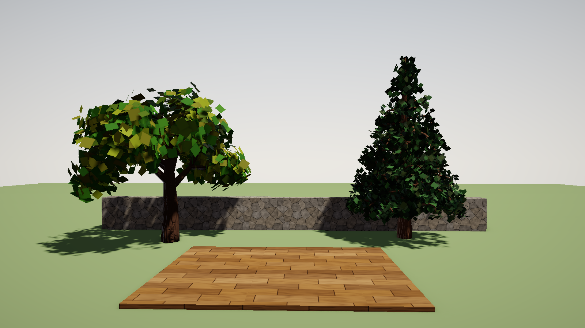
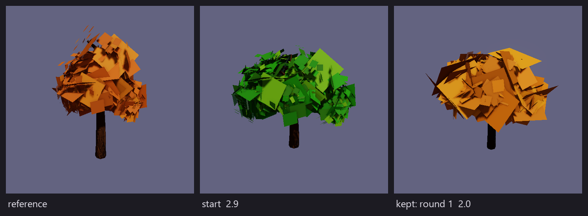

# Procedural Generation

The `flint-procgen` crate produces game-ready assets from small TOML specs: trees as glTF meshes with LOD chains, PBR texture sets from pattern parameters or a node graph, and skinned creatures from a bone hierarchy. Generation is deterministic (same spec, same seed, same bytes), runs from the CLI with `flint gen`, previews live in `flint edit`, and resolves on demand inside the player so a scene can reference a spec by name as if it were a file on disk.

Procgen is the offline, rule-driven half of asset creation; [AI asset generation](ai-generation.md) is the other half. They share the content store and the provenance sidecars.

## A Spec

A spec is a `*.procgen.toml` file with four parts: which generator, metadata, how to seed, and the generator's parameters.

```toml
generator = "tree_v1"

[meta]
name = "oak_tree_01"
description = "A sturdy oak with spreading branches"
version = "1.0.0"
tags = ["tree", "vegetation", "oak"]

[seed]
mode = "fixed"
value = 42

[params]
trunk_height = 4.5
trunk_radius_base = 0.35
branch_method = "lsystem"
lsystem_iterations = 5
crown_radius = 3.5
leaf_style = "billboard"
leaf_color_base = "#2D8C0D"
bark_color_base = "#573214"

[[lod]]
level = 0
target_triangles = 8000

[[lod]]
level = 1
target_triangles = 2000
```

| Section | Field | Description |
|---------|-------|-------------|
| top | `generator` | Registered generator type name |
| `[meta]` | `name` | Unique name. This is what scenes and the resolver look up |
| | `description`, `version`, `tags` | Search and provenance metadata |
| `[seed]` | `mode` | `fixed` (use `value`), `random` (fresh seed every run), `derived` (hash `derive_from`) |
| `[params]` | | Opaque table; each generator defines and validates its own keys |
| `[[lod]]` | `level`, `target_triangles` | Optional decimation targets; `level` is the LOD's index, 0 the most detailed |

Every generator publishes a JSON Schema for its `params` table, which is what the previewer uses to build its parameter editor and what `flint gen` checks a spec against before it runs (`flint_procgen::lint_params`). A key the generator would silently ignore is a warning: one that isn't in the schema (usually a typo, so the nearest key is suggested), or one that only applies in another mode. A schema marks those with `"x-when": { "pattern": ["voronoi_brick"] }` (the texture's patterns) or `"x-when": { "branch_method": ["space_colonization"] }` (the tree's growth methods); the previewer hides such fields and leaves them out when it saves. A key marked `"deprecated": true` is warned about with its reason. `--strict` turns these warnings into an error. Every key carries a one-line `description`, which the previewer shows when you hover the field.

The check reaches inside nested tables too. Each `[[params.ops]]` entry of a texture pipeline is held to its op type's own schema (`flint_procgen::op_schema`: the op's knobs plus `type`, `id` and `inputs`), and so are a `color_ramp`'s stops and a creature's `[params.materials.<name>]` tables. The warning names the key by its path:

```
warning: stone_wall.procgen.toml: `mortar_treshold` is not a parameter of this generator (did you mean `mortar_threshold`?)
warning: stone_wall.procgen.toml: `cell_count` is ignored: it only applies when pattern is "voronoi_brick", and this spec has pattern = "perlin_organic"
warning: tavern_brick.procgen.toml: `ops[0].colums` is not a parameter of the brick_grid op (did you mean `columns`?)
```

## Examples

Four commented specs in `specs/examples/` are the place to start: each opens by saying how its generator thinks, and notes every key that isn't obvious.

| Spec | Makes | Shows |
|------|-------|-------|
| `oak_tree` | A broad oak, three LODs | `tree_v1` with the built-in L-system |
| `pine_tree` | A Scots pine, three LODs | `tree_v1` with space colonization in a `cone` crown |
| `stone_wall` | Fieldstone in mortar, three tiling maps | `texture_v1`, the `voronoi_brick` pattern |
| `wood_plank` | Oak floorboards, three maps | `texture_v1`, a pipeline of ops |



*The four examples together, from `flint gen` and `flint render`. The trees were generated without their `[[lod]]` tables, because a GLB's LOD levels currently all draw at once ([#193](https://github.com/chrischaps/Flint/issues/193)).*

The crate's [README](https://github.com/chrischaps/Flint/blob/main/crates/flint-procgen/README.md) holds the full parameter catalog, generated from the schemas, and its [CONTRIBUTING guide](https://github.com/chrischaps/Flint/blob/main/crates/flint-procgen/CONTRIBUTING.md) builds a new generator from scratch.

## Generators

### `tree_v1`

Trunk, branches, leaves and bark in one pass. The trunk is a noise-displaced tapered tube (`trunk_height`, `trunk_radius_base`, `trunk_radius_top`, `trunk_segments`, `radial_segments`, `trunk_curve_noise`): it leaves the ground vertically at the origin and sways with a wavelength of about 0.6 of its height, `trunk_curve_noise` metres at most; a sway that would bend the tube tighter than its radius is scaled down until it fits. Branches come from one of two methods: `branch_method = "lsystem"` with `lsystem_iterations` and `lsystem_angle_variation`, its limbs reaching `crown_radius` from where they leave the trunk, or `"space_colonization"`, which grows toward attractor points filling a crown of `crown_shape` (`sphere`, `ellipsoid`, `hemisphere`, `box`, or `cone` for conifers: `crown_radius` wide at its floor, narrowing to a point `crown_radius * crown_height_ratio` above it), `crown_radius` and `crown_height_ratio`. Either way limbs leave the trunk all the way from `branch_start` (a fraction of its height, default 0.6) up to the tip: the L-system spreads its scaffold limbs over that stretch, biggest lowest, and space colonization may sprout from any of it, its crown resting on that height. A side limb is at most 0.7 of the trunk's thickness where it leaves; only the limb carrying on from the tip may match it. Its growth is set by `num_attraction_points`, `influence_distance` (how far a point pulls), `kill_distance` (how close a branch must come to consume it) and `step_size`. Branch radii follow the pipe model, `r_parent^n = sum(r_child^n)`, with `n = branch_pipe_exponent` (2 is da Vinci's rule; around 3 keeps twigs sturdier). `cargo run -p flint-procgen --example colonization_gallery` grows one tree per crown shape. With the L-system, `lsystem_iterations` (the branching depth), `branch_angle_min/max`, `lsystem_angle_variation`, `branch_length_falloff` and `branch_radius_falloff` shape the hierarchy; with either method `branch_radial_segments` sets the sides of the thickest limbs. `branch_levels` is deprecated: nothing ever read it. Segments that carry on from one another are swept as one tube per limb, so bends share a ring and the bark runs unbroken through them; each tip tapers and is capped, thinner limbs get fewer sides (down to three), and the bark map wraps once around a limb's base with square texels along it, as on the trunk. Leaves are `leaf_style = "billboard"` quads facing along their branch, or `"mesh"` diamonds tilted off it, placed `leaves_per_tip` at a `leaf_density` fraction of the branch tips plus `leaf_along_branch_density` along branches deeper than `leaf_along_branch_min_depth`, with `leaf_size`, `leaf_size_variation` and `leaf_spread_radius`. Each leaf is a two-sided card (a back face with its own normal), so it shows from both sides under back-face culling. Leaves come in `leaf_shades` shades (default 4, at most 8), each its own material: `leaf_color_base` tinted by `leaf_season` (0 the base colour, 0.4 yellow, 0.7 orange, 1.0 red), with the shades spread `leaf_season_variation` either side of it so a tree turns unevenly, and `leaf_color_variation` apart in lightness. Every leaf wears one shade. Bark gets a generated normal map (`bark_color_base`, `bark_roughness`, `bark_normal_strength`, `bark_normal_resolution`): vertical furrows crossed by short horizontal cracks, tiling around the trunk once at the base and repeating up it with square texels. The GLB embeds it as the bark material's `normalTexture` (`bark_normal`). With `[[lod]]` levels the output is a mesh chain, exported to one GLB: LOD *n* is the `[[lod]]` with `level = n`, reduced from the full tree to its `target_triangles` (LOD 0 too, when it has an entry; without one it is the full tree). Bark and leaves are reduced apart, each keeping its share of the budget: the bark through quadric edge collapse, the leaves by dropping whole cards evenly through every cluster and growing the survivors to cover the same area. Every level keeps the bark material and the leaf shades.

#### L-system grammars

With `branch_method = "lsystem"`, the crown can also be written as a grammar in the notation of *The Algorithmic Beauty of Plants*. Name a built-in one with `lsystem_preset` (`fractal_plant`, `weed`, `stochastic_plant`, `bush`), or write your own with `lsystem_axiom` and `lsystem_rules`:

```toml
branch_method = "lsystem"
lsystem_axiom = "X"
lsystem_rules = ["X -> F[+X][-X]FX", "F (0.7) -> FF", "F (0.3) -> F"]
lsystem_iterations = 5
lsystem_angle = 25.0
lsystem_size = 4.0      # crown reach from the trunk tip, metres
lsystem_tropism = 0.2   # bend toward the ground per step; negative bends up
```

Rules sharing a predecessor are picked per occurrence by weight, from the spec's seed. The turtle reads `F`/`G` (draw), `f` (move), `+ -` (yaw), `^ &` (pitch), `/ \` (roll), `|` (turn around), `[ ]` (branch) and `!` (thin); any other symbol only steers rewriting. Symbols take arguments, as in `F(2, 0.1)` or `+(137.5)`. Each `[` scales the step by `branch_length_falloff` and the radius by `branch_radius_falloff`, starting from `trunk_radius_top`. `lsystem_step` fixes the step length instead of scaling the crown to `lsystem_size`. `specs/weeping_willow.procgen.toml` is a worked example, and `cargo run -p flint-procgen --example lsystem_gallery` grows the presets.

### `texture_v1`

Produces an image set, by default albedo, normal and roughness (`output_maps`), at `width` by `height`. Two routes:

**Patterns.** `pattern` (default `voronoi_brick`) selects a base-shape producer whose per-pixel field (cell ids, heights, edge distances) is turned into PBR maps by shared derivation parameters: `base_color`, `color_variation`, `mortar_color`, `mortar_threshold`, `roughness_base`, `roughness_variation`, `roughness_mortar`, `normal_strength`, `detail_scale`, `detail_strength`.

The three maps agree with each other. Each cell gets its own shade of `base_color`: lightness moves by up to `color_variation` and saturation by half that, in sRGB, while the hue stays the same, so a grey-brown wall stays grey-brown. Mortar colour and roughness blend in where `distance_to_edge` falls below `mortar_threshold`. The default threshold fills the bottom half of a Voronoi or grid groove, or draws thin strata lines on organic bands. One detail field serves all three maps: a tiling FBM with `detail_scale` lattice cells across the texture, `detail_octaves` octaves (any finer than 4 px are dropped), scaled to unit RMS. It makes the albedo brighter or darker by about `detail_strength` (0.1 means ±10%), adds relief to the normal map, and makes low spots rougher, so a dent is dark, rough and shaded in the same place. Normals come from a 3×3 Sobel kernel taken per UV unit, so the relief at 1024² matches 512².

| Pattern | Good for | Its parameters |
|---------|----------|----------------|
| `voronoi_brick` | Stone walls, cobbles, cracked earth | `cell_count`, or `cell_size` in pixels (overrides it); `mortar_width` (the groove's full width, as a fraction of the texture); `regularity` or `irregularity`; `height_variation` |
| `perlin_organic` | Layered rock, dirt, bark, natural surfaces | `noise_type` (`perlin`, `simplex`), `frequency`, `octaves`, `lacunarity`, `persistence`, `height_bands` |
| `tiling_grid` | Manufactured tiles, bricks, panels | `columns`, `rows`, `gap_width`, `jitter`, `height_variation`, `noise_strength` |

With `seamless = true` (the default) every pattern tiles: Voronoi distances wrap round the tile, the grid's jittered tiles spill over one edge and return on the other, and organic noise repeats exactly. Seamless Perlin gives each octave a whole number of lattice cells per tile, so a fractional `frequency` is rounded (at least 1); seamless simplex cross-fades the noise with copies of itself shifted one tile across.

**Pipeline.** `pattern = "pipeline"` switches to a composable node graph: an ordered `[[params.ops]]` list where each op reads named fields and writes named outputs. The ops replace the derivation, so a pipeline reads only `width`, `height`, `output_maps`, `seamless` and `ops`; colours and roughness are set on the ops themselves.

A pipeline tiles too, with `seamless = true` (the default). Every op that samples noise or repeats a pattern rounds its frequencies to a whole number of cycles per tile, on each axis and for each octave: `noise_layer`, `musgrave_texture`, `voronoi_texture`, `wave_texture` (an even count along `diagonal`), `checker_texture` (an even count of squares), the distortion inside `wave_texture` and the displacement and mask noise of `edge_erode`. Perlin, value and Worley noise wrap their lattice, so a fractional `frequency` or a `scale_x` that differs from `scale_y` is rounded rather than refused; simplex cross-fades with copies of itself shifted one tile across. The grid ops already wrap, and `blur`, `sharpen`, `edge_detect` and `derive_normal` read across the edge. `gradient_texture` is a ramp and never tiles. `seamless = false` keeps the unwrapped fields.

```toml
[params]
pattern = "pipeline"
width = 512
height = 512

[[params.ops]]
type = "voronoi_texture"
output = "membrane"
scale = 8.0
feature = "smooth_f1"

[[params.ops]]
type = "map_range"
input = "membrane"
output = "veins"
from_min = 0.0
from_max = 0.3
interpolation = "smootherstep"
```

The op set: `brick_grid`, `voronoi_grid`, `domain_warp`, `cell_height`, `cell_bulge`, `noise_layer`, `blend`, `mortar_groove`, `cell_color`, `mortar_color`, `derive_normal`, `cell_roughness`, `math`, `map_range`, `color_ramp`, `checker_texture`, `gradient_texture`, `wave_texture`, `white_noise`, `voronoi_texture`, `musgrave_texture`, `invert`, `brightness_contrast`, `hsv_adjust`, `gamma`, `clamp`, `blur`, `sharpen`, `edge_detect`, `edge_erode`. Each op has its own parameter schema; the texture pipeline editor exposes them all.

### `creature_v1`

A skinned mesh from a data-driven skeleton. Everything anatomical is in the spec; the generator only knows bones, shapes and chains.

- `[[params.bones]]`: `name`, optional `parent`, `position`, `rotation`.
- `[[params.body_parts]]`: a `shape` (for example `ellipsoid`) with `dimensions`, attached to a `bone`, using a named `material`.
- `[[params.limb_chains]]`: `name`, `parent_bone`, `attach_offset`, segment definitions, and `mirror = true` to generate the bilateral twin. Chains create their own bones.
- `[params.materials.<name>]`: colour and PBR values referenced by body parts.
- `symmetry = "bilateral"` mirrors across X.

The output is a skinned GLB with a skeleton the [animation](animation.md) system can drive.

## Determinism and Seeds

All randomness flows through a `SeededRng` forked by name per stage (`"pattern"`, `"pipeline"`, and so on), so adding a stage never disturbs the numbers an earlier one draws. A `fixed` seed reproduces the asset bit for bit; `derived` hashes a string so a spec can be reseeded by, say, an entity name; `random` is for variants. `flint gen --seed N` overrides whatever the spec says, and `--batch N --seed-start S` writes N sequential-seed variants with the seed inserted into each filename.

Generators are stateless and `Send + Sync`; parameters live in the spec and randomness in the RNG.

## `flint gen`

```bash
flint gen specs/oak_tree.procgen.toml -o tree.glb
flint gen specs/stone_wall.procgen.toml -o wall.png
flint gen specs/oak_tree.procgen.toml --dry-run          # cost estimate, no output
flint gen specs/oak_tree.procgen.toml --seed 7 --register
flint gen specs/beetle.procgen.toml --batch 5 --seed-start 100
flint gen specs/oak_tree.procgen.toml --validate --style-guide styles/medieval_tavern.style.toml --strict
```

| Flag | Description |
|------|-------------|
| `-o, --output` | File or directory. Derived from `meta.name` and the output kind when omitted |
| `--seed` | Override the spec's seed |
| `--dry-run` | Print the generator's cost estimate without generating |
| `--format` | `glb`, `png` or `wav`; must be the generator's own format (mesh: GLB, images: PNG, sound: WAV). Names the file when `-o` is omitted or has another extension |
| `--batch N`, `--seed-start S` | N variants with seeds S..S+N-1 (S defaults to 0), made one after another and written as `<stem>_<seed>.<ext>` (or filling a `{seed}` in `-o`). `--seed-start` needs `--batch`, and `--seed` can't be combined with it |
| `--register` | Store each output file in the [project root](assets.md#the-project-root)'s `.flint/assets` (found from the working directory, or named by `--project <dir>`), write a `<file>.asset.toml` sidecar beside it, and reuse an earlier registered result for the same spec + seed |
| `--force` | With `--register`, generate even when this spec + seed is already stored |
| `--validate`, `--strict`, `--style-guide` | Run the output validator (see [Validation](#validation)); `--strict` turns warnings, including ignored spec keys, into exit code 1. `--style-guide` needs `--validate` |

Image sets write one PNG per map with the map name suffixed.

### Refining toward a reference

```bash
flint gen specs/oak_tree.procgen.toml --ai-refine --reference refs/autumn_oak.png \
  --refine-rounds 3 --save-spec specs/oak_autumn.procgen.toml -o oak.glb
```

This is the refine step of [AI assistance](#ai-assistance-and-cost) (`--ai-refine` or `--ai-assist`) given a `--reference`, so it needs `ANTHROPIC_API_KEY` and every call goes through the cost meter. Claude sees the reference beside a picture of what the spec builds now: a texture's own pixels, or for a mesh a 512x512 render from the headless model renderer (`flint edit model.glb --render`, auto-framed, no grid). It also gets a measured distance between the two (`flint_procgen_ai::measure`: mean colour, a 16-bin luminance histogram and a 16x16 luminance layout, as a score out of 100). Each round's reply is rendered and measured again. While the distance falls, the new render and numbers go back for another round; the first round that gets no closer ends the loop, and the closest spec is kept, which is the spec unchanged if no round improved on it. `--refine-rounds N` (1-8) caps the rounds; it defaults to `--ai-iterations`. The distances print to stderr, and `--save-spec` keeps the spec the loop kept.



```text
  start    distance   2.9  (colour  18.1, histogram 0.03, layout 0.02)
  round 1  distance   2.0  (colour   2.5, histogram 0.04, layout 0.02)  <- kept
  round 2  distance   2.4  (colour   1.9, histogram 0.05, layout 0.02)
```

The score measures whole images, backdrop included, so for a mesh it moves most with colour and only a little with shape. It is a ruler for "closer or further" between rounds, not a judge of likeness.

### Registering outputs

`--register` gives every file a provenance sidecar (`tree_42.glb.asset.toml`) whose `[asset.properties]` record `generator`, `generator_revision` (the revision of the generator that made the file), `spec_hash` (the spec file's content hash), `seed` (the seed actually used, so a `random` spec's variant can be made again with `--seed`), `timestamp` (ISO 8601 UTC), `flint_version`, and for an image set the `map`. The bytes go into the content store at `.flint/assets/<2 hex>/<hash>.<ext>`, and `.flint/procgen/<spec hash>/<seed>.toml` lists the hashes that spec + seed produced. Both paths are under the project root, so a run from `specs/`, from the root or from the game's `engine/` subtree shares one store and one cache.

That entry is the cache. A later `--register` run with the same spec and seed checks the files on disk against it and does not generate: `Cached:` when they match, and when one was deleted or has changed since, it is copied back from the store. Only when the store has lost a file does the run generate again.

The spec hash covers the spec file, not the generator code, so every generator carries a revision (`Generator::revision`, which it bumps whenever the same spec and seed would come out different) and the entry records it. An entry made by another revision, or by a Flint from before revisions were recorded, is stale: the run says so (`Stale: tree.glb (seed 42, tree_v1 rev 3 -> 4), regenerating`) and registers the new output. `--force` is still there to regenerate regardless.

Before anything is generated, `flint gen` checks that the spec's generator is registered (an unknown one is refused with the list of known generators) and that the output can hold what it makes: `-o tree.png` for a mesh, or `--format png` on one, fails with a suggested path instead of writing GLB bytes under a `.png` name. `--dry-run` shows the seed it would use, including a `--seed` override.

### Validation

`--validate` checks what was generated, not the spec, and prints one line per check and a summary (`Validation: 23 passed, 4 warnings, 0 failed`). Failures exit 1; warnings exit 0 unless `--strict`.

| Check | Fails when | Warns when |
|-------|-----------|------------|
| mesh integrity | indices aren't whole triangles, point past the vertices, or a position isn't finite | |
| spec triangle target | over 2x the spec's `[[lod]] target_triangles` for that level | over the target |
| style triangle budget | over 2x the style's `geometry.max_triangles` (every mesh, every LOD) | over the budget |
| UV range | a UV is outside [0,1] (UVs on a textured submesh may tile) or not finite; with `require_uvs`, every vertex shares one UV | |
| normals | a normal is zero or not finite | a normal isn't unit length |
| PBR roughness / metallic | a material factor is outside [0,1] | outside the style's `roughness_range` / `metallic_range` |
| palette | a style palette entry isn't a hex colour | a material's base colour is more than ΔE 20 (CIELAB) from every palette entry, or under half of a colour map's texels are within ΔE 20 |
| style range (roughness / metallic maps) | | under 90% of the map's texels are inside the style's range |
| degenerate triangles | a triangle's area is at most 1e-6 x its longest edge squared | |
| texture dimensions | the image isn't the spec's `width` x `height` | not a power of two |

A style guide is the `[style]` TOML that `flint asset` uses, e.g. `styles/medieval_tavern.style.toml`.

## Previewing

`flint edit` opens the right tool by inspecting the spec:

- **Procgen previewer** (any spec whose pattern is not `pipeline`): a 3D orbit viewport for meshes or texture tabs for images, plus a parameter panel generated from the generator's schema. Edits regenerate live. `R` rerolls the seed, `Ctrl+S` saves the spec, `Ctrl+Shift+S` saves as, `Ctrl+E` exports the output, `Space` resets the view, `T` toggles tiled preview for textures, `O` toggles auto-orbit with `[` and `]` for speed, `Tab` hides the panels. `--watch` reloads when the file changes on disk.
- **Texture pipeline editor** (`pattern = "pipeline"`): a three-pane node editor built on egui-snarl, with global parameters and the selected node's parameters on the left, the graph in the middle, and the output maps with a channel browser on the right. `Ctrl+Z` and `Ctrl+Shift+Z` undo and redo, `Delete` removes the selected node, `Ctrl+S` saves, `Ctrl+E` exports.

```bash
flint edit specs/oak_tree.procgen.toml
flint edit specs/alien_organic.procgen.toml     # pipeline pattern, opens the node editor
```

## Specs in Scenes

The player indexes every `*.procgen.toml` by `meta.name`, from `../specs/` (the game root when scenes live in `levels/`), then `specs/` beside the scene, then `models/`; a later directory's spec overrides an earlier one of the same name, so a scene's own spec beats the game's. Each name an entity's `model.asset`, `material.texture` or `sprite.texture` asks for resolves in one order: **catalog > procgen > file**. An asset catalog entry wins outright. A name with an indexed spec is generated and uploaded straight to the GPU under that name before any file is looked at, so a baked `models/<name>.glb` beside the spec is not drawn while the spec works. Anything else loads from its file, as before:

```toml
[entities.old_oak.model]
asset = "garden_tree"            # specs/garden_tree.procgen.toml

[entities.floor.material]
texture = "crypt_floor"          # specs/crypt_floor.procgen.toml, an image set
```

A mesh's sub-meshes (a tree's bark and each leaf shade) upload as parts of the one model, each with its own material, and a material's generated normal map comes along. An image set uploads its first map under the spec's name and the rest as `<name>_normal`, `<name>_roughness` and so on, the companion names the material path looks for.

When procgen can't make an asset (its generator isn't registered, the generator fails, or the output can't be drawn that way: a skinned creature as a model, a mesh as a texture) the player logs a warning saying why and falls through to the file. With no file either, a placeholder stays under the name: a magenta box standing on the entity's origin for a model, a 1x1 magenta texture for a texture.

Outputs are cached in memory keyed by spec hash and seed under a 256 MB budget; the resolver lives as long as the player, so a scene loaded again (or another scene naming the same spec) is served from the cache. A `random` seed makes every instance unique; a `fixed` seed makes them identical, which is the difference between a cave full of beetles and one boss.

By default the player generates during scene load, so the first frame shows every asset. `flint-player --procgen-defer` instead shows the placeholders at once and queues the generation, a few milliseconds of it per frame (`runtime_max_generation_ms_per_frame`), swapping each asset in under its name as it finishes; a queued asset that fails gives way to its file if there is one and keeps its placeholder if not. An asset is generated whole, so one expensive spec still costs the frame it lands in.

Headless `flint render` does not run the resolver. For snapshots of procgen-backed scenes, generate the assets first with `flint gen -o models/<name>.glb` so they resolve as files.

## Architecture

- **Algorithms**: noise (Perlin, simplex, Worley, FBM), an L-system engine, space colonization, and a mesh builder with primitives, extrusion, normals, tangents, UVs and simplification.
- **Generators**: `tree`, `texture` (patterns, node graph, map derivation) and `creature` (body parts, limb chains, skeleton builder), registered through `GeneratorRegistry`.
- **Spec, seed and RNG**: `ProcGenSpec`, `Seed`, `SeededRng`.
- **Output**: `MeshData`, `ImageData`, `SkinnedMeshData`, GLB export with LOD chains and skins.
- **Runtime**: `ProcGenResolver` (discovery, cache, frame-budgeted queue), used by the player.
- **Validation**: `validate_output` with style-guide constraints.

`flint-procgen-ai` sits on top for tool-time spec creation and refinement from prompts; it is not linked into the player.

## AI assistance and cost

`flint gen` can ask an agent to write or improve a spec before it generates:

```bash
flint gen --ai-create "twisted dead tree" -o tree.glb             # description -> spec -> GLB
flint gen specs/oak_tree.procgen.toml --ai-assist -o tree.glb     # interpret + refine, then generate
flint gen specs/stone_wall.procgen.toml --ai-refine --reference photo.png -o wall.png
flint gen --ai-create "old brick wall" --ai-provider mock --print-spec --save-spec wall.procgen.toml
```

The default provider is `anthropic` (`ANTHROPIC_API_KEY`, model `claude-opus-5-5`); `mock` is the offline, deterministic agent. Every spec the Anthropic agent returns has been checked against the generator's schema and built before it is accepted. `--ai-create` guesses the generator from the description (a tree word, a creature word, a surface word, or a `.png` output), and `--ai-generator` names it. Project defaults live in `.flint/procgen_ai.toml` (`provider`, `model`, `max_iterations`, `effort`; never the key), and the flags override them. The agent's suggestions, rationale and round count go to stderr; `--print-spec` puts the final spec alone on stdout. A `--dry-run` with an AI flag prints the plan and the most a call could cost, and sends nothing.

Every API call goes through a cost meter, which appends one JSON object per line to `.flint/procgen_costs.json`: `timestamp`, `provider`, `model`, `input_tokens`, `output_tokens`, the cache token counts, `estimated_usd`, `spec_name` and `operation`. A reply that came back unusable (cut off, declined) is recorded too, since it was billed. Prices are the published per-model rates; an unknown model is priced as the dearest one and marked `priced_as`.

`--max-cost <USD>` is checked before every call, retries included: the meter prices the call's worst case (its estimated input plus a full reply) against what's left. When only a shorter reply fits, it lowers `max_tokens` for that call; when not even 2,048 output tokens fit, it refuses with `cost ceiling reached` and sends nothing. It warns once past 80%. `flint gen --cost-report` sums the ledger by provider, model and spec, and `--since YYYY-MM-DD` limits it to recent calls.

## Further Reading

- [AI Asset Generation](ai-generation.md): the provider-driven half of the pipeline
- [Assets](assets.md): the content store and sidecars `--register` writes into
- [Animation](animation.md): driving the skeletons `creature_v1` produces
- [CLI Reference](../cli-reference/overview.md): `flint gen` and `flint edit`
