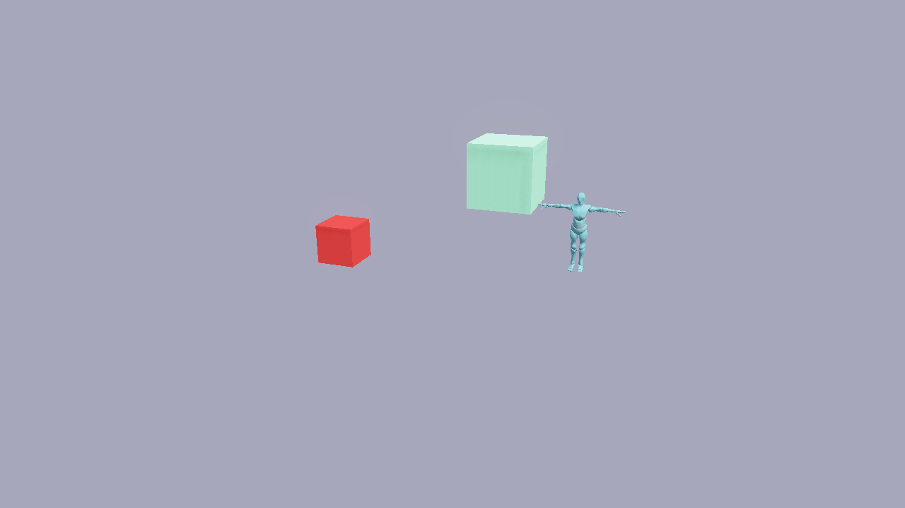
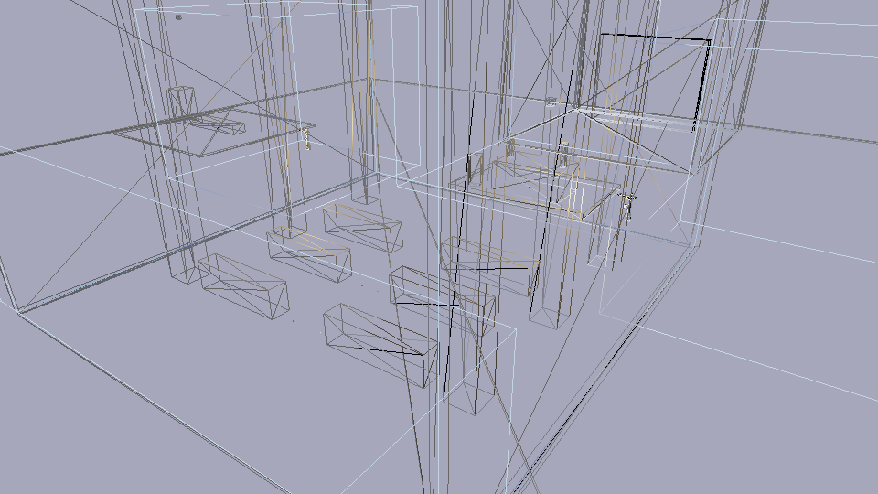
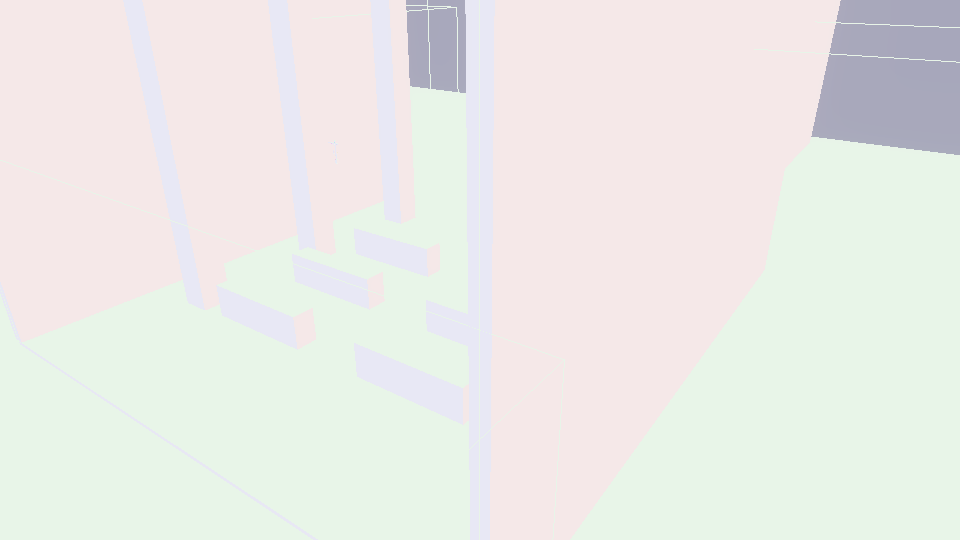

# Rendering

Flint uses wgpu 23 for cross-platform GPU rendering, providing physically-based rendering (PBR) with a Cook-Torrance BRDF, cascaded shadow mapping, optional 4x MSAA, and full glTF mesh support.

## PBR Shading

The renderer implements a metallic-roughness PBR workflow based on the Cook-Torrance specular BRDF:

- **Base color** --- the surface albedo, optionally sampled from a texture
- **Roughness** --- controls specular highlight spread (0.0 = mirror, 1.0 = diffuse)
- **Metallic** --- interpolates between dielectric and metallic response
- **Emissive** --- self-illumination for light sources and glowing objects

Materials are defined in scene TOML via the `material` component, matching the fields in `schemas/components/material.toml`.

Diffuse shading is Lambert by default, but the scene can blend toward Oren-Nayar, soften the terminator with diffuse wrap, and add a Charlie-sheen rim through the `[environment]` block. Those levers, the light component, and area lights are documented on the [Lighting](lighting.md) page.

## Shadow Mapping

Directional lights cast shadows via cascaded shadow maps. Multiple shadow cascades cover different distance ranges from the camera, giving high-resolution shadows close up and broader coverage at distance. A directional light with a non-zero `angular_size` gets contact-hardening PCSS shadows instead of the fixed PCF kernel.

Shadows are toggled at runtime from the Rendering & Effects menu (**F4**), which also offers the shadow-map resolution (512 to 4096). Headlessly, use `--no-shadows` and `--shadow-resolution`. See [Lighting](lighting.md#shadows) for details.

## Camera Modes

The renderer supports two camera modes that share the same view/projection math:

| Mode | Usage | Controls |
|------|-------|----------|
| **Orbit** | Scene viewer (`flint edit`) | Left-drag to orbit, right-drag to pan, scroll or Q/E to zoom, WASD to orbit by key |
| **First-person** | Player (`flint play`) | WASD to move, mouse to look, Space to jump, Shift to sprint |

The camera mode is determined by the entry point: `edit` uses orbit, `play` uses first-person. Both produce the same view and projection matrices. A scene's `[camera]` block seeds the orbit camera in the viewer and the framing in `flint render`; in the viewer, **Space** returns to that authored framing.

### World lines

`SceneRenderer::set_world_lines(Vec<WorldLine>, pixels_per_point)` gives the renderer segments to draw in every following frame, until they're replaced. Each `flint_core::world_line::WorldLine` has two world points, a display-space RGBA colour and a width in logical points. The player sets them each frame from the scripts' `draw_world_line` calls.

They're drawn after the composite and FXAA, straight onto the final target, before the HUD. Each segment is projected with the frame's own camera and cut at the near plane. It's expanded on the CPU into a screen-space quad of the requested width, with a one-pixel feather that the fragment shader fades. That's the anti-aliasing, since the pass comes after MSAA and FXAA. The pass tests against the frame's resolved single-sample depth (`LessEqual`) and doesn't write depth. Each end is pulled toward the eye by 0.2% of its distance (`world_line_pipeline::DEPTH_SLACK`), so a line lying on a surface doesn't fight it for depth. The colours are display-space, like the HUD's, and they're linearised when the target is sRGB, so a ring keeps the colour it had as a HUD line. The pipeline is built on the first frame that has lines, and its vertex buffer grows to fit the busiest frame. A renderer without the HDR chain and with MSAA has no resolved depth, so it skips the pass.

### Picking the ground

`Camera::screen_to_ground(x, y, width, height, plane_y)` returns the `[x, z]` point on the plane `y = plane_y` under a screen point, or `None` where the view doesn't reach it. Screen points start at the top-left with y down. Any unit works as long as the cursor and the viewport size use the same one, so logical points or physical pixels both give the right answer on a HiDPI display. Scripts get the same function as `screen_to_ground(x, y, plane_y)`.

It is built on `Camera::unproject_ray(ndc_x, ndc_y)`. That returns a ray whose origin is on the near plane, so the same code serves perspective cameras (rays fan out from the eye) and orthographic ones (parallel rays). It honours `ndc_offset`. The arithmetic is in `flint_core::projection` and runs in `f64`, because an `f32` inverse of a projection whose far plane is thousands of times its near plane would let distant hits drift off the cursor.

A camera looking straight down has no defined "right" (`forward × up` is zero). In that case the view basis puts north (-Z) at the top of the screen and east (+X) on the right, like a map. Without that fallback the view matrix collapses and nothing renders.

## glTF Mesh Rendering

Imported glTF models are rendered with their full mesh geometry and materials. The `flint-import` crate extracts meshes, materials, and textures from `.glb`/`.gltf` files, which the renderer draws with PBR shading.

### Recolouring a model per entity

Two ECS components tint an imported model without touching the GLB:

- `material.base_color_r/g/b[/a]` on the entity (or its direct parent) replaces the base colour of **every** primitive the entity draws. Scripts write it with `set_material_color`.
- `material_overrides` maps glTF **material names** to colours: `Frame = [0.9, 0.3, 0.1]`, `Capsule = [0.2, 0.6, 1.0, 0.5]`. The renderer looks it up on the drawn entity and then on each ancestor, so a single component on a model's root entity recolours the matching materials on all of its expanded child nodes, including meshes that mix several materials. A three-component value keeps the material's own alpha. It takes precedence over `material.base_color_*` for the named material. Scripts write it with `set_material_override(id, name, r, g, b, a)`.

Both are re-read whenever the renderer re-extracts the world (every frame in the player), so colour changes are live.

### Runtime meshes

Code can build meshes while the game runs and draw them like imported models. A mesh has a name. Any entity whose `model.asset` is that name draws it at the entity's transform.

- **Create or replace:** `SceneRenderer::load_procedural_mesh(device, name, vertices, indices, material)`.
  - Uploading under a name already in use replaces that mesh.
  - The old GPU buffers are freed once the current frame's draw list lets go of them, so a mesh can be rebuilt every frame without GPU memory growing.
- **Remove:** `SceneRenderer::remove_mesh(name)`. An entity that still names the mesh draws nothing until the name is uploaded again. If the entity has a `bounds` box, it draws the box instead.
- **From a player extension:** use `ExtensionGpu::upload_mesh` and `ExtensionGpu::remove_mesh` in `pre_update`. `ExtensionCtx::attach_mesh(entity, name)` sets the entity's model.
- **Declared in a scene:** add `runtime = true` to the model so the model loader doesn't look for a file:

  ```toml
  [entities.ground.model]
  asset = "city_ground"   # uploaded by code at runtime
  runtime = true
  ```

**Vertex colours.** `ImportedMaterial::vertex_colored(name)` makes a material that takes its colour from each vertex. One mesh can then carry many colours without one material per colour. Vertex colours are **linear**, so convert sRGB values such as hex codes with `flint_render::srgb_to_linear`, or they wash out.

**Culling.** Every static mesh has a local bounding box, which the renderer computes from its vertices at upload. Each frame, opaque and transparent mesh draws whose world box is outside the camera frustum are skipped. Each shadow cascade skips the draws outside its own frustum as well. The F2 stats overlay shows the main-view count as `Entities: N (M culled)`, and `RenderStats::culled_draws` holds the same number. Skinned meshes, wireframes and `bounds` boxes are never culled. Large meshes are hard to cull, so split a sprawling mesh into sectors if most of it is usually off screen.

## Skinned Mesh Pipeline

For skeletal animation, the renderer provides a separate GPU pipeline that applies bone matrix skinning in the vertex shader. This avoids the 32-byte overhead of bone data on static geometry.

**How it works:**

1. `flint-import` extracts joint indices and weights from glTF skins alongside the mesh data
2. `flint-animation` evaluates keyframes and computes bone matrices each frame (local pose -> global hierarchy -> inverse bind matrix)
3. The renderer uploads bone matrices to a **per-entity** storage buffer and applies them in the vertex shader

**Key types:**

- `SkinnedVertex` --- extends the standard vertex with `joint_indices: [u32; 4]` and `joint_weights: [f32; 4]` (6 attributes total vs. 4 for static geometry)
- `GpuSkinnedMesh` --- holds the vertex/index buffers and material for a skinned asset
- Skinned pipeline uses bind groups 0--3: transform, material, lights, and bones (storage buffer, read-only, vertex-visible)

Bone buffers are keyed by entity, not by asset. Two entities that instance the same skinned model animate independently; before this change every instance showed whichever skeleton uploaded last. Skinned meshes also cast shadows through a dedicated `vs_skinned_shadow` shader entry point that applies bone transforms before depth rendering, and both wireframe debug modes draw them posed, using a per-draw unique-edge index buffer.

## Billboard Sprites

Billboard sprites are camera-facing quads used for 2D elements in 3D space --- enemies, pickups, particle effects, and environmental details. They always face the camera, like classic Doom-style sprites.

The `BillboardPipeline` is a separate rendering pipeline from PBR, optimized for flat textured quads:

- **No vertex buffer** --- quad positions are generated procedurally from `vertex_index` (4 vertices per sprite)
- **Per-sprite uniform buffer** --- each sprite gets its own instance data (position, size, frame, anchor)
- **Binary alpha** --- the fragment shader uses `discard` for transparent pixels (avoids order-independent transparency complexity)
- **Sprite sheet animation** --- supports multi-frame sprite sheets via `frame`, `frames_x`, and `frames_y` fields
- **Render order** --- billboard sprites render after skinned meshes in the pipeline

### Sprite Component

Attach a sprite to any entity with the `sprite` component:

```toml
[entities.imp]
archetype = "enemy"

[entities.imp.transform]
position = [10, 0, 5]

[entities.imp.sprite]
texture = "imp_spritesheet"
width = 1.5
height = 2.0
frames_x = 4
frames_y = 1
frame = 0
anchor_y = 0.0
fullbright = true
```

| Field | Type | Default | Description |
|-------|------|---------|-------------|
| `texture` | string | `""` | Sprite sheet texture name (from `sprites/` directory) |
| `width` | f32 | `1.0` | World-space width of the quad |
| `height` | f32 | `1.0` | World-space height of the quad |
| `frame` | i32 | `0` | Current frame index in the sprite sheet |
| `frames_x` | i32 | `1` | Number of columns in the sprite sheet |
| `frames_y` | i32 | `1` | Number of rows in the sprite sheet |
| `anchor_y` | f32 | `0.0` | Vertical anchor point (0.0 = bottom, 0.5 = center) |
| `fullbright` | bool | `true` | If true, bypasses PBR lighting (always fully lit) |
| `visible` | bool | `true` | Whether the sprite is rendered |

### Design Decisions

Billboard sprites use a **separate pipeline** rather than extending the PBR pipeline. This keeps the PBR shaders clean and allows sprites to opt out of lighting entirely (`fullbright = true`). The `discard`-based alpha approach is simple and avoids the significant complexity of order-independent transparency, at the cost of no partial transparency (pixels are either fully opaque or fully transparent).

## MSAA

Every scene pipeline (PBR, skinned, sky, skybox, ocean, terrain, grass, particles, billboards, 2D sprites) takes a sample count, so the scene passes can run at 4x MSAA (ADR 0058). Post-processing, shadow and blit passes stay single-sample, and depth-reading effects consume a sample-0 depth resolve. Enable it with `flint render --msaa 4` or `flint-player --msaa 4`; the default is 1 so headless pixel gates stay single-sample.

## Post-Processing

The renderer includes an HDR post-processing pipeline that applies bloom, SSAO, fog, volumetric light, depth of field, Kuwahara, color grade, film grain, tonemapping, vignette, FXAA and render modes as fullscreen passes. See [Post-Processing](post-processing.md) for full details.

When post-processing is active, all scene pipelines render to an `Rgba16Float` HDR intermediate buffer. A composite fullscreen pass then applies exposure, ACES tonemapping and the rest of the chain to produce the final sRGB output.

Configure post-processing per-scene via the `[post_process]` TOML block, override with `flint render` flags (`--no-postprocess`, `--bloom-intensity`, `--exposure`, `--dof`, `--grade-gain`, and the rest of the set listed on the post-processing page), or tune it live from the F4 menu.

## PBR Materials



*PBR materials with varying roughness and metallic values. Left to right: rough dielectric, smooth dielectric, rough metal, polished metal.*

### Emission

A material can give off light of its own (ADR 0076): lamps, lit windows, embers, a glowing crown. Emission is added after lighting and before tonemapping, so it doesn't depend on facing, the sun or the ambient, and with post-processing on, bloom picks up anything brighter than its threshold. It lights only its own surface. To light the things around it, put a point light beside it.

- **`ImportedMaterial::emissive`** is the light, as linear RGB. It defaults to zero.
- **`emissive_strength`** multiplies it, so radiance can go past 1. It defaults to 1.
- **`emissive_texture`** is an optional emissive map, sRGB, whose RGB multiplies the light, so painted-on lights (a grid of windows, signage, panel lines) glow only where they're painted. As in glTF, a map does nothing while `emissive` is zero: set the factor to white to take the map's colours as they are.
- **glTF:** `emissiveFactor`, `emissiveTexture` and `KHR_materials_emissive_strength` are read into those three fields. The map uses the mesh's first UV set, like the other maps.

```rust
let lamp = ImportedMaterial {
    base_color: [0.05, 0.05, 0.05, 1.0],
    emissive: [1.0, 0.7, 0.35],
    emissive_strength: 4.0, // well past a bloom threshold of 1-3
    ..ImportedMaterial::default()
};
```

**Per-vertex emission** suits runtime meshes coloured per vertex, where one mesh mixes lit faces with glowing ones. Set `vertex_emission: true` on a `vertex_colored` material. Each vertex's alpha then says how much of it is surface:

| Vertex alpha | The face is... |
|---|---|
| 1 | an ordinary surface, lit as usual. Every existing vertex colour is unchanged. |
| 0 | light. It reflects no diffuse and gives off its RGB × `emissive_strength`. |
| between | a blend of the two. |

Vertex RGB may go past 1 for bright lights. In this mode vertex alpha is no longer opacity, but the entity's `material.opacity` still applies. A glowing face keeps its normal, so it can still take a faint specular highlight on top, like lit glass.

#### Changing the glow after upload

A mesh's emission is set when it's uploaded, but an entity can scale it every frame with **`material.emissive_scale`** (ADR 0090). It multiplies all of the mesh's emission: the material's own `emissive` and the per-vertex kind. The default is 1, which is the mesh as uploaded. Nothing is re-uploaded, so a city's worth of windows can come on with the evening as one number per entity.

```toml
[entities.lamp_post.material]
emissive_scale = 0.0   # off by day; a script or extension raises it at dusk
```

- **Where it applies:** imported and runtime meshes, skinned or not. An entity with no scale of its own takes its parent's, so a GLB expanded into child nodes dims as one.
- **Zero is dark.** At 0, a per-vertex light face goes black, like an unlit bulb. It doesn't turn back into a lit, see-through surface, and surface vertices are lit as usual. Negative values count as 0.
- **Only the strength changes.** To slide a face from lit paint by day to light by night, use `glow_surface` as well (below). Glass that is lit like any surface and gives off light from its material's `emissive` is often enough: at 0 it's plain glass.
- **Cost:** a new scale rebuilds that draw's small material uniform on the next frame, as a new `opacity` does. If hundreds of entities glow at once, change the value in steps rather than by a hair every frame.

From an extension, write the field like any other component:

```rust
let mut material = toml::Table::new();
material.insert("emissive_scale".into(), (night * 1.6).into());
world.set_component(id, "material", material.into())?;
```

#### Lighting the glow as surface too

**`material.glow_surface`** (ADR 0096), 0 to 1, says how much of each per-vertex light part is also an ordinary lit surface of its colour. It adds the surface and takes none of the light away, so `emissive_scale` and `glow_surface` set a light face's two halves apart: how much light it gives off, and how much paint the sun and sky can light. The default is 0, the mesh as uploaded. Surface vertices (alpha 1) don't change, so a mesh can mix plain faces with ones that slide.

Upload the sliding faces as pure light (alpha 0) at the colour you want, once. Then, every frame:

| `glow_surface` | `emissive_scale` | The face is... |
|---|---|---|
| 1 | 0 | lit paint: gold in the sun |
| 0.6 | 0.25 | gold paint with a little light in it, at dusk |
| 0 | 1.6 | light only, bright at night |

A vertex of alpha `a` is lit as surface by `a + (1 − a) × glow_surface` of its colour and gives off `(1 − a)` of it times the strength, as before. It applies wherever per-vertex emission does, skinned or not, with the same inheritance from the parent as `emissive_scale`, and the same cost when it changes. Values are clamped to 0..1.

## Debug Visualization

The renderer provides eight shading modes, selected from the **Shading** combo in the Rendering & Effects menu (F4) or with `--debug-mode` headlessly:

| Mode | `--debug-mode` | Description |
|------|----------------|-------------|
| **PBR** | (default) | Standard Cook-Torrance shading |
| **Wireframe overlay** | `--wireframe-overlay` | Edge lines drawn over solid PBR shading |
| **Wireframe** | `wireframe` | Edge lines only, no fill |
| **Normals** | `normals` | World-space surface normals mapped to RGB |
| **Depth** | `depth` | Linearized depth as grayscale |
| **UV Checker** | `uv` | UV coordinates as a procedural checkerboard |
| **Unlit** | `unlit` | Albedo color only, no lighting |
| **Metal/Rough** | `metalrough` | Metallic (red channel) and roughness (green channel) |

Both wireframe modes draw skinned meshes in their animated pose; rigged models used to get no lines at all in the overlay and vanished in wireframe-only.

Additional overlays:

- **Normal arrows** (F3 in the viewer, `--show-normals` in render) --- draws face-normal direction arrows
- **Skeleton overlay** (model previewer) --- draws the armature over a rigged model, following the animated pose, with a colour mode that paints joints by last writer, layer weight, mask, or keyed joints. See [Animation](animation.md).
- **Render stats** (F2 in the viewer and the player) --- frame time, draw counts, resolution



*Wireframe debug mode showing mesh topology.*



*Normal debug mode mapping world-space normals to RGB channels.*

## Viewer vs Headless

The renderer operates in two modes:

**Viewer mode** (`flint edit scene.toml --watch`) opens an interactive window with:
- Real-time PBR rendering, with the scene's `[post_process]` block applied on load
- egui inspector panel (entity tree, component editor, constraint overlay)
- Hot-reload: edit the scene TOML and the viewer updates automatically
- The Rendering & Effects menu (**F4**) for every render and post toggle, shading mode, shadows, lighting levers and FOV
- Auto-orbit turntable (**O**, with `[` / `]` for speed) and `--auto-orbit` to start in it

**Headless mode** (`flint render`) renders to a PNG file without opening a window --- useful for CI pipelines and automated screenshots:

```bash
flint render levels/tavern.scene.toml --output preview.png --width 1920 --height 1080
```

## Technology

The rendering stack uses winit 0.30's `ApplicationHandler` trait pattern (not the older event-loop closure style). wgpu 23 provides the GPU abstraction, selecting the best available backend (Vulkan, Metal, or DX12) at runtime.

## Further Reading

- [Lighting](lighting.md) --- the light component, shadows, area lights, and the `[environment]` shading levers
- [The Scene Viewer](../getting-started/viewing.md) --- getting started with the viewer
- [Scripting](scripting.md) --- UI draw API for script-driven HUD overlays
- [Schemas](schemas.md) --- sprite component schema definition
- [Animation](animation.md) --- the animation system that drives skinned meshes
- [Physics and Runtime](physics-and-runtime.md) --- the game loop and first-person gameplay
- [Headless Rendering](../guides/headless-rendering.md) --- CI integration guide
