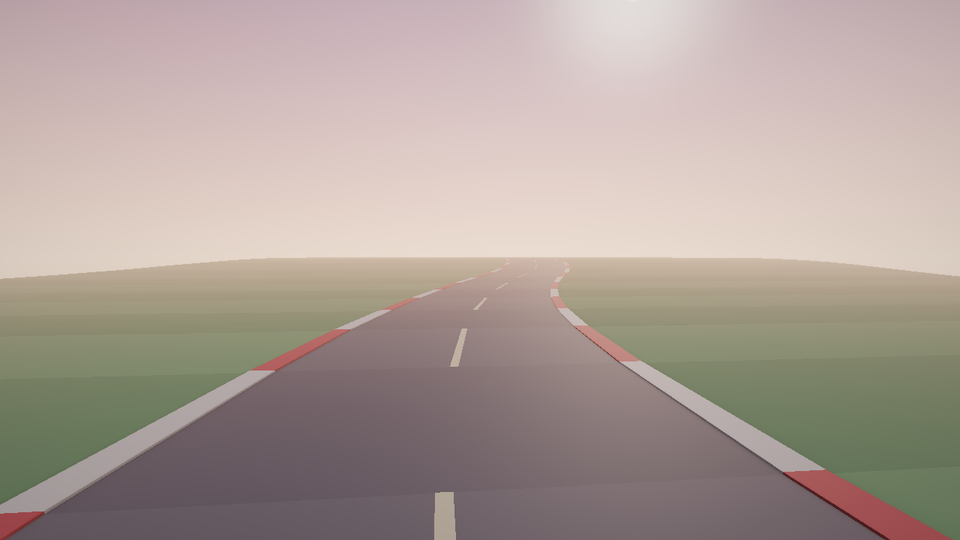
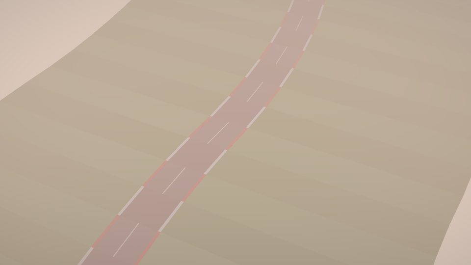
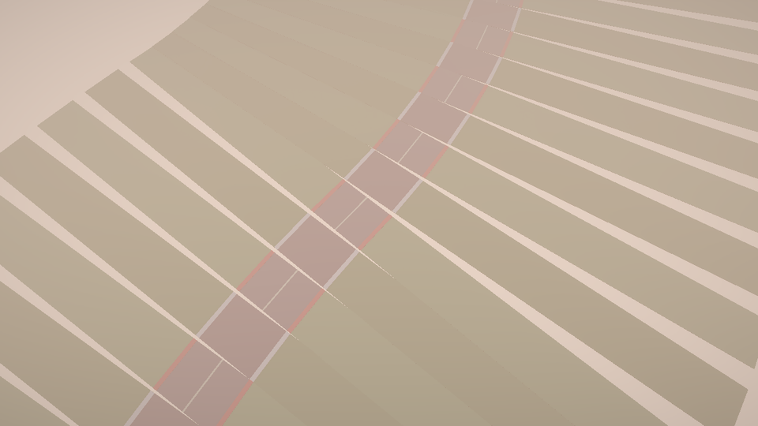

# Scenes

A scene in Flint is a TOML file that describes a collection of entities and their data. Scenes are the primary unit of content --- they're what you load, save, query, validate, and render.

## File Format

Scene files use the `.scene.toml` extension and have two sections:

```toml
# Metadata
[scene]
name = "The Rusty Flint Tavern"
version = "1.0"
description = "A showcase scene demonstrating Flint engine capabilities"

# Entity definitions
[entities.main_hall]
archetype = "room"
# ...
```

### The `[scene]` Table

| Field | Required | Description |
|-------|----------|-------------|
| `name` | yes | Human-readable scene name |
| `version` | yes | Format version (currently "1.0") |
| `description` | no | Optional description |
| `input_config` | no | Path of an input config file for this scene, from the scene's directory or any directory above it up to the project root (see [Input System](physics-and-runtime.md#input-system)) |
| `preload_audio` | no | Default `true`. When `false`, the player skips the blanket preload of every file under `audio/` at scene load, so a scene with a large audio folder starts instantly. Sounds named by `audio_source` components and music-session stems still load through their own paths; only the convenience preload for script-triggered sounds is skipped (ADR 0066, scene audio preload opt-out). See [Audio](audio.md#preloading). |

### The `[entities.*]` Tables

Each entity is a table under `[entities]`, keyed by its unique name:

```toml
[entities.front_door]
archetype = "door"
parent = "main_hall"

[entities.front_door.transform]
position = [0, 0, 5]

[entities.front_door.door]
style = "hinged"
locked = false
open_angle = 90.0
```

**Top-level fields:**
- `archetype` --- the archetype schema name (optional but recommended)
- `parent` --- name of the parent entity (optional)

**Component tables** are nested under the entity. Each component name (e.g., `transform`, `door`, `bounds`) corresponds to a schema in `schemas/components/`.

### Transforms

An entity's `transform` places it in its parent's frame (or the world's):

```toml
[entities.tile.transform]
position = [0, 0, -12]            # metres
rotation = [0, 30, 0]             # Euler degrees (pitch, yaw, roll)
rotation_quat = [0, 0.26, 0, 0.97] # optional [x, y, z, w]; wins over rotation
scale = [1, 1, 1]
shear = { xz = 0.25 }             # optional, see below
```

The matrix is `translate × rotate × shear × scale`: a point is scaled,
then sheared, then rotated, then moved. A child's world matrix is its
parent's times its own, so a child inherits a parent's shear as it does
its scale.

**Shear** (#625) is a table of up to six terms, `xy`, `xz`, `yx`, `yz`,
`zx`, `zy`, where `ab` is how far `a` moves per unit of `b`:

```text
x' = x + xy·y + xz·z
y' = y + yx·x + yz·z
z' = z + zx·x + zy·y
```

A missing term is 0, and an entity without `shear` draws exactly as it did
before shear existed. Shear is what a strip of ground needs to follow a
curve without turning: `{ xz = s }` slides its far end sideways by `s`
metres per metre while its near and far edges stay square to the road, so
neighbouring strips meet edge to edge however wide they are. Turning
(yawing) each strip instead swings its far corners through its
neighbours. `examples/shear_road.scene.toml` is a scanline road of 22 such
tiles, each one entity with `{ xz, yz }` for the bend and the hill, and
`examples/shear_road_yawed.scene.toml` is the same road laid with yaw:



| Sheared (one entity a tile) | Yawed (the old way) |
|---|---|
|  |  |

Normals go through the inverse transpose of the full matrix, so a sheared
surface is lit as the surface it became, and culling bounds are the
sheared box's. Scripts set it with `set_shear(id, #{xz: 0.25})`, read it
with `get_shear(id)` and remove it with `clear_shear(id)`
(`scripts/shear_road.rhai` re-lays the demo road every frame that way).
Physics has no sheared bodies: a sheared rigidbody or collider warns once
and is placed by the matrix's rotation alone, as non-unit scale is.
Loading warns on an unknown term (`xzz`) and on a shear that folds space
flat (`xy = yx = 1`).

## Scene Operations

### Creating a Scene

```bash
flint scene create levels/tavern.scene.toml --name "The Tavern"
```

### Listing Scenes

```bash
flint scene list
```

### Getting Scene Info

```bash
flint scene info levels/tavern.scene.toml
```

### Loading and Saving

The `flint-scene` crate handles serialization. Scenes are loaded into the ECS world as entities with dynamic components, and saved back to TOML with stable ordering.

When a scene is loaded:
1. The TOML is parsed into a scene structure. A file that is not TOML is an error that names the file as well as the line
2. Each entity definition creates an ECS entity with a stable `EntityId`
3. If the entity names an archetype, the archetype's `defaults` are written in first for every component the entity did not author itself
4. Every entity is checked against the schemas in one pass: its archetype, each component and each field (see [Scene Diagnostics](schemas.md#scene-diagnostics)). Nothing found here stops the load: the loader logs one summary line and the first five problems through `tracing`, as warnings, and keeps going. An unknown archetype gives the entity no defaults. A scene that loads is not necessarily a scene that validates: `flint validate` prints the whole list and fails on an error.
5. The authored data is merged field-by-field into whatever the archetype put there (see [Schemas](schemas.md))
6. For every component the entity explicitly lists, any field that has a `default` in its component schema and is still unset is filled in. Defaults are applied only to components the entity wrote a table for, not to archetype-required components it left out entirely. Step 4 knows about them: a `required` field that an archetype default or the field's own `default` will fill is not reported as missing.
7. Parent-child relationships are established
8. The entity ID counter is adjusted to be above any existing ID (preventing collisions on subsequent creates)

Step 6 is why scripts can read `get_field(id, "item", "enabled")` and get a bool rather than `()` even when the scene author never wrote the field.

When a scene is saved:
1. All entities are serialized to their TOML representation
2. Component data is written as nested tables
3. Parent references use entity names (not internal IDs)

## Reload Behavior

Scene reload is a full re-parse. When `flint edit --watch` detects a file change:

1. The entire scene file is re-read and re-parsed
2. The old world state is replaced with the new one
3. The renderer picks up the new state on the next frame

This approach is simple and correct --- there's no incremental diffing that could get out of sync. For the scene sizes Flint targets, re-parsing is fast enough.

## Scene as Source of Truth

A key design decision: **the scene file is the source of truth**, not the in-memory state. This means:

- You can edit the file with any text editor
- AI agents can write TOML directly
- Git diffs show exactly what changed
- No hidden state lives only in memory

The CLI commands (`entity create`, `entity delete`) modify the scene file, and the in-memory world loads from that file. The viewer watches the file, not the internal state.

## Example: The Showcase Scene

The demo scene `examples/showcase.scene.toml` demonstrates the full format:

```toml
[scene]
name = "The Rusty Flint Tavern"
version = "1.0"
description = "A showcase scene demonstrating Flint engine capabilities"

# Rooms - rendered as blue wireframe boxes
[entities.main_hall]
archetype = "room"

[entities.main_hall.transform]
position = [0, 0, 0]

[entities.main_hall.bounds]
min = [-7, 0, -5]
max = [7, 4, 5]

# Doors - rendered as orange boxes
[entities.front_entrance]
archetype = "door"
parent = "main_hall"

[entities.front_entrance.transform]
position = [0, 0, 5]

[entities.front_entrance.door]
style = "hinged"
locked = false
open_angle = 90.0

# Furniture - rendered as green boxes
[entities.bar_counter]
archetype = "furniture"
parent = "main_hall"

[entities.bar_counter.transform]
position = [-4, 0, 0]

[entities.bar_counter.bounds]
min = [-1.5, 0, -3]
max = [0, 1.2, 3]

# Characters - rendered as yellow boxes
[entities.bartender]
archetype = "character"
parent = "main_hall"

[entities.bartender.transform]
position = [-5, 0, 0]
```

This scene defines 4 rooms, 4 doors, 9 pieces of furniture, and 6 characters --- all in readable, diffable TOML.

## Prefabs

Prefabs are reusable entity group templates that reduce scene file duplication. A prefab defines a set of entities in a `.prefab.toml` file, and scenes instantiate them with variable substitution and optional overrides.

### Defining a Prefab

Prefab files live in a `prefabs/` folder, beside the scene or beside any directory above it up to the project root (the nearest of a name wins; [where the engine looks](assets.md#where-the-engine-looks-for-a-file)), and follow the same entity format as scenes, with a `[prefab]` metadata header. A template that isn't found fails the load with every path tried.

```toml
[prefab]
name = "kart"
description = "Racing kart with body, wheels, and driver"

[entities.kart]

[entities.kart.transform]
position = [0, 0, 0]

[entities.kart.model]
asset = "kart_body"

[entities.wheel_fl]
parent = "${PREFIX}_kart"

[entities.wheel_fl.transform]
position = [-0.4, 0.15, 0.55]

[entities.wheel_fl.model]
asset = "kart_wheel"
```

All string values containing `${PREFIX}` are substituted with the instance prefix at load time. Entity names are automatically prefixed (e.g., `kart` becomes `player_kart` when the prefix is `"player"`).

### Using Prefabs in a Scene

Scenes reference prefabs in a `[prefabs]` section:

```toml
[prefabs.player]
template = "kart"
prefix = "player"

[prefabs.player.overrides.kart.transform]
position = [0, 0, 0]

[prefabs.ai1]
template = "kart"
prefix = "ai1"

[prefabs.ai1.overrides.kart.transform]
position = [3, 0, -5]
```

Each prefab instance specifies:
- **`template`** --- the prefab name (matches the `.prefab.toml` filename without extension)
- **`prefix`** --- substituted for `${PREFIX}` in all string values and prepended to entity names
- **`overrides`** --- per-entity component field overrides (deep-merged with the template)

### Override Deep Merge

Overrides are merged at the field level, not the component level. If a prefab template defines a component with five fields and an override specifies one field, only that one field is replaced --- the other four are preserved from the template.

### Path Resolution

The loader finds a prefab template by [the engine's one search](assets.md#where-the-engine-looks-for-a-file) (kind `prefabs`): `prefabs/` beside the scene, then beside each directory above it up to the project root, then the engine's. A `prefabs/` directory at the project root is found from a scene at any depth.

### Previewing Prefabs

Use the CLI to visually inspect a prefab template:

```bash
flint prefab view prefabs/kart.prefab.toml --schemas schemas
```

## Splines

Splines define smooth paths through 3D space using Catmull-Rom interpolation. They're used for track layouts, camera paths, and procedural geometry generation.

### Spline Component

Attach a spline to an entity with the `spline` component:

```toml
[entities.track_path]

[entities.track_path.spline]
file = "oval_plus.spline.toml"
```

`file` is found like any file a scene names: beside the scene, then beside each folder up to the project root. The engine loads the `.spline.toml` file, samples it into a dense point array stored as the `spline_data` ECS component, and makes it available for script queries via the [Spline API](scripting.md#spline-api).

### Spline Meshes

The `spline_mesh` component generates geometry by sweeping a rectangular cross-section along a spline:

```toml
[entities.road_surface]

[entities.road_surface.spline_mesh]
spline = "track_path"        # the entity with the `spline`
width = 12.0
height = 0.3
offset = [0.0, -0.15]        # [right, up] from the path, in metres
color = [0.3, 0.3, 0.3, 1.0]
roughness = 0.8
texture = "textures/asphalt.png"
texture_length = 6.0         # metres of road per texture repeat
```

One spline can feed multiple mesh entities (road surface, walls, guardrails) with different cross-section dimensions and colours. The mesh's look is the component's own fields (`color`, `stripe_color`, `metallic`, `roughness`, `texture`, `normal_texture`), and it comes with a triangle-mesh collider unless `collider = false`. `chunk_size` splits a long sweep into child entities. `flint schema spline_mesh` lists every field with its fallback; `spline`, `width` and `height` are required. The mesh is built in world space, so leave the entity's transform at the origin.

## Further Reading

- [Your First Scene](../getting-started/first-scene.md) --- hands-on guide to building a scene
- [Entities and ECS](entities-and-ecs.md) --- how scene entities map to the ECS
- [Schemas](schemas.md) --- how component structure is defined
- [Constraints](constraints.md) --- how to validate scenes
- [File Formats](../formats/overview.md) --- prefab and spline file format details
