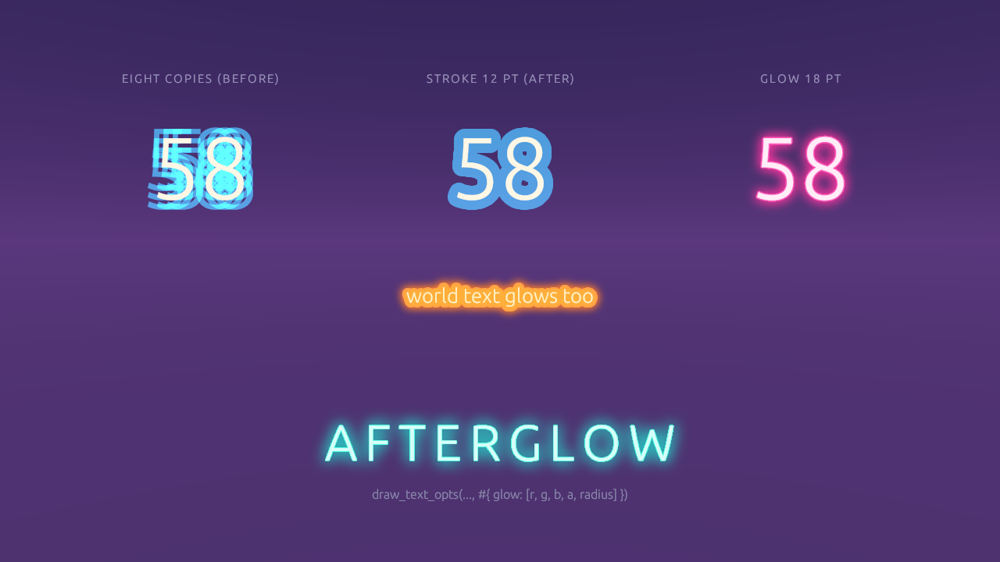

# Scripting

Flint's scripting system provides runtime game logic through [Rhai](https://rhai.rs/), a lightweight embedded scripting language. Scripts can read and write entity data, respond to game events, control animation and audio, and hot-reload while the game is running.

## Overview

The `flint-script` crate integrates Rhai into the game loop:

- **ScriptEngine** --- compiles and runs `.rhai` scripts, manages per-entity state (scope, AST, callbacks)
- **ScriptSync** --- discovers entities with `script` components, handles hot-reload by watching file timestamps
- **ScriptSystem** --- implements `RuntimeSystem`: the player calls its `update()` once a frame (variable-rate)

Scripts run each frame during the `update()` phase, after physics and before rendering. This gives them access to the latest physics state while allowing their output to affect the current frame's visuals.

## Script Component

Attach a script to any entity with the `script` component:

```toml
[entities.my_door]
archetype = "door"

[entities.my_door.script]
source = "door_interact.rhai"
enabled = true
```

| Field | Type | Default | Description |
|-------|------|---------|-------------|
| `source` | string | `""` | The `.rhai` file, by its name in a `scripts/` folder (`hud.rhai`, `ui/menu.rhai`) |
| `enabled` | bool | `true` | Whether the script is active |

Script files live in a `scripts/` folder: beside the scene, beside any directory above it up to the project root, or in the engine's (`engine/scripts/`). Each script is looked for in that order and the nearest file of its name wins ([where the engine looks](assets.md#where-the-engine-looks-for-a-file)), so a scene can keep a script of its own beside it and still use the project's. A `source` that isn't found is warned about with every path tried, and `flint asset where scripts hud.rhai --scene <scene>` prints the file chosen.

## Event Callbacks

Scripts define behavior through callback functions. The engine detects which callbacks are defined in each script's AST and only calls those that exist:

<!-- script-api:begin callbacks -->
<!-- Generated by `flint script api --book` from the engine's declarations (crates/flint-script/src/api/, or the ScriptModule of a feature that owns its module): edit the doc there, not here. CI's headless job runs --check-book. -->

| Callback | When it runs |
|---|---|
| `fn on_init()` | Once, when the script is first loaded. |
| `fn on_update()` | Every frame the game isn't paused; `delta_time()` is the frame's step. |
| `fn on_draw_ui()` | Every frame after `on_update`, paused or not: the HUD's draw calls. |
| `fn on_collision(other_id)` | This entity collided with another. |
| `fn on_collision_exit(other_id)` | A contact with another entity ended. |
| `fn on_trigger_enter(other_id)` | Another entity entered this trigger volume. |
| `fn on_trigger_exit(other_id)` | Another entity left this trigger volume. |
| `fn on_action(action_name)` | An input action fired ("jump", "interact"). |
| `fn on_interact()` | The player pressed Interact within this entity's interactable range. |
| `fn on_scene_exit()` | The scene is about to be left. |
| `fn on_scene_enter()` | A scene was entered. |
| `fn on_animation_end(clip)` | A once sprite clip finished. |
| `fn on_sequence_cue(sequence, cue)` | An animation sequence passed a cue event. |
| `fn on_event(name, data)` | A game event fired by a script, the engine or a player extension. |
| `fn on_expression(state)` | A new state arrived from outside the process (a timeline or a socket). |
| `fn on_persist_migrate(from)` | Save data loaded at a version below `save_version`; runs before `on_init`. |

<!-- script-api:end -->

More on some of them: `on_scene_enter` and `on_scene_exit` in [Scene Transition API](#scene-transition-api), `on_sequence_cue` in [Animation](animation.md#sequences), `on_animation_end` in [2D Sprites](sprites-2d.md), `on_event` in [Event API](#event-api), `on_expression` in [Expression API](#expression-api) and `on_persist_migrate` in [Versions and migration](#versions-and-migration).

The `on_interact` callback is sugar for the common pattern of proximity-based interaction. It automatically checks the entity's `interactable` component for `range` (default 3.0) and `enabled` (default true) before firing.

## API Reference

All functions are available globally in every script. Entity IDs are passed as `i64` (Rhai's native integer type).

The engine lists its own API: `flint script api` prints every function with its parameters, and `--json` gives the same as data (`--filter draw` narrows it). Every function is declared through the engine's API builder ([ADR 0116](https://github.com/chrischaps/Flint/blob/main/docs/adr/0116-declared-script-api.md)), so each comes with its module, parameter names, what each accepts and a one-line doc. The listing has an `undeclared` part only for a game binary whose extension registers functions on the Rhai engine directly (see [Player Extensions](../guides/player-extensions.md)): those are listed with their Rust parameter types. A wrong argument to a declared function is a script error that names the function, the parameter and what it wanted, with the line: ``set_position: argument `x` must be a number (an int or a float), not string (line 12, position 5)``. The listing opens with the rules every declared function keeps (`conventions`): what a number parameter accepts, and what a function does with an entity that isn't there or a query that finds nothing.

The function tables on this page, and the whole [Script API Reference](../reference/script-api.md) (every module, the conventions and the callbacks on one page), are written from those same declarations by `flint script api --book`. CI fails a pull request whose book has fallen behind them, or whose pages call a function the engine doesn't have. A table here shows a function's parameters with their kinds and what it returns; the notes under a table add what a one-line description can't.

In every function a number takes an integer as well as a float (`set_position(id, 0, 1, 0)`, `set_camera_fov(60)`, `sin(1)`, `draw_rect(10, 10, 100, 50, 1, 1, 1, 1)`, `set_wooze(knobs, 2)`), and an integer parameter, such as a layer index, a mouse button or a particle count, takes a float with nothing after the point (`is_mouse_pressed(0.0)`, `draw_ring(.., 2.0)`, `emit_burst(id, 3.0)`).

A call whose numbers are all floats, or (for a function with four or more numbers, such as the draw calls) all ints, is found at once. A call that mixes ints and floats among its numbers, `draw_text(10, 20, "hp", 16, 1.0, 1.0, 1.0, 1.0)`, works too, but Rhai finds the function by trying the combinations of its argument types, which costs about 4 µs a call for eight numbers when nothing in the callback has been called before the loop it is in (Rhai remembers the answer for the rest of a callback once it has one). In a loop that draws hundreds of things a frame, write the numbers all one way.

### Names and opts maps

The API's names follow one set of rules (#702), stated with the others at the top of the [Script API Reference](../reference/script-api.md#conventions):

- **Verb first**, then what it acts on: `play_sprite`, `set_sprite_speed`, `shake_camera`, `stop_camera_shake`, as `play_clip` and `play_sound` always were.
- **`get_` and `set_` with the same noun** for a value a script can change: `set_lod_scale` / `get_lod_scale`, `set_camera_follow_position` / `get_camera_follow_position`, `get_current_scene`. A yes-or-no question starts `is_` or `has_` (`is_sprite_playing`). What no script sets is named for what it returns: this frame's input, the clocks and the screen (`mouse_x()`, `touch_x(id)`, `delta_time()`, `screen_width()`) and calculations (`distance`, `raycast`, `measure_text`).
- **A family one module owns keeps its prefix** before the verb: `persist_*`, `ui_*`, `spline_*`, `conducted_*`.
- **One name a function.** No aliases (`self_entity`, not `this_entity`; `log`, not `log_info`) and no `_ex` variants: the draw calls' extras moved into an opts map. Two names that look alike are two functions: `set_visible` hides an entity and everything under it, `set_sprite_visible` only its sprite; `draw_line_3d` is a HUD line through world points, over everything, and `draw_world_line` is drawn in the 3D frame, behind what is nearer.

A renamed function keeps its old name for one release. The old name does exactly what the new one does, `flint script api` lists it as deprecated with the name to use, and `flint script check` warns at every call:

```text
touch_demo.rhai:61:5: warning[deprecated-function]: `draw_line_ex` is deprecated
    hint: use draw_line(x1, y1, x2, y2, #{color, thickness, layer})
```

Every draw primitive has two forms under one name. One takes what places it (a position and a size, two points, a centre and a radius) and its colour as four numbers; the other takes what places it and an **opts map** with everything else, every key optional:

```rhai
draw_rect(20.0, 20.0, 200.0, 40.0, 0.05, 0.05, 0.07, 0.6);                        // colour only
draw_rect(20.0, 20.0, 200.0, 40.0, #{ color: "#0d0d12", rounding: 10.0, layer: -1 }); // everything else
draw_text(28.0, 30.0, "SCORE", 16.0, #{ color: [1.0, 0.82, 0.55], layer: 1 });
```

In a map a colour is `[r, g, b]`, `[r, g, b, a]` (0..1) or `"#rrggbb(aa)"`, white when left out; `layer` orders draws (higher on top, 0); `thickness` is in points (1). Each function's description in the tables below lists its keys. A key the function doesn't take (`colour`), or a value of the wrong shape, is ignored with a warning once per function and key, and the draw goes ahead without it.

A map costs a call about 0.15 to 0.22 µs more than four colour numbers: building it, then reading it (measured in `docs/design/script-api-overhead.md`: `draw_rect` 315 ns positional, 534 ns with a three-key map, 404 ns when the colour is a hex string rather than an array). A HUD of a few dozen draws doesn't notice. A loop of hundreds of draws a frame that needs only a colour should keep the positional form; one that needs a layer or a rounding pays the map, about 0.2 ms for a thousand calls. A map held in a variable costs the same as a literal, since Rhai copies it into each call.

### Entity API

<!-- script-api:begin self_entity get_entity entity_exists entity_name has_component get_component get_field set_field get_position set_position get_rotation set_rotation get_rotation_quat set_rotation_quat get_scale set_scale set_visible is_visible rotate_local set_shear get_shear clear_shear distance set_parent get_parent get_children get_world_position set_material_color set_material_override set_material_emissive clear_material_override find_entities_with entity_count_with spawn_entity despawn_entity -->
<!-- Generated by `flint script api --book` from the engine's declarations (crates/flint-script/src/api/, or the ScriptModule of a feature that owns its module): edit the doc there, not here. CI's headless job runs --check-book. -->

| Function | Returns | Description |
|---|---|---|
| `self_entity()` | `entity`: its id | The entity this script is on. |
| `get_entity(name: str)` | `entity`: its id, or -1 when no entity has that name | The entity with this name. |
| `entity_exists(id: entity?)` | `bool`: false for -1 or a despawned id | Whether the id names a live entity; never warns. |
| `entity_name(id: entity)` | `str`: its name, or "" when it has none | The entity's name. |
| `has_component(id: entity, component: str)` | `bool` | Whether the entity has a component of this name. |
| `get_component(id: entity, component: str)` | `map`: its fields, or () when the entity hasn't it | The whole component as a map. |
| `get_field(id: entity, component: str, field: str)` | `any`: its value, or () when it isn't there | One field of a component. |
| `set_field(id: entity, component: str, field: str, value: any)` | — | Set one field of a component, making the component if it isn't there. |
| `get_position(id: entity)` | `map`: `#{x, y, z}`; empty when it has no transform | The entity's position in its parent's space. |
| `set_position(id: entity, x: num, y: num, z: num)` | — | Move the entity to a position in its parent's space. |
| `get_rotation(id: entity)` | `map`: `#{x, y, z}`; empty when it has no transform | The entity's Euler rotation, degrees. |
| `set_rotation(id: entity, x: num, y: num, z: num)` | — | Set the entity's Euler rotation in degrees, dropping any quaternion. |
| `get_rotation_quat(id: entity)` | `map`: `#{x, y, z, w}`: `rotation_quat`, else the Euler angles converted; empty when it has no transform | The rotation the entity renders with, as a quaternion. |
| `set_rotation_quat(id: entity, x: num, y: num, z: num, w: num)` | — | Set the entity's rotation as a quaternion (normalised); zeroes the Euler rotation. |
| `get_scale(id: entity)` | `map`: `#{x, y, z}`, 1s when unset; empty when it has no transform | The entity's scale. |
| `set_scale(id: entity, x: num, y: num, z: num)` | — | Set the entity's scale on each axis. |
| `set_visible(id: entity, visible: bool)` | — | Show or hide the entity and its descendants; hidden ones still simulate. |
| `is_visible(id: entity)` | `bool`: true when unset | The entity's own visibility switch (a hidden ancestor isn't counted). |
| `rotate_local(id: entity, x_deg: num, y_deg: num, z_deg: num)` | — | Turn the entity about its own axes by these degrees, onto its current orientation. |
| `set_shear(id: entity, shear: map)` | — | Shear the entity: any of `#{xy, xz, yx, yz, zx, zy}`, ab moving a per unit of b. |
| `get_shear(id: entity)` | `map`: `#{xy, xz, yx, yz, zx, zy}`; zeros when it has none | The entity's shear, all six terms. |
| `clear_shear(id: entity)` | — | Remove the entity's shear: back to rotation and scale. |
| `distance(a: entity, b: entity)` | `num`: metres; f64::MAX when either has no transform | The distance between two entities' positions. |
| `set_parent(child: entity, parent: entity)` | — | Make one entity the child of another. |
| `get_parent(id: entity)` | `entity`: its id, or -1 when it has none | The entity's parent. |
| `get_children(id: entity)` | `array`: their ids | The entity's children. |
| `get_world_position(id: entity)` | `map`: `#{x, y, z}`; empty when it has no transform | The entity's position in the world, through its parents. |
| `set_material_color(id: entity, r: num, g: num, b: num, a: num)` | — | Set the entity's material base colour. |
| `set_material_override(id: entity, material: str, r: num, g: num, b: num, a: num)` | — | Tint one named glTF material on the entity and its descendants. |
| `set_material_emissive(id: entity, material: str, r: num, g: num, b: num)` | — | Recolour one named glTF material's emission (linear RGB) on the entity and its descendants. |
| `set_material_emissive(id: entity, material: str, r: num, g: num, b: num, strength: num)` | — | Recolour one named glTF material's emission and set its strength. |
| `clear_material_override(id: entity, material: str)` | — | Drop the entity's own override of one material, colour and light alike. |
| `find_entities_with(component: str)` | `array`: their ids | Every entity that has a component of this name. |
| `entity_count_with(component: str)` | `int` | How many entities have a component of this name. |
| `spawn_entity(name: str)` | `entity`: its id, or -1 when the name is taken | Make an entity with this name, with no components. |
| `despawn_entity(id: entity)` | — | Remove the entity (and its children's link to it). |

<!-- script-api:end -->

- `set_visible(id, visible)`: Show or hide an entity and everything under it (writes `visibility.visible`; see [Hiding entities](#hiding-entities))
- `set_shear(id, map)`: Set `transform.shear` from any of `#{xy, xz, yx, yz, zx, zy}` (`ab` = how far `a` moves per unit of `b`, between rotation and scale); missing terms are 0, all zeros removes it (#625; [Transforms](scenes.md#transforms))
- `set_material_override(id, material, r, g, b, a)`: Replace one named glTF material's base colour on this entity and all its expanded child nodes (writes `material_overrides.<material>`; colours above 1 are allowed, see [Colours above 1](#colours-above-1))
- `set_material_emissive(id, material, r, g, b[, strength])`: Recolour one named glTF material's glow (linear RGB; `strength` replaces its `emissive_strength`) on this entity and its expanded child nodes; works on a material with no emission of its own. See [Recolouring an imported model's glow](rendering.md#recolouring-an-imported-models-glow)

Every number in the Entity API takes an integer as well as a float: `set_position(id, 0, 1, 0)` works, and so does an id written `3.0`.

Any other transform field goes through `set_field`, e.g. `set_field(id, "transform", "scale", [2.0, 1.0, 2.0])`; `set_position`, `set_rotation` and `set_scale` are that with the numbers checked for you.

A function given an entity that isn't there does nothing, and says so once. `get_entity` returns `-1` for a name it can't find (an entity a scene builder hasn't made yet, say), and every function with an entity parameter (the Entity API, `play_clip` and the rest of the Animation API, `audio_position`, `set_velocity_2d`, `get_velocity_2d`, `move_character`, `get_collider_extents`, `camera_follow`, the Sprite API, the screen-UI setters `set_text`, `set_text_color`, `ui_set_value`, `set_anchor` and `set_anchor_offset`, the particle emitter calls, the Style API's entity functions and the Spline API) given it, or a despawned id, logs a warning the first time for each script and function: `seeded_stars.rhai: line 17: set_position(-1, ...) did nothing: there is no entity -1 (-1 is what get_entity returns for a name it can't find)`. A setter that queues work for the engine, like `set_velocity_2d`, `emit_burst` or `set_entity_style`, queues nothing. A getter returns its empty value as well (`#{}`, `()`, `""`, `false`, `0`; `get_parent` gives `-1`, `audio_position` `-1.0` and `distance` the largest float), and warns too. `entity_exists(id)` never warns: test with it where a missing entity is expected.

#### Hiding entities

`set_visible(id, false)` writes a `visibility { visible = false }` component, which a scene can also author:

```toml
[entities.spare_tile.visibility]
visible = false
```

A hidden entity and all its descendants are left out of every draw: the scene pass, shadows, the style mask, the entity's lights and the ray targets `raycast_meshes` / `screen_to_mesh` meet (physics `raycast()` still meets its collider). It isn't culled, it is never extracted, so it costs nothing per frame and doesn't depend on being out of view. It still exists in every other way: its transform, physics body, collider and script go on, and particles it emits still draw (`stop_effect` those). `set_visible(id, true)` shows it again; showing an entity that was never hidden adds no component, and a scene where nothing is hidden pays nothing for the switch. A hidden parent hides a visible child, and `is_visible` reads only the entity's own switch.

That is the call for a pool of reused entities: hide the ones not in use rather than parking them far away.

```rhai
for i in 0..TILE_POOL {
    let id = tiles[i];
    if i < tiles_in_use {
        set_position(id, 0.0, 0.0, i * TILE_LEN - scroll);
        set_visible(id, true);
    } else {
        set_visible(id, false);   // unchanged calls write nothing
    }
}
```

#### Colours above 1

`set_material_override` (and `set_material_color`) take linear colours that are not clamped. With post-processing on, the frame is HDR, and a base colour above 1 reflects more light than it receives: the surface reads brighter than any real paint, and past the bloom threshold it glows. That is supported and useful for neon, signage and flashes. It still scales *reflected* light, so it does nothing in the dark; for a surface that gives light, use `emissive_scale` or emissive vertex colours. Alpha is opacity and stays 0–1.

#### Script state

Every script runs once at load: its top-level statements, including `let`s, fill a scope that belongs to that entity and lasts as long as the script does (and across a [hot reload](#hot-reload)). Every callback (`on_init`, `on_update`, `on_collision`, ...) runs inside that scope, so it reads and writes those variables directly, and what it writes is still there next frame.

A helper function you write yourself does **not** see them. A Rhai `fn` is pure: it sees its arguments and nothing else, and reading `frames` inside one is an error ("Variable not found"), even when a callback calls it. This shapes how a longer script is written:

```rhai
let frames = 0;
let tiles = [];

fn on_update() {
    frames += 1;              // top-level state: read, written, kept
    tiles.add_tile(frames);   // method call: the helper gets `tiles` as `this`
    copy_add(tiles, 99);      // plain call: the helper gets a copy
}

fn add_tile(x) { this.push(x); }   // changes the caller's array
fn copy_add(arr, x) { arr.push(x); } // changes a copy; `tiles` is untouched
fn peek() { frames }                 // error: no `frames` in here
```

So there are three ways to share state with a helper: pass values in and return the result (`let speed = clamp_speed(speed, dt);`), which is fine for numbers but copies an array or map each call; call the helper as a method on the one array or map it changes, which hands it over by reference as `this`; or keep the work in the callback itself. Constants that never change can simply be repeated as `const`s. `crates/flint-script/src/engine.rs`'s `test_top_level_state_reaches_callbacks_not_helpers` holds all of this.

### Input API

<!-- script-api:begin is_action_pressed is_action_just_pressed is_action_just_released action_value mouse_delta_x mouse_delta_y mouse_wheel_x mouse_wheel_y mouse_x mouse_y is_mouse_pressed is_mouse_just_pressed -->
<!-- Generated by `flint script api --book` from the engine's declarations (crates/flint-script/src/api/, or the ScriptModule of a feature that owns its module): edit the doc there, not here. CI's headless job runs --check-book. -->

| Function | Returns | Description |
|---|---|---|
| `is_action_pressed(action: str)` | `bool`: false for an action nothing binds | Whether the action is held. |
| `is_action_just_pressed(action: str)` | `bool` | Whether the action was pressed this frame. |
| `is_action_just_released(action: str)` | `bool` | Whether the action was released this frame. |
| `action_value(action: str)` | `num`: 0.0 when nothing binds it | The analog value of an axis action. |
| `mouse_delta_x()` | `num` | Horizontal mouse movement this frame. |
| `mouse_delta_y()` | `num` | Vertical mouse movement this frame. |
| `mouse_wheel_x()` | `num` | Horizontal wheel lines this frame, right positive; zero over egui. |
| `mouse_wheel_y()` | `num` | Vertical wheel lines (notches) this frame, up positive; zero over egui. |
| `mouse_x()` | `num` | The cursor's x in logical points (the `screen_width()` and draw_\* space). |
| `mouse_y()` | `num` | The cursor's y in logical points (the `screen_height()` and draw_\* space). |
| `is_mouse_pressed(button: int)` | `bool` | Whether a mouse button is held: 0 left, 1 right, 2 middle. |
| `is_mouse_just_pressed(button: int)` | `bool` | Whether a mouse button went down this frame: 0 left, 1 right, 2 middle. |

<!-- script-api:end -->

- `mouse_wheel_x()` / `mouse_wheel_y()`: Wheel lines (notches) this frame; up and right are positive. A touchpad's scroll arrives as fractions, 50 px to a line. Zero while the cursor is over egui

`mouse_x()` / `mouse_y()` and the button queries are what menus and other screen-space UI hit-test against. The buttons are always fed, whether or not the cursor is captured. While it's captured, `mouse_x()` / `mouse_y()` read the window centre, and clicks skip egui ([Cursor Capture and Input Gates](input-gates.md)). In scenes with a player character the first left click also captures the cursor for mouse-look (it still registers as a press).

Action names are defined by input configuration files and are fully customizable per game. The built-in defaults include: `move_forward`, `move_backward`, `move_left`, `move_right`, `jump`, `interact`, `sprint`, `weapon_1`, `weapon_2`, `reload`, `fire`. Games can define arbitrary custom actions in their input config TOML files and query them from scripts with `is_action_pressed("custom_action")`.

Input bindings support keyboard, mouse, and gamepad devices. See [Physics and Runtime: Input System](physics-and-runtime.md#input-system) for the config file format and layered loading model.

### Time API

<!-- script-api:begin module:time -->
<!-- Generated by `flint script api --book` from the engine's declarations (crates/flint-script/src/api/, or the ScriptModule of a feature that owns its module): edit the doc there, not here. CI's headless job runs --check-book. -->

| Function | Returns | Description |
|---|---|---|
| `delta_time()` | `num` | Seconds of game time since the last frame (the time scale applied). |
| `total_time()` | `num` | Seconds of game time since the scene started. |
| `set_time_scale(scale: num)` | — | Game seconds per real second from the next frame (1 normal, 0.25 slow motion), clamped to 0.05..4; a scene load resets it. |

<!-- script-api:end -->

### Audio API

Audio functions produce deferred commands that the player processes after the script update phase:

<!-- script-api:begin play_sound play_sound_at stop_sound audio_position audio_output_latency -->
<!-- Generated by `flint script api --book` from the engine's declarations (crates/flint-script/src/api/, or the ScriptModule of a feature that owns its module): edit the doc there, not here. CI's headless job runs --check-book. -->

| Function | Returns | Description |
|---|---|---|
| `play_sound(name: str)` | — | Play a sound at full volume, not placed in the world. |
| `play_sound(name: str, volume: num)` | — | Play a sound at a volume (0..1), not placed in the world. |
| `play_sound(name: str, volume: num, pitch: num)` | — | Play a sound at a volume and a pitch multiplier, not placed in the world. |
| `play_sound_at(name: str, x: num, y: num, z: num, volume_or_opts: any)` | — | Play a sound at a point: a volume, or a map of any of volume, pitch, `min_distance`, `max_distance`, rolloff. |
| `play_sound_at(name: str, x: num, y: num, z: num, volume: num, pitch: num)` | — | Play a sound at a point, at a volume and a pitch multiplier. |
| `stop_sound(name: str)` | — | Stop a playing sound. |
| `audio_position(id: entity)` | `num`: seconds; -1.0 before it has started, after it ends, and for no entity | Seconds into the sound the entity's `audio_source` plays, wrapped for a loop, on the mixer's clock. |
| `audio_output_latency()` | `num`: seconds; -1.0 where it isn't known (the desktop) | How long after it is mixed a sound is heard, where the platform says (the browser). |

<!-- script-api:end -->

- `audio_position(entity)`: Seconds into the sound the entity's `audio_source` is playing, wrapped for a loop, on the mixer's clock; `-1.0` before it has started and after it ends, and for an entity that isn't there (with a warning, once). See [Keeping time with the music](audio.md#keeping-time-with-the-music)

A sound's name is its file's path from the game root, extension included: the scene preloads `audio/whoosh.ogg` as `"audio/whoosh.ogg"`. The bare stem works too: a name that isn't cached as written tries `audio/<name>`, then `audio/<name>.ogg`, `.wav`, `.flac` and `.mp3`, so these three play the same file:

```rust
play_sound("audio/whoosh.ogg", 0.8);
play_sound("whoosh.ogg", 0.8);
play_sound("whoosh", 0.8);
```

A name cached as written always wins, so a sound an extension loaded as `"blip"` stays `"blip"`, and two files that share a stem (`whoosh.ogg`, `whoosh.wav`) want the full path. A one-shot naming a sound that is not there plays nothing and logs a warning that names the nearest cached sound:

```text
WARN script: play_sound error: AudioError("Sound not cached: whosh (nearest: \"audio/whoosh.ogg\")")
```

Varying `pitch` slightly per trigger (say 0.9–1.1) is the cheapest way to stop a
repeated one-shot sounding like a repeated one-shot.

By default a spatial one-shot fades to silence at 25 m. A sound meant to be
heard further away sets `max_distance` in the options map, and usually a
`rolloff` below 1 so it fades like a sound in the open. See
[Audio: Scripting](audio.md#scripting-integration).

### Animation API

Animation functions write directly to the `animator` component on the target entity. The `AnimationSync` system picks up changes on the next frame:

<!-- script-api:begin module:animation -->
<!-- Generated by `flint script api --book` from the engine's declarations (crates/flint-script/src/api/, or the ScriptModule of a feature that owns its module): edit the doc there, not here. CI's headless job runs --check-book. -->

| Function | Returns | Description |
|---|---|---|
| `play_clip(id: entity, clip: str)` | — | Start playing a named clip on the entity's animator. |
| `stop_clip(id: entity)` | — | Stop the entity's animator. |
| `blend_to(id: entity, clip: str, duration: num)` | — | Crossfade to another clip over a duration in seconds. |
| `set_anim_speed(id: entity, speed: num)` | — | Set the animator's playback speed (1 normal). |
| `set_anim_layer(id: entity, index: int, clip: str, weight: num)` | — | Play a clip on layer \`index\`, additive and unmasked, at a weight. |
| `set_anim_layer(id: entity, index: int, clip: str, weight: num, opts: map)` | — | Play a clip on layer \`index\` at a weight; opts: mode ("additive", the default, or "override"), mask (a root joint; "" unmasked). |
| `set_anim_layer_weight(id: entity, index: int, weight: num)` | — | Set a layer's weight at once, cancelling any fade. |
| `clear_anim_layer(id: entity, index: int)` | — | Deactivate a layer, keeping its slot so the indices stay stable. |
| `fade_anim_layer(id: entity, index: int, weight: num, duration: num)` | — | Ramp a layer's weight over a duration in seconds; `set_anim_layer_weight` cancels it. |
| `play_sequence(id: entity, name: str)` | — | Play a \*.sequence.toml (timed blends, layers, speeds and cues) on the entity's animator. |
| `stop_sequence(id: entity)` | — | Stop the animator's sequence. |

<!-- script-api:end -->

- `set_field(id, "ik_two_bone", "target", name)`: Arm two-bone IK on a forearm node (also `pole`, `tip`, `weight`); the engine pins the chain every frame ([ADR 0070](https://github.com/chrischaps/Flint/blob/main/docs/adr/0070-two-bone-ik-on-transform-chains.md))

Weights and durations take an int or a float (`0` is the same as `0.0`), and a layer `index` takes a whole float (`1.0`). Given `-1` or a despawned id, each of these warns once and does nothing; a negative `index` does nothing.

### Coordinate System

Flint uses a **Y-up, right-handed** coordinate system:

- **Forward** = `-Z` (into the screen)
- **Right** = `+X`
- **Up** = `+Y`

Euler angles are stored as `(pitch, yaw, roll)` in **degrees**, applied in ZYX order. Positive yaw rotates counter-clockwise when viewed from above (i.e., turns left).

Use the direction helpers (`forward_from_yaw`, `right_from_yaw`) to convert a yaw angle into a world-space direction vector. These encode the coordinate convention so scripts don't need to compute the trig manually.

### Math API

<!-- script-api:begin module:math -->
<!-- Generated by `flint script api --book` from the engine's declarations (crates/flint-script/src/api/, or the ScriptModule of a feature that owns its module): edit the doc there, not here. CI's headless job runs --check-book. -->

| Function | Returns | Description |
|---|---|---|
| `clamp(value: num, min: num, max: num)` | `num` | The value kept within min..max. |
| `lerp(a: num, b: num, t: num)` | `num` | Linear interpolation from a to b by t (0 a, 1 b). |
| `sin(x: num)` | `num` | Sine of radians. |
| `cos(x: num)` | `num` | Cosine of radians. |
| `abs(x: num)` | `num` | Absolute value (an int gives an int back, by Rhai's own abs). |
| `sqrt(x: num)` | `num` | Square root. |
| `floor(x: num)` | `num` | The largest whole number not above x, as a float. |
| `ceil(x: num)` | `num` | The smallest whole number not below x, as a float. |
| `min(a: num, b: num)` | `num` | The smaller of two (two ints give an int back). |
| `max(a: num, b: num)` | `num` | The larger of two (two ints give an int back). |
| `atan2(y: num, x: num)` | `num`: -PI..PI | The angle of (x, y) from the +x axis, radians. |
| `PI()` | `num` | The constant pi, 3.14159... |
| `TAU()` | `num` | The constant tau = 2 pi, 6.28318... |
| `deg_to_rad(degrees: num)` | `num` | Degrees as radians. |
| `rad_to_deg(radians: num)` | `num` | Radians as degrees. |
| `forward_from_yaw(yaw_degrees: num)` | `map`: `#{x, y, z}`, y 0 | The forward direction (-Z at yaw 0) turned by a yaw in degrees about +Y. |
| `right_from_yaw(yaw_degrees: num)` | `map`: `#{x, y, z}`, y 0 | The right direction (+X at yaw 0) turned by a yaw in degrees about +Y. |
| `wrap_angle(degrees: num)` | `num` | Degrees brought into \[0, 360). |
| `random()` | `num`: in \[0, 1) | The next number of the engine's one random sequence, every script's draws in turn. |
| `random_range(min: num, max: num)` | `num`: in \[min, max) | A random number between two, from the same sequence. |
| `seed_random(seed: int)` | — | Restart every script's random sequence at a seed, as --seed does; call it in `on_init`, not at the top. |

<!-- script-api:end -->

- `random()`: Random value in `[0, 1)`, the next of one SplitMix64 sequence every script shares, so two calls never repeat. It starts from the clock once, when the player starts; under `flint render --scripts`, and in a player run with `--frame-step` or `--seed N`, from a seed, so it's the same every run
- `seed_random(n)`: Restart the sequence at `n` (an `i64`; a negative one is the `u64` with its bits, so `seed_random(-1)` is `--seed 18446744073709551615`). The numbers after it are the ones `--seed n` gives, every run. Call it in `on_init` or a callback, not at the top of the script: top-level statements run again before every callback, so it would restart the sequence each frame. It reseeds every script's draws, not only its own

Each takes ints as well as floats (`sin(1)`, `clamp(n, 0, 10)`, `random_range(1, 6)`) and answers with a float, except `abs`, `min` and `max` given only ints, which answer with Rhai's own integer result as they always have.

### Ocean API

Available when the scene has an [`ocean`](ocean.md) component. All coordinates
are world-space; all queries are evaluated on the same clock the renderer used
this frame, so what you sample is what is on screen.

<!-- script-api:begin module:ocean -->
<!-- Generated by `flint script api --book` from the engine's declarations (crates/flint-script/src/api/, or the ScriptModule of a feature that owns its module): edit the doc there, not here. CI's headless job runs --check-book. -->

| Function | Returns | Description |
|---|---|---|
| `ocean_height(x: num, z: num)` | `num`: metres; 0.0 without an ocean | The ocean surface's height at world (x, z), as drawn this frame. |
| `ocean_velocity_y(x: num, z: num)` | `num`: m/s; 0.0 without an ocean | The ocean surface's vertical velocity at world (x, z): the impact signal beside `ocean_height`. |
| `ocean_normal(x: num, z: num)` | `map`: `#{x, y, z}`; `#{0, 1, 0}` without an ocean | The ocean surface's normal at world (x, z). |

<!-- script-api:end -->

```rhai
// Float a hull on five probe points.
let p = get_field(me, "transform", "position");
let h = ocean_height(p.x, p.z);
```

`ocean_velocity_y` is the impact signal: the *relative* approach speed between
water and hull is what distinguishes a lap from a slam. Without a scene ocean
these return 0 (and `#{0,1,0}`) rather than failing.

A handful of probes per frame is cheap. Thousands are not.

### Input and Cursor API

<!-- script-api:begin any_input_just_pressed last_input_device gamepad_connected rumble is_touch_device safe_area set_cursor_captured is_cursor_captured touch_controls_visible set_touch_controls -->
<!-- Generated by `flint script api --book` from the engine's declarations (crates/flint-script/src/api/, or the ScriptModule of a feature that owns its module): edit the doc there, not here. CI's headless job runs --check-book. -->

| Function | Returns | Description |
|---|---|---|
| `any_input_just_pressed()` | `bool` | Whether any key, mouse or pad button was pressed, or a finger landed, this frame; bound or not. |
| `last_input_device()` | `str`: "keyboard", "mouse", "gamepad" or "touch"; "keyboard" before any input | The device of the most recent deliberate input (a press, a stick past the noise floor, a touch). |
| `gamepad_connected()` | `bool` | Whether at least one gamepad is attached. |
| `rumble(pad: int, strength: num, seconds: num)` | — | Buzz a pad's motors at strength 0..1 for seconds (up to 10, in 50 ms steps); pad -1 is every pad, 0 of either stops it. |
| `is_touch_device()` | `bool` | Whether this is a touch-first device (a pointer: coarse page, Android), from the first frame. |
| `safe_area()` | `map`: `#{left, top, right, bottom}`; zeros where there are none | The safe-area insets in points (a notch, a rounded corner, a home bar). |
| `set_cursor_captured(captured: bool)` | — | Capture (hide and lock) or release the mouse cursor, at the end of this frame. |
| `is_cursor_captured()` | `bool` | Whether the cursor is captured now; a request shows from the next frame. |
| `touch_controls_visible()` | `bool` | Whether the engine is drawing the input config's on-screen sticks and buttons now. |
| `set_touch_controls(enabled: bool)` | — | Put the on-screen controls away (false) or bring them back (true), from the end of this frame. |

<!-- script-api:end -->

- `is_cursor_captured()`: Whether the cursor is captured now ([Cursor Capture and Input Gates](input-gates.md))

`any_input_just_pressed` reads **raw** presses and bypasses action maps
entirely — it is for "press any key to continue", where the whole point is that
you do not care which key.

`last_input_device` is a latch, not a per-frame flag: it changes on a key
press, a mouse *button* press, a gamepad button, a stick pushed past 0.3, or a
touch beginning, and keeps its value until the next such event. Mouse motion
and idle stick drift never flip it, so a HUD that swaps prompt glyphs
(`[E]` vs the `(A)` button) on it does not flicker when the mouse is nudged.
`gamepad_connected` is the companion for "show pad prompts before the first
press"; it starts `false` and follows the host's gamepad backend each frame.
`is_touch_device` is the same for a phone: it is a fact about the device, not
the last input, so a title screen shows "TAP" rather than "ENTER" before the
first touch, while `last_input_device` still starts at `"keyboard"`.

`rumble(pad, strength, seconds)` buzzes both motors of a pad: `pad` is `-1`
for every pad or the index an input config's `gamepad = n` names, `strength`
runs 0 to 1 and `seconds` up to 10, rounded up to gilrs's 50 ms ticks. A new
rumble on a pad replaces the one it had, and a strength or length of 0 stops
it. It needs no music session; while one runs the session's own haptics own
the motors and `rumble()` does nothing. With no pad, a pad that can't
rumble, a build without the `gamepad` feature, or the browser, it does
nothing and says nothing.

```rust
fn on_collision(other_id) {
    rumble(-1, 0.6, 0.15);   // a hit
}
```

`set_cursor_captured(true)` is how a scene gets mouse-look without a
character-controller player entity. The engine only captures automatically for
scenes that have one, so a fixed-camera or custom-camera scene must ask.

### Event API

<!-- script-api:begin module:event -->
<!-- Generated by `flint script api --book` from the engine's declarations (crates/flint-script/src/api/, or the ScriptModule of a feature that owns its module): edit the doc there, not here. CI's headless job runs --check-book. -->

| Function | Returns | Description |
|---|---|---|
| `fire_event(name: str)` | — | Fire a named game event with an empty data map, heard by every `on_event` next frame. |
| `fire_event_data(name: str, data: map)` | — | Fire a named game event with a data map (booleans, numbers, strings, arrays, maps; () is dropped). |

<!-- script-api:end -->

A fired event is broadcast. Every script that defines `on_event(name, data)`
receives it, including the script that fired it, in entity-id order. `data` is
always a map: `fire_event` sends an empty one. The payload travels as TOML, so
map values must be booleans, integers, floats, strings, arrays or maps; `()`
and other types are dropped. Audio triggers hear the same events.

```rhai
fn on_event(name, data) {
    if name == "door_opened" {
        log(`door ${data.id} opened`);
    }
}
```

**Timing.** Script commands run after `on_update`, so an event a script fires
reaches `on_event` at the start of the next frame, before that frame's
`on_update`. Events from the host arrive the same frame:

- **Player extensions** call `ExtensionCtx::fire_event(name, data)` in
  `pre_update`. `data` is anything that converts into a `toml::Value`, usually
  a `toml::Table`. Scripts see it before this frame's `on_update`.
- **Engine code** pushes a `GameEvent::Custom { name, data }` onto the
  player's `EventBus`, which hands it to scripts with the next batch of
  collisions and input actions. Physics pushes its contacts onto the same
  bus, so a collision and an event fired the frame before arrive together.

A payload that isn't a table arrives as `#{ value: data }`. Events are dropped
while the game state pauses scripts, as input actions are.

### Expression API

State from outside the player process, for a game that something else drives:
a live bridge, a rehearsal timeline, a recorded replay. The player is started
with either source, or both:

```bash
flint play scenes/stage.scene.toml --expression-timeline timelines/one-turn.timeline.json
flint play scenes/stage.scene.toml --expression-listen 127.0.0.1:7777
```

<!-- script-api:begin module:expression -->
<!-- Generated by `flint script api --book` from the engine's declarations (crates/flint-script/src/api/, or the ScriptModule of a feature that owns its module): edit the doc there, not here. CI's headless job runs --check-book. -->

| Function | Returns | Description |
|---|---|---|
| `expression()` | `map`: the state's map; `#{}` before the first arrives | The latest state from outside the process (a timeline or a socket). |

<!-- script-api:end -->

Every script that defines `on_expression(state)` hears each new state, once,
in arrival order and in the order of the entities' names, before that frame's
`on_update`. During
the call `expression()` already returns that state, so a frame that takes two
calls `on_expression` twice and leaves the second in place. The state holds
until another arrives, and outlives scene changes: it describes the world
outside the game.

```rhai
fn on_expression(state) {
    log(`now ${state.state}, energy ${state.energy}`);
}

fn on_update() {
    let e = expression();
    if e.len() == 0 { return; }          // nothing has arrived yet
    // ease toward e.energy here; a state says what is happening, not how it moves
}
```

Flint doesn't know the fields. Any JSON object arrives as a map, and every
number as a float, so `1` and `1.0` read the same. Whoever writes the messages
owns their vocabulary and how strictly to check it.

- **`--expression-timeline <file>`** plays `{"events": [{..., "t": secs}, ...]}`
  on the game clock, so `--frame-step` and `set_time_scale` apply to it. An
  event is delivered on the first frame whose game time reaches its `t` (to
  within a microsecond, so summed frame steps don't put a whole-second cue a
  frame late); one long frame delivers all that came due, in file order.
  `flint render --expression-timeline` plays the same file headless and
  deterministically ([Headless Rendering](../guides/headless-rendering.md#scripts-and-an-expression-timeline)). `t` must be 0 or later
  and never decrease. Other top-level fields are ignored.
- **`--expression-listen <ip:port>`** takes newline-delimited JSON objects over
  TCP. It binds loopback only (`127.0.0.1` or `::1`; anything else is refused)
  and is off unless given. Reader threads parse each line off the frame
  thread, so a frame never waits on the network, and a frame takes at most 64
  states. A line that isn't a JSON object, or is over 64 KiB, is logged and
  dropped, and the connection stays open. At most 8 connections at once. If
  more than 256 states are waiting, the oldest go: each is a whole snapshot,
  so the latest is the one that matters.

The feed logs each state it delivers at info under the `expression` target
(`RUST_LOG=expression=info,script=info` shows them beside the scripts' own
`log` lines). While the game state pauses scripts, states wait for them, up to
256.

### Log API

<!-- script-api:begin module:log -->
<!-- Generated by `flint script api --book` from the engine's declarations (crates/flint-script/src/api/, or the ScriptModule of a feature that owns its module): edit the doc there, not here. CI's headless job runs --check-book. -->

| Function | Returns | Description |
|---|---|---|
| `log(message: any)` | — | Log a message (any value) at info level. |
| `log_warn(message: any)` | — | Log a message at warning level. |
| `log_error(message: any)` | — | Log a message at error level. |

<!-- script-api:end -->

The message can be any value, printed as Rhai prints it: `log(42)` and `log(3.5)` log the number, and a map or array logs its contents. `log` with one float used to reach Rhai's own base-10 logarithm and print nothing; the logarithm is `log(x, 10.0)`.

### Physics API

Physics functions provide raycasting and camera access for combat, line-of-sight checks, and interaction targeting:

<!-- script-api:begin raycast move_character get_collider_extents set_joint_target get_joint_target get_joint_position get_camera_position get_camera_direction set_camera_position set_camera_target set_camera_fov set_camera_orthographic set_camera_ortho_height set_camera_roll -->
<!-- Generated by `flint script api --book` from the engine's declarations (crates/flint-script/src/api/, or the ScriptModule of a feature that owns its module): edit the doc there, not here. CI's headless job runs --check-book. -->

| Function | Returns | Description |
|---|---|---|
| `raycast(ox: num, oy: num, oz: num, dx: num, dy: num, dz: num, max_dist: num)` | `map`: `#{entity, distance, point_x, point_y, point_z, normal_x, normal_y, normal_z}`, or () for no hit or no physics | The nearest collider a ray meets, the calling entity's own excluded. |
| `move_character(id: entity, dx: num, dy: num, dz: num)` | `map`: `#{x, y, z, grounded}`: where it ended up; () with no physics, transform or character collider | Move a character's collider by a step, sliding along what it hits, from where the entity stands now. |
| `get_collider_extents(id: entity)` | `map`: `#{shape: "box", half_x, half_y, half_z}`, `#{shape: "sphere", radius}` or `#{shape: "capsule"\|"cylinder", radius, half_height}`; () with no collider or no physics | The shape and size of an entity's collider. |
| `set_joint_target(id: entity, value: num)` | — | Set the joint's motor target: degrees for a hinge or spherical, metres for prismatic. |
| `get_joint_target(id: entity)` | `num`: 0 when it has none | The joint's motor target. |
| `get_joint_position(id: entity)` | `num`: the coordinate, or () when there is no physics or no such joint | The simulated joint coordinate from its rest pose: hinge degrees or prismatic metres. |
| `get_camera_position()` | `map`: `#{x, y, z}` | The camera's position in the world. |
| `get_camera_direction()` | `map`: `#{x, y, z}`, unit length | The camera's forward vector. |
| `set_camera_position(x: num, y: num, z: num)` | — | Put the camera at a point, overriding its rig. |
| `set_camera_target(x: num, y: num, z: num)` | — | Point the camera at a point, overriding its rig. |
| `set_camera_fov(fov: num)` | — | The camera's vertical field of view, degrees. |
| `set_camera_orthographic(enabled: bool)` | — | Switch the camera between orthographic (true) and perspective (false). |
| `set_camera_ortho_height(height: num)` | — | The orthographic camera's half-height in world units. |
| `set_camera_roll(radians: num)` | — | Roll the camera about its view axis, radians. |

<!-- script-api:end -->

The `raycast()` function automatically excludes the calling entity's collider from results. On a hit, it returns a map with these fields:

| Field | Type | Description |
|-------|------|-------------|
| `entity` | `i64` | Entity ID of the hit object |
| `distance` | `f64` | Distance from origin to hit point |
| `point_x`, `point_y`, `point_z` | `f64` | World-space hit position |
| `normal_x`, `normal_y`, `normal_z` | `f64` | Surface normal at hit point |

`raycast()` meets physics colliders. To meet what's drawn, the runtime meshes a host uploaded as ray targets (see [Rendering: Runtime meshes](rendering.md#runtime-meshes)), use `raycast_meshes` and `screen_to_mesh` ([ADR 0105](https://github.com/chrischaps/Flint/blob/main/docs/adr/0105-rays-against-drawn-meshes.md)). They need no physics, meet the drawn triangles from either side, and answer with the same fields as `raycast()`, the normal turned back toward the ray's origin:

<!-- script-api:begin raycast_meshes screen_to_mesh -->
<!-- Generated by `flint script api --book` from the engine's declarations (crates/flint-script/src/api/, or the ScriptModule of a feature that owns its module): edit the doc there, not here. CI's headless job runs --check-book. -->

| Function | Returns | Description |
|---|---|---|
| `raycast_meshes(ox: num, oy: num, oz: num, dx: num, dy: num, dz: num, max_dist: num)` | `any`: `#{entity, distance, point_x, point_y, point_z, normal_x, normal_y, normal_z}`, the normal facing back along the ray; () when it meets none | The nearest mesh drawn as a ray target that a ray meets within `max_dist`, where the last frame drew it. |
| `screen_to_mesh(x: num, y: num)` | `any`: `#{entity, distance, point_x, point_y, point_z, normal_x, normal_y, normal_z}`, the normal facing back along the ray; () when it meets none | The nearest mesh drawn as a ray target under a screen point: picking a wall or a roof, not the ground. |

<!-- script-api:end -->

- `raycast_meshes(ox, oy, oz, dx, dy, dz, max_dist)`: The nearest ray target the ray meets within `max_dist` world units. `(dx, dy, dz)` needn't be unit length; `distance` is in world units

They meet the targets where the last frame drew them. A camera rig that keeps out of walls casts from the player's head toward where it wants to stand, and comes in to the hit:

```rust
let d = [cx - hx, cy - hy, cz - hz];
let len = (d[0] * d[0] + d[1] * d[1] + d[2] * d[2]).sqrt();
let hit = raycast_meshes(hx, hy, hz, d[0], d[1], d[2], len);
let clear = if hit == () { 1.0 } else { hit.distance / len };   // the share of the way that's open
```

**`move_character`** performs collision-corrected kinematic movement using Rapier's shape-sweep. The entity must have `rigidbody` and `collider` components. The returned map contains the corrected position and a `grounded` flag:

```rust
fn on_update() {
    let me = self_entity();
    let dt = delta_time();
    let result = move_character(me, 0.0, -9.81 * dt, 5.0 * dt);
    if result != () {
        set_position(me, result.x, result.y, result.z);
        if result.grounded {
            // Can jump
        }
    }
}
```

**`get_collider_extents`** returns the collider shape dimensions. The returned map varies by shape:

- Box: `#{shape: "box", half_x, half_y, half_z}`
- Capsule: `#{shape: "capsule", radius, half_height}`
- Sphere: `#{shape: "sphere", radius}`

Returns `()` if the entity has no collider.

**Example: Hitscan weapon**

```rust
fn fire_weapon() {
    let cam_pos = get_camera_position();
    let cam_dir = get_camera_direction();
    let hit = raycast(cam_pos.x, cam_pos.y, cam_pos.z,
                      cam_dir.x, cam_dir.y, cam_dir.z, 100.0);
    if hit != () {
        let target = hit.entity;
        if has_component(target, "health") {
            let hp = get_field(target, "health", "current_hp");
            set_field(target, "health", "current_hp", hp - 25);
        }
    }
}
```

#### 2D Physics

For sprite games the physics world is a flat plane. These mirror the 3D calls above:

<!-- script-api:begin module:physics_2d -->
<!-- Generated by `flint script api --book` from the engine's declarations (crates/flint-script/src/api/, or the ScriptModule of a feature that owns its module): edit the doc there, not here. CI's headless job runs --check-book. -->

| Function | Returns | Description |
|---|---|---|
| `overlap_rect(x: num, y: num, w: num, h: num)` | `array`: their ids; empty with no physics | Every entity whose 2D collider overlaps a rectangle on the sprite plane. |
| `raycast_2d(ox: num, oy: num, dx: num, dy: num, max_dist: num)` | `map`: `#{entity, distance, point_x, point_y, normal_x, normal_y}`, or () for no hit or no physics | The nearest 2D collider a ray on the sprite plane meets, the calling entity's own excluded. |
| `set_velocity_2d(id: entity, vx: num, vy: num)` | — | Set a 2D body's velocity, applied after the script batch. |
| `get_velocity_2d(id: entity)` | `map`: `#{vx, vy}`, or () when it has no 2D body or there is no physics | A 2D body's velocity. |

<!-- script-api:end -->

#### 2D Camera

A follow camera with deadzone and smoothing, plus a stackable shake. All positions are world units on the sprite plane; the camera sits at `z = 10` looking down `-z` so every sprite layer stays in front of it.

<!-- script-api:begin module:camera_2d -->
<!-- Generated by `flint script api --book` from the engine's declarations (crates/flint-script/src/api/, or the ScriptModule of a feature that owns its module): edit the doc there, not here. CI's headless job runs --check-book. -->

| Function | Returns | Description |
|---|---|---|
| `follow_with_camera(id: entity, offset_x: num, offset_y: num, speed: num, deadzone_w: num, deadzone_h: num)` | — | Follow an entity with the camera from an offset, at a speed, moving only once it leaves a deadzone; call every frame. |
| `get_camera_follow_position()` | `map`: `#{x, y}` | Where `follow_with_camera` has the camera. |
| `set_camera_follow_position(x: num, y: num)` | — | Put `follow_with_camera`'s camera at a point at once, without smoothing. |
| `shake_camera(amplitude: num, frequency: num, decay: num)` | — | Shake the camera: an amplitude (stacking on a shake under way), a frequency and a decay rate. |
| `stop_camera_shake()` | — | Stop the camera shake at once. |
| `apply_camera_shake()` | — | Add this frame's shake to a camera the script sets itself, without `follow_with_camera`. |

<!-- script-api:end -->

- `follow_with_camera(id, offset_x, offset_y, speed, deadzone_w, deadzone_h)`: Track an entity each frame: the camera only moves when the target leaves the deadzone rectangle, then eases toward it with frame-rate-independent smoothing at `speed`. Applies any active shake
- `shake_camera(amplitude, frequency, decay)`: Start or stack a shake. Amplitude takes the max of current and new; frequency in Hz; amplitude decays exponentially at `decay` per second
- `apply_camera_shake()`: Advance and apply the shake to a camera you position yourself with `set_camera_position` (not needed when `follow_with_camera` is in use)

#### Chunks

Large 2D worlds stream in `.chunk.toml` files at runtime:

<!-- script-api:begin module:chunk -->
<!-- Generated by `flint script api --book` from the engine's declarations (crates/flint-script/src/api/, or the ScriptModule of a feature that owns its module): edit the doc there, not here. CI's headless job runs --check-book. -->

| Function | Returns | Description |
|---|---|---|
| `load_chunk(path: str, offset_x: num, offset_y: num, chunk_id: str)` | — | Load a chunk scene file, offset in x and y, under an id of the script's choosing. |
| `unload_chunk(chunk_id: str)` | — | Unload the chunk loaded under this id. |
| `is_chunk_loaded(chunk_id: str)` | `bool`: false too while its load is still queued | Whether a chunk is loaded under this id. |

<!-- script-api:end -->

### Spline API

Query spline entities for path-following, track layouts, and procedural placement:

<!-- script-api:begin module:spline -->
<!-- Generated by `flint script api --book` from the engine's declarations (crates/flint-script/src/api/, or the ScriptModule of a feature that owns its module): edit the doc there, not here. CI's headless job runs --check-book. -->

| Function | Returns | Description |
|---|---|---|
| `spline_closest_point(spline: entity, x: num, y: num, z: num)` | `map`: `#{t, x, y, z, dist_sq}`; () when the entity has no `spline_data` samples | The spline's sample nearest a world point. |
| `spline_is_gap(spline: entity, t: num)` | `bool`: false too when the entity has no `spline_data` | Whether t (wrapped into 0..1) falls in one of the spline's gaps. |
| `spline_gap_at(spline: entity, t: num)` | `map`: `#{start_t, end_t}`; () when t is in no gap or the entity has no `spline_data` | The spline's gap that t (wrapped into 0..1) falls in. |
| `spline_sample_at(spline: entity, t: num)` | `map`: `#{x, y, z, fwd_x, fwd_y, fwd_z, right_x, right_y, right_z}`; () with fewer than two samples | The spline's point at t (wrapped into 0..1), with its forward and level right directions. |

<!-- script-api:end -->

The `t` parameter wraps for closed splines. The returned forward and right vectors are normalized and can be used for orientation.

### Particle API

<!-- script-api:begin module:particle -->
<!-- Generated by `flint script api --book` from the engine's declarations (crates/flint-script/src/api/, or the ScriptModule of a feature that owns its module): edit the doc there, not here. CI's headless job runs --check-book. -->

| Function | Returns | Description |
|---|---|---|
| `emit_burst(id: entity, count: int)` | — | Fire a number of particles from the entity's emitter at once. |
| `start_emitter(id: entity)` | — | Start the entity's particle emitter. |
| `stop_emitter(id: entity)` | — | Stop the entity's particle emitter; particles in flight finish. |
| `set_emission_rate(id: entity, rate: num)` | — | Set the entity's emitter's rate, in particles a second. |
| `play_effect(name: str, x: num, y: num, z: num)` | `int`: its handle, for `stop_effect` and `set_effect_param` | Play a detached one-shot particle effect (particles/\<name\>.particles.toml) at a world point. |
| `stop_effect(handle: int)` | — | Stop a detached effect's emission; particles in flight finish. |
| `set_effect_param(handle: int, param: str, value: num)` | — | Tune a detached effect: `emission_scale`, scale, playing (above 0.5 is on), x, y or z. |

<!-- script-api:end -->

See [Particles](particles.md) for full component schema and recipes.

### Style API

Turn an entity into glyphs at a story beat and animate how it looks (#269). These change the entity's per-entity style component (`ascii_style`), which the renderer reads every frame. See [Stylize Passes](stylize-passes.md#per-entity-ascii) for every setting.

<!-- script-api:begin set_entity_style set_style_param tween_style_param clear_entity_style get_entity_style get_entity_style_variant get_style_param reset_style_history set_camera_cut_detection set_look clear_look -->
<!-- Generated by `flint script api --book` from the engine's declarations (crates/flint-script/src/api/, or the ScriptModule of a feature that owns its module): edit the doc there, not here. CI's headless job runs --check-book. -->

| Function | Returns | Description |
|---|---|---|
| `set_entity_style(id: entity, style: str)` | — | Draw the entity and its descendants in a style ("ascii", ...); settings it had are kept. |
| `set_style_param(id: entity, param: str, value: any)` | — | Set one of the entity's style settings: a number, a string, enabled, blend (0..1) or a colour. |
| `tween_style_param(id: entity, param: str, target: any, seconds: num)` | — | Ease one of the entity's style settings (a number, blend or a colour) to a target over game seconds, smoothly. |
| `tween_style_param(id: entity, param: str, target: any, seconds: num, easing: str)` | — | Ease one of the entity's style settings to a target over game seconds: linear, smooth, `ease_in`, `ease_out` or `ease_in_out`. |
| `clear_entity_style(id: entity)` | — | Take the entity's own style off, and stop its style tweens. |
| `get_entity_style(id: entity)` | `str`: the style's name; "" for none | The style the entity is drawn in: its own, an ancestor's, or the scene's whole-frame style. |
| `get_entity_style_variant(id: entity)` | `str`: "ascii{ramp=blocks}", "ascii@barrel"; "" for none | The variant of the style the entity is drawn in, named for the settings that set it apart. |
| `get_style_param(id: entity, param: str)` | `any`: a number, a string, \[r, g, b\] or a bool; () when unstyled or the style has no such setting | The value one of the entity's style settings has: its own, an ancestor's, the scene's, or the default. |
| `reset_style_history()` | — | The next frame doesn't follow on from this one (a cut, a teleport): styles that remember frames start over. |
| `set_camera_cut_detection(enabled: bool)` | — | Whether the player resets style history itself when the camera jumps (on by default). |
| `set_look(name: str)` | — | Lay a post-processing look (styles/\<name\>.look.toml or a built-in) under the scene's keys; "" for none. |
| `clear_look()` | — | Take the look off: the scene's own post-processing keys alone. |

<!-- script-api:end -->

- `set_entity_style(entity_id, style)`: Draw the entity and its descendants in `style` (`"ascii"`). Settings it had before are kept, and any other style or `style_mask` on it comes off
- `set_style_param(entity_id, param, value)`: Change one setting: a number (`cell`, `glow`, `brightness`, `levels`, ...; clamped to the style's range), a string (`ramp`, `color`, `palette`, `grid`, `transition`, ...), `enabled` (`true`/`false`), `blend` (0--1, how much of the style shows; [Blending in and out](stylize-passes.md#blending-in-and-out)) or a [colour](stylize-passes.md#colours) (`tint`: a three-number array or a `"#rrggbb"` string). Integers count as numbers, so web scripts (i64 only) work unchanged
- `tween_style_param(entity_id, param, target, seconds[, easing])`: Let the engine ease a number, `blend` or a colour to `target` over `seconds` of game time (#370), instead of a `set_style_param` in every `on_update`. `easing` is `"linear"`, `"smooth"` (the default, a smoothstep), `"ease_in"`, `"ease_out"` or `"ease_in_out"`. Fires `style_tween_done` with `#{ entity, param }` when it arrives
- `get_entity_style(entity_id)`: The style the entity is drawn in: its own, one it inherits from its nearest styled ancestor (a style component or a `style_mask`), or the scene's whole-frame style; `""` for none (#372)
- `get_entity_style_variant(entity_id)`: The same style's variant, named for the settings that set it apart: `"ascii{cell=12,ramp=blocks}"`, `"ascii@barrel"` for an object grid, or the style's own name for a whole-frame style; `""` for none
- `get_style_param(entity_id, param)`: The setting in effect: the entity's (or the ancestor's it inherits), else the scene's `[post_process.styles.<name>]` table, else the style's default. A number (`cell`), a string (`ramp`), a colour as `[r, g, b]` (`tint`), `blend` (0--1, 1 for a whole-frame style) or `enabled` (`true`); `()` when the entity is drawn in no style or the style has no such setting
- `reset_style_history()`: The next frame doesn't follow on from this one (a cutscene's new shot, a teleport, a respawn): styles that remember earlier frames, such as ASCII's [temporal stability](stylize-passes.md#camera-cuts), draw it as if it were the first (#343)
- `set_camera_cut_detection(enabled)`: Turn the player's own [cut detection](stylize-passes.md#camera-cuts) on or off (on by default). A script that calls `reset_style_history()` at its own cuts can turn it off
- `set_look(name)`: Draw the whole frame in a [look](stylize-passes.md#looks-in-scenes-f4-and-scripts) (`"graphite"`, `"matrix"`, or a `styles/<name>.look.toml` beside the scene), laid under the scene's own `[post_process]` keys in place of the look it had (#356). `""` is no look. An unknown look is a warning and changes nothing. Call it once per change, not every frame: each call re-reads the look and replaces the post config

Calls are queued and applied after the frame's scripts, before the renderer reads the world, so a change shows the same frame. Each `set_entity_style` and each `clear_entity_style` that removed something fires `style_changed` to every script's `on_event`, with `#{ entity, style }` (`style` is `""` after a clear). A param change fires nothing, since it may come every frame.

Changing a param every frame is cheap: it becomes a row of the style's variant table, written into the uniform buffer the pass already has, with no new buffer, texture or bind group. Mistakes (an unknown style or setting, a wrong type, a param before any style) are logged as warnings and change nothing. Whole-frame styles such as `kuwahara` can't be set per entity; switch them with [`set_post_style`](#whole-frame-styles).

A clear only removes the entity's own style. One it inherits from an ancestor, or the scene's whole-frame ASCII, still reaches it: to keep it smooth under those, use `set_style_param(id, "enabled", false)`.

The reads follow the renderer's own rules, so they answer what `has_component(id, "ascii_style")` can't: a hoop under a styled barrel reads `"ascii"` and the barrel's settings, an unstyled bench in a whole-frame ASCII scene reads `"ascii"` and the scene's, and an entity opted out (`enabled = false`) reads the next whole-frame style that still reaches it, or `""`. Where several whole-frame styles run, the last in the chain (display after HDR) is the one named. With post-processing off, everything reads `""`. They see the world as the script finds it: a `set_entity_style` is queued, so it reads back from the next frame on.

```rust
fn on_update() {
    let hoop = get_entity("hoop");                 // a child of the barrel
    if get_entity_style(hoop) == "ascii" && get_style_param(hoop, "cell") > 16.0 {
        set_style_param(get_entity("barrel"), "cell", 8.0);
    }
}
```

```rust
// Coarse glyphs settling into a fine grid over 1.5 s
fn on_init() {
    let barrel = get_entity("barrel");
    set_entity_style(barrel, "ascii");
    set_style_param(barrel, "cell", 22.0);
    tween_style_param(barrel, "cell", 7.0, 1.5);
}
fn on_event(name, data) {
    if name == "style_changed" { log(`${entity_name(data.entity)} -> ${data.style}`); }
    if name == "style_tween_done" { log(`${entity_name(data.entity)}'s ${data.param} arrived`); }
}
```

#### Tweens

A tween starts where the setting is now: the entity's own value, else the scene's `[post_process.styles.<name>]` table, else the style's default (`blend`: 1). It begins to move the frame after the call and is stepped on game time, so it pauses with the scripts and a `--frame-step` capture is the same every run. The target is clamped to the setting's range, as `set_style_param` would. On its last step it writes the target exactly and fires `style_tween_done`; a script that wants a loop starts the next tween from `on_event` (`examples/scripts/ascii_story.rhai` makes the bench breathe that way).

- A new tween of the same setting replaces the old one, from wherever it had got to.
- A `set_style_param` of that setting stops it: the script took over.
- `clear_entity_style` stops all of the entity's tweens, and so does giving it another style.
- `seconds` of 0 or less sets the target at once and fires `style_tween_done` with it.
- Options (`ramp`, `grid`, ...) and `enabled` don't ease; they refuse with a warning, like any other mistake.
- `seconds` is a number, an int or a float; anything else is a script error that names it.

`blend` is the cheapest setting to tween: it rides in the style mask beside the entity's id, so it never makes a variant. A tween of `cell` or `glow` makes a new variant row every frame it moves.

`examples/ascii_story.scene.toml` tells a looping story with these calls: the barrel comes apart into letters, the bench follows in amber blocks, and both are given back. `examples/ascii_reveal.scene.toml` does it with `blend` instead (#278): both props are styled once at blend 0, then only the blend moves, so the barrel dissolves into glyphs and the bench fades into them.

#### Whole-frame styles

The same for the scene's `[post_process.styles.<name>]` tables (#369): any registered style, for the whole frame. Kuwahara, invert, watercolor, palette, the full-screen ASCII look and [user styles](stylize-passes.md#user-authored-styles) all work.

<!-- script-api:begin set_post_style set_post_style_param reset_post_style -->
<!-- Generated by `flint script api --book` from the engine's declarations (crates/flint-script/src/api/, or the ScriptModule of a feature that owns its module): edit the doc there, not here. CI's headless job runs --check-book. -->

| Function | Returns | Description |
|---|---|---|
| `set_post_style(style: str, enabled: bool)` | — | Switch a whole-frame style (\[`post_process`.styles.\<name\>\]) on or off; settings it had are kept. |
| `set_post_style_param(style: str, param: str, value: any)` | — | Set one of a whole-frame style's settings: a number, a string, enabled, blend (0..1) or a colour. |
| `reset_post_style(style: str)` | — | Put a whole-frame style back to what the scene authored. |

<!-- script-api:end -->

- `set_post_style_param(style, param, value)`: Change one setting: a number (`radius`, `cell`, `strength`, ...; clamped to the style's range), a string option (`ramp`, `palette`, ...; one of its choices when the list is closed), a [colour](stylize-passes.md#colours) (`tint`), `enabled`, `order`, `feeds_bloom` (HDR styles), or `blend`, 0--1: how much of the style shows over what it read. Setting a param doesn't switch the style on
- `reset_post_style(style)`: Put the style back to what the scene authored (with any `--style` words over it): on or off, and every value

`set_post_style` and `reset_post_style` fire `post_style_changed` to every script's `on_event`, with `#{ style, enabled }`; a param change fires nothing. A param change every frame is a uniform write in a pass that already exists, and `blend` is one more draw with a blend constant, so neither allocates. A style switched on is built the first frame it draws. Mistakes are logged as warnings and change nothing. A scene load or transition puts the new scene's own settings in place.

`blend` is how a script cross-fades into a look ([Blending a whole-frame style](stylize-passes.md#blending-a-whole-frame-style)):

```rust
// Fall asleep into paint over 3 s, starting at 2 s
fn on_init() {
    set_post_style("kuwahara", true);
    set_post_style_param("kuwahara", "blend", 0.0);   // on, but none of it shows yet
}
fn on_update() {
    let k = (total_time() - 2.0) / 3.0;
    k = if k < 0.0 { 0.0 } else if k > 1.0 { 1.0 } else { k };
    set_post_style_param("kuwahara", "blend", k);
    set_post_style_param("kuwahara", "radius", 3.0 + 4.0 * k);
}
```

`examples/dream_story.scene.toml` tells it as a looping story: the clearing is awake, softens into Kuwahara as its blend climbs, breathes there, and wakes.

### Post-Processing API

Control the HDR post-processing pipeline at runtime from scripts:

<!-- script-api:begin module:post_process -->
<!-- Generated by `flint script api --book` from the engine's declarations (crates/flint-script/src/api/, or the ScriptModule of a feature that owns its module): edit the doc there, not here. CI's headless job runs --check-book. -->

| Function | Returns | Description |
|---|---|---|
| `set_vignette(intensity: num)` | — | Vignette intensity (0 none, 1 heavy). |
| `set_bloom_intensity(intensity: num)` | — | Bloom strength (0 none). |
| `set_exposure(value: num)` | — | Exposure multiplier (1 as authored). |
| `set_chromatic_aberration(intensity: num)` | — | Chromatic aberration strength. |
| `set_radial_blur(intensity: num)` | — | Radial blur strength. |
| `set_ssao_intensity(intensity: num)` | — | SSAO intensity. |
| `set_fog_density(density: num)` | — | Fog density. |
| `set_fog_color(r: num, g: num, b: num)` | — | Fog colour, linear 0..1. |
| `set_desaturation(amount: num)` | — | Desaturate toward ash grey (0 full colour, 1 grey). |
| `set_dof(strength: num)` | — | Depth-of-field defocus strength (0 sharp, 1 full blur). |
| `set_dof_focus(distance: num, range: num)` | — | The depth-of-field focus plane's distance and half-width, view metres. |
| `set_render_mode(mode: int, mix: num)` | — | A stylized render mode (0 none, 1 Matrix, 2 blood, 3 drunk, 4 Tron, 5 underwater, 6 a tear only props with `blend_source` = "tear" show) at a mix of 0..1; call it every frame it shows. |
| `set_render_mode_params(x: num, y: num, z: num, w: num)` | — | The render mode's four tuning values (see Post-Processing: Render Modes). |
| `set_lod_scale(scale: num)` | — | Multiply every level-of-detail switch distance (1 as authored, 0.5 simpler levels at half the distance). |
| `set_draw_distance_scale(scale: num)` | — | Multiply every model's draw distance (1 as authored). |
| `get_lod_scale()` | `num` | The level-of-detail scale in force, or the one just asked for. |
| `get_draw_distance_scale()` | `num` | The draw-distance scale in force, or the one just asked for. |

<!-- script-api:end -->

- `set_lod_scale(scale)` / `get_lod_scale()`: Multiply every level-of-detail switch distance (1 = as authored, 0.5 = simpler levels at half the distance; kept across scenes; see Rendering)

These overrides are applied each frame and combine with the scene's `[post_process]` baseline settings. Useful for dynamic effects like speed vignetting, boost bloom, or exposure flashes.

**All of these are sticky except `set_render_mode`.** Set an override once and
it persists until you change it. The render mode is the deliberate exception:
it is cleared the frame your script stops calling it, so a crashed or
hot-reloaded script cannot strand the world inside an effect. Call it every
frame the effect is active. See
[Post-Processing: Render Modes](post-processing.md#render-modes).

### Quality Settings API

Change the renderer's load levers while the game runs: a graphics menu, or
stepping down on a slow device. See [Quality Settings](quality-settings.md)
for every key and what a change rebuilds.

<!-- script-api:begin module:quality -->
<!-- Generated by `flint script api --book` from the engine's declarations (crates/flint-script/src/api/, or the ScriptModule of a feature that owns its module): edit the doc there, not here. CI's headless job runs --check-book. -->

| Function | Returns | Description |
|---|---|---|
| `set_quality(settings: map)` | `bool`: true when every key was taken | Change any of the quality settings from the next frame; a bad key is warned about and skipped. |
| `set_quality(key: str, value: any)` | `bool`: true when the key and value were taken | Change one quality setting (a bool, an int or a number) from the next frame. |
| `get_quality()` | `map`: `#{msaa, shadow_cascades, ssao, render_scale, ...}` | Every quality setting as it stands. |
| `get_quality(key: str)` | `any`: a bool, an int or a float; () for an unknown key | One quality setting as it stands. |
| `gpu_info()` | `map`: `#{name, vendor, device_type, backend, driver, class, platform}`, strings | What the GPU is, as the host found it. |

<!-- script-api:end -->

- `set_quality(map)`: Merge `#{ render_scale: 0.75, msaa: 4, shadow_cascades: 2, ssao: false, ... }` into the settings in force, from the end of this frame. Returns `true` when every key was taken; a bad key is warned about and skipped
- `gpu_info()`: `#{ name, vendor, device_type, backend, driver, class, platform }`; `class` is `"desktop"`, `"integrated"`, `"mobile"`, `"software"` or `"unknown"`

The post-process keys (`post_process`, `bloom`, `ssao`, `ssao_samples`,
`fog`, `volumetric`) are caps: off turns the scene's effect off, on leaves it
as the scene set it. They hold across scene loads.
### Wooze API

Moves the scene's [wooze field](procgen.md#the-wooze-field), which every living prop and [shallow wooze](procgen.md#shallow-wooze) mesh reads. Each takes an optional last argument of seconds to get there over, an integer or a float. Without it, the change is immediate.

<!-- script-api:begin module:wooze -->
<!-- Generated by `flint script api --book` from the engine's declarations (crates/flint-script/src/api/, or the ScriptModule of a feature that owns its module): edit the doc there, not here. CI's headless job runs --check-book. -->

| Function | Returns | Description |
|---|---|---|
| `set_wooze(knobs: map)` | — | Change the field's global knobs at once: any of amplitude, step, glide, jitter, preset. |
| `set_wooze(knobs: map, seconds: num)` | — | Change the field's global knobs over some seconds. |
| `set_wooze_zone(name: str, fields: map)` | — | Change a named zone at once, keeping what fields leaves out, or add it (shape, center, radius or size, a knob). |
| `set_wooze_zone(name: str, fields: map, seconds: num)` | — | Change or add a named zone, its knobs easing and a new zone fading in over some seconds. |
| `remove_wooze_zone(name: str)` | — | Drop a named zone at once. |
| `remove_wooze_zone(name: str, seconds: num)` | — | Fade a named zone out over some seconds, then drop it. |

<!-- script-api:end -->

- `set_wooze(knobs)`: Change global knobs. `knobs` is a map of any of `amplitude`, `step`, `glide`, `jitter`, `preset`; a preset applies first and the others on top

Whether or not the change eases, nothing pops: a prop's parts take a new glide or amplitude when their own cycles begin, and a new step bends their clocks from wherever they stand.

A change the field can't use is logged by the player, naming the zone, and changes nothing. So does any of these in a scene with living props but no `[wooze]` table: it has no field to change, and an empty table opts it in.

These are the `wooze` module, which Living Props owns (#698): it is enabled in a scene the living subsystem runs in (living props, a `[living]` or `[wooze]` table, a `shallow_wooze` entity or woozy grass). In any other scene a call is a script error at its line, `set_wooze: the wooze module is not enabled here; it is enabled when the scene has living props, ...`, and the rest of that callback doesn't run.

### Living Props API

The F3 [Living Props panel](../guides/debug-panels.md#living-props-f3)'s controls, for a script. These reach every prop at once, or [one species](procgen.md#species-values), and a look lab or a test can run them with no panel open.

They are two modules Living Props owns (#698): `living`, the knobs and presets, and `debug`, the panel's actions (`commit_living` and the A/B comparison). Both are enabled where the `wooze` module is, in a scene the living subsystem runs in, from the first `on_init`; anywhere else a call is a script error saying the module is not enabled.

<!-- script-api:begin tune_living clear_living freeze_living step_living save_living_preset load_living_preset commit_living compare_living flip_living split_living stop_comparing_living -->
<!-- Generated by `flint script api --book` from the engine's declarations (crates/flint-script/src/api/, or the ScriptModule of a feature that owns its module): edit the doc there, not here. CI's headless job runs --check-book. -->

| Function | Returns | Description |
|---|---|---|
| `tune_living(knobs: map)` | — | Turn Living Props knobs: what a .wooze.toml holds as a map, or one species' own values with species: name. |
| `clear_living(species: str)` | — | Give all of a species' own values back to the layers below. |
| `clear_living(species: str, keys: array)` | — | Give the keys named of a species' own values back to the layers below (\["step", "echoes.count"\]). |
| `freeze_living(frozen: bool)` | — | Stop or start the clock everything woozy runs on; the game goes on. |
| `step_living()` | — | Move the woozy clock on by exactly one beat, for use while frozen. |
| `save_living_preset(name: str)` | — | Save the knobs the props agree on, and each species' own, as wooze/\<name\>.wooze.toml (not on the web). |
| `load_living_preset(name: str)` | — | Load a .wooze.toml preset or a built-in, live. |
| `commit_living()` | — | Write every Living Props value the scene file doesn't say into it, one line each (an error on the web). |
| `compare_living(a: str, b: str)` | — | Put two presets on the same grove, showing A; "" is the knobs as they stand. |
| `flip_living()` | — | Show the comparison's other side, on the same clock and camera. |
| `split_living(split: bool)` | — | Show both sides of the comparison at once, A left and B right, or one at a time. |
| `stop_comparing_living()` | — | End the comparison, keeping the side that's shown. |

<!-- script-api:end -->

- `tune_living(knobs)`: Turn any knobs. `knobs` is what a [`.wooze.toml`](procgen.md#saved-presets) holds, as a map, and what it leaves out stays as it is, prop by prop: `echoes: #{ count: 3 }` gives every prop three echoes and leaves each species its own `spread` and `alpha`
- `tune_living(#{ species: name, ... })`: One species' own values, which beat the global ones, the field and its zones: the shape of a scene's [`[living.species.<spec>]`](procgen.md#species-values), so `step`, `glide`, `amplitude`, `jitter`, `stagger`, `echoes`, `variance` and `softness`. A field it leaves out stays as the species has it. A species no prop grows from is logged and kept, for none
- `save_living_preset(name)`: Save every knob the props agree on as `wooze/<name>.wooze.toml`, leaving out the ones a grove's species differ on, and each species' own values as `[living.species.<spec>]` tables. Not on the web, which has nowhere to put it
- `load_living_preset(name)`: Load a preset file or a built-in, live. Each species the file names takes exactly its values
- `commit_living()`: Write every value the scene file doesn't already say into it, as the panel's [Commit to File](../guides/debug-panels.md#living-props-f3) does: species to `[living.species.<spec>]`, the grove's to `[wooze]` and `[living]`, one line each. Logged; an error on the web
- `compare_living(a, b)`: Put preset `a` and preset `b` on the same grove, showing A ([A/B](../guides/debug-panels.md#comparing-two-presets-ab)). `""` is the knobs as they stand

```rust
tune_living(#{
    wooze: #{ step: 0.25, glide: 0.4 },
    living: #{
        stagger: "per_branch",
        echoes: #{ count: 3, spread: 1.2 },
        variance: #{ amount: 0.6, keep_size: false },
    },
    boil: #{ contour: 1.0, on: 3 },
});

// The thorns twitchier than the rest, whatever the grove does next.
tune_living(#{ species: "grove_thorn", step: 0.125, glide: 0.0, echoes: #{ count: 1 } });
clear_living("grove_thorn", ["echoes"]);   // their echoes back to the grove's
```

Unlike `set_wooze`, these work in a scene with no `[wooze]` table: turning a clock knob gives it a field, starting from where its props stand. What can't be used is logged, naming the key, and the rest still happens. New echoes wait until the rings have every pose they'd read, and a new variance re-holds the poses in use first. Bench: `examples/living_sweep.scene.toml`, whose script moves every knob across its range.

### Conducted Parameters API

When a scene's [`music_session`](music-sessions.md) has a `chart`, the player fills a per-frame snapshot of the session's state and exposes it to the scene's scripts through these getters ([ADR 0020](https://github.com/chrischaps/Flint/blob/main/docs/adr/0020-conducted-parameters-script-surface.md), conducted-parameters script surface). They are the `conducted` module, which the music subsystem owns (#698): enabled in a scene whose `music_session` has a chart, and a script error saying the module is not enabled in any other (`music_beat()`, `music_bar()` and `music_section()` are core, for any scene). Until the session runs (its count-in, waiting for a sound device, a headless capture, a player built without the `rhythm` feature) every getter returns a neutral value: a clean, settled world with `coherence` and `reassembly` at `1.0`, zero lean, and `1e6` beats until anything upcoming. Bindings written as `1 - conducted_coherence()` therefore show nothing before the music runs, and a charted scene's scripts never need to test for a session.

<!-- script-api:begin module:conducted -->
<!-- Generated by `flint script api --book` from the engine's declarations (crates/flint-script/src/api/, or the ScriptModule of a feature that owns its module): edit the doc there, not here. CI's headless job runs --check-book. -->

| Function | Returns | Description |
|---|---|---|
| `conducted_lean()` | `map`: `#{x, y}`, each -1..1 | The player's lean. |
| `conducted_target()` | `map`: `#{x, y}`, each -1..1 | The chart's lean target now. |
| `conducted_next_target()` | `map`: `#{x, y, beats}`; beats 1e6 and x, y the current target when nothing is upcoming | The next authored lean key and the suite beats until its anchor (ADR 0023). |
| `conducted_next_pulse()` | `map`: `#{beats, open}`; beats 1e6 when nothing is upcoming or no session is active | Suite beats until the next unconsumed judgment window, and whether it is open now. |
| `conducted_coherence()` | `num`: 0..1; 1 with no session | How well the player follows the chart. |
| `conducted_beat_phase()` | `num`: 0..1, 0 at the beat | How far through the current beat the music is. |
| `conducted_bar_phase()` | `num`: 0..1, 0 at the bar line | How far through the current bar the music is. |
| `conducted_beat()` | `num`: beats | Suite beats from zero, accumulated across tempo changes. |
| `conducted_desaturate()` | `num`: 0..1, 0 clean | The ladder's desaturation ramp. |
| `conducted_blur()` | `num`: 0..1, 0 clean | The ladder's blur ramp. |
| `conducted_chromatic()` | `num`: 0..1, 0 clean | The ladder's chromatic-aberration ramp. |
| `conducted_reassembly()` | `num`: 1 in normal play, 0 to 1 while re-gathering | Reassembly progress after a fall. |
| `conducted_rewind()` | `num`: 0..1, 0 when not rewinding | The rewind interlude's progress. |
| `conducted_bar()` | `int`: the bar index | The current bar, from zero. |
| `conducted_section()` | `str`: its name; "" when none | The current section of the chart. |
| `conducted_pulses()` | `array`: \[`#{age, err_ms, kind}`\] | The pulses judged this frame; empty most frames. |
| `conducted_sway()` | `map`: `#{x, y}`; zeros under the prototype input map | The player's sway (the right stick). |
| `conducted_pressure_l()` | `num`: 0..1; 0 under the prototype input map | The left trigger's depth. |
| `conducted_pressure_r()` | `num`: 0..1; 0 under the prototype input map | The right trigger's depth. |
| `conducted_cues()` | `array`: \[`#{name, age, params}`\], params the chart's table as numbers, strings and bools | The chart cues fired this frame (ADR 0033); empty most frames. |
| `conducted_no_input()` | `bool` | Whether input capture has delivered nothing since the bar-2 check (a dead controller). |
| `conducted_preroll()` | `bool` | Whether the session is still in its count-in, when the world should stay untouched. |

<!-- script-api:end -->

- `conducted_cues()`: Chart cues fired this frame, each `#{name, age, params}` ([ADR 0033](https://github.com/chrischaps/Flint/blob/main/docs/adr/0033-chart-cues-fire-with-params.md)). `params` is the cue's flat table as floats, strings and bools; nested tables are dropped

The scalars are floats (`conducted_bar()` is an int), and an int literal mixes with them in arithmetic and comparisons (`conducted_coherence() > 0`, `conducted_beat() * 2`). A typical binding reads the snapshot in `on_update` and writes a post-process override:

```rhai
fn on_update() {
    let grey = conducted_desaturate();
    set_desaturation(grey);
    let p = conducted_next_pulse();
    if p.open { set_vignette(0.4); } else { set_vignette(0.2); }
}
```

### Audio Filter API

<!-- script-api:begin set_audio_lowpass -->
<!-- Generated by `flint script api --book` from the engine's declarations (crates/flint-script/src/api/, or the ScriptModule of a feature that owns its module): edit the doc there, not here. CI's headless job runs --check-book. -->

| Function | Returns | Description |
|---|---|---|
| `set_audio_lowpass(cutoff_hz: num)` | — | The master bus low-pass cutoff in Hz (20000 for none), held until changed. |

<!-- script-api:end -->

The low-pass filter affects all audio output. Pass `20000.0` for no filtering, lower values for a muffled effect. Useful for speed-dependent audio (e.g., wind rush at high speed) or dramatic transitions.

### Scene Transition API

Load new scenes, manage game state, and persist data across transitions:

<!-- script-api:begin module:scene -->
<!-- Generated by `flint script api --book` from the engine's declarations (crates/flint-script/src/api/, or the ScriptModule of a feature that owns its module): edit the doc there, not here. CI's headless job runs --check-book. -->

| Function | Returns | Description |
|---|---|---|
| `load_scene(path: str)` | — | Leave this scene for another, by its path, after the frame. |
| `reload_scene()` | — | Load this scene again from its file, after the frame. |
| `quit_game()` | — | End the run as closing the window does: saves flushed, exit 0 (on the web, back to the game list). |
| `get_current_scene()` | `str`: the path as the host loaded it | The path of the scene loaded now. |
| `complete_transition()` | — | Advance the scene transition to its next phase (the script's fade is done). |
| `transition_progress()` | `num`: 0..1 during a transition; -1.0 when none is running | How far through its current phase a scene transition is. |
| `is_transitioning()` | `bool` | Whether a scene transition is running. |
| `transition_phase()` | `str`: "idle", "exiting", "loading" or "entering" | The phase of the scene transition running. |

<!-- script-api:end -->

- `quit_game()`: End the run, as closing the window does: saves flush and the player exits with code 0 after this frame (`--exit-after`'s report prints first). On the web there's no window to close: the page leaves full screen and the pointer lock and goes back to its list of games, where it has one (`gpu_info().platform == "web"` lets a menu hide its EXIT row there)

Scene transitions follow a lifecycle: Idle -> Exiting -> Loading -> Entering -> Idle. During the Exiting and Entering phases, `on_draw_ui()` still runs so scripts can draw fade effects using `transition_progress()`. Call `complete_transition()` to advance phases --- this gives scripts full control over transition timing and visuals.

Nobody has to draw a transition. When no loaded script can call `complete_transition()` (none names it, and none `import`s a module, which might), the player doesn't wait for one: a `load_scene()` loads its scene on the next frame and goes straight back to Idle, with no Exiting or Entering frames to fade over. Each phase is checked against the scripts loaded at the time, so a scene whose HUD draws fades and a scene without one can lead into each other either way: the HUD's scene waits for its fade, and the other doesn't. A phase that a script could end but doesn't is ended by the player after 10 seconds of game time, with a warning naming the phase. The fades `showcase_hud.rhai` draws take 1.5 seconds out and 2 seconds in.

Two additional callbacks fire during transitions:

| Callback | Signature | When It Fires |
|----------|-----------|---------------|
| `on_scene_enter` | `fn on_scene_enter()` | After a new scene is loaded and ready |
| `on_scene_exit` | `fn on_scene_exit()` | Before the current scene is unloaded |

A scene reached by `load_scene()` is brought up exactly as the first scene is at startup: the same code, in the same order. Everything the scene file says is taken from it, and anything it doesn't say is the default, never what the last scene had:

- its `[scene] input_config`, or with none the project's input config (`[project] input` or `config/input.toml`);
- its `[post_process]`, or with none the default post-processing, which also clears whatever a script set on the last scene;
- its `[environment] skybox`, or no skybox; its ambient light, shadows and shading levers, or the defaults;
- its `[camera]` over a fresh camera, so a scene with no `[camera]` doesn't inherit an orthographic projection or a field of view;
- `on_init`, then `on_scene_enter`, with the state machine and the persistent store in reach.

The persistent store, the game state stack, the window and the quality settings carry over.

The target is read before the current scene is touched. If it can't be loaded (a missing file, a scene that doesn't parse), the current scene keeps playing, the error names the path it was read from, and the transition goes on to its Entering phase so a fade can come back in. The run then ends with a non-zero exit code, so a capture under `--exit-after` fails instead of passing on the wrong picture.

### Game State Machine API

A pushdown automaton for managing game states (playing, paused, custom):

<!-- script-api:begin module:state -->
<!-- Generated by `flint script api --book` from the engine's declarations (crates/flint-script/src/api/, or the ScriptModule of a feature that owns its module): edit the doc there, not here. CI's headless job runs --check-book. -->

| Function | Returns | Description |
|---|---|---|
| `push_state(name: str)` | — | Push a registered state on top of the stack (a pause menu over play). |
| `pop_state()` | — | Pop the top state off the stack. |
| `replace_state(name: str)` | — | Replace the top state with another. |
| `get_current_state()` | `str`: its name; "playing" without a state machine | The state on top of the stack. |
| `get_state_stack()` | `array`: their names; \["playing"\] without a state machine | Every state on the stack, bottom first. |
| `register_state(name: str, config: map)` | — | Make a state: a system's name (physics, scripts, animation, particles, audio, living) to "run" or "pause"; one left out runs. An unknown name is an error. |

<!-- script-api:end -->

A state names the systems it changes, each `"run"` or `"pause"`, and every system it leaves out runs:

```rhai
register_state("menu", #{ physics: "pause", scripts: "pause", living: "pause" });
push_state("menu");
```

| Key | What pauses |
|---|---|
| `physics` | the fixed physics steps and the character controller |
| `scripts` | `on_update`, the events and actions it hears, and style tweens; `on_draw_ui` runs under every state |
| `animation` | property, skeletal, node and sprite animation and sequences |
| `particles` | the particle simulation |
| `audio` | audio triggers, source sync and the first-person listener |
| `living` | the living props' and wooze field's clock (living props follow their own key, not `animation`) |

The frame always draws, under every state. `register_state` is a script error for a key no system answers to (`#{ grass: "pause" }`), a policy other than `"run"` or `"pause"`, and for `rendering`, `transparent` and `"hidden"`, which were once listed here and never did anything: leave them out.

Built-in state templates:
- **`"playing"`** --- all systems run (default)
- **`"paused"`** --- every system paused, living props too; the frame draws and `on_draw_ui()` still fires (for pause menus)
- **`"loading"`** --- every system paused, as `"paused"`

### Persistent Data API

Key-value store that survives scene transitions:

<!-- script-api:begin module:persistence -->
<!-- Generated by `flint script api --book` from the engine's declarations (crates/flint-script/src/api/, or the ScriptModule of a feature that owns its module): edit the doc there, not here. CI's headless job runs --check-book. -->

| Function | Returns | Description |
|---|---|---|
| `persist_set(key: str, value: any)` | — | Save a value under a key: a bool, a number, a string, or an array or map of them. |
| `persist_get(key: str)` | `any`: the value as it was saved; () for no such key | The value saved under a key. |
| `persist_has(key: str)` | `bool` | Whether a value is saved under a key. |
| `persist_remove(key: str)` | — | Forget the value saved under a key. |
| `persist_clear()` | — | Forget every saved value in the slot held. |
| `persist_keys()` | `array`: the keys, as strings | Every key with a saved value. |
| `persist_save()` | — | Write the save file now, not waiting for the player's own write. |
| `persist_save(path: str)` | — | Write the saved values to a file at this path, at once. |
| `persist_load(path: str)` | — | Read saved values from a file at this path into the slot held. |
| `persist_slot()` | `str`: its name; "default" to begin with | The save slot held. |
| `persist_slot(name: str)` | `bool`: false, with a warning, for a bad name, a failed save or no save location; the slot held is then unchanged | Hold another save slot: the one held is saved first if it changed, then this one loaded or begun empty. |
| `persist_slots()` | `array`: their names, in name order | The slots that have a save. |
| `persist_version()` | `int`: 0 for a file from before versions | The version of the save data held. |
| `persist_set_version(version: int)` | — | Stamp the save data held with a version, for a game that migrates by hand. |
| `persist_corrupt()` | `map`: `#{slot, file, backup, error}`; () when it loaded cleanly or had no file | What was wrong with the slot held's file, when it didn't load. |

<!-- script-api:end -->

- `persist_set_version(n)`: Stamp the data held with version `n`. For a game with no `save_version` in its manifest; with one, the engine stamps after `on_persist_migrate`
- `persist_corrupt()`: `()` when the slot held loaded cleanly. Otherwise `#{ slot, file, backup, error }`: the save file did not parse, and `backup` is where its text is kept

#### Persistence

The store is also kept on disk without any script involvement. The player
reads the game's save file at startup, before any script runs, and if there
is one every `persist_get` sees last session's values from the first
`on_init` onward. A missing file is a fresh, empty store --- nothing is
created until something is stored.

It is written back 1 s after the last `persist_set` / `persist_remove` /
`persist_clear` (a script writing every frame still produces one write per
second), on every scene transition (after the outgoing scene's
`on_scene_exit`), and on exit. `persist_save()` with no arguments forces the
write at the end of the frame --- call it after a settings screen commits, so
a crash a moment later loses nothing. Loads and saves log at `info`; a save
that fails or a file that can't be read logs at `error`.

A game's Rust code shares the same store: a player extension reaches it as
`ExtensionCtx::persist` (see [Player Extensions](../guides/player-extensions.md#saved-data)),
and its writes are saved the same way.

#### Where saves live

The place is decided once, at startup, and no scene transition moves it.

| The game | Its saves |
|----------|-----------|
| has `[project] id = "kart"` in its [`flint.toml`](../guides/building-a-game-project.md#the-project-manifest) | the OS user directory: `<config>/kart/saves/<slot>.toml` |
| has no manifest id, but its input config sets `game_id = "kart"` | the same, keyed on that id |
| has no id at all (a loose scene, the engine's own examples), or an id that can't be a folder name | its own folder, as before: `<project root>/save/persist.toml`, named slots beside it as `save/<slot>.toml` |
| is run with `--save-dir <dir>` | `<dir>/<slot>.toml`, and no other save is read |

`<config>` is `%APPDATA%` on Windows (`C:\Users\<you>\AppData\Roaming`),
`~/.config` on Linux (or `$XDG_CONFIG_HOME`) and
`~/Library/Application Support` on macOS: the directory input rebinds already
go under. The default slot's file is `default.toml`. Nothing is written into
the game's own folder, so a game installed somewhere read-only can save, and
deleting or updating the game leaves the saves alone.

A game with no id keeps saving inside its project because the engine won't
make an id up from a folder name: two games in folders called `game` would
share one save. Give the game an `id` to move its saves out. Add `save/` to
the `.gitignore` of a game that has none.

- **Android**: the app's internal files directory,
  `.../<package>/files/save/persist.toml`, as before. It is private to the
  app and writable.
- **The web**: `localStorage`, one entry per game and slot. The default slot
  is `flint:/config/flint/save_<id>.toml`, the entry web saves have always
  used; a named slot is `flint:/config/flint/saves_<id>/<slot>.toml`.
- **`--save-dir <dir>`** on `flint play` and `flint-player` is for tests,
  captures and a second profile: the run reads and writes only that folder.

**The old place is read once.** Before saves moved to the user directory
every game kept `save/persist.toml` in its project. The first time a game
with an id starts and has no `default.toml` yet, the player reads that file
(or, for a scene two folders deep, the one at the root the engine guessed
before there were projects), warns once that the save now lives under the
user directory, and writes it there within a second. The old file is left
exactly as it was, and is no longer read once the new one exists. This read
lasts one release. On the web, a store keyed on the input config's `game_id`
is read the same way when the manifest's `id` is another name.

#### A save is never half-written, and a broken one is never lost

Every save is written to `<file>.tmp` beside the save, flushed to the disk,
and renamed over it. A power cut, a crash or a full disk mid-save leaves the
file that was there, whole.

A save file that doesn't parse (a hand edit with a typo, a file cut short by
another tool) is not loaded and not written over. The player renames it
`<file>.bak`, logs an error naming both paths, and starts with an empty
store:

```text
ERROR persist: the save file .../kart/saves/default.toml could not be parsed (parse
error: TOML parse error at line 5, column 1 ...). It is kept as
.../kart/saves/default.toml.bak and the game starts with an empty store
```

If `default.toml.bak` is already there the next one is `default.toml.bak.1`,
then `.bak.2`: an earlier backup is never replaced. Fix the typo and rename
the file back to restore the save. Scripts see it through
`persist_corrupt()`, so a menu can say what happened:

```rust
fn on_init() {
    let bad = persist_corrupt();
    if bad != () {
        log_warn(`Your save could not be read. It is kept as ${bad.backup}.`);
    }
}
```

If the file can't be moved aside (a read-only folder), it stays where it is
and nothing is saved to that slot for the rest of the run.

#### Slots

A slot is one save file. The store holds one slot at a time, `"default"` to
begin with, which is the single save file games had before slots.

```rust
persist_slot("hard");            // saves "default" if it changed, loads "hard"
let gold = persist_get("gold");  // reads the new slot at once
persist_slots();                 // ["default", "hard"]
persist_slot();                  // "hard"
```

Switching **saves the slot held first** when it has unsaved changes. If that
save fails the switch is refused and `persist_slot` returns `false`, so
nothing is lost. A slot with nothing saved begins empty, and appears in
`persist_slots()` once it has been saved. The run always starts in
`"default"`; a game that wants to resume the last slot played keeps its name
in the default slot.

A slot name is 1 to 32 of `a-z`, `0-9`, `_` and `-`, starting with a letter
or digit. No dots, separators, spaces or upper case: a slot is a file name on
every platform. `persist` and the names Windows keeps for devices (`con`,
`nul`, `com1`...) are refused. Keep the name a player typed as a key inside
the slot.

`flint render --scripts` keeps the store in memory only: nothing is loaded or
saved there, `persist_slot(name)` returns `false` and `persist_slots()` is
empty.

#### Versions and migration

A save file can carry a version, in the one table the engine keeps for
itself:

```toml
gold = 70
visits = 12

[meta]
version = 2
```

A file with no `[meta]` is **version 0**, with every top-level key the
game's: that is every save written before versions, and they load unchanged.
A store at version 0 is still written without `[meta]`.

The game says what version its saves are at in `flint.toml`:

```toml
[project]
id = "lanterns"
save_version = 2
```

When the save loaded is older than that, the player calls
`on_persist_migrate(from)` on every script that defines it, then stamps the
store with the game's version:

```rust
// Version 1 kept `coins`; version 2 keeps `gold`, ten to a coin.
fn on_persist_migrate(from) {
    if from < 2 {
        let coins = persist_get("coins");
        persist_set("gold", coins * 10);
        persist_remove("coins");
    }
}

fn on_init() {
    log(`slot ${persist_slot()} at version ${persist_version()}: gold = ${persist_get("gold")}`);
}
```

Run on a version 0 save holding `coins = 7`, that logs
`slot default at version 2: gold = 70`, and the file is written back with
`gold = 70` and `[meta] version = 2`.

When it runs:

- **At startup**: after the scene's scripts are compiled and before any
  `on_init`, so `on_init` reads migrated data.
- **After `persist_slot(name)`** loads an older slot: before the next frame's
  `on_update`. The script that switched reads the slot as saved until then;
  `persist_version()` tells it.
- Once per load. A store that began empty is already at the game's version
  and is not migrated; a save from a *newer* build keeps its higher version
  and is not migrated either.
- If no loaded script defines `on_persist_migrate`, the data keeps its old
  version and stays pending until a scene whose scripts do is loaded, so put
  the callback in a script every scene has, or in the first scene.

`meta` is the one key name the engine keeps. A game that already stores a key
called `meta` keeps it: `persist_get("meta")` works as before, and the value
is saved inside the engine's table as `key_meta`. The one case that reads
differently is an old save whose `meta` key was exactly a table holding only
an integer `version`: it is taken for the engine's.

### Data Files API

Read-only game data tables (trick dictionaries, item stats, tuning) kept as
TOML under the project root:

<!-- script-api:begin module:data -->
<!-- Generated by `flint script api --book` from the engine's declarations (crates/flint-script/src/api/, or the ScriptModule of a feature that owns its module): edit the doc there, not here. CI's headless job runs --check-book. -->

| Function | Returns | Description |
|---|---|---|
| `load_data(path: str)` | `map`: the document as a map; () when it is missing or doesn't parse (logged) | A TOML data file from the project root, parsed once and cached for the session. |
| `load_data(path: str, reload: bool)` | `map`: the document as a map; () when it is missing or doesn't parse (logged) | A TOML data file from the project root; reload true reads it again in place of the cached parse. |

<!-- script-api:end -->

Types are preserved exactly: a TOML integer arrives as `INT`, a float as
`FLOAT`. Rhai mixes them in arithmetic (`points * 1.5` is a float), and an
engine function that wants a number takes either, but two ints divide as ints:
`points / 3` drops the remainder, where `points / 3.0` keeps it. Tables come back as maps with
keys in alphabetical order; use an array of tables (`[[entries]]`) when file
order matters. A missing or malformed file returns `()` and logs a warning.
Call it once in `on_init` and keep the map --- every call clones the tree.

### Data-Driven UI API

Load and manipulate TOML-defined UI documents at runtime:

<!-- script-api:begin module:ui -->
<!-- Generated by `flint script api --book` from the engine's declarations (crates/flint-script/src/api/, or the ScriptModule of a feature that owns its module): edit the doc there, not here. CI's headless job runs --check-book. -->

| Function | Returns | Description |
|---|---|---|
| `load_ui(layout_path: str)` | `int`: a handle for `unload_ui` | Load a UI layout document, a path from the project root. |
| `unload_ui(handle: int)` | — | Unload a UI document `load_ui` returned. |
| `ui_set_text(element_id: str, text: str)` | — | Set an element's text. |
| `ui_show(element_id: str)` | — | Show an element. |
| `ui_hide(element_id: str)` | — | Hide an element. |
| `ui_set_visible(element_id: str, visible: bool)` | — | Show or hide an element. |
| `ui_set_color(element_id: str, r: num, g: num, b: num, a: num)` | — | Set an element's text colour, 0..1. |
| `ui_set_bg_color(element_id: str, r: num, g: num, b: num, a: num)` | — | Set an element's background colour, 0..1. |
| `ui_set_style(element_id: str, prop: str, value: any)` | — | Set one style property: a number, a string, a bool, an array of 3, 4 or 6 numbers, or a "$token". |
| `ui_set_style_array(element_id: str, prop: str, value: array)` | — | Set an array style property: 4 numbers (color, padding, uv) or 6 (shadow: dx, dy, r, g, b, a). |
| `ui_reset_style(element_id: str)` | — | Drop every style a script set on an element. |
| `ui_set_class(element_id: str, class: str)` | — | Set an element's style class. |
| `ui_exists(element_id: str)` | `bool` | Whether a loaded document has an element with this id. |
| `ui_hit(element_id: str, x: num, y: num)` | `bool`: false for an element no document has | Whether a screen point is inside an element's laid-out rectangle. |
| `ui_token(name: str)` | `any`: a float, an array of floats, a string or a bool; () for no such token | A style token from the loaded documents' \[tokens\] and the shared token file ("accent", "$accent", "color.accent"). |
| `ui_get_rect(element_id: str)` | `map`: `#{x, y, w, h}`, or () for an element no document has | An element's laid-out rectangle, in points. |

<!-- script-api:end -->

Older scenes place HUD elements as entities with `screen_anchor`, `ui_text` and `ui_fill` components instead of a UI document. Those are driven with entity-level setters:

<!-- script-api:begin module:screen_ui -->
<!-- Generated by `flint script api --book` from the engine's declarations (crates/flint-script/src/api/, or the ScriptModule of a feature that owns its module): edit the doc there, not here. CI's headless job runs --check-book. -->

| Function | Returns | Description |
|---|---|---|
| `ui_set_value(id: entity, value: num)` | — | Set an entity's `ui_fill` value (a bar's fill, 0..1). |
| `set_text(id: entity, text: str)` | — | Set an entity's `ui_text` text. |
| `set_text_color(id: entity, r: num, g: num, b: num, a: num)` | — | Set an entity's `ui_text` colour, 0..1. |
| `set_anchor(id: entity, anchor: str)` | — | Set an entity's `screen_anchor` anchor ("top-left", "center", "bottom-right", ...). |
| `set_anchor_offset(id: entity, x: num, y: num)` | — | Set an entity's `screen_anchor` offset from its anchor, in world units. |

<!-- script-api:end -->

UI documents are defined with paired `.ui.toml` (layout) and `.style.toml` (styling) files, following an HTML/CSS/JS-like separation of concerns. See [File Formats](../formats/overview.md) for the format specification.

### UI Draw API

The draw API lets scripts render 2D overlays each frame via the `on_draw_ui()` callback. Draw commands are issued in screen-space coordinates (logical points, not physical pixels) and rendered by the engine through egui.

#### Draw Primitives

<!-- script-api:begin draw_text draw_rect draw_rect_outline draw_rect_gradient draw_circle draw_circle_outline draw_line draw_line_3d draw_world_line draw_world_text draw_ring draw_arc draw_polygon draw_polygon_outline draw_sprite -->
<!-- Generated by `flint script api --book` from the engine's declarations (crates/flint-script/src/api/, or the ScriptModule of a feature that owns its module): edit the doc there, not here. CI's headless job runs --check-book. -->

| Function | Returns | Description |
|---|---|---|
| `draw_text(x: num, y: num, text: str, size: num, r: num, g: num, b: num, a: num)` | — | Draw text at a point, its top left, in the default font. |
| `draw_text(x: num, y: num, text: str, size: num, opts: map)` | — | Draw text at a point; opts: color, font, align, stroke \[r, g, b, a, width\], spacing, layer, shadow \[dx, dy, r, g, b, a\], glow \[r, g, b, a, radius\]. |
| `draw_rect(x: num, y: num, w: num, h: num, r: num, g: num, b: num, a: num)` | — | Fill a rectangle. |
| `draw_rect(x: num, y: num, w: num, h: num, opts: map)` | — | Fill a rectangle; opts: color, rounding (a radius, or \[tl, tr, br, bl\]), layer. |
| `draw_rect_outline(x: num, y: num, w: num, h: num, r: num, g: num, b: num, a: num, thickness: num)` | — | Outline a rectangle, thickness in points. |
| `draw_rect_outline(x: num, y: num, w: num, h: num, opts: map)` | — | Outline a rectangle; opts: color, thickness (points, 1), rounding (a radius), layer. |
| `draw_rect_gradient(x: num, y: num, w: num, h: num, opts: map)` | — | Fill a rectangle from one colour to another; opts: from, to (colours, white), vertical (top to bottom, true; false is left to right), layer. |
| `draw_circle(x: num, y: num, radius: num, r: num, g: num, b: num, a: num)` | — | Fill a circle. |
| `draw_circle(x: num, y: num, radius: num, opts: map)` | — | Fill a circle; opts: color, layer. |
| `draw_circle_outline(x: num, y: num, radius: num, r: num, g: num, b: num, a: num, thickness: num)` | — | Outline a circle, thickness in points. |
| `draw_circle_outline(x: num, y: num, radius: num, opts: map)` | — | Outline a circle; opts: color, thickness (points, 1), layer. |
| `draw_line(x1: num, y1: num, x2: num, y2: num, r: num, g: num, b: num, a: num, thickness: num)` | — | Draw a line between two points, thickness in points. |
| `draw_line(x1: num, y1: num, x2: num, y2: num, opts: map)` | — | Draw a line between two points; opts: color, thickness (points, 1), layer. |
| `draw_line_3d(x1: num, y1: num, z1: num, x2: num, y2: num, z2: num, r: num, g: num, b: num, a: num, thickness: num)` | — | A line between two world points, projected onto the HUD and clipped at the near plane. |
| `draw_line_3d(x1: num, y1: num, z1: num, x2: num, y2: num, z2: num, opts: map)` | — | A line between two world points projected onto the HUD; opts: color, thickness (points, 1), layer. |
| `draw_world_line(x1: num, y1: num, z1: num, x2: num, y2: num, z2: num, r: num, g: num, b: num, a: num, thickness: num)` | — | A line between two world points drawn in the 3D frame, depth-tested; thickness in points. |
| `draw_world_line(x1: num, y1: num, z1: num, x2: num, y2: num, z2: num, opts: map)` | — | A line between two world points in the 3D frame, depth-tested; opts: color, thickness (points, 1). |
| `draw_world_text(x: num, y: num, z: num, text: str, size: num, opts: map)` | — | Text at a world point, depth-tested; opts: `draw_text`'s (no layer) plus valign, facing \[x, y, z\] (a plane's normal; none is a billboard) and up. |
| `draw_ring(cx: num, cy: num, r_inner: num, r_outer: num, start_deg: num, end_deg: num, r: num, g: num, b: num, a: num, layer: int)` | — | Fill an annular sector: degrees clockwise from 12 o'clock, end after start, `r_inner` 0 for a pie. |
| `draw_ring(cx: num, cy: num, r_inner: num, r_outer: num, start_deg: num, end_deg: num, opts: map)` | — | Fill an annular sector (degrees clockwise from 12 o'clock); opts: color, layer. |
| `draw_arc(cx: num, cy: num, radius: num, start_deg: num, end_deg: num, r: num, g: num, b: num, a: num, thickness: num, layer: int)` | — | Stroke an arc of a circle: `draw_ring` centred on radius, thickness wide. |
| `draw_arc(cx: num, cy: num, radius: num, start_deg: num, end_deg: num, opts: map)` | — | Stroke an arc of a circle; opts: color, thickness (points, 1), layer. |
| `draw_polygon(points: array, r: num, g: num, b: num, a: num, layer: int)` | — | Fill a convex polygon: points \[\[x, y\], ...\] or flat \[x0, y0, x1, y1, ...\]. |
| `draw_polygon(points: array, opts: map)` | — | Fill a convex polygon (points \[\[x, y\], ...\] or flat); opts: color, layer. |
| `draw_polygon_outline(points: array, r: num, g: num, b: num, a: num, thickness: num, closed: bool, layer: int)` | — | Stroke a polygon's edges, closing it back to the first point when closed. |
| `draw_polygon_outline(points: array, opts: map)` | — | Stroke a polygon's edges; opts: color, thickness (points, 1), closed (back to the first point, true), layer. |
| `draw_sprite(x: num, y: num, w: num, h: num, name: str)` | — | Draw a whole image (a sprite name) into a rectangle. |
| `draw_sprite(x: num, y: num, w: num, h: num, name: str, opts: map)` | — | Draw an image (a sprite name) into a rectangle; opts: uv \[u0, v0, u1, v1\] (0..1, the whole image), color (multiplies the image), layer. |

<!-- script-api:end -->

- `draw_rect_gradient(x, y, w, h, #{from, to, vertical, layer})`: Two-colour linear gradient fill: `from` to `to`, top to bottom unless `vertical` is `false`, then left to right

#### Query Functions

<!-- script-api:begin screen_width screen_height measure_text find_nearest_interactable world_to_screen screen_to_ground screen_to_mesh screen_to_heightfield ground_height -->
<!-- Generated by `flint script api --book` from the engine's declarations (crates/flint-script/src/api/, or the ScriptModule of a feature that owns its module): edit the doc there, not here. CI's headless job runs --check-book. -->

| Function | Returns | Description |
|---|---|---|
| `screen_width()` | `num`: points | The window's width in logical points, the draw space. |
| `screen_height()` | `num`: points | The window's height in logical points, the draw space. |
| `measure_text(text: str, size: num)` | `map`: `#{width, height}` in points | The size text would draw at, in the default font. |
| `measure_text(text: str, size: num, opts: map)` | `map`: `#{width, height}` in points | The size text would draw at; opts: font ("" for the default), spacing (extra letter spacing). |
| `find_nearest_interactable()` | `map`: `#{entity, prompt_text, interaction_type, distance}`, or () when none is in range | The enabled interactable nearest the player within its own range, as the HUD's prompt shows it. |
| `world_to_screen(x: num, y: num, z: num)` | `map`: `#{x, y, depth, visible}`; visible is false behind the near plane, where x and y mean nothing | Where a world point lands on the screen, with the camera the last frame rendered with. |
| `screen_to_ground(x: num, y: num, plane_y: num)` | `any`: \[x, z\], or () where the view doesn't reach the plane (sky, a level orthographic camera, a plane behind) | Where the ray through a screen point meets the plane y = `plane_y`. |
| `screen_to_mesh(x: num, y: num)` | `any`: `#{entity, distance, point_x, point_y, point_z, normal_x, normal_y, normal_z}`, the normal facing back along the ray; () when it meets none | The nearest mesh drawn as a ray target under a screen point: picking a wall or a roof, not the ground. |
| `screen_to_heightfield(x: num, y: num)` | `any`: \[x, y, z\], or () with no ground registered or where the ray misses it; fall back to `screen_to_ground` | Where the ray through a screen point first comes down onto the game's registered ground field (ADR 0095). |
| `ground_height(x: num, z: num)` | `any`: a float, or () with no ground registered or off its edge | The registered ground field's world y at (x, z); `terrain_height` reads a scene's terrain. |

<!-- script-api:end -->

#### Lines in the world

`draw_line_3d` projects onto the HUD, so it shows in front of everything, including the model a ring is drawn round. `draw_world_line` draws in the 3D frame instead. It goes over the finished image, before the HUD, and it's hidden wherever the scene's depth is nearer. A ring on the ground round a statue therefore passes behind the statue's far side. The arguments and units are `draw_line_3d`'s: world coordinates, a display-space colour, and a width in logical points. The edges are anti-aliased. World lines don't write depth, so they never hide each other. Fog, bloom and tonemapping don't touch them. They're projected with the camera the frame renders with, from `on_update` or `on_draw_ui` alike. There is no layer, and there is no clip rect.

Each end is pulled toward the camera by 0.2% of its distance, so a line laid exactly on a surface doesn't flicker against it. A line meant to lie on a raised surface, such as a road or a pavement, should still be drawn at or just above that surface. Draw a ring as a polyline:

```rust
fn ring(cx, cz, y, r, steps) {
    for i in 0..steps {
        let a0 = i.to_float() / steps.to_float() * 2.0 * PI();
        let a1 = (i + 1).to_float() / steps.to_float() * 2.0 * PI();
        draw_world_line(cx + r * a0.cos(), y, cz + r * a0.sin(),
                        cx + r * a1.cos(), y, cz + r * a1.sin(),
                        1.0, 0.8, 0.2, 0.7, 2.0);
    }
}
```

Rust hosts can set the same lines on the renderer directly with `SceneRenderer::set_world_lines(lines, pixels_per_point)`.

#### Text in the world

`draw_text` at a `world_to_screen` point floats over everything, so a name on a sign shows through the roof in front of it. `draw_world_text(x, y, z, text, size, opts)` writes text in the world instead. Like a world line, it's drawn over the finished image, before the HUD, and hidden wherever the scene's depth is nearer, glyph by glyph: a name half behind a post is half drawn. It doesn't write depth, and fog, bloom and tonemapping don't touch it. It's laid out in the HUD's fonts and colours, so it looks like the same text drawn with `draw_text`.

`opts` takes `draw_text`'s keys: `font`, `color`, `align`, `stroke`, `spacing`, `shadow` and `glow`. There's no `layer`, and no clip rect. The text is centred on the point unless `align` (`"left"`, `"center"`, `"right"`) or `valign` (`"top"`, `"middle"`, `"bottom"`) say otherwise.

Without `facing`, the text is a billboard: it faces the screen at `size` logical points wherever the point is, like a name tag, and takes the point's depth. With `facing: [nx, ny, nz]` it lies in the plane through the point with that normal, as if painted there, and reads from that side. It isn't drawn from behind, so paint a two-sided sign twice, once on each face. `up` (default `[0, 1, 0]`) says which way the letters stand; only its part across the plane counts. On a plane every length is in world units: `size` is the em, and `spacing`, the stroke's width, the glow's radius and the shadow's offset are world units too. The letters are rasterised at the size the em spans on screen, in whole pixels from 4 to 128, so they stay sharp as the camera comes close.

```rust
// A shop's name on both faces of its sign, fitted to a 0.5 m board.
fn sign(x, y, z, fx, fz, name) {
    let m = measure_text(name, 20.0, #{ font: "display" });
    let size = (0.5 * 20.0 / m.width).min(0.13);
    for side in [1.0, -1.0] {
        draw_world_text(x + fx * side * 0.03, y, z + fz * side * 0.03, name, size,
            #{ font: "display", color: [0.98, 0.93, 0.80, 1.0], facing: [fx * side, 0.0, fz * side] });
    }
}
```

The point is pulled toward the camera by the world lines' 0.2% (`DEPTH_SLACK`), so text painted on a surface doesn't fight it. A plane's text that reaches behind the camera isn't drawn at all, and nor is any text whose point is behind it or past the far plane. Scripts decide when text is too small to read: there's no minimum size.

`find_nearest_interactable()` returns a map with `entity` (ID), `prompt_text`, `interaction_type`, and `distance` fields when an interactable entity is within range.

`world_to_screen` and `screen_to_ground` are inverses. In `on_draw_ui` they use the camera the frame renders with; in `on_update`, which runs before script camera overrides apply, they use the previous frame's. `world_to_screen` of a ground hit lands back on the screen point it came from. Native functions a game registers get the same answers from `Projector` (see [Player extensions](../guides/player-extensions.md#projecting-from-native-functions)). `screen_to_ground` takes logical points, the `mouse_x()` / `mouse_y()` space, so it is correct at any display scale. It works for perspective and orthographic cameras, including one looking straight down. It returns `()` over the sky, when an orthographic camera looks level, or when the plane is behind the camera. Picking the ground under the cursor:

```rhai
let g = screen_to_ground(mouse_x(), mouse_y(), 0.0);
if g != () && is_mouse_just_pressed(0) {
    set_position(marker, g[0], 0.0, g[1]);   // exactly under the cursor
}
```

On ground that isn't flat, a plane cuts the view at the wrong height: on a hill, the click lands past or short of the spot under the cursor. A game that registers its ground with `Projector::set_ground` (see [Player extensions](../guides/player-extensions.md#picking-a-ground-that-isnt-flat)) gets `screen_to_heightfield(x, y)`, the first point where the ray through the screen point comes down onto that ground, as `[x, y, z]`, and `ground_height(x, z)`. Both return `()` where there's no answer, so fall back to the plane there:

```rhai
let g = screen_to_heightfield(mouse_x(), mouse_y());
if g == () {
    let p = screen_to_ground(mouse_x(), mouse_y(), 0.0);
    if p != () { g = [p[0], 0.0, p[1]]; }
}
```

Both `measure_text` calls lay the string out with the same font stack the HUD draws with, so a measured width can be used to centre or right-pad text exactly. (Before the first frame has rendered they return a glyph-count estimate.)

#### Text Options and Fonts

`draw_text(x, y, text, size, opts)` takes a map whose keys are all optional:

```rhai
draw_text(40.0, 40.0, "128", 96.0, #{
    font: "BarlowCondensed-BlackItalic",   // family name; unknown → default font (warned once)
    color: [1.0, 0.85, 0.2, 1.0],          // default white
    align: "center",                       // "left" | "center" | "right"
    stroke: [0.0, 0.0, 0.0, 1.0, 2.0],     // r, g, b, a, width
    spacing: 1.5,                          // extra letter spacing in points
    layer: 6,                              // integer
    shadow: [3.0, 3.0, 0.0, 0.0, 0.0, 0.7],// dx, dy, r, g, b, a
    glow: [1.0, 0.6, 0.1, 0.8, 16.0]       // r, g, b, a, radius
});
```

| Key | Value | Default | What it draws |
|-----|-------|---------|---------------|
| `font` | string | default font | A family from `<project>/fonts/` (below) |
| `color` | `[r, g, b, a]` | white | The text's face |
| `align` | `"left"` \| `"center"` \| `"right"` (or 0--2) | `"left"` | Which edge of the text `x` names |
| `stroke` | `[r, g, b, a, width]` | none | A band `width` points wide round the glyphs, beneath them |
| `spacing` | points | `0` | Extra space between letters |
| `layer` | integer | `0` | Draw order among script UI |
| `shadow` | `[dx, dy, r, g, b, a]` | none | The text once more, offset by `(dx, dy)`, beneath everything else |
| `glow` | `[r, g, b, a, radius]` | none | A soft halo of the glyphs and their stroke, fading out by `radius` points, beneath the stroke |

Array entries may mix ints and floats. Back to front: shadow, glow, stroke, text.

A stroke up to 2 points wide is the text again at eight compass offsets, which reads as an outline. A wider one, and any glow, is drawn as one picture (#626): the glyphs are copied out of the font atlas at the screen's pixel size, the stroke is everything within `width` of them, so it's round at any width, and the glow is a blur of glyphs and stroke together. A translucent stroke is one even band, with nothing darker where copies would have overlapped. Each distinct label (text, font, size, spacing, stroke, glow) makes its picture once and keeps it while it's drawn every frame; a label whose text changes every frame, a counter, makes one a frame. In a release build that's about 0.6 ms for a 60 point numeral with a 10 point stroke, and 3 ms for ten 60 point digits with a stroke and a glow at 2 pixels a point (most of it the stroke's distances), so keep a busy counter's stroke thin or its glow off if the frame is tight. For neon lettering, a bright face with a 1--2 point stroke of its hue and a glow of the same hue reads best (`examples/hud_glow.scene.toml`).

A picture can be no wider or taller than the GPU's largest texture (8192 pixels on most desktops). Lettering whose halo would pass it has its halo drawn at a half, a third and so on of the screen's pixel size and stretched back over the same place, which a glow's softness hides; a warning says so once a run (#657).



*`examples/hud_glow.scene.toml`: left, a 12 point stroke at 0.3 alpha drawn as eight offset copies (what `stroke` was at every width before #626); middle, the same `stroke` now; right and below, `glow`, on HUD and world text.*

**Project fonts.** Drop `.ttf` / `.otf` files in `<project>/fonts/` (found by [the one asset search](assets.md#where-the-engine-looks-for-a-file), kind `font-faces`: every `fonts/` beside the scene, in each directory above it up to the project root, then in the mounted engine, a nearer file hiding a farther one of its name). Each file registers a font family named after its file stem, so `fonts/BarlowCondensed-Bold.ttf` is usable as `font: "BarlowCondensed-Bold"`. The folders are read (not their subfolders) once at startup and again on a scene change when the new scene sees other files. An optional `fonts/fonts.toml` (the nearest one) adds aliases that point at the same files:

```toml
[[font]]
name = "display"                      # use as font = "display"
file = "BarlowCondensed-BlackItalic.ttf"
```

Each named family keeps egui's built-in fonts behind it, for glyphs the file lacks. The player logs the loaded families at startup (`RUST_LOG=info`). Text without a `font` — and the data-driven UI's default — uses egui's built-in proportional font, unless the manifest names another ([ADR 0081](https://github.com/chrischaps/Flint/blob/main/docs/adr/0081-project-fonts-name-egui-defaults.md)):

```toml
[egui]
proportional = "body"                 # a file stem or an alias
monospace = "code"
```

That face then leads egui's default family, for the script HUD's unnamed text and for a game's own egui panels alike ([Player Extensions](../guides/player-extensions.md#fonts)).

#### Rings and Arcs

`draw_ring` / `draw_arc` angles are **degrees from 12 o'clock, clockwise on screen**: `0` is up, `90` is right, `180` is down, `270` is left. `end_deg` must exceed `start_deg`; a sweep larger than 360 is clamped to a full circle. A radial progress dial that fills clockwise from the top is therefore `draw_ring(cx, cy, 40.0, 50.0, 0.0, 360.0 * progress, ...)`. Sectors are tessellated at roughly one segment per 3 degrees (6 to 180 segments).

#### Clipping

<!-- script-api:begin push_clip pop_clip -->
<!-- Generated by `flint script api --book` from the engine's declarations (crates/flint-script/src/api/, or the ScriptModule of a feature that owns its module): edit the doc there, not here. CI's headless job runs --check-book. -->

| Function | Returns | Description |
|---|---|---|
| `push_clip(x: num, y: num, w: num, h: num)` | — | Confine every draw until the matching `pop_clip` to a rectangle (nested pushes intersect). |
| `pop_clip()` | — | End the innermost `push_clip`; an unbalanced pop is ignored, and the stack resets each frame. |

<!-- script-api:end -->

Clips nest: an inner `push_clip` is intersected with the enclosing one. Each draw command remembers the clip that was active when it was issued, so clipping composes with `layer` ordering (a clipped layer-5 command still draws after unclipped layer-0 ones). Unbalanced `pop_clip` calls are ignored, and the stack is reset at the start of every frame, so a script that forgets to pop cannot clip the next frame. Typical use is a scrolling list or a marquee:

```rhai
push_clip(list_x, list_y, list_w, list_h);
for i in 0..items.len() {
    draw_text(list_x, list_y + i * 24.0 - scroll, items[i], 18.0, 1.0, 1.0, 1.0, 1.0);
}
pop_clip();
```

#### Over the UI

<!-- script-api:begin push_over_ui pop_over_ui -->
<!-- Generated by `flint script api --book` from the engine's declarations (crates/flint-script/src/api/, or the ScriptModule of a feature that owns its module): edit the doc there, not here. CI's headless job runs --check-book. -->

| Function | Returns | Description |
|---|---|---|
| `push_over_ui()` | — | Draw above the game's egui panels until the matching `pop_over_ui` (pushes nest). |
| `pop_over_ui()` | — | End the innermost `push_over_ui`; an unbalanced pop is ignored, and the depth resets each frame. |

<!-- script-api:end -->

The script HUD normally draws under a game's own egui ([Player Extensions](../guides/player-extensions.md)), so a panel covers any HUD drawing behind it. Calls issued between `push_over_ui()` and `pop_over_ui()` go on a layer of their own, painted after every egui panel and window but before popups, debug panels and tooltips. Among themselves they still sort by `layer`, and each can be clipped. Pushes nest, unbalanced pops are ignored, and the depth is reset every frame. Use it for short-lived effects that have to reach the UI, such as an item flying into an inventory button, and keep everything else under it, so the HUD never covers what a panel says:

```rhai
push_over_ui();
draw_circle(pip_x, pip_y, 5.0, 0.79, 0.64, 0.15, 1.0);  // lands on the button
pop_over_ui();
```

#### Shared Modules (`scripts/lib`)

Scripts can `import` shared Rhai modules from `scripts/lib/`. A module is a script like any other and is found the same way: `import "ui_kit" as ui;` loads the nearest `scripts/lib/ui_kit.rhai`, from beside the scene up to the project root and then the engine's, so a scene's own `scripts/lib/` can override one module and leave the rest to the project; nested paths work too (`import "fx/easing" as ease;`). Every top-level `fn` in a module is exported automatically (mark helpers `private` to hide them); top-level variables must be `export`ed:

```rhai
// scripts/lib/ui_kit.rhai
export let PANEL_ALPHA = 0.85;
fn ease_out_cubic(t) { 1.0 - (1.0 - t) * (1.0 - t) * (1.0 - t) }
private fn helper() { }
```

```rhai
// scripts/hud.rhai
import "ui_kit" as ui;

fn on_draw_ui() {
    let a = ui::ease_out_cubic(delta_time());
    draw_rect(0.0, 0.0, 100.0, 20.0, 0.0, 0.0, 0.0, ui::PANEL_ALPHA);
}
```

Put the `import` at the top level of the script: the engine evaluates a script's global statements before each callback, so a global import is visible inside `on_update`, `on_draw_ui` and any function you define. Modules are compiled once and cached. Editing, adding or removing any `.rhai` file under `scripts/lib/` clears that cache and hot-reloads every script in the scene (script state is preserved as with any hot-reload), so a change to a shared helper shows up everywhere at once.

#### Layer Ordering

All `_ex` draw variants take a `layer`, an integer (`0`, `1`, `-1`); a float with nothing after the point (`0.0`) is the same layer, and one with a fraction (`0.5`) is a script error naming the parameter. Commands are sorted by layer before rendering:

- **Negative layers** render behind (background elements)
- **Layer 0** is the default
- **Positive layers** render in front (foreground elements)

#### Coordinate System

Coordinates are in **egui logical points**, not physical pixels. On high-DPI displays, logical points differ from pixels by the scale factor. Use `screen_width()` and `screen_height()` for layout calculations --- they return the correct logical dimensions.

#### Sprite Loading

A sprite name is an image's file name, extension included (`"heart.png"`, `"ui/coin.png"`), found in `sprites/` or loose beside the scene, then the same beside each directory above it up to the project root ([where the engine looks](assets.md#where-the-engine-looks-for-a-file)). A name that isn't found is warned about once, with every path tried. Supported formats: PNG, JPG, BMP, TGA. Textures are lazy-loaded on first use and cached for subsequent frames.

### Sprite API

Runtime control of the `sprite` component on 2D entities (see [2D Sprites](sprites-2d.md) for the component and clip formats):

<!-- script-api:begin module:sprite -->
<!-- Generated by `flint script api --book` from the engine's declarations (crates/flint-script/src/api/, or the ScriptModule of a feature that owns its module): edit the doc there, not here. CI's headless job runs --check-book. -->

| Function | Returns | Description |
|---|---|---|
| `set_sprite_source_rect(id: entity, x: num, y: num, w: num, h: num)` | — | Set the part of its image an entity's sprite shows, in pixels. |
| `set_sprite_flip(id: entity, flip_x: bool, flip_y: bool)` | — | Mirror an entity's sprite across x, y or both. |
| `set_sprite_tint(id: entity, r: num, g: num, b: num, a: num)` | — | Tint an entity's sprite, 0..1. |
| `set_sprite_layer(id: entity, layer: int)` | — | Set an entity's sprite layer (higher draws in front). |
| `set_sprite_visible(id: entity, visible: bool)` | — | Show or hide an entity's sprite. |
| `get_sprite_layer(id: entity)` | `int`: 0 without a sprite or a layer | An entity's sprite layer. |
| `play_sprite(id: entity, clip: str)` | — | Play one of an entity's `sprite_animator` clips. |
| `stop_sprite(id: entity)` | — | Stop an entity's sprite animation. |
| `set_sprite_speed(id: entity, speed: num)` | — | Set an entity's sprite animation playback speed (1 is the clip's own). |
| `is_sprite_playing(id: entity)` | `bool`: false without a `sprite_animator` | Whether an entity's sprite animation is playing. |

<!-- script-api:end -->

### Data-Driven UI System

For structured interfaces like menus, HUDs, and dialog boxes, Flint provides a data-driven UI system that separates layout, style, and logic into distinct files. The procedural `draw_*` API above continues to work alongside it for dynamic elements like minimaps or particle trails.

The pattern is:
- **Layout** (`.ui.toml`) --- element tree with types, hierarchy, anchoring, and default text/images
- **Style** (`.style.toml`) --- named style classes with visual properties (colors, sizes, fonts, padding)
- **Logic** (`.rhai`) --- scripts load UI documents and manipulate elements at runtime

#### File Format: `.ui.toml`

```toml
[ui]
name = "Race HUD"
style = "ui/race_hud.style.toml"   # Path to companion style file

[elements.speed_panel]
type = "panel"
anchor = "bottom-center"
class = "hud-panel"

[elements.speed_label]
type = "text"
parent = "speed_panel"
class = "speed-text"
text = "0"

[elements.lap_counter]
type = "text"
anchor = "top-right"
class = "lap-text"
text = "Lap 1/3"
```

| Field | Type | Default | Description |
|-------|------|---------|-------------|
| `type` | string | `"panel"` | Element type: `panel`, `text`, `rect`, `circle`, `image` |
| `anchor` | string | `"top-left"` | Screen anchor for root elements (see below) |
| `parent` | string | --- | Parent element ID (child inherits position from parent) |
| `class` | string | `""` | Style class name from the companion `.style.toml` |
| `text` | string | `""` | Default text content (for `text` elements) |
| `src` | string | `""` | Image source path (for `image` elements) |
| `visible` | bool | `true` | Initial visibility |

**Anchor points:** `top-left`, `top-center`, `top-right`, `center-left`, `center`, `center-right`, `bottom-left`, `bottom-center`, `bottom-right`

#### File Format: `.style.toml`

```toml
[styles.hud-panel]
width = 200
height = 60
bg_color = [0.0, 0.0, 0.0, 0.6]
rounding = 8
padding = [12, 8, 12, 8]
layout = "stack"

[styles.speed-text]
font_size = 32
color = [1.0, 1.0, 1.0, 1.0]
text_align = "center"
width_pct = 100

[styles.lap-text]
font_size = 24
color = [1.0, 0.85, 0.2, 1.0]
width = 120
height = 30
x = -10
y = 10
```

**Style properties:**

| Property | Type | Default | Description |
|----------|------|---------|-------------|
| `x`, `y` | float | `0` | Offset from anchor point or parent |
| `width`, `height` | float | `0` | Fixed dimensions in logical points |
| `width_pct`, `height_pct` | float | --- | Percentage of parent width/height (0--100) |
| `height_auto` | bool | `false` | Auto-size height from children extent |
| `color` | [r,g,b,a] | `[1,1,1,1]` | Primary color (text color, shape fill) |
| `bg_color` | [r,g,b,a] | `[0,0,0,0]` | Background color (panels) |
| `font_size` | float | `16` | Text font size |
| `font` | string | --- | Font family from `<project>/fonts/` (file stem or `fonts.toml` alias); unset = default font |
| `letter_spacing` | float | `0` | Extra spacing between glyphs, in points |
| `shadow` | [dx,dy,r,g,b,a] | --- | Drop shadow offset and colour, drawn beneath the text |
| `stroke_color`, `stroke_width` | [r,g,b,a], float | `[0,0,0,1]`, `0` | A text stroke, as `draw_text`'s `stroke` |
| `glow_color`, `glow_radius` | [r,g,b,a], float | `[1,1,1,0.5]`, `0` | A text glow, as `draw_text`'s `glow`; on while `glow_radius` is above 0 |
| `text_align` | string | `"left"` | Text alignment: `left`, `center`, `right` |
| `rounding` | float | `0` | Corner rounding for panels/rects |
| `opacity` | float | `1.0` | Element opacity multiplier |
| `thickness` | float | `1` | Stroke thickness for outlines |
| `radius` | float | `0` | Circle radius |
| `layer` | int | `0` | Render layer (negative = behind, positive = in front) |
| `padding` | [l,t,r,b] | `[0,0,0,0]` | Interior padding (left, top, right, bottom) |
| `uv` | [u0,v0,u1,v1] | `[0,0,1,1]` | Sub-rectangle of an `image` element's texture in 0--1 space (sprite-sheet cells, atlases) |
| `layout` | string | `"stack"` | Child flow: `stack` (vertical) or `horizontal` |
| `margin_bottom` | float | `0` | Space below element in flow layout |

Colour arrays may be `[r, g, b]` (alpha 1) or `[r, g, b, a]`.

#### Style Tokens

Any property value that is a string starting with `$` is a **token reference**, resolved when the style file is parsed. Tokens come from two places:

- a local `[tokens]` table in the style file itself
- a shared token file (the game's theme), named at the top level with `tokens = "ui/theme.toml"`

```toml
# ui/main_menu.style.toml
tokens = "ui/theme.toml"          # shared theme, resolved from the project root

[styles.select-header]
font_size = 42
color = "$accent"                 # searched: local [tokens], then every section of the theme
font = "$font.label"              # section-qualified: [font] label = "Barlow-SemiBold"
rounding = "$shape.radius"
```

The shared file is plain TOML sections --- `[color]`, `[font]`, `[type]`, `[shape]`, `[space]`, `[motion]`, whatever the game defines:

```toml
# ui/theme.toml
[color]
accent = [1.0, 0.55, 0.15, 1.0]
paper  = [0.96, 0.96, 0.98]

[font]
label = "Barlow-SemiBold"

[shape]
radius = 4
```

Lookup order for `"$name"` is the local `[tokens]` table first, then each section of the shared file in file order; `"$section.name"` addresses one section explicitly. A local token may itself be a `"$ref"` into the shared file. Unknown tokens warn once (naming the property that used them) and leave the property unset, so the default applies.

TOML cannot hold `tokens = "..."` and a `[tokens]` table under one key. To use a local table *and* a shared file, name the file with `tokens_file = "ui/theme.toml"` at the top level, or with `import = "ui/theme.toml"` inside `[tokens]`:

```toml
[tokens]
import = "ui/theme.toml"
card_pad = [12, 8, 12, 8]
brand = "$color.accent"           # local alias for a shared token
```

Scripts read the same values with `ui_token(name)` (see below), so a Rhai HUD and a `.style.toml` never disagree about a colour or a spacing.

#### Hot Reload

Every loaded document remembers its `.ui.toml`, `.style.toml` and shared token file. The player polls them each frame alongside script hot-reload: when any changes, the document is re-parsed **in place** --- the handle stays valid, and runtime state set from scripts (`ui_set_text`, `ui_set_color`, `ui_set_bg_color`, `ui_set_visible`, `ui_set_class`, `ui_set_style`) is re-applied to every element id that still exists. New elements appear, removed ones vanish, edited tokens recolour. A file that fails to parse logs a warning and leaves the last good document in place until the next edit. Reloads are logged at `info` (`RUST_LOG=info`).

#### Rhai API: Data-Driven UI

The functions are in the [Data-Driven UI API](#data-driven-ui-api) table above. Three of them in more detail:

- `ui_set_style(element_id, prop, value)`: Override any style property by name --- every property the `.style.toml` parser accepts (see below)
- `ui_hit(element_id, x, y)`: True when the point (logical points, e.g. `mouse_x()`, `mouse_y()`) lies inside the element's resolved rect; `false` for unknown ids
- `ui_token(name)`: Read a style token from the loaded documents' `[tokens]` tables and shared theme: `"accent"`, `"$accent"` and `"color.accent"` all work. Arrays and numbers come back as floats

Element IDs are the TOML key names from the layout file (e.g., `"speed_label"`, `"lap_counter"`). Functions search all loaded documents when resolving an element ID.

`ui_set_style` takes whatever the property takes in the style file --- a number (`x`, `width_pct`, `font_size`, `thickness`, `stroke_width`, `glow_radius`, `letter_spacing`, `radius`, `rounding`, `margin_bottom`, `layer`, `opacity`), a string (`text_align`, `layout`, `font`), a bool (`height_auto`), an array (`color`, `bg_color`, `stroke_color`, `glow_color`, `padding`, `shadow`) or a `"$token"` string for any of them, resolved through the owning document's tokens:

```rhai
ui_set_style("card_1_border", "color", "$accent");        // token -> colour
ui_set_style("card_1_name", "font", "$font.display");
ui_set_style("speed_panel", "padding", [12, 8, 12, 8]);
ui_set_style("speed_panel", "height_auto", true);
ui_set_style("speed_value", "text_align", "right");

let accent = ui_token("accent");                            // [1.0, 0.55, 0.15, 1.0]
draw_rect(10.0, 10.0, 40.0, 4.0, accent[0], accent[1], accent[2], accent[3]);

if ui_hit("start_button", mouse_x, mouse_y) && is_action_just_pressed("click") { start(); }
```

An unknown property name logs one warning per (element, property) and is ignored; a `load_ui` failure returns `-1` and logs the resolved path together with the parse error.

#### Example: Menu with Data-Driven UI

```toml
# ui/main_menu.ui.toml
[ui]
name = "Main Menu"
style = "ui/main_menu.style.toml"

[elements.title]
type = "text"
anchor = "top-center"
class = "title"
text = "MY GAME"

[elements.menu_panel]
type = "panel"
anchor = "center"
class = "menu-container"

[elements.btn_play]
type = "text"
parent = "menu_panel"
class = "menu-item"
text = "Play"

[elements.btn_quit]
type = "text"
parent = "menu_panel"
class = "menu-item"
text = "Quit"
```

```rust
// scripts/menu.rhai
let menu_handle = 0;
let selected = 0;

fn on_init() {
    menu_handle = load_ui("ui/main_menu.ui.toml");
}

fn on_update() {
    // Highlight selected item
    if selected == 0 {
        ui_set_color("btn_play", 1.0, 0.85, 0.2, 1.0);
        ui_set_color("btn_quit", 0.6, 0.6, 0.6, 1.0);
    } else {
        ui_set_color("btn_play", 0.6, 0.6, 0.6, 1.0);
        ui_set_color("btn_quit", 1.0, 0.85, 0.2, 1.0);
    }

    if is_action_just_pressed("move_forward") { selected = 0; }
    if is_action_just_pressed("move_backward") { selected = 1; }

    if is_action_just_pressed("interact") {
        if selected == 0 { load_scene("scenes/level1.scene.toml"); }
    }
}
```

#### When to Use Each UI Approach

| Approach | Best For |
|----------|----------|
| **Data-driven** (`.ui.toml` + `.style.toml`) | Menus, HUD panels, dialog boxes, score displays --- anything with stable structure |
| **Procedural** (`draw_*` API) | Crosshairs, damage flashes, debug overlays, dynamic effects --- anything computed per-frame |
| **Both together** | Load a HUD layout for structure, use `draw_*` for dynamic overlays on top |

## Checking your scripts

Rhai finds a function when the line that calls it runs, so a misspelt name in a game-over branch, a call with one argument too few or an `fn on_colision` that the engine never calls is found by playing to it, or not at all. `flint script check` finds them before the game runs:

```bash
flint script check                    # every script of the project here
flint script check examples/          # every script under a folder
flint script check levels/dock.scene.toml   # the scripts one scene runs
flint script check scripts/hud.rhai   # one file
flint script check . --json           # one JSON document, as flint check prints
```

It compiles each script, and each module it imports through `scripts/lib/` (found by the [same search](assets.md) the player uses), and holds every call to the [script API](../reference/script-api.md) at the argument counts each function is declared at, to Rhai's own functions and methods, and to the functions the file and its modules define. For this script:

```text
fn on_update() {
    let id = get_entity("lamp");
    set_postion(id, 0.0, 1.0, 0.0);
    draw_line(0.0, 0.0, 10.0, 10.0, 1.0, 1.0, 1.0, 1.0);
}

fn on_colision(other) {
    log("bump");
}
```

it prints:

```text
scripts/keeper.rhai:3:5: error[unknown-function]: no script function `set_postion`
    hint: did you mean `set_position`?
scripts/keeper.rhai:4:5: error[wrong-arity]: `draw_line` takes 9 arguments; this call passes 8
    hint: declared: draw_line(x1: num, y1: num, x2: num, y2: num, r: num, g: num, b: num, a: num, thickness: num)
scripts/keeper.rhai:7:1: error[unknown-callback]: `fn on_colision` is not a callback, and nothing in this script calls it
    hint: did you mean `on_collision`?
checked 1 script: 3 errors
```

and exits 1. What else it reports: a syntax error at its line, a literal no declaration accepts (`set_position("crate", ...)`, an entity id given as a string), a callback with the wrong parameters (`fn on_update(dt)`; `delta_time()` is the step), an import that finds no module, with the paths tried, a call of a deprecated function (a warning), and, as a warning, a call in `on_update` or `on_draw_ui` that mixes int and float literals in four or more number arguments (`draw_rect(10, 10, 100.0, 50, ...)`), which misses both signatures the engine registers for it and takes Rhai's slow search every frame: write its numbers all as floats or all as ints. The full list of codes is in [Scene diagnostics](schemas.md#scene-diagnostics).

`flint check` and `flint validate` run the same check, so a script error fails them too.

**A game's own functions.** A function the game's binary registers through a [player extension](../guides/player-extensions.md) is not in the engine's API, so the check reports a call of it as `unknown-function`. Name each one with `--allow <name>`, or give the binary's own listing, which has them with their parameters, with `--api <file>`: the game binary prints `app.core.script.api_listing()` in the shape `flint script api --json` prints (a `functions` list, each with a `name` and its `params`). `flint check` and `flint validate` take both flags.

## Hot-Reload

The script system checks file modification timestamps each frame. When a `.rhai` file changes on disk:

1. The file is recompiled to a new AST
2. If compilation succeeds, the old AST is replaced and the new version takes effect immediately
3. If compilation fails, the old AST is kept and an error is logged --- the game never crashes from a script typo

**What a reload keeps and what it starts** (#634). The entity's [scope](#script-state) survives a reload, so every top-level variable the script already had keeps the value it had reached: a counter keeps counting, a timer keeps running. A top-level `let` or `const` that the new source adds, and the old scope lacks, gets its initial value from the new source, so `on_update` can read it on the very next frame (the player prints `new top-level variables: boost_s`). Changing the initial value of a variable that already exists does nothing until a restart, since the kept value wins; removing a `let` leaves the old variable in the scope, unused. `on_init` does not run again.

To pick out the new names, the reload runs the new source's top-level statements once, into a scope of its own, and copies over only what the kept scope doesn't have. A script's top-level statements already run before every callback (Rhai evaluates them to load imports, then drops the `let`s they push), so a top-level call with a side effect runs on each callback anyway: keep the top level to declarations and imports.

This enables a fast iteration workflow: edit a script in your text editor, save, and see the result in the running game without restarting.

Shared modules under `scripts/lib/` are watched as well, in every `scripts/` folder the scene can see: a change there clears the module cache and recompiles every script in the scene, since any of them may import the changed file.

Hot reload follows the search. A script or module of the same name written **nearer** to the scene than the one loaded (a new `scripts/hud.rhai` beside the scene, say, when the project's was running) takes over, as it would on the next launch; the log says `[script] hud.rhai is now <path>`.

In the player none of this waits on the disk in a frame (#633). A watcher thread (`flint_core::file_watch`) stats the files every quarter second and passes a change on only once the file has held still for two of its looks, so a change lands a quarter to half a second after the last write. A second thread reads and compiles the changed script, checking that the file didn't move while it read it, and compiles a changed `scripts/lib` module by module; the frame only swaps finished ASTs in. Before this, a frame could wait seconds on a file another process was writing, and a script half-written when it was read could be compiled as a shorter one. UI documents, user styles, glyph sets, palettes and style images ask the same watcher. Tools such as `flint render --scripts` poll the disk directly, as they always did.

`flint-player --no-hot-reload` (and `flint play --no-hot-reload`) turns all of it off: everything loads once and nothing polls the disk, which is what a capture or a shipped build wants. A game that embeds `PlayerApp` calls `flint_core::file_watch::disable()` before its event loop starts.

## Interactable System

The `interactable` component marks entities that the player can interact with at close range. It works together with scripting to create interactive objects:

```toml
[entities.tavern_door]
archetype = "door"

[entities.tavern_door.interactable]
prompt_text = "Open Door"
range = 3.0
interaction_type = "use"
enabled = true

[entities.tavern_door.script]
source = "door_interact.rhai"
```

| Field | Type | Default | Description |
|-------|------|---------|-------------|
| `prompt_text` | string | `"Interact"` | Text shown on the HUD when in range |
| `range` | f32 | `3.0` | Maximum interaction distance from the player |
| `interaction_type` | string | `"use"` | Type of interaction: `use`, `talk`, `examine` |
| `enabled` | bool | `true` | Whether this interactable is currently active |

When the player is within `range` of an enabled interactable entity, the HUD displays a crosshair and the `prompt_text`. Pressing the Interact key (`E`) fires the `on_interact` callback on the entity's script.

The `find_nearest_interactable()` function scans all interactable entities each frame to determine which (if any) to highlight. The HUD prompt fades in and out based on proximity.

## Example: Interactive Door

```rust
// scripts/door_interact.rhai

let door_open = false;

fn on_interact() {
    let me = self_entity();
    door_open = !door_open;

    if door_open {
        play_clip(me, "door_swing");
        play_sound("door_open");
        log("Door opened");
    } else {
        play_clip(me, "door_close");
        play_sound("door_close");
        log("Door closed");
    }
}
```

## Example: Flickering Torch

```rust
// scripts/torch_flicker.rhai

fn on_update() {
    let me = self_entity();
    let t = total_time();

    // Flicker the emissive intensity with layered sine waves
    let flicker = 0.8 + 0.2 * sin(t * 8.0) * sin(t * 13.0 + 0.7);
    set_field(me, "material", "emissive_strength", clamp(flicker, 0.3, 1.0));
}
```

## Example: NPC Bartender

```rust
// scripts/bartender.rhai

fn on_init() {
    let me = self_entity();
    play_clip(me, "idle");
    log("Bartender ready to serve");
}

fn on_interact() {
    let me = self_entity();
    let player = get_entity("player");
    let dist = distance(me, player);

    // Face the player
    let my_pos = get_position(me);
    let player_pos = get_position(player);
    let angle = atan2(player_pos.x - my_pos.x, player_pos.z - my_pos.z);
    set_rotation(me, 0.0, angle * 57.2958, 0.0);

    // React
    play_sound("glass_clink");
    blend_to(me, "wave", 0.3);
    log("Bartender waves at you");
}
```

## Architecture

```
on_init ──► ScriptEngine.call_inits()
                │
                ▼
            per-entity Scope + AST
                │
                ▼
on_update ──► ScriptEngine.call_updates()
                │
                ▼
events ────► ScriptEngine.process_events()
                │                    │
                ▼                    ▼
        ECS reads/writes      ScriptCommands
        (via ScriptCallContext)  (PlaySound, FireEvent, Log,
                                  LoadScene, LoadChunk, SetVelocity2D, ...)
                                     │
on_draw_ui ► ScriptEngine            ▼
                │              host::apply (one match)
                ▼                    │
                               ScriptHost: the player,
                               or a headless capture
          DrawCommands
          (Text, Rect, Circle,
           Line, Sprite)
                │
                ▼
          egui layer_painter()
          renders 2D overlay
```

Each entity gets its own Rhai `Scope`, preserving persistent variables between frames. The `Engine` is shared across all entities. World access happens through a `ScriptCallContext` that holds a raw pointer to the `FlintWorld` --- valid only during the call batch, cleared immediately after.

The context also carries the per-frame inputs the host fills before each batch: the `InputState` snapshot (actions, mouse, touch, swipes), the music clock, the set of loaded chunk IDs, and the camera follow / shake state. `ScriptCommand` is the one channel for effects on the host (#697): a sound, a style, a scene or chunk load, a state, 2D velocity. A setter of something a frame keeps one value of (`set_vignette`, `set_camera_roll`, `set_time_scale`, `set_quality`...) writes the context's `FrameRequests`, where the last call in a frame wins, and comes out of the same drain as a command (`SetCamera`, `SetPostProcess`, `SetTimeScale`, ...). A host drains them and hands each to `flint_script::host::apply`, the one `match` over `ScriptCommand`, which calls the host's `ScriptHost` method for it; a method a host doesn't implement says once that it isn't supported there. The player and `flint render --scripts` are both hosts, so a command does the same in each, as far as each can (the capture's list of what it can't: [Headless Rendering](../guides/headless-rendering.md#scripts-and-an-expression-timeline)). An id in a command is always a live entity: a function given `-1` or a despawned id queues nothing.

A module an optional feature owns (`living`, `wooze`, `debug`, `conducted`; #698) is not flint-script's: the crate with the feature declares it through a `ScriptModule` (`ScriptSystem::declare_module`), and a host enables it where that feature's subsystem runs (`ScriptSystem::set_enabled_modules`; the player and `flint render --scripts` both do, before the scene's scripts load). Its functions check that before they run, so a call anywhere else is a script error that names the module and when it is enabled. Its commands are one variant, `ScriptCommand::Module`, whose payload is the owner's own type, taken by the subsystem that owns it; what the host hands its functions each frame (the rhythm session's `ConductedSnapshot`) is module state (`ScriptSystem::set_module_state`). Chart cue parameters cross into the `conducted` module as a small `CueParam` enum (`Number`, `Text`, `Flag`), so the module needs nothing of flint-rhythm.

## Example: Combat HUD

For game-specific UI, use a dedicated `hud_controller` entity with a `script` component. The entity has no physical presence in the world --- it exists only to run the HUD script:

```toml
[entities.hud_controller]

[entities.hud_controller.script]
source = "hud.rhai"
```

```rust
// scripts/hud.rhai

fn on_draw_ui() {
    let sw = screen_width();
    let sh = screen_height();

    // Crosshair
    let cx = sw / 2.0;
    let cy = sh / 2.0;
    draw_line(cx - 10.0, cy, cx + 10.0, cy, 0.0, 1.0, 0.0, 0.8, 2.0);
    draw_line(cx, cy - 10.0, cx, cy + 10.0, 0.0, 1.0, 0.0, 0.8, 2.0);

    // Health bar
    let player = get_entity("player");
    if player != -1 && has_component(player, "health") {
        let hp = get_field(player, "health", "current_hp");
        let max_hp = get_field(player, "health", "max_hp");
        let pct = hp / max_hp;

        draw_rect(20.0, sh - 40.0, 200.0, 20.0, 0.2, 0.2, 0.2, 0.8);
        draw_rect(20.0, sh - 40.0, 200.0 * pct, 20.0, 0.8, 0.1, 0.1, 0.9);
        draw_text(25.0, sh - 38.0, `HP: ${hp}/${max_hp}`, 14.0, 1.0, 1.0, 1.0, 1.0);
    }

    // Interaction prompt
    let interact = find_nearest_interactable();
    if interact != () {
        let prompt = interact.prompt_text;
        let tw = measure_text(prompt, 18.0);
        draw_text(cx - tw.width / 2.0, cy + 40.0, `[E] ${prompt}`, 18.0, 1.0, 1.0, 1.0, 0.9);
    }
}
```

This pattern keeps all game-specific HUD logic in scripts rather than engine code. The engine provides only the generic draw primitives.

## Further Reading

- [Audio](audio.md) --- sound system that scripts can control
- [Animation](animation.md) --- animation system driven by script commands
- [Physics and Runtime](physics-and-runtime.md) --- the game loop that calls scripts
- [Rendering](rendering.md) --- billboard sprites and the PBR pipeline
- [Building a Tavern](../guides/building-a-tavern.md) --- tutorial using scripts for interactive entities
