# Stylize Passes

A stylize pass is a full-screen effect that changes how the picture looks rather than how the light behaves: the painterly Kuwahara filter, ASCII, the pencil sketch and watercolor (epic #260). They share one framework in `flint-render` (`crates/flint-render/src/stylize/`), so a new style is mostly a shader and a parameter list.

This page is the reference. For choosing between a whole-frame and a per-entity style, which grid glyphs sit on and which stage a style runs at, with the captures the choice was made from, see the guide [Stylized Rendering](../guides/stylized-rendering.md) and [ADR 0111](https://github.com/chrischaps/flint/blob/main/docs/adr/0111-stylized-rendering.md).

## Using a style

A scene switches a style on with a table under `[post_process]`:

```toml
[post_process]
bloom_enabled = true

[post_process.styles.invert]
strength = 1.0          # a parameter: a number
```

A table switches its style on unless it says `enabled = false`. Every other key is one of the style's parameters (a number) or one of its options (a string, such as a font or a ramp). Unknown style names and keys are reported as warnings when the scene loads, with the names that do exist, and so is a value outside an option's closed list of choices (#318: a colour mode, a ground, a scope; a ramp or a palette only suggests its list, since a glyph set brings its own ramps and a palette may be a file). The value is kept as written and draws as the default. A number outside its parameter's range (the range `--list-styles` and F4 give, a colour's channels included) warns too, and is kept as written (#355): a style may clamp it or draw it badly, so it rarely draws as asked. `flint validate` reports the same warnings:

```text
WARN unknown style 'watercolour' in [post_process.styles]; registered: kuwahara, watercolor, ascii, pencil, invert, mask_view
WARN style 'invert' has no parameter 'wobble'; it takes: strength
WARN styles.ascii.color: unknown value 'plaid'; it takes: source, tint, raw, mono, palette (drawing as 'source')
WARN styles.invert.strength=3 is outside its range 0..1; kept as written, past what the style is tuned for
```

Kuwahara's table is `[post_process.styles.kuwahara]`. Scenes from before the table spell it `kuwahara_enabled`, `kuwahara_radius` and so on in `[post_process]`; those keys are folded into the table when the scene loads (see [Post-Processing](post-processing.md#kuwahara-painterly-filter)).

From the command line, `--style name[:key=value,...]` turns any registered style on over a scene without editing it (#271), on `flint render` and on `flint edit <model or effect> --render`:

```bash
flint render demo/pbr_test.scene.toml --style ascii
flint render demo/stylize_props.scene.toml --style ascii:ramp=detailed,color=tint,cell=10
flint render demo/pbr_test.scene.toml --style invert:strength=0.5 --style kuwahara:radius=6
flint render demo/stylize_props.scene.toml --style ascii:color=tint,tint=#ffb340   # a colour: #rrggbb or r/g/b
flint render levels/tavern.scene.toml --style ascii:off       # the scene's table off (entities' ascii_style stay on, #376)
flint edit demo/models/barrel.glb --render barrel.png --style ascii:cell=6
flint render demo/pbr_test.scene.toml --style help            # every style and its keys
```

A word is checked before anything draws, and a mistake stops the command with what would have worked: an unknown style or key names the ones that exist, and a number outside its parameter's range names the range (#355), as `--sweep` does for each column:

```text
error: invalid value 'ascii:cell=400' for '--style <STYLES>': ascii: cell=400 is outside its range 4..32
```

The windowed hosts take the same words (#328): `flint play`, `flint-player` and the scene viewer (`flint edit scene.toml`), with `--style-time` beside them. They write the words over the scene's `[post_process]` when it loads and again after each scene transition (the player), each hot reload and each authored/default swap in F4 (the viewer), so the command line keeps winning over the file. F4 and the F3 Styles panel still edit the live result, and their Authored button goes back to what the scene says. On the web the query takes them as `?style=ascii:cell=12`, repeated for more than one (`?style=ascii&style=invert`).

```bash
flint play demo/stylize_props.scene.toml --style ascii
flint-player demo/stylize_props.scene.toml --schemas schemas --style pencil:spacing=5 --style-time 1.5
flint edit demo/stylize_props.scene.toml --watch --style ascii:cell=10
```

### Listing the styles

`flint render --list-styles` prints every registered style (#303): its stage, where a scene sets it, its options with their choices and its parameters with their defaults, F4 ranges and whether they step by whole numbers, each with its hover help. Add `--json` for an agent; give a scene and the user styles in its `styles/` folder are listed too:

```bash
flint render --list-styles
flint render demo/user_styles.scene.toml --list-styles --json
```

```text
kuwahara (Kuwahara) [hdr, builtin]
  [post_process.styles.kuwahara]
  radius      4  [1 .. 8, integer]  — The brush: each sector's reach in scene pixels; bigger is more painterly and costs more
  sharpness   8  [1 .. 16]  — How strongly the least varied sector wins; lower blends sectors more softly
  ...
invert (Invert) [display, builtin]
  [post_process.styles.invert]
  strength  1  [0 .. 1]  — How far toward the negative: 0 = none, 1 = full
```

Each JSON entry has `name`, `label`, `stage` (`hdr` or `display`), `source` (`builtin` or `user`), `table`, `component` (the per-entity component, or null), `uses_mask`, `params` (`name`, `key` as the scene writes it, `default`, `min`, `max`, `integer`, `color` (the colour it is a channel of, or null), `label`, `help`), `options` (`name`, `default`, `choices`, `open`, `label`, `help`; empty choices take any text, and `open` marks choices found beside the scene, which any other name a style can resolve, a file path, may join) and `colors` (`key`, `default` as `[r, g, b]`, `channels`, `label`, `help`; #315). The text form lists a colour once, by its key. A range is the F4 menu's: `--style` refuses a value outside it, and a scene's table warns and keeps it (#355). Every table also takes `enabled` and `order`. The list is read from the same declarations as F4 and `--style`, so a new style appears in it with nothing added (`flint_render::stylize::catalog`).

The keys are checked against the style's declaration: a number for a parameter, text for an option (one of its choices when the list is closed), a [colour](#colours) as `#rrggbb` or `r/g/b` (`tint=0.3/1/0.4`: commas split the keys, so not `r,g,b`), `off` or `enabled=false`. A mistake names what would have worked (`--style ascii has no key 'colour'; it takes: cell=8, ..., color=source|tint|raw, off`). `--style-time <s>` fixes the post time animated styles read (headless captures default to 0).

In the player and the scene viewer, **F4 → Styles** lists every style that reads the table, each in a section of its own drawn from the style's declaration (#268). A style needs no UI code to appear there:

- **A row per setting.** A combo per option with a list of choices, a text field per option that takes any name (it applies on Enter), a slider per parameter, and one colour picker for each `<base>_r`, `<base>_g`, `<base>_b` triple (ASCII's `tint`). The rows are labelled, explained on hover, and step by whole numbers where the style says so ([hints](#writing-a-style)). A setting the current options don't read is greyed out, and its hover line says why: in ASCII's `source` colour mode, Tint and Palette are both idle until `color` is `tint` or `palette`.
- **The scene's own files** (#322). An option can find its choices at run time (`StyleOption::discovered`), and ASCII's do: `palette` offers the built-ins, then every `palettes/*.palette.toml` beside the scene or in its parent; `font` offers `builtin`, then every `fonts/*.glyphs.toml` there; and `ramp` offers the ramps the chosen font has, so a project's set lists its own names rather than the built-in four. The folders are read through the vfs, so a bundle on the web lists the same files. The list is found when the scene loads (and reloads) and when another option it depends on changes, not every frame. A value the scene names that isn't listed (a palette by its path) still shows, selected. `flint render <scene> --list-styles` lists the same choices.
- **↺** beside a value that isn't the default puts it back.
- **Defaults** clears the style's values. **Authored** puts back what the scene says, on and off included. **Copy TOML** puts the `[post_process.styles.<name>]` block that reproduces what's on screen on the clipboard, with only the values that differ from the defaults, so a look tuned by eye goes back into the scene in one paste:

  ```toml
  [post_process.styles.ascii]
  color = "palette"
  palette = "amber"
  cell = 16
  levels = 5
  glow = 0.77
  ```

- **Commit to scene** (#364) writes that same block into the scene file, as the Grass, Ocean and Camera panels' Commit to File do for theirs. It works key by key through `toml_edit` (`SceneDocument::set_style_table`). A changed value is rewritten in place and keeps its comments. A key back at its default is removed, and a comment on its own line above that key goes with it. A key the style doesn't know is left alone. Comments and key order elsewhere in the file survive. A style that is off with nothing else set loses its table, and on Kuwahara the old `kuwahara_*` keys in `[post_process]` are removed. After the write the editor's authored settings are the committed ones, so the *edited* marker and the dots clear. The viewer reloads the file as it does any scene edit. Because that reload would drop entity edits not yet saved, the button is greyed out until Ctrl+S. A scene played from a bundle (`flint-player --bundle`, the web) has no file to write, so the button isn't drawn there.
- **Against the scene.** The header says *edited* while the style differs from the scene's own table, and a dot marks each value that does (hover it for the scene's value).

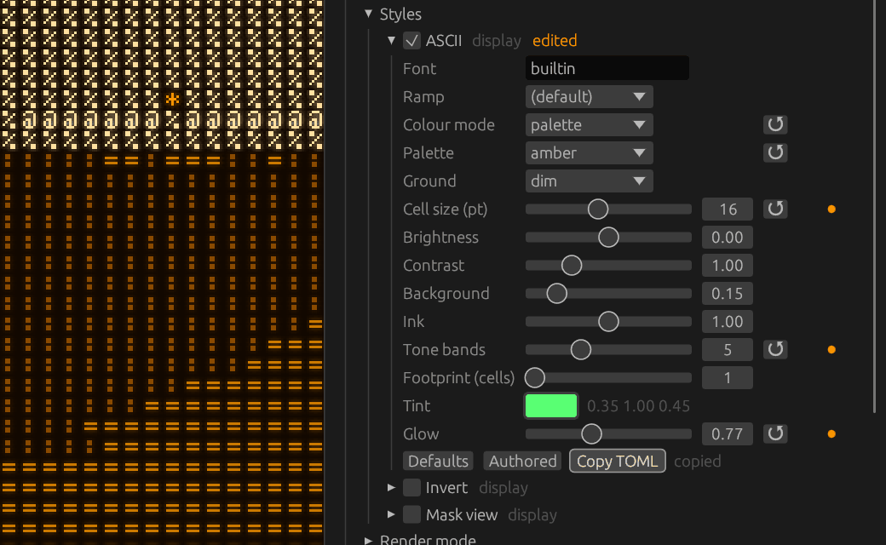

The same editor is the player's **F3 Styles** panel, which appears with the other scene panels when the scene uses a style (a `[post_process.styles]` table or a `style_mask` entity). It also lists the scene's styled entities, the style each asks for, and the hue the [mask view](#the-entity-style-mask) paints that style in.

| Style | Stage | Parameters |
|-------|-------|------------|
| `kuwahara` | HDR | `radius` (whole pixels), `sharpness`, `hardness`, `anisotropy`; see [Post-Processing](post-processing.md#kuwahara-painterly-filter) |
| `watercolor` | Display | see [Watercolor](#watercolor) |
| `ascii` | Display | see [ASCII](#ascii) |
| `pencil` | Display | see [Pencil](#pencil) |
| `palette` | Display | `palette`, `dither` 0--1 (0), `pixel` 1--32 points (1); see [Palette](#palette) |
| `invert` | Display | `strength` 0--1 (default 1): how far toward the negative |
| `mask_view` | Display | `shading` 0--1 (0.8), `dim` 0--1 (0.35), `outline` 0--4 px (1): shows the [entity style mask](#the-entity-style-mask) |

`invert` is the template style: the smallest one that exercises the framework.

## ASCII

The full-screen ASCII style (#265) turns every cell of one screen grid into a glyph from a [glyph set](glyph-atlas.md). The cell's luminance picks a step of the ramp, so glyph density carries brightness, and the glyph is inked in the cell's colour or a tint.

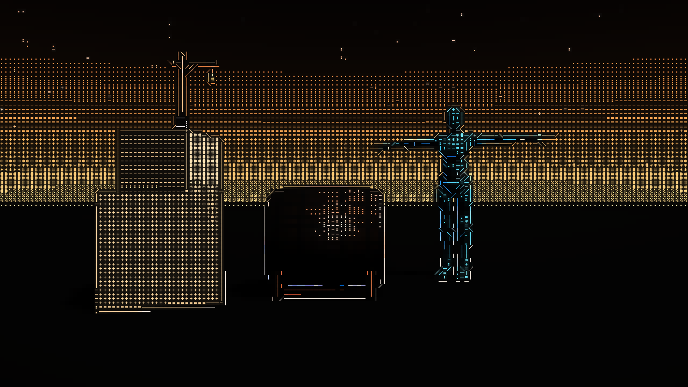

*`flint render demo/ascii_lantern.scene.toml --width 1280 --height 720`, with no other flags: the scene's `[camera]` frames it and its `[post_process.styles.ascii]` block sets the look.*

The style rewards value contrast. Glyph density follows luminance, so a scene lit for PBR, mid-greys everywhere, turns into an even field of `=` and `-`. `demo/ascii_lantern.scene.toml` (#316) is authored for glyphs instead: a near-black ground that stays empty, crates lit warm from one side by a lamp so each has a bright face and a dark one, and a figure and a barrel standing against the last band of a low sun under a dark, starred sky. Its block raises `contrast` to 1.5, which pushes the dim sky to black and keeps the glyphs for what is lit. The ground's top sits 2 cm above y = 0, so the editor grid `flint render` draws by default is hidden under it instead of lifting the empty ground into dashes. The same scene in each built-in ramp:

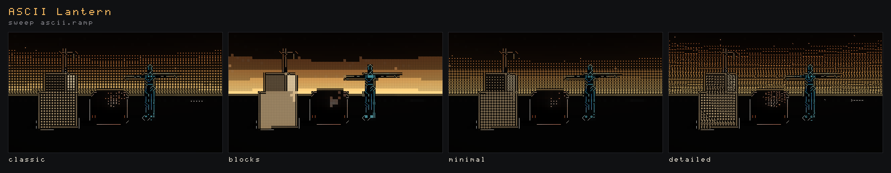

*`flint render demo/ascii_lantern.scene.toml --sweep ascii.ramp=classic,blocks,minimal,detailed`*

```toml
[post_process.styles.ascii]
cell = 8                # cell width in points; the height follows the font's aspect
font = "builtin"        # or a fonts/<name>.glyphs.toml set beside the scene
ramp = "classic"        # a ramp of that set; empty = the set's default_ramp
color = "source"        # source | tint | raw | mono | palette
palette = "phosphor"    # with color = "palette": a built-in or palettes/<name>.palette.toml
ground = "dim"          # dim | black | inverse
glow = 0.0              # halo around bright glyphs
```

```bash
flint render demo/ascii_lantern.scene.toml --width 1280 --height 720   # authored for the style
flint render demo/pbr_test.scene.toml --ascii --schemas schemas --width 1280 --height 720
flint render demo/mesh_meadow.scene.toml --ascii --ascii-ramp blocks --ascii-tint 1,0.7,0.25
```

| Key | Default | |
|-----|---------|---|
| `cell` | `8` | Cell width in points (4--32). Times the window's scale factor, so cells look the same size on a high-DPI display; rounded to whole pixels |
| `font` | `builtin` | The glyph set: `builtin`, a set name (`fonts/<name>.glyphs.toml` in the scene's folder or its parent) or a `.glyphs.toml` path. One that fails to load falls back to the built-in set, with a warning |
| `ramp` | the set's default | A ramp of the set. The built-in set has `classic`, `blocks`, `minimal` and `detailed`. An unknown name warns once and uses the default |
| `color` | `source` | `source`: the cell's hue at full value. `tint`: one colour (`tint`, default phosphor green). `raw`: the cell's colour as it is, dark cells dark. `mono`: white glyphs on grey. `palette`: the inks of `palette` (see [Colour modes](#colour-modes)) |
| `tint` | `[0.35, 1.0, 0.45]` | With `color = "tint"`: the ink, a [colour](#colours) (`[r, g, b]` 0--1 in display values, or `"#59ff73"`). `--ascii-tint r,g,b` sets it |
| `palette` | `phosphor` | With `color = "palette"`: `cga`, `cga-warm`, `cga16`, `phosphor`, `amber`, `mono`, `paper` (with `ground = "inverse"`), or a palette file. One that can't be found warns once and uses `phosphor` |
| `chroma` | `1` | With a `nearest` palette: scale each cell's saturation (OKLab a/b) before its ink is matched, so a muted scene reaches the palette's colours (0--4; 0 matches on lightness alone). See [Palettes](#palettes-match-in-oklab) |
| `palette_dither` | `0` | With a `nearest` palette: mix each cell's two nearest inks by a 4x4 Bayer pattern on the cell grid, in proportion to how far the cell sits between them (0--1), so a gradient steps through inks instead of banding into one |
| `ground` | `dim` | Behind the glyph: `dim` (the mode's own: the cell's colour times `background`, or the palette's background), `black`, or `inverse` (the ink fills the cell and the glyph is cut out of it; the ramp runs backwards so bright cells stay bright) |
| `glow` | `0` | A halo around each glyph, stronger on bright cells (0--2; 0.6 reads as a phosphor tube). It's drawn in the pass, since a display-stage style runs after bloom, so it stops at the cell's edge: for glow that crosses cells, add [display bloom](#display-bloom) |
| `background` | `0.15` | How much of the cell's colour fills behind its glyph: 0 is black, 1 the cell's colour |
| `brightness`, `contrast` | `0`, `1` | Luminance remap before the ramp: contrast about mid-grey, then an offset |
| `exposure` | `0` | Stops of gain on each cell's colour, in linear light, before its glyph and ink are picked (-4--4, `--ascii-exposure`). See [dark props](#dark-props-exposure-and-normalize) |
| `normalize` | `0` | Stretch the style's own luminance range over the ramp, measured from the same frame: the whole frame's, or each styled entity's (0--1, `--ascii-normalize`; #289) |
| `ink` | `1` | Glyph brightness |
| `levels` | `0` | Quantize the tone to this many bands (0 keeps every step of the ramp) |
| `footprint` | `1` | Average each cell's colour over this many cells (wider settles texture noise) |
| `edges` | `1` | Line glyphs along [edges](#edges), mixed over the tone glyph: 0 turns the edge passes off, 1 draws the line alone |
| `edge_threshold` | `0.5` | How much edge, in cell widths, a cell needs to draw a line glyph (a line straight across is 1) |
| `edge_max` | `3` | More edge than this is texture-like geometry (grass, foliage) and keeps its tone glyph. A styled entity's outline ignores it |
| `edge_depth` | `0.6` | The relative view-distance step that counts as a silhouette (lower finds more) |
| `edge_normal` | `2.5` | The normal change, as a Sobel over normals rebuilt from depth, that counts as a crease (lower finds more) |
| `edge_ink` | `cell` | What inks the line glyphs ([Edge ink](#edge-ink), #351): `cell` (as the cell's tone glyph), `color` (`edge_color`) or `hue` (the near side's own colour) |
| `edge_color` | `[0.85, 0.82, 0.74]` | The line glyphs' ink for `edge_ink = "color"`, a warm off-white; `[r, g, b]` or `"#rrggbb"` |
| `edge_tint` | `0` | For `edge_ink = "color"`: mix the colour toward the near side's hue (0--1) |
| `outline` | `1` | Per-entity only: ink a styled entity's own pixels this many points from its silhouette (0--4, at least one pixel when on; 0 = off), so features thinner than a cell keep their shape ([Silhouettes](#silhouettes), #288) |
| `min_coverage` | `0.5` | Per-entity only: the least ink of the pixels in a cell the entity only grazes (0--1) |
| `silhouette` | `"pixel"` | Per-entity only: `pixel` cuts the glyphs at the entity's exact edge; `cell` draws every edge cell whole, as the entity's glyph or as the scene, by how much of it the entity covers ([Whole-cell silhouettes](#whole-cell-silhouettes), #338) |
| `cell_share` | `0.5` | Per-entity only, with `silhouette = "cell"`: the share of a cell's 16 colour samples the entity must cover for the cell to be its (1/16--1) |
| `temporal` | `on` | Temporal stability (#277), below. `off` draws every frame as if it were the first |
| `smoothing` | `0.6` | How much of last frame's colour a cell keeps, per 60 Hz frame (0--0.95): at 120 Hz each frame keeps its square root, at 30 Hz its square, so a change settles in the same game time at any frame rate (#342). A cell whose colour jumps takes the new one at once, so nothing trails |
| `hysteresis` | `0.35` | How far, in ramp steps, a cell's tone may stray from its glyph's band before the glyph changes (0--1) |
| `dither` | `0` | Ordered (4x4 Bayer) dither before the ramp, fixed to the grid: gradients break into a still pattern instead of one hard edge (0--1, `--ascii-dither`) |

### Temporal stability

In motion, a cell whose tone sits on a ramp boundary tips to the neighbouring glyph and back at the slightest change, and the whole picture crawls. So the style draws in two passes: a cell pass writes each cell's colour and glyph into a small state texture (one texel a cell), and the glyph pass draws from it. The state is kept for the next frame. A cell blends in part of last frame's colour (`smoothing`, scaled by the frame's length in game time: the player's clock, so the fixed step under `--frame-step`) and keeps last frame's glyph until its tone has clearly moved on (`hysteresis`).

On `demo/ascii_motion.scene.toml`, a slow orbit of the meadow clearing captured at 1280x720 with `--frame-step 0.0166667` for 3 s (181 frames, 14,400 cells), `python tools/ascii_flips.py` counted:

| | glyph flips per frame | reversals per frame (A, B, A) |
|---|---|---|
| `temporal = "off"` | 408.3 (2.84% of cells) | 100.6 (0.70%) |
| `temporal = "on"` | 118.3 (0.82%) | 0.1 (0.00%) |

Reversals, where a glyph changes and changes back two frames later, are the shimmer itself, and they are gone. The flips that remain are the scene really moving.

`flint render --frames 181 --orbit 6.8755 --flip-stats` measures the same thing headlessly and exactly, from the style's own grid ([Frame sequences](../guides/headless-rendering.md#frame-sequences), #345). With `edges = 0` it gives 105.1 flips and 0.0 reversals a frame with the history on, against 321.1 and 57.8 with it off. The edge glyphs (#267), which came after this measurement, don't go through the history yet. With them on, the history leaves 30.3 reversals a frame (#477).

The state counts as history only when the last frame the renderer drew was the one before, and the grid, ramp and size are unchanged. A single `flint render` therefore draws exactly what the stateless style drew, and a `--frame-step` capture gives the style the same frames every run. Until #341 the player's captures still differed by one level in a few pixels, history on or off: the grass compute's blades came out in a different order each run. Five captures of the motion bench are now byte-identical. The player calls `SceneRenderer::reset_style_history()` when a new scene comes up, and on a [camera cut](#camera-cuts).

#### Camera cuts

After a cut (a cutscene's new shot, a teleport, a respawn) the history belongs to the old shot. Kept, it blends the old shot's colours into the new one's first frames, and cells whose tone barely changed keep the old glyph through the hysteresis band, for as long as the shot lasts. Two things reset it (#343):

- **Scripts** call `reset_style_history()` on the frame of the cut ([Scripting → Style API](scripting.md#style-api)). The next frame is drawn as if it were the first.
- **The player watches the camera** and resets by itself when a frame's step is both large and sudden: a move of more than 2 m or a turn of more than 30° in one frame, at more than four times the rate of the frame before. The second test keeps a fast chase camera, or a hitch that stretches one frame, from resetting every frame and losing its stability. A missed cut costs a shot's worth of stale glyphs, a false one costs one frame drawn without history. FOV and orthographic zoom changes aren't watched: a script that cuts by zoom calls `reset_style_history()`. `set_camera_cut_detection(false)` turns the watch off; the thresholds are the constants in `crates/flint-player/src/player_app/camera_cut.rs`.

`demo/ascii_cuts.scene.toml` cuts between two shots of the meadow clearing every second. Its script's `mode` is `"script"` (it resets at each cut), `"auto"` (the player's detection does) or `"none"` (neither). Captured at 1280x720 with `--frame-step 0.0166667` for 2.5 s, cells whose glyph differs from the `"script"` run (of 14,400):

| Mode | Before the first cut | First frame of the new shot | Its last frame, a second later | All frames after the cut |
|------|---|---|---|---|
| `"script"` | 0 | 0 | 0 | 0 |
| `"auto"` | 0 | 0 | 0 | 0 |
| `"none"` | 0 | 1,006 (7.0%) | 493 (3.4%) | 45,800 |

The carry-over is mostly in mid tones: `-` where the new shot has `=`, `.` and `:` in the grass. Half of it is still there when the shot ends, because cells that clear the hysteresis band have no reason to change.

It is a display-stage style: it reads the finished, tonemapped picture at output resolution, after the render-scale upscale, so glyphs stay sharp at `--render-scale 0.5`. The grid is centred on the frame, so the part cells at the borders match. At a whole-number scale (8 px glyphs in 8, 16 or 24 px cells) glyphs are drawn exactly; at a fractional one, such as 12 px cells on a 1.5x display, each glyph pixel keeps one width and only its borders blend. It costs about 0.04 ms at 1080p on an RTX 4070 (`--gpu-time 240`), down from about 0.15 ms before #277 split it in two: the cell pass averages each cell's colour once, where the old single pass did it for every pixel. That is with `edges = 0`. The [edge passes](#edges) add about 0.4 ms (measured on the tavern before #277, as 0.15 against 0.53--0.67 ms).

| Key | Default | |
|-----|---------|---|
| `scope` | `screen` | `screen`: the table glyphizes the whole frame. `entities`: only the entities that ask (below), the table being their preset |
| `grid` | `screen` | `screen`: one grid centred on the frame. `object`: each styled entity's cells pinned to its projected origin (below) |

[Edges](#edges) (#267) draw line glyphs along silhouettes and creases, and [per-entity ASCII](#per-entity-ascii) (#266) applies the style to chosen entities. Its goldens are in the [stylize goldens](#goldens).

### Colour modes

The glyph's shape carries brightness; its colour sets the mood (#276). Every capture below is `demo/pbr_test.scene.toml` at 1280x720, cropped at 1:1 around the two boxes and the character. They were made before edges (#267) were on by default: add `--ascii-no-edges` to get them exactly, or leave it off and the boxes are outlined too.

| | |
|---|---|
| 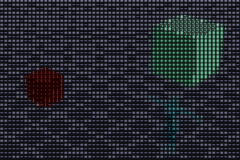 `--ascii` (source) | 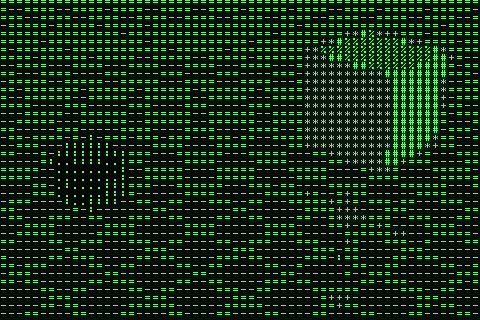 `--ascii-color tint` |
| 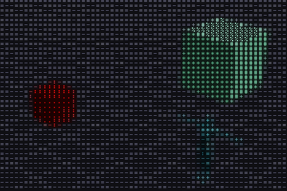 `--ascii-color raw` | 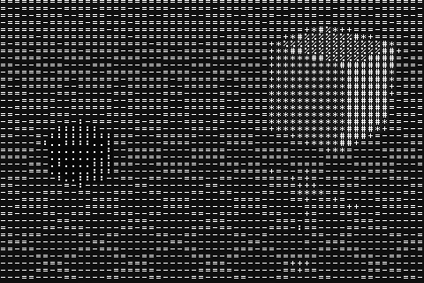 `--ascii-color mono` |
| 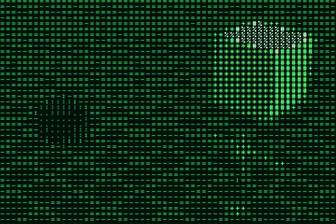 `--ascii-palette phosphor --ascii-glow 0.6` | 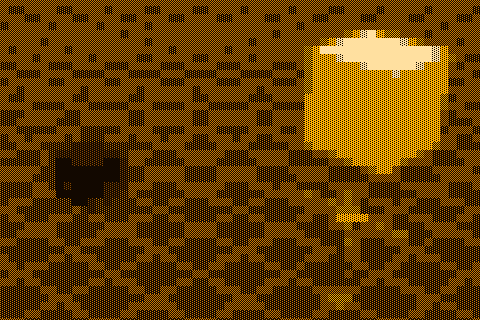 `--ascii-palette amber --ascii-ramp blocks` |
|  `--ascii-palette cga` | 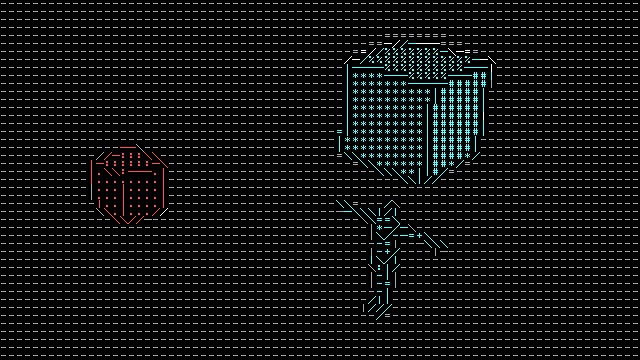 `--ascii-palette cga16` |
| 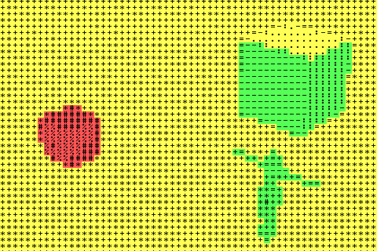 `--ascii-palette cga-warm --ascii-ground inverse` | 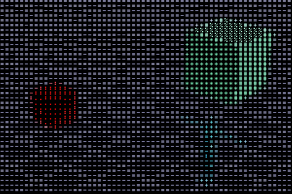 `--ascii-ground black` |
| 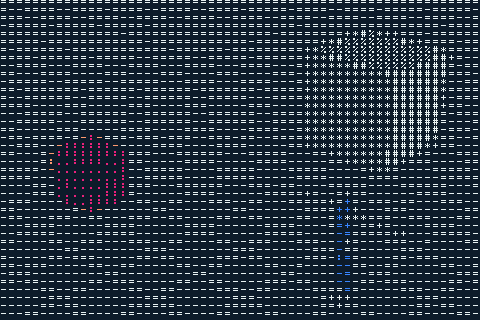 `--ascii-palette tidepool` (`demo/palettes/tidepool.palette.toml`) | |

And on `demo/mesh_meadow.scene.toml` (640x360 crops):

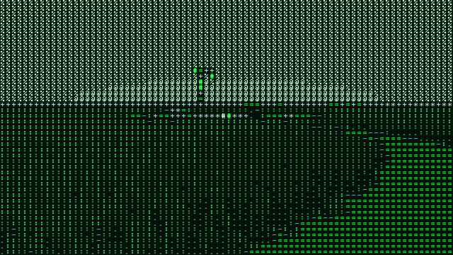
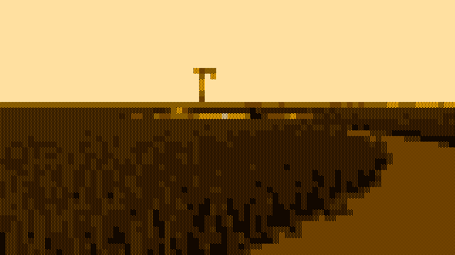
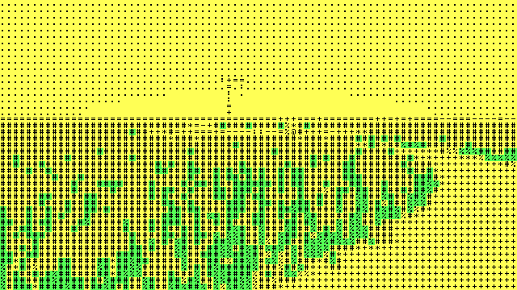

**Palettes** live in `flint_render::palette`, so any style can use them; the [palette style](#palette) is the other one that does. A palette is a list of inks and a background, in display (sRGB) hex:

```toml
# palettes/tidepool.palette.toml, beside the scene or in its parent folder
match = "nearest"          # nearest (default) | luminance
background = "#0d1b2a"     # default black
colors = ["#1b998b", "#3a86ff", "#ed217c", "#ff9b71", "#fffd82", "#e8f1f2"]
```

`nearest` gives each cell the ink nearest its hue at full value, so a dark red still reads red and glyph density alone says it's dark. Distance is measured in OKLab (#320, below), and the style's `chroma` and `palette_dither` shape the match. `luminance` lists the inks darkest first and picks one by the cell's tone, as a one-colour phosphor tube does. Up to 32 inks. A file wins over a built-in of the same name; `PaletteCache` resolves names the way `GlyphSetCache` resolves fonts, through the vfs, and hot-reloads the same way (#323): change an ink with the viewer or player open and the frame recolours within a second (half a second, measured on `demo/ascii_tidepool.scene.toml`), and a file that appears beside the scene takes over a built-in of its name. Natively only; a web bundle never changes.

| Built-in | Match | Inks |
|---|---|---|
| `cga` | nearest | cyan, magenta, white on black (mode 4, palette 1, high intensity) |
| `cga-warm` | nearest | green, red, yellow on black (palette 0, high intensity) |
| `cga16` | nearest | the 15 text-mode colours on black |
| `phosphor` | luminance | four greens on near-black |
| `amber` | luminance | four ambers on near-black |
| `mono` | luminance | four greys on black |
| `paper` | luminance | four inks, near-black to pale grey, on cream paper (#324). In ASCII, pair it with `ground = "inverse"` |

`paper` is the one palette whose ground is lighter than its inks, and ASCII's glyph density carries brightness: under the default `ground = "dim"` a dark field is a sparse scatter of dark glyphs on cream, so the meadow's grass reads as pale as its sky (top). With `ground = "inverse"` the cell is filled with its ink and the glyph is cut out of it in paper, so dark grass is dark and the sky stays light (bottom):

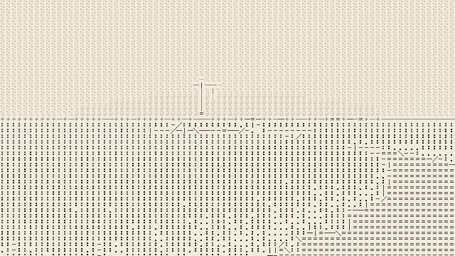
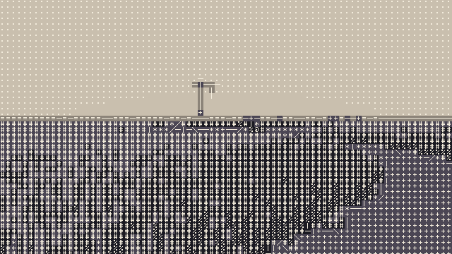

*`--ascii --ascii-palette paper --ascii-ground dim|inverse` on `demo/mesh_meadow.scene.toml` at 1280x720, cropped at 1:1.*

#### Palettes match in OKLab

A `nearest` palette compares colours in [OKLab](https://bottosson.github.io/posts/oklab/) (#320), where the distance between two colours follows how different they look. Plain RGB distance read wrong in two ways. Under `cga16`, a full-value red `(1, 0, 0)` is nearer `#aa0000` than `#ff5555` in RGB, so saturated objects took the dim text-mode inks on top of the darkening that glyph density already does. Under `cga`, every muted colour went to white. OKLab fixes the first. Two style keys deal with the second, since a near-grey really is nearest the white ink:

- `chroma` scales the cell's OKLab a/b before matching. pbr_test's floor is a muted blue (`#636380`): at `chroma = 3` it is far enough from white to reach the cyan and magenta.
- `palette_dither` mixes the two nearest inks on a 4x4 Bayer pattern fixed to the cell grid. A cell takes the second ink in proportion to how far it sits between the two, so a gradient steps through the inks instead of banding into one.

Each pair below is the same 640x360 crop (from 1280x720), before #320 (RGB), after it with the defaults, and after it with `--style ascii:chroma=3,palette_dither=1`:

| `--ascii-palette` | RGB (before) | OKLab | OKLab, `chroma = 3`, `palette_dither = 1` |
|---|---|---|---|
| `cga`, pbr_test | 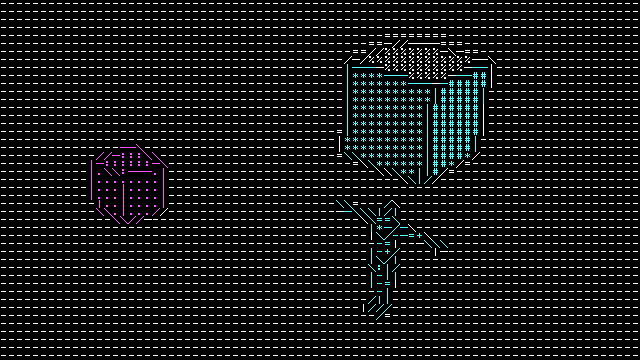 |  | 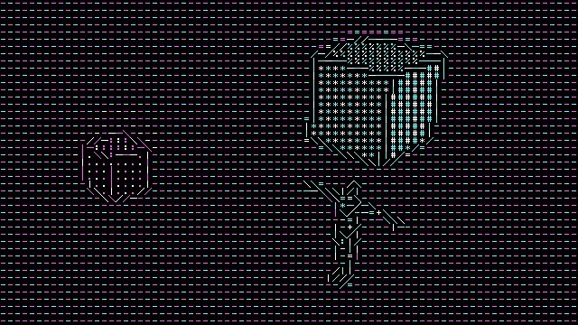 |
| `cga16`, pbr_test | 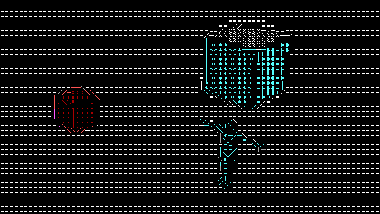 |  | 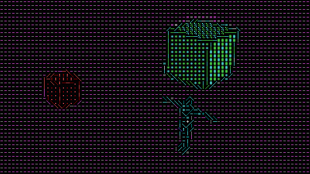 |
| `cga`, mesh_meadow | 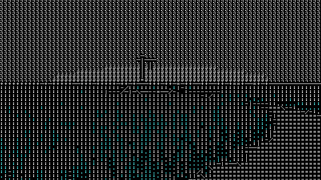 | 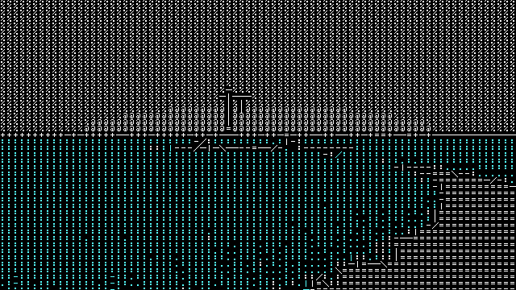 | 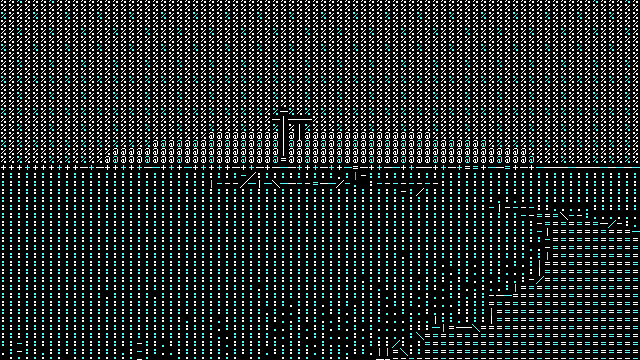 |
| `cga16`, mesh_meadow | 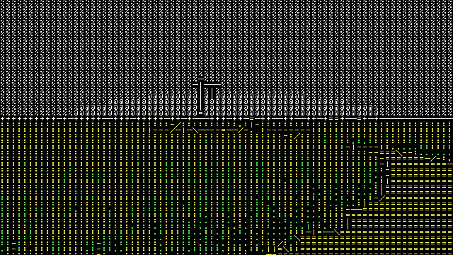 | 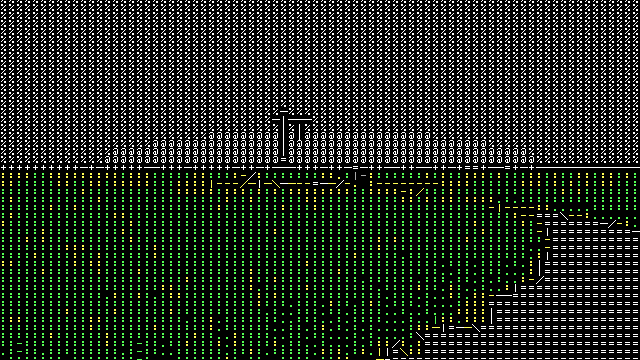 | 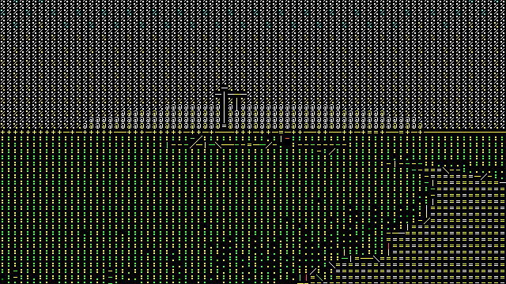 |

Under `cga16` the red box now takes `#ff5555` rather than `#aa0000`, the cube's top turns cyan, and the meadow's grass is green where RGB made it yellow. Its path, a muted tan, comes out grey with the defaults, and yellow and red with chroma pushed. The meadow's sky stays white or grey under any setting. That is correct: it is `#cbccd0`, close to neutral.

The CPU reference is `Palette::pick(colour, chroma, dither, cell)`, and the shader's is `pal_pick` in `crates/flint-render/src/palette.wgsl`, which the glyph pass includes. Inks are converted to OKLab once a frame on the CPU. A GPU test (`the_palette_matcher_agrees_with_its_cpu_reference`) holds the two to the same ink over a grid of 4096 colours with chroma and dither on. A `luminance` palette ignores both keys. Matching in OKLab costs about 0.03 ms at 1080p for `cga16`'s 15 inks (0.076 ms before, 0.103 ms after, `--gpu-time 240` on an RTX 4070 with edges off). Dither adds about 0.003 ms.

On an RTX 4070 at 1080p the pass costs 0.143 ms in `source`, 0.152 ms matching `cga16`'s 15 inks, 0.144 ms with `ground = "inverse"` and 0.220 ms with `glow` on (24 more glyph reads a pixel).

### Edges

Luminance alone loses a silhouette wherever an object is about as bright as what's behind it. So cells along the scene's edges draw the glyph set's line glyphs, `─ │ ╱ ╲` in the built-in set, picked by the direction of the edge through the cell (#267). Away from edges cells keep their tone glyphs.

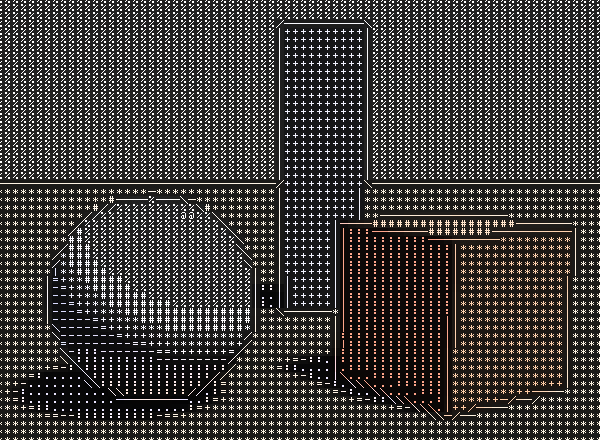

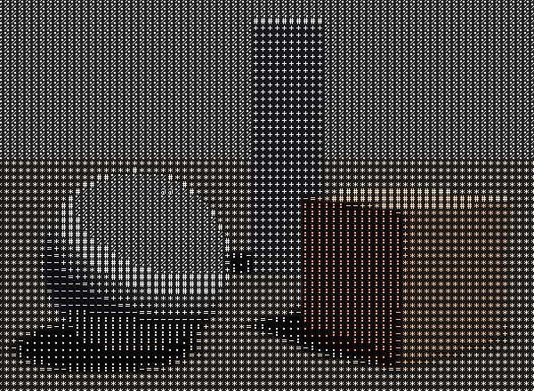

*`demo/ascii_edges.scene.toml` at 1280x720, cropped at 1:1, with edges (top) and with `--ascii-no-edges`. The sphere and the box carry `style_mask { style = "ascii" }`; the pillar has none, so it is outlined by depth alone.*

Edges come from geometry, never from colour, so a wood texture makes none but a table's outline and its creases do (the ASCII spike's finding, #261). Three passes, before the glyph pass:

1. **Edge pixels**, at the depth's resolution. A 3x3 Sobel over the relative view distance finds silhouettes; one over normals rebuilt from the depth finds creases, counted only where the 5x5 patch is one surface. Where an ASCII-styled entity (an `ascii_style`, or a `style_mask { style = "ascii" }`, [the entity style mask](#the-entity-style-mask)) meets anything else, including another styled entity with different settings, the pixel is an **outline**. Silhouettes and outlines keep their near side only, so each is drawn once.
2. **Cells**, one fragment a glyph cell. It reads every edge pixel in its cell, not a sparse lattice, so a one-pixel outline can't slip between samples, and sums their structure tensors: the dominant orientation picks the glyph. The cell draws a line when it holds at least `edge_threshold` cell widths of edge and at most `edge_max` (an outline needs only the threshold).
3. **The glyph pass** draws the cell's line glyph in the one cell the line passes within half a cell of, measured across it: down the cell's centre column for a line nearer horizontal, along its centre row for one nearer vertical (#352). The cell pass finds where that is from the edge pixels' centroid, each pixel weighted by how much its gradient agrees with the cell's line, so a corner's other arm doesn't pull it. That is the cell a Bresenham line lights, so a line along a cell border, a coarse diagonal or a silhouette at render scale 0.5 draws one chain of cells, not two. A band of edge pixels wider than one (two-pixel stairs at scale 0.5) can straddle the border; the two halves count as one line when they run within 10° of each other and lie within three quarters of a cell, and the pair's centroid decides. Two real edges a cell apart, or converging at an angle like a box's silhouette and the crease below it, each keep their own.

Under a render scale the edge pixels are the scene's, so a line is still one cell wide. The editor grid of `flint render` (on unless `--no-grid`) is an overlay drawn after the opaque geometry that writes no depth (#346), so the edges never trace it; its lines still lift the tone glyphs they cross, which is why renders of the look pass `--no-grid`.

Edges come with the colour modes: by default (`edge_ink = "cell"`) line glyphs are inked as the cell's tone glyph would be, cut out of the ink under `ground = "inverse"`, and glow around them. The edge cells lie on the screen grid, so per-entity variants on that grid get them, and a variant on `grid = "object"` keeps its tone glyphs. Edge cells keep no history: under #277's temporal stability the tone glyphs hold still and the lines follow the geometry each frame. The [stylize goldens](#goldens) pin pbr_test without edges (the #265 golden, unchanged), with edges, and the sphere and box above.

#### Edge ink

Along a silhouette a cell's colour is a mix of the object and what's behind it, so an outline inked like its cell drifts between the two and never stands apart from the fill. `edge_ink` gives the lines an ink of their own (#351):

- `cell`, the default: as the cell's tone glyph, above.
- `color`: one colour, `edge_color`, mixed toward the near side's hue by `edge_tint` (the ASCII spike's pair, #261).
- `hue`: the near side's own colour, at the cell's value, inked as the colour mode inks a cell (its hue under `source`, its nearest ink under `palette`; under `tint` and `mono` that is the tint or white again).

The edge cell pass knows the near side: edge pixels keep only the near side of a step, so it averages the picture under the pixels that decided the cell's line and stores their hue beside the glyph. A styled entity's silhouette floor (`outline`, [Silhouettes](#silhouettes)) is an outline too and takes the same ink. Under `ground = "inverse"` the lines are drawn in the edge ink over the ink-filled cell, not cut out of it.

```toml
[post_process.styles.ascii]
color = "tint"            # a green phosphor fill...
edge_ink = "color"
edge_color = "#ffb347"    # ...outlined in amber
```

From the command line, `--style ascii:color=tint,edge_ink=color,edge_color=#ffb347`.

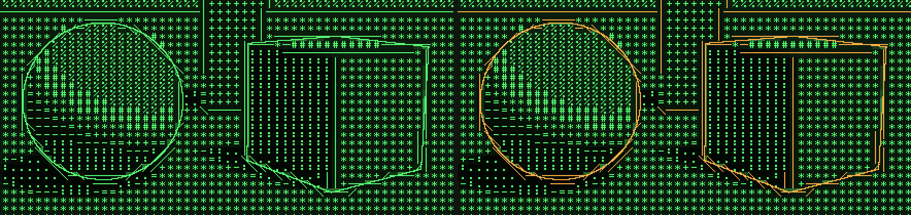

*`demo/ascii_edges.scene.toml` at 960x540, cropped and doubled: `color = "tint"` with `edge_ink = "cell"` (left) and `edge_ink = "color", edge_color = "#ffb347"` (right).*

#### Seeing the decisions: `--debug-mode edges`

A missing or doubled line glyph could come from any of the three passes, and the glyphs alone don't say which. The edge view (#349) draws what each pass decided, in place of the glyphs, over the scene in dim grey:

```bash
flint render demo/ascii_edges.scene.toml --debug-mode edges --no-grid --output edges.png
flint render demo/ascii_edges.scene.toml --debug-mode edges --no-grid --style ascii:cell=16 --output cells.png
```

- **Edge pixels**, by the source that marked them: cyan a depth step, amber a crease, magenta a styled entity's outline.
- **Each cell's decision**: a green line in the glyph's direction where the cell draws one; a dim dashed line where it holds a line that runs more than half a cell from its centre, which a neighbour draws (pass 3's thinning); a red wash where it holds more than `edge_max` and counts as texture; nothing where it holds less than `edge_threshold`.
- **Each cell's edge length**: a bar along the cell's foot, full at `edge_max`, with a white tick at `edge_threshold`. In cells 12 pixels or wider the length is also written in the top left, in cell widths.

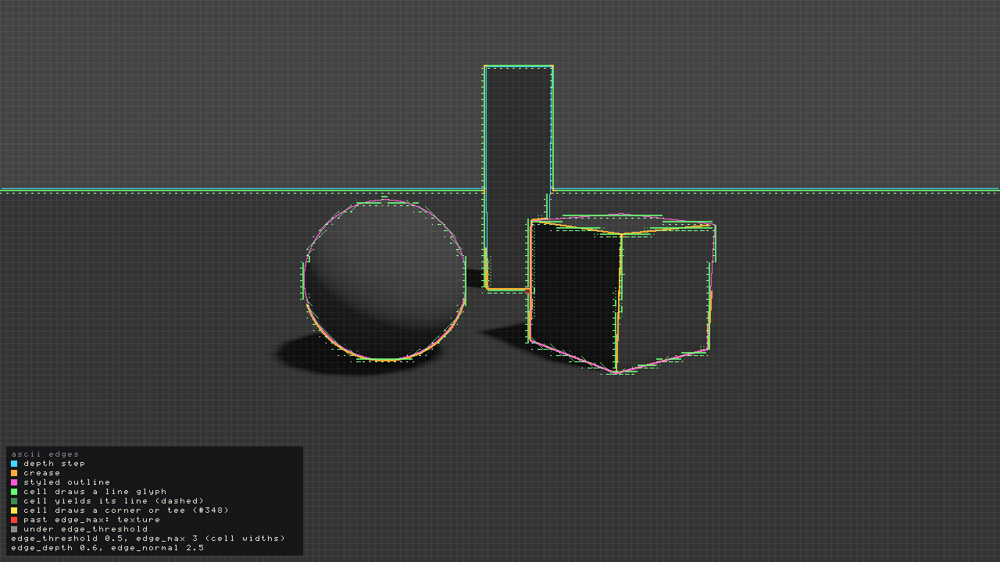

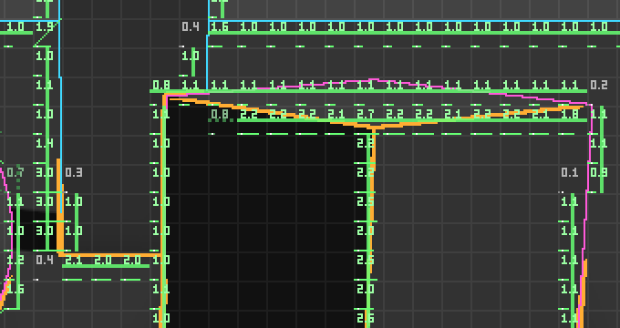

*`demo/ascii_edges.scene.toml` at 1280x720 (top) and at `ascii:cell=16`, cropped and doubled (bottom). The horizon is a depth step, the sky's far plane against the ground. Along the box's top the crease and the outline run a few pixels apart, so its cells hold 2.1 to 2.7 cell widths, inside `edge_max`; where the pillar meets the ground they hold 3.0, right at it.*

Read it beside the four keys in the table above: `edge_depth` and `edge_normal` decide the coloured pixels, `edge_threshold` and `edge_max` the cells. `flint render` prints the thresholds it drew at and the legend, and draws the same legend in the image's lower left. Lower `edge_max` until a cell turns red to see how close a run of geometry is to being called texture. The view draws through post-processing, and switches ASCII on at its defaults in a scene that has none. In the player and viewer it is **Style Edges** in F4's debug shading list, with the legend under it.

### Dark props: exposure and normalize

Glyph density follows luminance, so a dark prop maps to `.` and `-` and nearly disappears: a barrel in the meadow reads as a black shape with a few dots. Carrying hue in the ink helps, but the brightness is still gone. A `luminance` palette (`phosphor`, `amber`, `mono`) dims it twice, since it picks the ink rung by the same tone (#289).

Two settings fix it, on the scene's table or on one entity's `ascii_style`:

- **`exposure`**, in stops: the cell's colour times 2^exposure in linear light, before the glyph and ink are picked. Simple, but a dark prop's range stays narrow, only higher up.
- **`normalize`**, 0 to 1: the style's own tone range is stretched over the whole ramp. Each style id has its own range: the whole frame's (slot 0), and each per-entity variant's, so a dark barrel and a bright sign in one frame are stretched separately. 1 maps the range onto 0..1; between 0 and 1 mixes the stretched tone with the plain one.

```toml
[entities.barrel.ascii_style]
normalize = 1.0     # its own tones over every glyph of the ramp
exposure = 0.5      # optional: half a stop first
```

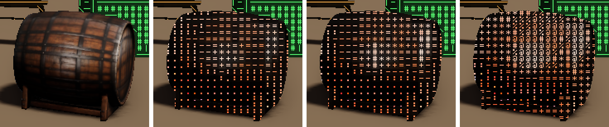

*The barrel in `demo/ascii_entities.scene.toml` at 1280x720, cropped and doubled: smooth, plain, the `brightness = 0.35, contrast = 1.4` it needed before, and `normalize = 1` (its setting now). Its lower half averages 0.024 luminance in the smooth render, so it stays sparse even stretched: that is real darkness, not lost detail.*

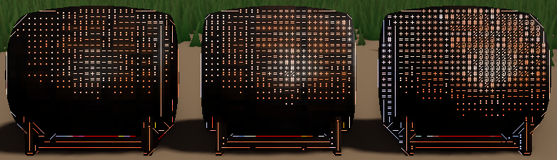

*`demo/ascii_dark_props.scene.toml`: plain, `exposure = 1.5` and `normalize = 1`, side by side.*

The range is measured from the same frame, so `flint render` stays deterministic and nothing lags a frame behind: two small passes before the cell pass walk a fixed 320x180 lattice over the picture, sum each slot's samples (count, luminance, luminance squared) row by row, and resolve each slot's range as its mean -/+ 2 standard deviations. The range maps linearly onto 0..1, then a gamma (0.35 to 2.5) puts the slot's mean at mid-grey, since a lit top and a shadowed side are often both in range and the linear stretch alone leaves the shadow blank. That is a percentile without a histogram: a highlight or a crack moves it far less than it would a min and max. A range narrower than 0.08 is widened around its middle, so a flat wall's noise doesn't fill the ramp. The passes run only when some slot asks for `normalize`; brightness and contrast then apply to the stretched tone as before. On an RTX 4070 at 1080p, `demo/ascii_dark_props.scene.toml`'s ASCII pass took 0.37--0.43 ms without a normalised barrel and 0.45--0.54 ms with one (`--gpu-time 240`, two runs each): about 0.1 ms for the statistics.

## Per-entity ASCII

An entity with an `ascii_style` component is drawn in glyphs while the rest of the scene stays smooth (#266). No `[post_process.styles.ascii]` table is needed:


*`flint render demo/ascii_entities.scene.toml --no-grid --target 0.7,0.7,4.2 --distance 5.2 --yaw 29 --pitch 10`, 1280x720.*

```toml
[post_process.styles.ascii]   # optional: the preset every styled entity starts from
scope = "entities"            # without it, the table would glyphize the whole frame
background = 0.3

[entities.bench.ascii_style]  # only what differs from the preset
ramp = "blocks"
color = "tint"
tint = [1.0, 0.70, 0.30]      # a colour, as in the scene's table (or "#ffb34d")
levels = 4

[entities.ybot.ascii_style]   # empty: the preset as it is (skinned meshes work too)

[entities.lantern_glass.ascii_style]
enabled = false               # stays smooth, even under a whole-frame ASCII
```

- **Fields.** Every key of the table above except `scope`, all optional. A field the entity leaves out comes from the scene's table, then the style's default. The schema gives no field a default on purpose, since the loader would fill it in and hide the scene's setting. An archetype's `[archetype.<name>.defaults.ascii_style]` is a preset too, and an entity's own fields merge over it field by field.
- **Descendants** inherit their ancestor's style until one carries an `ascii_style` or `style_mask` of its own; the nearest wins. A plain `style_mask { style = "ascii" }` is the same as an empty `ascii_style`.
- **Ids.** Entities with the same settings share one style mask id. Each distinct set of settings is a variant, and the pass looks up each pixel's settings by its id. The variant table is two storage buffers, every variant's row and each mask id's slot, sized to the frame: they start at 64 entries and double when a frame needs more, so 500 props on `grid = "object"` each get a row (#336). A pixel of the whole frame never reads them, so full-screen ASCII costs what it did. Past 4095 variants (the tone statistics' texture holds a column each) the rest are drawn like the whole frame, with a warning.
- **Colour.** A cell's colour averages only the samples of the pixel's own variant, so a styled prop's glyphs carry its colour, not the meadow's behind it. Its silhouette is the mask's, to the pixel. With a `footprint` of 2 or more those 16 samples are summed once a cell, in a pre-pass (#313, `ascii_variant_cells.wgsl`), rather than in each of the cell's pixels. Variants on one grid (the same cell, origin and footprint) share a band of rows, and each cell keeps the first two of the band's variants met in it. A pixel of a third variant still sums for itself, and so does a variant past 8 grids. At footprint 1 every pixel sums for itself: its 16 loads hit the 16 texels its cell shares, so they come from the texture cache, and there a pre-pass over every cell cost more than it saved. The pixels are the same either way, to the bit. Timings are in [Profiling](../guides/profiling.md#gpu-timing).
- **The whole frame.** With the scene's table on and `scope = "screen"` (or `--ascii`), everything is glyphs and entities still change their own settings; `enabled = false` keeps one smooth.
- **Grids.** By default every styled entity shares the screen's grid, which keeps glyphs aligned where props meet (the spike's finding, #261). `grid = "object"` pins an entity's cells to its projected origin: its glyphs hold still while it slides across the screen, but still swim when it turns or comes closer (#277). Each such entity gets a variant of its own.
- **Colour modes** (`color`, `palette`, `ground`, `glow`) are per entity too: a frame packs up to 32 palette inks in all, and a palette that doesn't fit beside the others uses the scene's, with a warning.
- **Edges between entities** come from [edges](#edges) (#267). Without them a styled prop's edge is only where its glyph field stops, so two styled props that overlap would run together. The edge passes draw line glyphs along depth steps and creases, and an outline wherever the style mask changes from one of the style's ids to any other: the plain `ascii` id or any variant's, so a change between two variants is an outline too. Ids are per variant, not per entity, so two props with the same settings that touch on one surface are told apart by the depth and crease edges, not the mask. Variants on `grid = "object"` don't draw edges yet, because the edge cells are on the screen grid.
- **Temporal stability** (#277's `smoothing`, `hysteresis` and `dither`) applies to the whole frame's cells. A per-entity variant is drawn per pixel on its own grid and keeps no history yet, so a styled prop can still shimmer in motion.
- **From scripts** (#269): `set_entity_style(id, "ascii")`, `set_style_param(id, "cell", 12.0)` and `clear_entity_style(id)` edit the component at runtime, and changing a param every frame makes no GPU allocation. See [Scripting → Style API](scripting.md#style-api) and `demo/ascii_story.scene.toml`.
- **Fonts** (#335). An entity's `font` names its own glyph set, so props can draw in different fonts in one frame. Every set in use is stacked into one atlas texture (`GpuGlyphStack`, uploaded again only when the frame's sets change), and each variant's row carries its font's glyph cell and where its ramp and its four edge glyphs sit, so the cell's height follows that font's aspect and the edges are drawn in its own line glyphs. A frame holds up to 8 fonts and an atlas stack up to 8192 pixels tall. A font that doesn't fit, or whose ramp and edges don't fit in the frame's 128 ramp steps, draws in the scene's font, with a warning. `demo/ascii_fonts.scene.toml` draws a YBot and a barrel in a hand-drawn halftone set (`demo/fonts/halftone.glyphs.toml`, 8x12 cells) beside props in the built-in letters.
- **Not yet:** ramps beyond 128 steps in all across the frame's variants (a ramp that doesn't fit uses the scene's, with a warning).

```bash
flint render demo/ascii_entities.scene.toml --output ascii.png              # as authored
flint render demo/ascii_entities.scene.toml --ascii-scope screen            # the whole frame
flint render demo/pbr_test.scene.toml --ascii --ascii-grid object           # flags set the preset
```

At 1080p on an RTX 4070 the demo's ASCII pass costs about 0.045 ms and its mask 0.013--0.023 ms (DX12, Vulkan); with `--ascii-scope screen` the pass costs about 0.06 ms, and with no styled entities 0.04 ms. In Chrome it is about twice that, and a render scale leaves it unchanged, since the cells are output pixels. The numbers by backend, scale and browser are in `docs/design/web.md` ("Stylize passes", #270). It works under `--msaa 4` and `--render-scale`, where the silhouette follows the scaled mask. F4 → Styles → ASCII offers `scope` and `grid` beside the other settings, and `flint edit --watch` hot-reloads `ascii_style` edits.

### Silhouettes

A styled entity's silhouette is cut to the pixel, but it is filled with cells 8 points wide. A bench leg 3 px wide holds a sliver of one glyph, mostly ground, so under per-entity ASCII the meadow bench's legs and rails were dark smudges, while the whole frame kept the bench readable as a shape cut out of the glyphs around it (#261, #288). Two ink floors keep thin features:

- **`outline`** (points, default 1) inks the entity's own pixels that lie within that distance of a pixel of another mask slot. The silhouette is drawn as a line inside the entity, in its own ink (the hue at full value, a tint, or a palette ink, as its glyphs are), and a feature two outlines wide comes out solid.
- **`min_coverage`** (default 0.5) is the least ink of every pixel in a cell the entity only grazes: under a quarter of the cell's colour samples, easing out by five eighths.

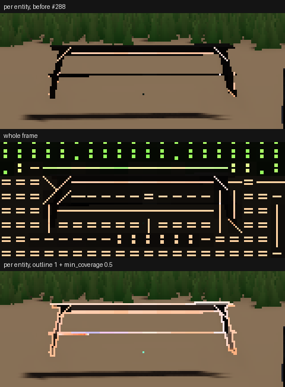

They apply to per-entity variants only: the whole frame's cells have no silhouette, and `ground = "inverse"` already fills its cells with ink. `outline = 0, min_coverage = 0` draws what came before. The outline reads up to 4 rings of 8 mask texels for each styled pixel. On the demo at 1080p on an RTX 4070 (`--gpu-time 240`, edges on) the ASCII pass measured 0.38--1.0 ms with the floors on and 0.53--1.0 ms with them off: run-to-run noise hides the difference.

```bash
flint render demo/ascii_silhouette.scene.toml --no-grid -o bench.png
flint render demo/ascii_silhouette.scene.toml --no-grid --style ascii:outline=0,min_coverage=0 -o before.png
```

### Whole-cell silhouettes

The outline reads a prop as a shape cut out of the scene: the glyphs end at the mask's pixel-exact edge, so the cells along it are half glyphs. `silhouette = "cell"` (#338) is the other reading, a silhouette made of whole glyphs. Each cell of the variant's grid is all glyph or all scene, decided by how much of it the entity covers:

- A cell where the entity covers at least `cell_share` (default 0.5) of the cell's 16 colour samples is the entity's. Every pixel in it draws the entity's glyph, the scene's pixels in the cell included.
- A cell it covers less of is dropped. The entity's own pixels in it show the scene around the entity, each the picture at the nearest of the cell's samples that isn't the entity's, rather than the prop's smooth shading. With the whole frame in ASCII they draw the whole frame's glyph instead.

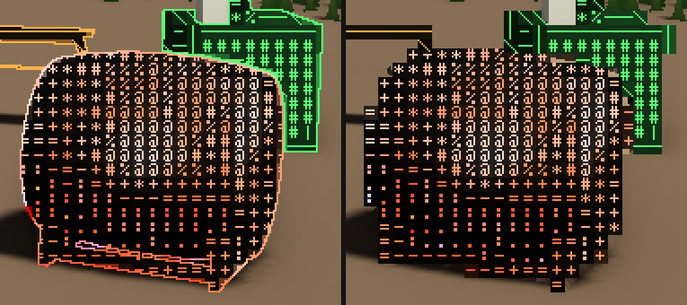

The edge becomes a staircase of cells, like a character on a text screen. The pixel `outline` is off on a snapped variant, since the edge is the cells'. `min_coverage` still applies, and lowering `cell_share` (0.25 keeps more of a bench's legs) is the way to hold thin features. Edge glyphs (#267) still draw in the cells the entity keeps. Object grids (`grid = "object"`) snap on their own grid. A variant that keeps `silhouette = "pixel"` keeps its own pixels even inside a snapped neighbour's cell.

```bash
flint render demo/ascii_entities.scene.toml --no-grid --style ascii:silhouette=cell -o cells.png
flint render demo/ascii_entities.scene.toml --no-grid --style ascii:silhouette=cell,cell_share=0.25 -o thin.png
```

The glyph pass works out each pixel's cell, so every pixel of a cell gets the same answer. It reads the cell's 16 mask samples once for the pixel's own grid, then once for each other grid a snapping variant uses (up to 8; a variant on a ninth still drops its own minority cells but fills none). Each pass keeps counts in registers for the first two snapping variants met in the cell, so a third variant of the same grid meeting them in one cell is left out. On `demo/ascii_entities` at 1080p on an RTX 4070 (`--gpu-time 240`, three alternating runs, two snapping grids) the ASCII pass took 0.34–0.38 ms with cells against 0.17–0.24 ms with pixels (edges off), and 0.64–0.68 ms against 0.49–0.54 ms with edges on: about 0.15 ms more. A first version that kept the samples in private arrays cost 0.4 ms more. A pixel the mask itself misses (a grazing silhouette pixel its depth tolerance drops) still passes through, as it does with `pixel`.

## Pencil

The `pencil` style (#273) draws the scene in graphite on paper. The picture's tone becomes layers of cross-hatching. The scene's silhouettes and creases become contour lines that wobble and double the way quick sketch lines do. Both sit on a paper with grain, whose tooth breaks the strokes up.

```toml
[post_process.styles.pencil]
spacing = 6.0          # hatch line spacing, points
thickness = 1.0        # stroke width, points
layers = 3             # hatch layers, 0-4: each joins, crossing the last, as the tone darkens
direction = "surface"  # surface | screen | tensor
angle = 50.0           # the base angle, degrees
contrast = 1.2         # tone contrast before it picks layers (brightness too)
contour = 1.0          # outline strength; contour_width in points
depth = 1.0            # outline sensitivity to depth steps; crease to creases
detail = 0.35          # outlines from the picture's own luminance edges
wobble = 1.5           # how far lines wander, points
sketchy = 0.6          # a second, offset outline beside the first
grain = 0.5            # paper grain, and how much it breaks strokes
shade = 0.25           # soft rubbed graphite in the darks
paper = [0.95, 0.93, 0.88]   # display RGB; fills paper_r/g/b (lead_r/g/b likewise)
lead = [0.16, 0.16, 0.19]
color = 0.0            # 1 draws over the scene's own colour: coloured pencil
seed = 0               # another whole number is another hand
boil = 0.0             # redraws a second, for boiling lines (0 = still)
```

```bash
flint render demo/stylize_props.scene.toml --no-grid --style pencil -o page.png
flint render demo/pencil_sketch.scene.toml --no-grid -o props.png        # per-entity variants
flint render scene.toml --style pencil --sweep pencil.direction=surface,screen,tensor -o dirs.png
```

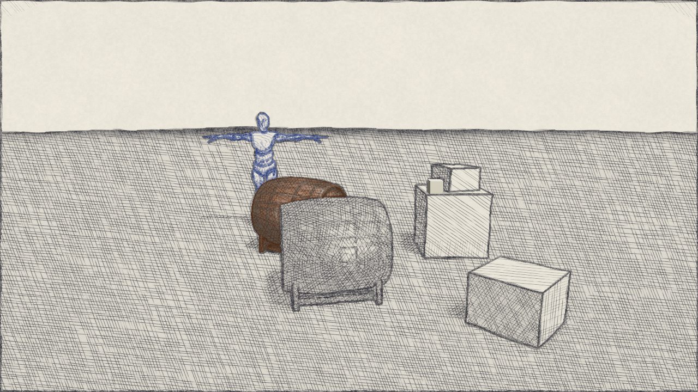

How it draws:

- **Hatching builds tone the way a hand does.** Each layer switches on as the tone darkens past its threshold, and its strokes thicken from nothing rather than popping in. A layer crosses the one before it off the square (at 0°, +65°, −40° and +25°), so layers never make a grid. Each stroke is a dash of its own length that tapers at both ends, is jittered off its row and is bent by a slow wobble. A few dashes are left out.
- **Stroke direction.** `surface` runs strokes along the surface's iso-depth lines, taken from the gradient of 1/z. That gradient is constant over a plane, so a box face hatches straight, and it turns smoothly round a barrel and across a floor. `screen` hatches everything at `angle`. `tensor` follows the picture's luminance edges (a blurred structure tensor), which gets busy around shadows. Where a surface or tensor direction is unsure (a face turned square to the camera, a flat colour), `angle` shows through. Directions are quantized to 15° bins with neighbouring bins blended, so strokes stay straight within a patch, as hand hatching does.
- **Contours** come from depth steps (drawn on the near side), creases (the normal rebuilt from depth turns), the edge of a styled entity's mask, and luminance edges by `detail`. They are read back through a noise offset (`wobble`), twice when `sketchy` is set.
- **Deterministic.** Every random choice is an integer hash of the stroke's row, dash, layer and `seed`, so the same seed draws byte-identical frames. `boil` moves the seed in whole steps of post time, which `--style-time` fixes.

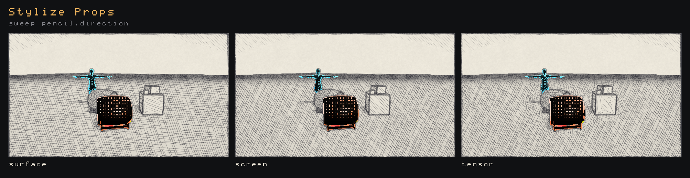

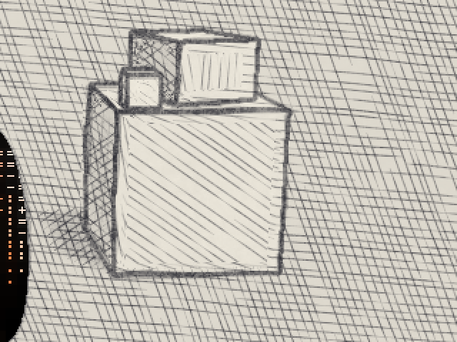

It runs at the display stage, at output resolution, with sizes in points (times the pixels-per-point scale), in two passes. The first pass writes each pixel's tone, contour strength and stroke direction into a scratch target. The second blurs the direction into a flow and draws the strokes. At 1080p on an RTX 4070 the whole frame costs about 0.49 ms. With only two props asking for it the cost is 0.19 ms, because both full-screen passes still run and only return early on unstyled pixels.

**Per entity.** Pencil works per entity in the same way as ASCII. A `pencil_style` component, or a plain `style_mask { style = "pencil" }`, draws that entity in pencil while the rest of the frame stays as it is, and each distinct set of settings becomes a variant with its own mask id. Every field of the table above except `scope` can be set on the component, and a field it leaves out comes from the scene's table, then the default. `grid = "object"` pins an entity's hatching to its projected origin, so its strokes travel with it. With `scope = "entities"` the scene's table is only a preset. A pixel that another style owns (an ASCII prop in a pencil frame) is left to that style.

```toml
[post_process.styles.pencil]
scope = "entities"     # a preset for the entities below
spacing = 5.0

[entities.cask.pencil_style]
color = 0.6            # coloured pencil over the cask's own colour
lead = [0.34, 0.17, 0.07]

[entities.ybot.pencil_style]
lead = [0.10, 0.18, 0.45]
sketchy = 1.0

[entities.tag.pencil_style]
enabled = false        # stays painted
```

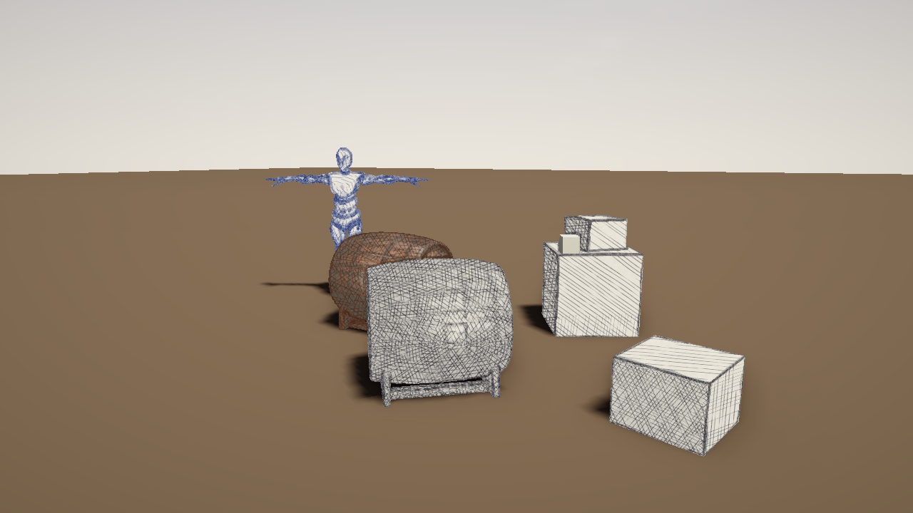

### Blending in and out

`blend` draws an entity part-way into its style, from 0 (its own shading) to 1 (the style's, and the default when it's left out). A script ramps it to fade a prop into text and back (#278):

```toml
[entities.barrel.ascii_style]
blend = 0.5
transition = "dissolve"   # or "fade", the default
```

```rust
fn on_init() {
    let barrel = get_entity("barrel");
    set_entity_style(barrel, "ascii");
    set_style_param(barrel, "blend", 0.0);          // styled, but nothing shows yet
    set_style_param(barrel, "transition", "dissolve");
}
fn on_update() {
    let k = (total_time() - 1.0) / 3.0;             // 0 -> 1 from 1 s to 4 s
    let k = if k < 0.0 { 0.0 } else if k > 1.0 { 1.0 } else { k };
    set_style_param(get_entity("barrel"), "blend", k);
}
```

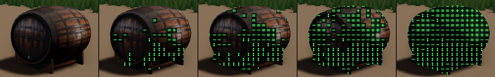

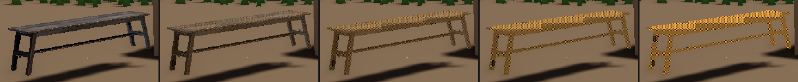

*Frames from `flint-player demo/ascii_reveal.scene.toml --frame-step 0.05 --screenshot-every 0.05`, cropped and doubled.*

- **`fade`** mixes every pixel of the entity with its glyph pixel by `blend`, in display space.
- **`dissolve`** turns whole cells: a cell is a glyph once `blend` passes its place in a dissolve order, half patch noise a few cells across and half per-cell hash, so glyphs arrive in ragged patches that spread. The order is fixed per cell, so a ramp never shimmers, and on `grid = "object"` it travels with the prop. On average the share of turned cells equals `blend`. A small prop holds few cells, so its share varies more: for a 6x5-cell prop at blend 0.5, the middle 80% of placings turn 30--73% of its cells; for 24x18 cells, 42--58%.
- **It rides in the mask, not the variant.** The [style mask](#the-entity-style-mask) carries each pixel's blend in its `.g` channel beside the id in `.r`. Two props fading at different rates still share one id, and a ramp makes no new variant, row or GPU object (a GPU test in `tests/stylize.rs` ramps it and counts). Like the id, the blend is the styled root's, inherited by its subtree.
- **`style_mask { blend = ... }`** works too, for a style with no component of its own. A style component's `blend` wins over the `style_mask`'s on the same entity.
- **Under a whole-frame style**, a prop at blend 0 is a smooth hole in the glyph field: the blend says how much of the entity's *own* variant shows, and below 1 the rest is the picture as it came.
- The `style` debug view draws each entity's hue as strong as its blend.
- **Cost.** The blend costs one more channel in the mask (`Rg16Uint`, 4 bytes a pixel) and no extra texture read. Pixels a blend leaves plain skip the glyph work: at 1080p `demo/stylize_blend.scene.toml`'s ASCII pass took 0.31 ms, against 0.39 ms for the same props fully styled.

`demo/ascii_reveal.scene.toml` is a 10-second loop: the barrel dissolves into phosphor glyphs, the bench fades into amber blocks, and both go back. The `ascii-blend` golden pins a half-way dissolve and a 40% fade.

### Style blends and render-mode tears

`--render-mode` 1--4 (matrix, blood, drunk, tron) and a style blend can both look like reality tearing into text, but they work at different levels:

| | Render-mode tears | Style blend |
|---|---|---|
| Where | Composite pass, before display styles | Display-stage style, after the composite |
| What it covers | The whole screen, through `tear_mask`: drifting fbm patches or an iris from the centre, in screen space | One entity and its subtree, through the style mask, on the entity's own cells |
| Driven by | `mode_mix` and `mode_params` (a scene-wide value) | `blend` on each entity's component |
| The look | Fixed per mode (mode 1's glyphs are an 8x12 dot-matrix built into `composite_shader.wgsl`) | Any style's settings: fonts, ramps, palettes, edges, grids |

Neither duplicates the other's job. Tears change how the *world* is seen, and a blend changes how one *thing* is drawn. They compose: an ASCII prop inside a matrix tear is glyphized from the tear's picture, since display styles read the composite's output. Mode 1's glyphs and the ASCII style do overlap as looks, and the `matrix` look (`--look matrix`) is the ASCII style's take on it. Letting a style's blend follow the tear mask, so props turn to text where reality tears, is left for later.

## Palette

The `palette` style (#324) draws the finished picture in a palette's colours and nothing else: no glyphs, no strokes. It is the [palettes](#colour-modes) on their own, as a look: a CGA screen, a green phosphor tube, ink on paper, or a game's house palette.

```toml
[post_process.styles.palette]
palette = "phosphor"   # a built-in, palettes/<name>.palette.toml beside the scene, or a path
dither = 1.0           # 0 = flat bands; 1 = an ordered 4x4 dither between colours
pixel = 4              # block size in points: 1 = per pixel, more = a chunky low-res screen
```

```bash
flint render demo/mesh_meadow.scene.toml --output meadow.png --schemas schemas \
  --style palette:palette=phosphor,dither=1,pixel=4
```

| Setting | Default | Meaning |
|---|---|---|
| `palette` | `cga` | Any palette ASCII takes: `cga`, `cga-warm`, `cga16`, `phosphor`, `amber`, `mono`, `paper`, or a file. One that can't be found warns once and uses `cga` |
| `dither` | 0 | For `nearest` palettes: a colour lying `s` of the way from its nearest colour to the next takes the next in `s x dither` of the blocks, by a 4x4 Bayer pattern. For `luminance` ladders: the tone moves up to half a rung either way. The pattern is fixed to the blocks, so a still camera gives a still picture |
| `pixel` | 1 | Block size in points (times the display's pixels per point). A block takes the mean of its pixels, in linear light, and is one colour |
| `chroma` | 1 | For `nearest` palettes: scale each block's saturation (OKLab a/b) before matching, as ASCII's [`chroma`](#palettes-match-in-oklab) does (0--4) |

**The ground is a colour here.** ASCII never inks a glyph in the palette's background, since the glyph's density already says how bright the cell is. The palette style has nothing else to say it with, so the ground joins the inks: `nearest` palettes list it first, and a `luminance` ladder takes it at its own lightness, so phosphor's near-black is the bottom rung and paper's cream the top. `Palette::table()` gives that list and `Palette::quantize()` the colour it draws for a pixel.

**One matcher.** A `nearest` palette picks with `pal_pick` in `crates/flint-render/src/palette.wgsl` (`palette::PALETTE_WGSL`, OKLab distance since #320) in both styles. Each shader concatenates the same file and defines `palette_ink(i)` and `palette_ink_lab(i)` over its own uniform, so a palette can't mean one thing in ASCII and another here. `Palette::pick` (and `palette::pick_in` over any list) is the same function on the CPU, and `the_palette_matcher_agrees_with_its_cpu_reference` holds them to each other. A `luminance` ladder is climbed by each style itself, since ASCII climbs it by the cell's tone; `the_palette_style_quantizes_the_frame_to_its_table` holds the palette style's ladder and nearest picks to `Palette::quantize`, flat and dithered. A new style that reads a palette should include the file rather than copy it.

`demo/pbr_test.scene.toml` and `demo/mesh_meadow.scene.toml` at 1280x720, cropped at 1:1; the right column is `dither=1,pixel=4`:

| | flat (`pixel=1`) | dithered, 4-point blocks |
|---|---|---|
| `cga` | 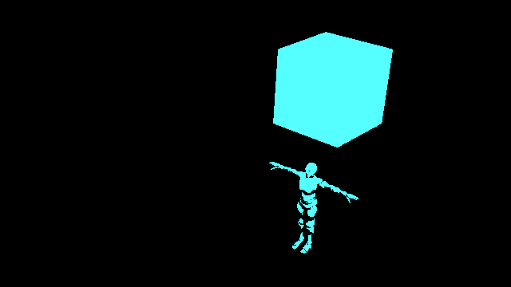 | 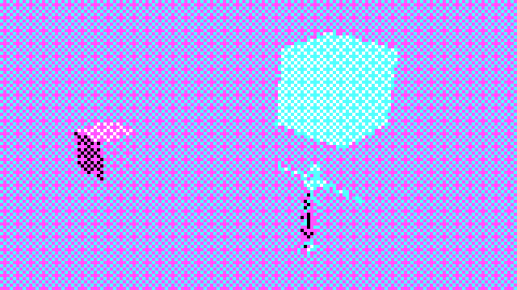 |
| | 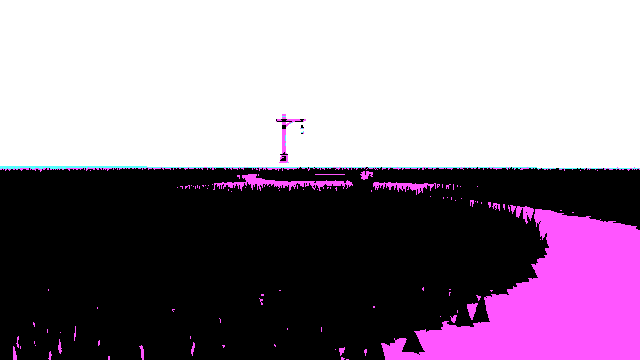 | 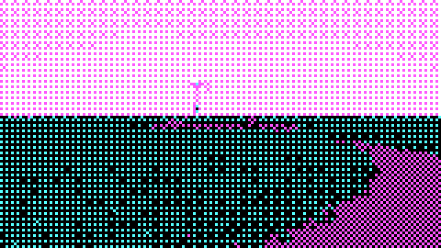 |
| `phosphor` | 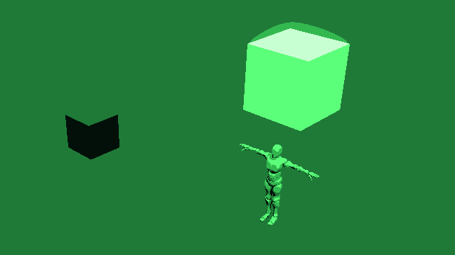 | 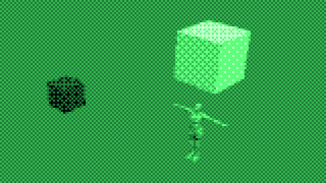 |
| | 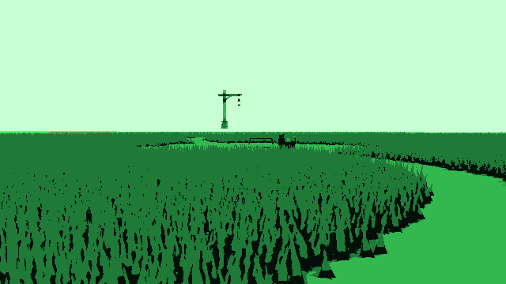 |  |
| `paper` |  |  |
| |  |  |
| `cga16` | |   |

Undithered `cga` is a hard look on a naturalistic scene: four colours, two of them black and white. Matching in OKLab, pbr_test's blue-grey floor (#636380) takes magenta, its nearest hue, and the meadow's dark grass goes to black under a white sky. That is the matcher being honest, not a bug, and the dither is what CGA artists used for it: the floor comes out a cyan-and-magenta weave. Ladders (`phosphor`, `amber`, `mono`, `paper`) are kinder, since every tone has a rung.

On an RTX 4070 at 1080p the pass costs 0.033 ms with `phosphor` (a ladder picks without a search), 0.086 ms matching `cga16`'s 16 colours, and 0.108 ms for `cga16` dithered in 4-point blocks (four bilinear taps a pixel; reading all 16 texels was 0.31 ms).

Palette runs after watercolor, ASCII and pencil, so with them on it quantizes their output, glyphs and strokes included, and before display bloom, so the bloom glows in the palette's colours instead of being quantized away.

## Watercolor

The `watercolor` style (#272) paints the picture as transparent pigment on paper. Colour bleeds into soft washes, the washes are laid in a few glazes, their borders wander, pigment pools darker along edges and settles into the paper's grain:

```toml
[post_process.styles.watercolor]
wash = 4.0          # how far pigment diffuses, in points (the wash's blur radius)
bleed = 0.55        # how much of the colour is the diffused wash
layers = 4          # glazes: tone steps, each edged darker on its darker side (0 = smooth)
wobble = 2.0        # how far borders and silhouettes wander, in points
wobble_scale = 40   # the wander's wavelength, in points
edge = 1.0          # pigment pooling at colour edges and glaze borders
edge_depth = 0.8    # pooling on the near side of silhouettes, from depth
edge_width = 1.5    # how wide that rim is, in points
turbulence = 0.35   # low-frequency blotches of thicker and thinner pigment
granulation = 0.5   # pigment settling into the paper's valleys, strongest in dark washes
grain = 0.35        # the paper's relief, shading even bare paper
grain_scale = 1.0   # the paper's tooth (bigger = coarser)
pigment = 1.0       # overall density: below 1 dilutes, above 1 deepens
paper_r = 0.97      # the paper's colour (paper_g 0.94, paper_b 0.87)
scope = "screen"    # or "entities": a preset for watercolor_style entities
```


*`flint render demo/mesh_meadow.scene.toml --style watercolor`, 1280x720.*


*`flint render demo/watercolor.scene.toml --no-grid`, 1280x720: per entity, as authored.*


*`--style kuwahara:radius=4 --style watercolor:layers=3`: the two chain.*


It runs at the **display stage**, after tonemapping, because it paints *on* paper: the paper and its grain must not be fogged, bloomed or graded as if they were in the world. Three passes: a separable Gaussian makes the wash (two targets of the style's own), then the paint pass wobbles where it reads the picture, the wash and the mask, mixes the wash in, steps it into glazes, works out the pigment's density, and lays it on the paper.

- **Density.** The colour is treated as the pigment layer's transmittance over white paper, and a layer `d` times as thick transmits `C^d` (Beer–Lambert). White stays the paper and black stays black; a mid-tone moves most. Edges, glaze borders, depth rims, turbulence and granulation all add to `d`.
- **Paper** lives in screen space, in points, so its grain holds still as the camera moves and is the same size to the eye at any `--pixels-per-point`. The noise is integer-hashed, so a frame is the same on every run.
- **Per entity.** A `watercolor_style` component (its fields are the keys above, `paper = [r, g, b]` for the paper's colour) or a `style_mask { style = "watercolor" }` paints an entity with no table, the rest of the frame passing through, exactly as [per-entity ASCII](#per-entity-ascii) works: the scene's table (with `scope = "entities"`) is the preset, entities with equal settings share an id, `enabled = false` opts out, descendants inherit. The mask is read at the wobbled position, so a painted prop's silhouette wanders a little over its surroundings, as a real wash's would. One frame holds 15 variants. `demo/watercolor.scene.toml` paints a static mesh, a skinned one, two props with settings of their own and an inherited one, and leaves one out.
- **One wash radius a frame.** `wash` is the largest any variant (or the scene) asks for; every other key is per entity.
- **With Kuwahara** they chain: Kuwahara (HDR stage) flattens the scene into brush pools, and watercolor then paints those pools on paper (`--style kuwahara:radius=4 --style watercolor:layers=3`). They share nothing, and neither needs the other.
- **With ASCII and pencil**, watercolor runs first by default (registration order), so glyphs and hatching draw over the paint. Give it a higher `order` to paint over them instead ([Order within a stage](#order-within-a-stage)).
- The `watercolor` look (`--look watercolor`) is the style with softened light (no bloom, lighter SSAO), `pigment = 0.85` and four glazes. `ink_wash` is still the Kuwahara-built monochrome look.

```bash
flint render demo/mesh_meadow.scene.toml --style watercolor -o meadow.png
flint render demo/watercolor.scene.toml -o props.png                       # per entity, as authored
flint render demo/stylize_props.scene.toml --look watercolor --sweep watercolor.layers=0,3,5,8 -o glazes.png
```

At 1080p on an RTX 4070 the whole-frame pass costs about 0.43 ms (`mesh_meadow`, `--gpu-time 240`). The per-entity demo costs 0.32 ms plus 0.03 ms for the mask: the wash is still blurred over the whole frame, and only the paint pass skips unpainted pixels. `--style watercolor:off` turns off the scene's table, not entities that carry a `watercolor_style` of their own; set `enabled = false` on them, as with ASCII.

## Display bloom

Display styles draw after the scene's bloom has run, so their bright marks can't feed it. ASCII's `glow` makes up for that inside each glyph's cell, but it stops at the cell's edge: a glyph never lights its neighbours, and a bright run of cells doesn't bloom as one. The `display_bloom` style (#321) is a bloom over the displayed picture, for any display style that wants one (ASCII's glyphs, pencil's highlights, a CRT look):

```toml
[post_process.styles.display_bloom]
intensity = 1.5    # how much halo is added
threshold = 0.55   # display value (0-1) a pixel's brightest channel must pass
knee = 0.25        # softness of that threshold, as a share of it
levels = 5         # how far it reaches: each level doubles it (in points)
saturation = 1.0   # 1 keeps the glyph's hue, 0 glows white
```


*A crop of `flint render demo/pbr_test.scene.toml --ascii --ascii-palette phosphor --ascii-glow 0.6` at 1280x720, shown at 3x, without and with `--style display_bloom`.*

- **Where it runs.** It's registered after ASCII and pencil, so by default it blooms what they drew. Give it an `order` to place it elsewhere in the display chain ([Order within a stage](#order-within-a-stage)).
- **The threshold is on what you see.** A pixel passes by its brightest channel in display values (0--1), with a soft knee. The halo itself adds in linear light. At the defaults the dim grass glyphs stay clean and only the lit box and the ridge glow; a lower `threshold` or a wider `knee` lifts the whole field.
- **The chain** has the HDR bloom's shape: a threshold into a half-size mip (four taps over each 4x4 block, so a one-pixel stroke lands whole), a 13-tap downsample per level, a tent upsample added back up level by level, and a composite that adds the result over the input. The mips are `Rgba16Float` textures of the style's own (`StyleFrame::target_sized`), the first mip chain a display style keeps. Each step has its own uniform slot, because every write lands before the frame's one submission.
- **`levels` is in points.** On a 2x display the chain takes one more level, so the halo keeps its size next to cells that also grew. The intensity is divided by the levels drawn, so changing the reach doesn't change the brightness.
- It's a whole-frame style with no per-entity component.

At 1080p on an RTX 4070 it costs **0.066 ms** (5 levels; `flint render demo/pbr_test.scene.toml --ascii --ascii-palette phosphor --style display_bloom --width 1920 --height 1080 --gpu-time 240`). Its mips add about 5.5 MB at 1080p (a half-size `Rgba16Float` texture and the quarter, eighth... ones under it). The `display-bloom` golden pins it over phosphor ASCII.

```bash
flint render demo/pbr_test.scene.toml --ascii --ascii-palette phosphor --style display_bloom -o glow.png
flint render demo/pbr_test.scene.toml --ascii --ascii-palette phosphor --style display_bloom --sweep display_bloom.knee=0,0.25,0.5 -o knee.png
```

## Looks and sweeps

A **look** (#279) is a named preset you can put over any scene. It lives in `styles/<name>.look.toml`, next to the `*.style.toml` generation guides, and has two tables. `[look]` says what the look is and which sweeps to try first. `[post_process]` is a block in exactly the scene format. The look's block is merged into the scene's own `[post_process]` key by key: tables merge and everything else replaces, so a look changes only the keys it names. A field or style the engine doesn't know is an error that names the closest real one, because otherwise a typo would quietly fall back to a default.

```toml
[look]
name = "graphite"
description = "Pencil sketch: cross-hatched tone, wobbling contours, paper grain"
tune = ["pencil.spacing=4,6,9", "pencil.contrast=1,1.4,1.8"]
notes = "Spacing is the pencil's sharpness..."

[post_process]
bloom_enabled = false

[post_process.styles.pencil]
spacing = 5.0
contrast = 1.4
wobble = 1.8
```

Five looks ship, compiled into the CLI so they work from a game repo as well. A `styles/<name>.look.toml` beside the scene, or in its parent folder, takes the place of a built-in with the same name.

| Look | Built from |
|------|------------|
| `ascii_noir` | mono ASCII, black ground, hard contrast, heavy vignette |
| `matrix` | phosphor-palette ASCII with glow, `detailed` ramp |
| `ink_wash` | Kuwahara radius 6, desaturation, warm paper fog and grade, grain: monochrome brush pools |
| `watercolor` | the watercolor style in four glazes, pigment 0.85, no bloom, light SSAO |
| `graphite` | the pencil style at a 5-point spacing, contrast 1.4, doubled outlines (inverted mono ASCII before #273) |

```bash
flint render --look help                                   # every look, its tune sweeps and notes
flint render scene.toml --look ink_wash -o wash.png
flint render scene.toml --look ink_wash --style kuwahara:radius=3 -o sharper.png   # flags apply over the look
```

**`--sweep KEY=V1,V2,...`** renders the same frame once per value and lays the frames out as one labelled contact sheet, four across, in the ASCII style's built-in glyphs. KEY can be:

- any `--style` key, written `<style>.<key>`: `ascii.cell=6,8,12`, `ascii.ramp=classic,blocks`, `kuwahara.radius=2,4,6,8`. Values are checked against the style's range;
- any `[post_process]` field, written `post.<field>`: `post.exposure=0.8,1.2`. Use `|` between values to sweep a vector: `post.fog_color=0,0,0|0.7,0.75,0.82`;
- `look=ascii_noir,matrix,ink_wash,graphite`, to compare whole looks;
- a Living Props wooze knob, written `wooze.<knob>`: `wooze.glide=0,0.25,0.5,1`, `wooze.preset=boil,morph` (knobs `amplitude`, `step`, `glide`, `jitter`, `preset`). This needs a build with the wooze field, which is on `feature/living-props` until it merges; elsewhere the flag parses the key and then refuses it.

Each family is one key prefix on the one flag, parsed by one type (`commands/sweep.rs`, #353), and every family lands on the same sheet. Each cell is 640x360 unless you pass `--width` and `--height`. The scene loads once and every column re-renders the same frame, so four columns of `stylize_props` take about 13 s in a debug build. A sweep goes over `--look` and every other flag. When two neighbouring columns come out pixel-identical, `flint render` warns that the sweep showed nothing between them: the style was off, nothing on screen read the key, or both values clamped to one.

The ASCII looks set no `edges` key, so they draw the [edge glyphs](#edges) by default; add `edges = 0` to a look's `[post_process.styles.ascii]` for tone alone. The two sweeps below were captured before edges landed, so the props in them aren't outlined.


### Two keys as a grid

Some keys only make sense together. Brightness and contrast both move the ground, so a contrast that looks right at one brightness can black the scene out at another. **Give `--sweep` twice** and the sheet becomes a grid (#358): the first key's values run across the columns, the second key's run down the rows, and every cell takes one value from each. A grid never wraps, so a column holds one value all the way down and you can read along either key. A grid takes up to 48 cells. You can't sweep the same key twice, or two `look=` lists; one axis can be a look and the other a post field or style key.

```bash
flint render demo/stylize_props.scene.toml --look ascii_noir \
    --sweep ascii.brightness=0,0.15,0.3,0.45 --sweep ascii.contrast=1,1.6,2.2 -o noir-grid.png
```


The pixel-identical warning works along both axes, and in a grid it says how many rows (or columns) the pair matched in: `ascii.cell=6 and 8 are pixel-identical: ... (in 1 of 3)`.

### Cells at the final scale

A style sized in points, such as ASCII's `cell` or pencil's `spacing`, draws as many glyphs across a frame as the frame has points. A 640-wide cell at `cell = 8` is 80 glyphs across, while the 1920-wide final render is 240, so a sheet of small frames can pick a winner that the final render disagrees with. Two flags draw each cell at the final size instead (#358):

- **`--sweep-crop X,Y,W,H`** draws every cell at `--width`x`--height` (1920x1080 unless you set them) and keeps that region pixel for pixel. The glyphs come out exactly the size the final render draws them, but you only see part of the frame. Choose a region that holds what the key affects, such as a prop's edge for glow or a gradient for a ramp.
- **`--sweep-scale full`** draws every cell at the full size and shrinks it to 640 wide. The composition matches the final render (where glyphs land, how much of the frame the tone fills), but the glyphs blur.

Both flags work with a grid. The sheet's subtitle states the scale, for example `1:1 640x360 at 760,520 of 1920x1080` or `1920x1080 shown at 33%`, so a reader knows what they are looking at. A crop that goes past the frame is refused before anything is drawn. `--sweep-scale cell` is the default.

```bash
flint render demo/stylize_props.scene.toml --look ascii_noir \
    --sweep ascii.glow=0,0.6,1.2 --sweep-crop 760,520,640,360 -o glow.png
```


Rendering at full size costs more: each cell is a whole 1080p frame. The pixel-identical check compares the full frames before they're cropped, so a crop can't hide a difference elsewhere in the frame.

### Measuring and refining a look

A sheet is judged by eye. **`--report FILE.json`** (#357) also measures each column, from the same pixels the sheet is made of: mean luminance, the share of near-black (luma ≤ 24) and near-white (≥ 232) pixels, edge density (the share of pixels whose right + down luma step passes 24), and, when the ASCII style drew, the grid's size, its share of blank cells and the share of cells on each step of the ramp, darkest first. Edge glyphs are counted in `off_ramp`. The same sweep prints a line per column:

```text
$ flint render demo/stylize_props.scene.toml --look ascii_noir \
    --sweep ascii.brightness=0,0.15,0.3,0.45 --report brightness.json -o brightness.png
  [0] luma 0.10  black 82%  white 1%  edges 24%  blank cells 29%
  [0.15] luma 0.18  black 69%  white 2%  edges 42%  blank cells 5%
  ...
```

**`--reference ref.png`** adds each column's distance to a target image, using the metric `flint gen --ai-refine` uses (#183): mean colour, a 16-bin luminance histogram and a 16x16 luminance layout, as a score out of 100 where 0 is the reference itself. It's a ruler, not a judge. It can say whether one column is closer than another, but it doesn't measure taste. On a sheet each label gets `d <score>`, the nearest column is starred, and `nearest` in the report names it. Under `--sweep-crop` or `--sweep-scale full` the image measures and distance are taken from the cell as the sheet shows it, while the ASCII section still counts the whole drawn frame's grid. A two-key grid reports every cell, each `value` naming both keys, but its labels carry no distances.

**`--ai-refine`** closes the loop: `flint render scene --look <x> --reference ref.png --ai-refine`. Each round an agent sees the reference, the current render, the look's block, every key it may change (with ranges) and every edit tried so far with its score. It proposes up to `--refine-candidates` (4) candidates in `--sweep` key syntax. Each candidate is checked like a sweep value, then rendered and measured. The best is kept if it lowers the distance by more than 0.05. The loop stops after `--refine-rounds` (4), or after two rounds in a row with no gain, or when the agent has nothing left to propose. It writes:

- `<look>_refined.look.toml` beside `-o` (or `--refine-out`): the kept block, plus a note of what was kept and what it cost;
- the same path with `.json`: the log of every candidate, its score and image measures, and whether it was kept;
- `-o`: a sheet showing the reference, the start, and each kept round.

`--ai-provider anthropic` (the default) asks Claude (`ANTHROPIC_API_KEY`, `--ai-model`). Every call goes through the procgen `CostMeter`: it's priced, appended to `.flint/procgen_costs.json`, and refused before sending when it could pass `--max-cost`. `--ai-provider mock` is free and offline. It walks the look's own `tune` sweeps one untried value at a time, which turns the loop into a measured coordinate search. Toward a hidden target (ascii_noir at cell 12, brightness 0.3, contrast 1.2), the mock went 7.68 → 0.00 in five rounds. Contrast 1.2 scored *worse* than the start on its own, and only helped once the other two had moved.

Toward the `matrix` look's render, with Claude (four calls, $0.115), ascii_noir went 25.66 → 15.09. Claude turned the colour to `tint` and the ramp to `detailed`, then found that `glow` was the strongest lever. It also learned from the log that whitening the tint and turning off the vignette both scored worse:


### Choosing cell size and ramp

- **The cell is in points, not image pixels.** A 640-wide sweep cell at `cell = 8` is 80 glyphs across, while the same look at 1920 is 240. Glow and fine ramps in particular read differently at full size. Add `--sweep-crop` or `--sweep-scale full` (see [Cells at the final scale](#cells-at-the-final-scale)) to sweep at the final size, or confirm the winner with one render at that size.
- **Size by columns.** About 200–240 columns (cell 8–9 at 1080p) keeps props readable. Below about 120 columns (cell 16 and up at 1080p) the image becomes a poster: silhouettes only, no surface detail. Cells of 4–5 read as texture or hatching, not as letters.
- **Pick a ramp for the tones the scene has.** `classic` (` .:-=+*#%@`, 10 steps) is the general-purpose ramp. `detailed` (70 glyphs sorted by coverage) gives the smoothest gradients and the most letter-like texture, so it suits small cells. `minimal` (` .oO@`) and `blocks` (` ░▒▓█`) have five steps each: they band hard, which suits big cells and posters.
- **Brightness first, then contrast.** When a scene comes out mostly black or mostly blank, sweep `brightness` before `contrast`. On `stylize_props` with `ascii_noir` at brightness 0, contrast 1.6 and 2.2 left the ground black. Contrast 0.6 or 1 brought the ground back, but it also flattened the props into it. Brightness 0.15 at contrast 1.6 brought the ground back and kept the props dark against it.

## Where styles run

Each style belongs to one of two stages:

```text
scene (HDR, render scale)
  -> style mask (Rg16Uint: id + blend, only while a style reads it)
  -> HDR styles (Kuwahara)          linear Rgba16Float, scene resolution
  -> SSAO, volumetric (depth), bloom (the original HDR, or the HDR styles' result: feeds_bloom)
  -> composite: fog, DoF, tonemap, grade, vignette, grain, render modes
  -> Display styles (watercolor, ASCII, pencil, palette, display bloom, invert) surface format, output resolution
  -> FXAA -> surface -> HUD
```

- **HDR stage.** Linear light at the scene's render scale. Everything after it shades the style: fog fades it, bloom haloes its bright strokes, the grade tints it. Bloom reads the unstylized scene unless a style feeds it (below). SSAO and volumetrics read depth and shadows, never colour, so no style changes them; the composite lays them over the stylized image.
- **Display stage.** The finished, tonemapped picture at output resolution, after the render-scale upscale and before FXAA and the HUD. This is where glyphs and lines stay crisp under `--render-scale` (the ASCII spike's finding).

Styles of one stage run one after another, each reading the one before it. The framework ping-pongs between two targets it owns, so any number of styles chain without a style knowing its neighbours.

The display stage keeps its memory to two full-size textures (#302). At 1440p each one is about 15 MB, which matters on phones and the web. The composite draws into the stage's input, and once the first style has read that input it is free to be a ping. With FXAA on, FXAA's intermediate is the second texture: the composite draws into whichever of the two leaves the last style writing the intermediate. So one style needs one texture of its own (two with FXAA's), and longer chains need two (still two with FXAA's). The output is byte-identical to the old chain. A style's own intermediates come on top of these; watercolor's two washes are full size, for example. The player's F3 stats show every target as `Style targets: N (MB, K full-size)`, where the full-size count includes FXAA's intermediate. The count is everything asked for since the last resize, so switching a style off doesn't lower it.

### Order within a stage

By default a stage runs its styles in registration order: kuwahara, watercolor, ascii, pencil, palette, display_bloom, invert, mask_view, edges_view, then user styles in the order they loaded. A style's table can give it a place of its own with `order` (#299). Lower runs first; a style without one stands at its registration index (watercolor 1, ascii 2, pencil 3, palette 4, display_bloom 5, invert 6), and equal orders keep registration order:

```toml
# ASCII first, then watercolor paints over the glyphs
[post_process.styles.ascii]
[post_process.styles.watercolor]
order = 9
```


- Any number works: an integer, a fraction to slip between two (`order = 2.5`), or a negative to go before everything.
- Only styles of the same stage compare. An HDR style always runs before a display style.
- A table switches its style on, so to place a style without turning it on write `enabled = false` beside `order`. Kuwahara takes `order` in its `[post_process.styles.kuwahara]` table like any other style.
- `--style ascii:order=0` sets it from the command line, and `--sweep watercolor.order=0,9` lays the orders side by side.
- The F4 Styles section opens with each stage's chain, first to last; **swap** runs a style before the one ahead of it, and Copy TOML writes the `order` back out.

`order` is a key of every style's own table, not a `style_order = [...]` list on `[post_process]`, because everything else about a style lives in its table: a [look](#looks-and-sweeps) or a `--style` word that adds one style can place it without restating every other style, Copy TOML stays one block, and a list naming a style the scene doesn't use would need its own warnings. The cost is that the whole order isn't written in one place, which is what the F4 chain line shows instead. No style may name a parameter or option `order` or `enabled`.

### Bloom from a style

By default bloom's threshold reads the scene *under* the HDR styles: light comes from the world, not the brush, so a painted surface keeps the halo its original bright pixels had. A style whose own bright shapes should glow (ink brighter than white, a bleeding highlight) **feeds bloom** instead: bloom then reads the HDR stage's result (#300).

- A style says so in its descriptor (`feeds_bloom: true`) or, for a user style, in its `.shader.toml` (`feeds_bloom = true`, `stage = "hdr"` only).
- A scene overrides it in the style's table, Kuwahara's included:

  ```toml
  [post_process.styles.kuwahara]
  feeds_bloom = true
  ```
- On the command line: `--style kuwahara:feeds_bloom=1`, `--sweep neon.feeds_bloom=0,1`. In F4 it is the **Feeds bloom** checkbox under each HDR style in Styles, Kuwahara's included, and Copy TOML writes it when it differs from the style's default.
- When any HDR style that ran this frame feeds bloom, bloom reads the stage's final result, every style in it included. A display style can't feed bloom: it runs after it (`feeds_bloom` on one is a warning). ASCII's phosphor halo is its own `glow` for that reason.

Kuwahara's default is unchanged: off.

|  |  |
|---|---|
| `demo/neon_bloom.scene.toml --style neon:feeds_bloom=0`: bloom reads the scene under the style. The lines are flat, and the lamp, which the style dimmed to a fifth, still haloes at full strength | The scene as written (`neon` says `feeds_bloom = true`): bloom reads the styled picture, so each line glows and the lamp's halo shrinks with it |
|  |  |
| Kuwahara at its default (`neon_bloom` with `--style neon:off --style kuwahara:radius=8 --exposure 2.2`, a crop at 2x): the lamp's halo keeps the original, unpainted rim | The same with `kuwahara:feeds_bloom=1`: the halo follows the painted strokes, so the rim breaks where the filter broke it. Subtle at Kuwahara's sizes, which is why it stays off by default |

## Writing a style

A style is one module in `crates/flint-render/src/stylize/` plus its name in the `register_styles!` list at the bottom of `stylize/mod.rs`. The module exports a `StyleDescriptor` called `STYLE`, built with `const` constructors (#366) so that a field added to the descriptor, a parameter or an option later gets its default in the constructor and no style has to change (the types are `#[non_exhaustive]`, so a game crate can't write a literal either):

```rust
pub(super) static STYLE: StyleDescriptor = StyleDescriptor::new(
    "invert",                      // the [post_process.styles.<name>] key
    "Invert",                      // F4 and --gpu-time
    StyleStage::Display,
    create,                        // fn(&StyleDevice) -> Box<dyn StylePass>: pipelines in d.format
)
.params(&[StyleParam::new("strength", 1.0, 0.0..=1.0)])
.hints(&[StyleHint::new("strength", "Strength", "0 = none, 1 = the full negative")]);
// Everything else has a default, and a setter for a style that differs:
//   .options(&[StyleOption::new(name, default, choices)])   named strings;
//       .discovered(fn) finds choices beside the scene (#322)
//   .uses_mask(MaskUse::Always)    the renderer draws the entity style mask for it;
//       MaskUse::When(fn(&config, &ids) -> bool): only while it says so (#350)
//   .needs(&[StyleNeed::Edges])    the shared geometry edges (#301)
//   .component("ascii_style")      entities take the style per entity (#266)
//   .feeds_bloom(true)             bloom reads this (hdr) style's result (#300)
```

An option's `choices` are a closed list unless it is `discovered`: its `fn(&ChoiceScope) -> Vec<String>` then gives the list wherever a scene is known (`StyleOption::choices_in`, which the F4 menu and `--list-styles` read), from `scope.files("palettes", ".palette.toml")` (names in the scene's folder, its parent and `.`, through the vfs) and the other options' values (`(scope.option)("font")`). A discovered option is open: `--style ascii:palette=tidepool` passes, and the style resolves the name and warns if it can't.

`hints` are optional, and F4 draws a style without them: a setting with no hint shows its own name (`edge_max` becomes "Edge max") on a plain slider. A hint gives a setting (or a colour, by its key) a label, a hover line, and `.integer()` for a value that only makes sense whole (ASCII's cell size). `.when(option, &[values])` says the setting is read only while that option has one of those values, and `.unless(option, &[values])` that it is idle while it does; F4 greys the row out while a condition fails (a hint holds up to two). ASCII's are

```rust
StyleHint::new("tint", "Tint", "The ink for colour mode tint").when("color", &["tint"]),
StyleHint::new("background", "Background", "How much of the scene shows behind the glyphs (dim ground)")
    .when("ground", &["dim", "inverse"])
    .unless("color", &["palette"]),
```

A greyed row's reset button stays live, and the value is kept: it only stops mattering. `StyleDescriptor::unused_reason(config, name)` gives the hover line, or `None` while the setting is read.

### Colours

A colour is three parameters named `<base>_r`, `<base>_g` and `<base>_b`, each 0--1 in display values (what the eye sees, sRGB-encoded), and the framework makes them one setting (`StyleColor`, #315) everywhere a person or an agent meets it:

| Where | What it looks like |
|---|---|
| Scene table, `ascii_style`-type components | `tint = [1.0, 0.7, 0.25]` (integers allowed) or `tint = "#ffb340"`; a channel on its own (`tint_g = 0.5`) still works |
| `--style` | `ascii:tint=#ffb340` or `ascii:tint=1/0.7/0.25` |
| F4 → Styles | one colour picker |
| Copy TOML (`stylize::style_toml`) | `tint = [1.0, 0.7, 0.25]`, only when it differs from the default |
| `--list-styles` | one row, `tint  [0.35, 1, 0.45]  colour`; `colors` in the JSON |
| Scripts' `set_style_param` | `set_style_param(id, "tint", [1.0, 0.7, 0.25])` or `"#ffb340"`, clamped to the channels' ranges |
| The style, in `encode` | `frame.color("tint")` → `[f32; 3]`; per entity, `frame.variant_color(v, "tint")` |

Underneath they stay three parameters, so a per-entity variant row or a uniform reads three numbers as before and a style declares nothing new. A user-authored style gets the same by naming three `[params]` that way. `StyleDescriptor::colors()`, `color_setting(base)` and `color_of(param)` find them; `stylize::color_from_toml` / `color_from_text` parse the two spellings.

and the `StylePass` that `create` returns records the style's draws for one frame:

```rust
impl StylePass for Invert {
    fn encode(&self, frame: &StyleFrame<'_>, encoder: &mut wgpu::CommandEncoder,
              input: &StyleInput<'_>, output: &wgpu::TextureView) {
        // write uniforms from frame.param("strength"), then draw one
        // full-screen triangle that samples `input` into `output`
    }
}
```

`stylize::kit` has the parts most styles are made of: `fullscreen_pipeline`, `uniform_layout`, `sampled_layout`, `uniform_buffer`, `shader` and `fullscreen_pass`. `stylize/invert.rs` and `invert.wgsl` together are about 140 lines.

What a style gets from `StyleFrame`:

| | |
|---|---|
| `width`, `height`, `format`, `texel_size()`, `srgb()` | the stage's size and format |
| `param(name)` | the style's parameter from the config, or its default |
| `option(name)` | the style's option (a string) from the config, or its default |
| `color(name)` | the style's [colour](#colours) `name` (`tint`) as `[r, g, b]` in display values, each channel from the config or its default (#315) |
| `pixels_per_point` | the window's scale factor (1 headless, or `flint render --pixels-per-point`), for styles sized in points |
| `scene_dir` | the scene's folder when the host knows it, for styles that load files (ASCII's glyph sets) |
| `depth`, `camera` | the scene's depth (sample by UV) and the inverse view-projection, position, near and far |
| `mask`, `mask_bind(...)`, `style_id(name)` | the [entity style mask](#the-entity-style-mask), while a `uses_mask` style is on |
| `edges`, `edges_bind(...)` | the [shared geometry edges](#shared-edges), while a style that `needs` them is on |
| `target(name, format)` | a texture of the style's own at the stage's size, kept until the next resize |
| `sampled(...)`, `sampled_input(...)`, `uniform(...)`, `bind(...)`, `depth_bind(...)` | bind groups kept with the post chain |
| `first_write(name)` | true once per chain, for uniforms that only change on resize |
| `time` | game seconds, for animated styles |

What the framework does so a style doesn't have to:

- **Lazy building.** A style's pipelines are built the first frame it is on, under `catch_unwind` (some drivers crash compiling shaders); one that fails stays off. Hosts can call `SceneRenderer::ensure_style_resources` after setting a config to move the compile off that frame.
- **Resize.** Every target and cached bind group lives in the post chain's resources, which `resize_postprocess()` rebuilds. There is no per-style resize hook to forget.
- **Formats.** HDR-stage styles draw in `Rgba16Float`; display-stage styles in the surface format. On an sRGB surface a display style samples linear values and its writes are encoded, so a style that works in display values decodes and encodes itself (`frame.srgb()`; `invert.wgsl` shows how).
- **Samplers.** Styles bind the chain's one linear sampler, so their bind groups add nothing to DX12's 2048-slot sampler heap.
- **The mask.** A `uses_mask` style gets the entity style mask drawn for it each frame, and no style pays for it otherwise. `MaskUse::When` asks per frame from the config and the ids (#350): ASCII reads it only while `edges > 0` and something is styled, or another style's entity passes through it, so `--ascii-no-edges` in a scene with no `style_mask` makes no mask target and `--gpu-time` shows no "Style mask" line.
- **Shared inputs.** A style that lists `StyleNeed::Edges` in `needs` gets the [geometry edge texture](#shared-edges), drawn once a frame however many styles read it.
- **Timing.** Each style is a GPU-timer scope under its `label`, so `flint render --gpu-time` and the player's `--perf` name it.
- **The command line.** `flint render --style <name>` reaches a new style from its descriptor alone.

## User-authored styles

*Experimental, format version 1 ([ADR 0112](../../../adr/0112-user-authored-styles.md); #274, #275). `flint render`, `flint edit`, `flint-player`, `flint bundle` and the web player all load them.*

A game can write a style without touching the engine: a `styles/<name>.shader.toml` and one WGSL function beside it. Flint finds them in the scene's `styles/` folder, then in the folder above (as it finds models), so a game with `levels/` and `styles/` side by side needs nothing else. Start from the commented template, `demo/styles/template.shader.toml` and `template.wgsl`: copy both into your `styles/`, rename them and edit.

```toml
# styles/greyscale.shader.toml
version = 1
name = "greyscale"         # the file stem; lowercase, digits and _
stage = "display"          # or "hdr"
shader = "greyscale.wgsl"
inputs = []                # any of "depth", "mask", "edges"; colour is always there
# feeds_bloom = true       # hdr only: bloom reads this style's result (#300)

[params.amount]
default = 1.0
min = 0.0
max = 1.0
label = "Amount"           # optional, with help = "..." and integer = true
```

```wgsl
// styles/greyscale.wgsl
fn style(p: StylePixel) -> vec4<f32> {
    let grey = vec3<f32>(flint_luma(p.color.rgb));
    return vec4<f32>(mix(p.color.rgb, grey, params.amount), 1.0);
}
```

It is then a style like the built-ins: `[post_process.styles.greyscale]` turns it on, `--style greyscale:amount=0.5` and `--sweep greyscale.amount=0,0.5,1` reach it, and the F4 menu draws its sliders (`<base>_r/_g/_b` params become one colour picker).

Flint writes everything around the function: the bindings, a `params` struct with one `f32` per parameter, and the entry points. `p.uv` is 0..1 from the top left, `p.pos` the pixel, `p.color` the input there. At the display stage colours in and out are display values on any target, so a style never decodes sRGB itself. At the hdr stage they are linear HDR.

| | |
|---|---|
| `flint.resolution`, `flint.texel`, `flint.time`, `flint.frame`, `flint.pixels_per_point` | the frame |
| `flint.near`, `flint.far`, `flint.camera_pos`, `flint.inv_view_proj` | the camera |
| `flint_sample(uv)` | the input anywhere, in the same space as `p.color` |
| `flint_luma(c)`, `flint_hash(v)`, `flint_to_display(c)`, `flint_to_linear(c)` | small helpers |
| `flint_depth(uv)`, `flint_view_depth(uv)`, `flint_world_pos(uv)` | with `inputs = ["depth"]`: raw depth, metres from the eye, the world position |
| `flint_mask_id(uv)`, `flint_style_blend(uv)` | with `inputs = ["mask"]`: the [style mask](#the-entity-style-mask) id, and 0..1 for entities whose `style_mask` names this style (their `blend`) |
| `flint_edges(uv)`, `flint_edge(uv)` | with `inputs = ["edges"]`: the [shared edges](#shared-edges) (silhouette, crease, direction), and the stronger of the two strengths; 1 is an edge |

**When it goes wrong.** Flint checks the composed shader with naga before the GPU sees it. An error names your file, line and column, quotes the line, and gives a hint if you called a depth or mask helper without declaring the input. A style that doesn't compile still loads and draws its input unchanged, so the scene keeps its other styles. Loops are allowed, but each one is warned about: a loop that never ends hangs the GPU until the driver resets it.

**Hot reload.** Natively, both files reload while the player or viewer runs, a few times a second:

- Save the `.wgsl` and the next frames draw it. If the edit doesn't compile, the last good build keeps drawing.
- Save the `.shader.toml` and the style is replaced where it stands in the chain, with its new parameters, label, stage, inputs or shader. The scene's `[post_process.styles.<name>]` is read again against them (other F4 edits stay). A description that no longer reads keeps the old style and reports.
- A new `*.shader.toml` dropped into a `styles/` folder is picked up too.

Until a broken style compiles, a card in the bottom-left corner of the player and the viewer shows its error with the line it points at, and the style's F4 header is tagged `error` (hover it for the message; the `user` tag beside it names both files). `flint render` prints the same message and renders the passthrough.

|  |  |
|---|---|
| A game outside the engine (`levels/`, `styles/cyanotype.*`) in `flint-player`, after its `.wgsl` was edited live | The next save had a typo (`params.exposre`): the card names `cyanotype.wgsl:7:57` and quotes the line while the last good build keeps drawing |

**On the web.** `flint bundle` packs `styles/` with the rest of the game. It loads every user style each scene sees from the packed files, the way the browser will, and refuses the bundle if a description doesn't read, its shader isn't packed or the shader doesn't compile. In the browser the style is checked by the browser's own compiler, and nothing reloads (#415 tracks showing those errors on the page).

|  `hologram`: `inputs = ["mask"]`; the YBot and the barrel carry `style_mask { style = "hologram" }`, the barrel at `blend = 0.6` |  `--style contour`: `inputs = ["depth"]`; height lines from `flint_world_pos`, range rings round the eye |
|---|---|
|  `--style risograph` (a crop at 1:1): two dot screens out of register, colour only | Each is one `.shader.toml` and under 50 lines of WGSL in `demo/styles/`; none needed a rebuild of the engine |

**What a user style can't do yet:** more than one pass, textures of its own, string options, per-entity settings (a component like `ascii_style`), frame history. The built-ins that need those stay in Rust. The demos in `demo/styles/` show what one pass reaches: `risograph` (two misregistered inks), `contour` (survey lines from depth), `neon` (an hdr style that feeds bloom, `demo/neon_bloom.scene.toml`) and `hologram` (a style mask on chosen props, `demo/user_styles.scene.toml`).

## Goldens

Every registered style is pinned by a golden image in `crates/flint-cli/tests/golden/`, listed in `stylize.goldens.toml` (#271). `flint render-suite` renders each case as `flint render` would, all in one process (#329), and fails when one moves past its tolerance; `cargo test -p flint-cli --test render_goldens` runs the same suite. CI runs it on WARP for every PR (#314), against a `<stem>.warp.png` variant where WARP's render differs from the golden by more than the tolerance allows ([adapters and variants](../guides/headless-rendering.md#adapters-and-golden-variants)). Each run leaves an `index.html` contact sheet in its out dir, failures first, with golden, render and diff side by side ([the contact sheet](../guides/headless-rendering.md#the-contact-sheet)). Review a `--bless` there.

```bash
flint render-suite crates/flint-cli/tests/golden/stylize.goldens.toml            # gate
flint render-suite crates/flint-cli/tests/golden/stylize.goldens.toml --case ascii-entity
flint render-suite crates/flint-cli/tests/golden/stylize.goldens.toml --bless    # after a deliberate change
```

| Case | What it pins |
|------|--------------|
| `ascii-full` | `--style ascii:edges=0` on `pbr_test`: the #265 golden, unchanged with edges off, and its character grid exactly (`ascii_pbr_test.txt`, #317) |
| `ascii-full-detailed-tint` | another ramp and the tint colour mode on `stylize_props`, with edges |
| `ascii-full-hidpi` | `--pixels-per-point 2`: cells in points (edges off) |
| `ascii-full-msaa4` | `--msaa 4` scene passes under the glyph grid (edges off) |
| `ascii-edges-pbr` | [edges](#edges) on `pbr_test`, grid off |
| `ascii-edges-pbr-grid` | the same with the editor grid on: the grid writes no depth, so no edge traces it (#346) |
| `ascii-edges`, `ascii-edges-msaa4`, `ascii-edges-scale05` | the styled sphere and box of `demo/ascii_edges.scene.toml` outlined, at 1x, under MSAA 4 and at `--render-scale 0.5` |
| `ascii-entity`, `ascii-entity-object` | the spike's per-entity modes (#261), screen and object grids |
| `style-mask` | the entity style mask the per-entity styles read (`--debug-mode style`) |
| `edges-view`, `edges-inkline-scale05` | the [shared edges](#shared-edges) on the props scene, and a user style reading them beside `edges_view` at `--render-scale 0.5` |
| `invert`, `kuwahara` | the other styles, with a tighter tolerance |
| `palette-phosphor-dither`, `palette-cga16` | the [palette style](#palette) on the props scene: a ladder dithered in 2-point blocks, and nearest colours flat. Glyph tolerance, since a colour on a boundary flips a whole block |

Cases render single-sample with the post clock at 0 unless they say otherwise. The props cases use `demo/stylize_props.scene.toml`, which loads in a few seconds in a debug build, with the grid off. Glyph styles share #265's tolerance (fail when more than 2% of pixels differ by more than 48 levels, or the mean passes 3), since a cell on a ramp step's border can flip glyph on another GPU; smooth styles take `level = 8, share = 0.003, mean = 0.25`, because Kuwahara at radius 4 against a radius-5 golden is a 0.39 mean the glyph limits would pass. On one machine, every case is byte-identical run to run. **A new style adds a case here.** The manifest format is in [Headless Rendering](../guides/headless-rendering.md#golden-suites).

## Shared edges

Line styles are defined by their edges, and the edges that read best come from the geometry, not the picture's colour: a wood texture makes none, while a table's outline and the creases where its faces meet do (the ASCII spike's round 2, #261). Finding them costs a 5x5 patch of positions unprojected from the depth for every pixel, so the framework does it once a frame (#301) and hands the result to every style that asks. A style asks in its descriptor, `needs: &[StyleNeed::Edges]`, and reads `frame.edges` (bind it with `frame.edges_bind(...)` over a `kit::texture_layout`); a [user style](#user-authored-styles) adds `"edges"` to its `inputs` and calls `flint_edges(uv)`.

The texture is `Rgba16Float` at the depth's size (the scene's, so under `--render-scale` a display style reads it by UV, like the depth and the mask):

| channel | holds |
|---|---|
| `r` | silhouette strength: a 3x3 Sobel of the view distance relative to the centre pixel's (so a far edge counts as much as a near one), kept on the near side only, over `edge_depth` |
| `g` | crease strength: the Sobel of normals rebuilt from the depth, counted only where the 5x5 patch is one surface (across a depth step rebuilt normals mark a band on both sides), over `edge_normal` |
| `ba` | the unit direction across the edge in screen space (x right, y down): the silhouette's where `r >= 1`, else the crease's, picked from both axes of the normal Sobel |

A strength of 1 is an edge at the scene's thresholds. The two pixels at each border are always 0, where the patch clamps and makes a degenerate normal.

```toml
[post_process]
edge_depth = 0.6     # the relative view-distance step that is a silhouette
edge_normal = 2.5    # the normal change that is a crease
```

The thresholds are shared because the pass is: every style reading the edges sees the same strengths. A style that wants more or fewer lines compares them against a level of its own (`demo/styles/inkline.wgsl` multiplies them by its `reach`). `flint render --edge-depth` / `--edge-normal` set them for one render, and F4's Styles section has them under **Shared edges**.

|  | ![inkline, a user style with inputs = ["edges"], over the same scene](../images/shared-edges-inkline.png) |
|---|---|
| `--style edges_view`: the texture itself. Hue is the direction (opposite sides of a line agree), silhouettes are solid, creases softer; `ghost` shows strengths just under the threshold while tuning | `--style inkline` (`demo/styles/inkline.*`): flat paper tones under ink from `flint_edges`, about 40 lines of WGSL. Here it runs after the scene's own ASCII and pencil props |

At 1920x1080 on an RTX 4070 the pass costs about 0.16 ms, once, with one or two styles reading it (`--gpu-time` names it **Style edges**); `edges_view` and `inkline` add 0.04 ms each. While no style that needs the edges is on, the pipeline isn't built and nothing is drawn. The ASCII and pencil styles still find their own edges (ASCII's also outlines its own mask ids, pencil's adds luma edges); moving them onto the shared texture is still to do.

## The entity style mask

A style that should change only some entities (per-entity ASCII, watercolor or pencil) needs to know, per pixel, which entity drew it. The entity style mask is that answer: an `Rg16Uint` texture at the scene's resolution, with one id a pixel in `.r` (0 where no style asked) and the entity's [blend](#blending-in-and-out) in `.g` (65535 for 1, #278).

An entity asks with the `style_mask` component:

```toml
[entities.barrel.style_mask]
style = "pencil"        # entities sharing a name share an id

[entities.lantern_glass.style_mask]
enabled = false         # out of any style, including an inherited one
```

Descendants inherit their ancestor's style until one of them carries a `style_mask` of its own. Ids are numbered from 1 in name order, so the same scene gets the same ids on every run; a style finds its own with `frame.style_id("pencil")`.


See it with the `style` debug view, which switches the `mask_view` style on and runs it alone: while the view is up the scene's other styles, of either stage, are suspended, so the hues lie over the plain scene rather than over glyphs or hatching (#334). A scene that turns `mask_view` on in its own `[post_process.styles]` keeps its chain, the mask view reading whatever ran before it:

```bash
flint render demo/style_mask.scene.toml --debug-mode style --output mask.png
```

Each style is a hue over the scene's shading, unstyled pixels are grey, and a white line marks where two ids meet. A legend in the image's lower left gives each id's swatch and name, and the command prints the same table (#309):

```text
style mask: 1 ascii (blue), 2 pencil (lime)
```

Ids follow name order, so they shift when a scene adds a style: read the legend rather than remembering a hue. A variant is its own row (`ascii{ramp=blocks}`, `ascii@barrel`). In the player and viewer the view is **Style Mask** in F4's debug shading list, and choosing it shows the same legend under the list; `flint_render::style_mask::legend` / `legend_line` build it from `SceneRenderer::style_ids()` for any other host.

How it's drawn:

- **A redraw, not a new attachment.** After the scene pass, each visible opaque draw of a styled entity is drawn again into the mask with its cached transform bind group (and bone bind group for skinned meshes). The scene pipelines don't change and the per-entity loop makes no buffers or bind groups; the ids go up in one write a frame.
- **Depth without a depth buffer.** A mask fragment tests itself against the scene's single-sample depth with a tolerance of twice its own depth slope, so grass or a wall in front of a styled prop cuts its mask. Under `--render-scale` the mask is at the scaled size, and a display-stage style reads it by UV.
- **MSAA: drawn 4x, resolved "any sample wins"** (#306). Under `--msaa 4` the mask is drawn into a 4x target of its own, and each sample the triangle covers is tested against that sample of the scene's multisampled depth. A resolve then folds the four samples into the single-sample mask the styles read: a pixel takes the id that covers the most samples, and is empty only if no sample was styled. Drawn single-sample at pixel centres, a feature about a pixel thin (the bench's seat edge at a grazing angle) lost the pixels the scene's samples gave it, and an outline style drew the gaps as white dashes. The 4x target costs 33 MB at 1080p, and only while MSAA and a mask-reading style are both on.
- **Only when wanted.** The mask target and its pipelines exist only once a style whose `uses_mask` asks for it this frame (or the debug view) is on. At 1080p on an RTX 4070 the pass (with the veil) costs about 0.022 ms for `demo/style_mask.scene.toml`'s styled entities, or about 0.05 ms under MSAA 4 with the 4x draw and its resolve, some 0.025 ms more than the single-sample mask cost there before #306.
- **What's masked.** Static glTF meshes, procedural boxes, skinned meshes, terrain (#310) and styled transparents (#310, below). Particles, sprites, grass and water never are: grass is instanced, and the rest write no depth to test against.

### Terrain and transparents

A heightmap terrain is masked like any mesh when its entity carries a `style_mask` or a style's component (`ascii_style`, `pencil_style`), or inherits one. Each visible chunk is redrawn into the mask with the terrain's own transform, so an ASCII or pencil ground runs under smooth props, and every unstyled prop on it cuts its own hole, pixel by pixel, from the depth test:

```toml
[entities.ground]
archetype = "terrain"
[entities.ground.ascii_style]
color = "tint"
tint = [1.0, 0.72, 0.32]
```

The host names the terrain's entity (`SceneRenderer::set_terrain_entity`) beside `load_terrain`; `flint render` and the player do.

**A styled transparent is a lens.** Glass, a ghost or a hologram with a style of its own is drawn into the mask after every opaque, back to front as the scene drew it. It writes no depth, but it is tested against the depth the opaques wrote, so an opaque in front still hides it. Where it shows, its id (and its blend) replaces whatever was behind it, and the style draws that whole pixel: what you see through a green-glyph pane comes out in green glyphs. The decision, and the alternatives it was chosen over:

- *Skip styled transparents* (the mask before #310). A pane that asks for a style would draw as plain glass, which surprises whoever asked.
- *Mask by coverage.* A half-covered pixel would be a share of the glass's style and a share of what's behind. One id per pixel can't carry two styles, and the coverage would need the material's alpha (texture and all) in the mask pass itself; the veil below samples it only for unstyled transparents. The blend channel already gives a lens a softer edge: set `blend` below 1 on the pane to mix the style with the plain view through it.

What the lens costs: the pixel the style redraws is the composite (glass and all behind it), and a transparent cut-out (an alpha-textured leaf card drawn blended) masks its whole quad, since the mask pass doesn't sample the material. Unstyled transparents in front of a styled entity, the lens included, are the veil's (below), the other side of the same question. The veil is depth-tested only against opaques, so an unstyled transparent *behind* a styled pane also thins the pane's blend where they overlap.


### What's in front: the veil

Transparents and particles write no depth, so the depth test alone can't see them: where fire or glass sits in front of a styled stone, the stone's id would stay in the mask and the style would draw the fire as if it were stone. The rule (#290) is that **what's in front unmasks by its coverage.** Just before the mask, a veil pass draws every visible transparent mesh (static and skinned) and every particle into an `R8Unorm` target, depth-tested against the scene and never writing it, with the alpha it is drawn with (an additive particle covers by its alpha times its brightest channel). Layers blend "over" each other, so two faces of 50% glass cover 75%. The mask then writes each styled pixel's blend times what the veil leaves uncovered.


```bash
flint render demo/style_veil.scene.toml --particle-time 2 --output veil.png
```

- A style that honours the blend (ASCII, and user styles through `flint_style_blend`) shows the fire as fire and the stone through any uncovered share. A fully covered pixel keeps its id at blend 0, so under a whole-frame ASCII the stone behind thick smoke is a smooth hole, as a blend-0 entity is. Pencil and watercolor ignore `.g` and still draw what's in front in their style until the framework cross-fade (#396).
- A transparent that is itself styled stays out of the veil: it is in the mask as a lens ([above](#terrain-and-transparents)).
- The pass costs about 0.02 ms at 1080p on an RTX 4070 for `demo/style_veil.scene.toml` (69 particles and a pane), and is skipped in a frame with no styled draws.

To read it in a style, set `uses_mask: MaskUse::Always` (or `MaskUse::When(f)` to read it only under some settings), make a layout with `kit::mask_layout` and bind it with `frame.mask_bind(...)`; in WGSL it is a `texture_2d<u32>` read with `textureLoad`, the id in `.r` and the blend in `.g` (`stylize/mask_view.rs` and `mask_view.wgsl` show the whole thing). A per-entity style honours a blend by mixing its pixel with its input by `f32(m.g) / 65535.0`; one that ignores `.g` draws every entity at blend 1.

### Per-entity settings

A style that takes settings per entity names its component in its descriptor: `component: Some("ascii_style")`, with a schema in `schemas/components/`. The framework then does the rest:

- an entity carrying the component (or a `style_mask` naming the style) switches the style on for the frame, and the mask is drawn, with no `[post_process.styles]` table;
- the component's fields are read as the descriptor's params and options (a 3-array `x` fills `x_r`, `x_g`, `x_b`), and each distinct set is a `StyleVariant` with its own mask id, named for its settings (`ascii{cell=12,ramp=blocks}`, `ascii@barrel`, `ascii{off}` for `enabled = false`);
- a style whose `grid` option is `object` gets one variant per styled root, with `anchor` set to the root's world origin each frame (`frame.project(anchor)` puts it on screen).

In `encode`, `frame.variants()` lists this style's `(id, variant)` pairs, `frame.variant_param(v, "cell")`, `frame.variant_option(v, "ramp")` and `frame.variant_color(v, "tint")` read a variant's settings with the scene's as fallback, and `frame.whole_frame()` says whether the scene's table covers everything. `stylize/ascii.rs` and `stylize/pencil.rs` pack them into a table indexed by mask id; watercolor (#272) can do the same.
