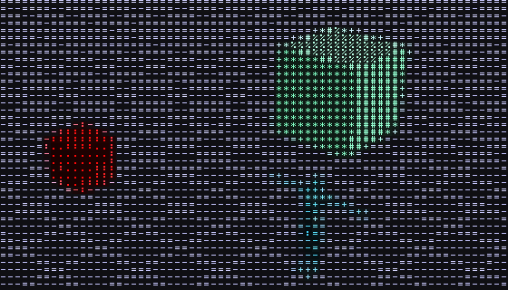
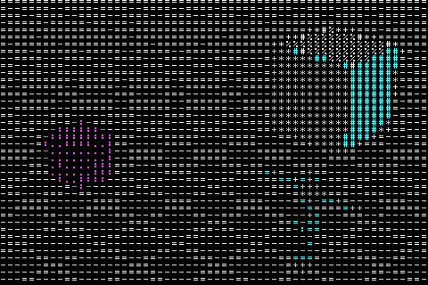
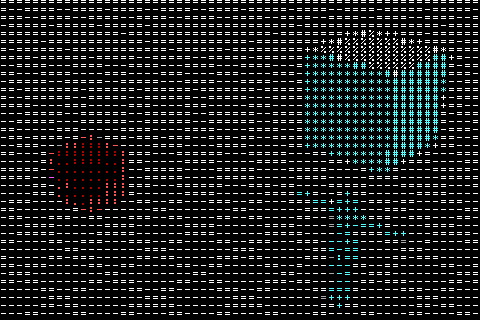
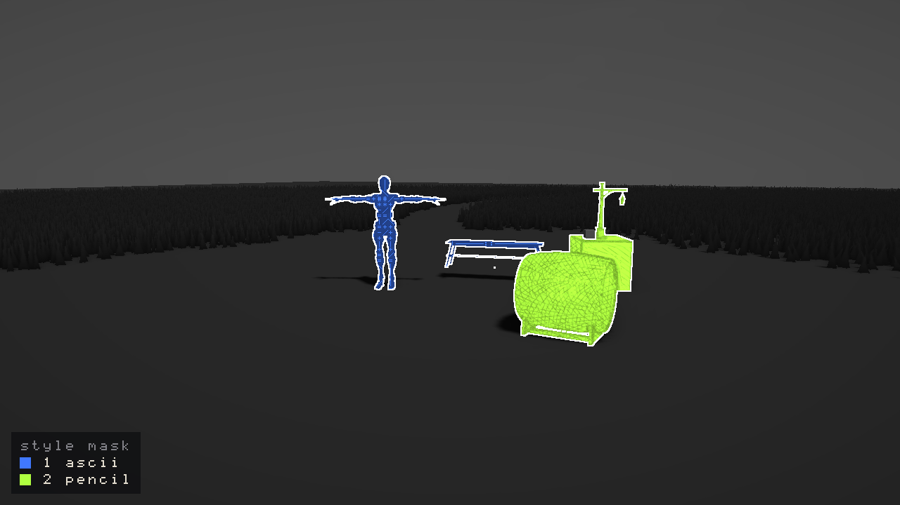

# Stylize Passes

A stylize pass is a full-screen effect that changes how the picture looks rather than how the light behaves: the painterly Kuwahara filter, and the ASCII, watercolor and pencil styles planned after it (epic #260). They share one framework in `flint-render` (`crates/flint-render/src/stylize/`), so a new style is mostly a shader and a parameter list.

## Using a style

A scene switches a style on with a table under `[post_process]`:

```toml
[post_process]
bloom_enabled = true

[post_process.styles.invert]
strength = 1.0          # a parameter: a number
```

A table switches its style on unless it says `enabled = false`. Every other key is one of the style's parameters (a number) or one of its options (a string, such as a font or a ramp). Unknown style names and keys are reported as warnings when the scene loads, with the names that do exist:

```text
WARN unknown style 'watercolour' in [post_process.styles]; registered: kuwahara, ascii, invert, mask_view
WARN style 'invert' has no parameter 'wobble'; it takes: strength
```

Kuwahara predates the table and keeps its own `kuwahara_*` fields (see [Post-Processing](post-processing.md#kuwahara-painterly-filter)).

From the command line, `--style name[:key=value,...]` turns any registered style on over a scene without editing it (#271), on `flint render` and on `flint edit <model or effect> --render`:

```bash
flint render demo/pbr_test.scene.toml --style ascii
flint render demo/stylize_props.scene.toml --style ascii:ramp=detailed,color=tint,cell=10
flint render demo/pbr_test.scene.toml --style invert:strength=0.5 --style kuwahara:radius=6
flint render levels/tavern.scene.toml --style ascii:off       # a style the scene has on, off
flint edit demo/models/barrel.glb --render barrel.png --style ascii:cell=6
flint render demo/pbr_test.scene.toml --style help            # every style and its keys
```

The keys are checked against the style's declaration: a number for a parameter, text for an option (one of its choices when it lists them), `off` or `enabled=false`. A mistake names what would have worked (`--style ascii has no key 'colour'; it takes: cell=8, ..., color=source|tint|raw, off`). `kuwahara:` takes `radius`, `sharpness`, `hardness` and `anisotropy`, its `kuwahara_*` fields. `--style-time <s>` fixes the post time animated styles read (headless captures default to 0).

In the player and the scene viewer, **F4 → Styles** lists every style that reads the table, drawn from the style's own declaration: a toggle, a slider per parameter, and a combo (or a text field) per option.

| Style | Stage | Parameters |
|-------|-------|------------|
| `kuwahara` | HDR | the `kuwahara_*` fields |
| `ascii` | Display | see [ASCII](#ascii) |
| `invert` | Display | `strength` 0--1 (default 1): how far toward the negative |
| `mask_view` | Display | `shading` 0--1 (0.8), `dim` 0--1 (0.35), `outline` 0--4 px (1): shows the [entity style mask](#the-entity-style-mask) |

`invert` is the template style: the smallest one that exercises the framework.

## ASCII

The full-screen ASCII style (#265) turns every cell of one screen grid into a glyph from a [glyph set](glyph-atlas.md). The cell's luminance picks a step of the ramp, so glyph density carries brightness, and the glyph is inked in the cell's colour or a tint.



*`flint render demo/pbr_test.scene.toml --ascii` at 1280x720, cropped at 1:1.*

```toml
[post_process.styles.ascii]
cell = 8                # cell width in points; the height follows the font's aspect
font = "builtin"        # or a fonts/<name>.glyphs.toml set beside the scene
ramp = "classic"        # a ramp of that set; empty = the set's default_ramp
color = "source"        # source | tint | raw | mono | palette
palette = "phosphor"    # with color = "palette": a built-in or palettes/<name>.palette.toml
ground = "dim"          # dim | black | inverse
glow = 0.0              # halo around bright glyphs
```

```bash
flint render demo/pbr_test.scene.toml --ascii --schemas schemas --width 1280 --height 720
flint render demo/mesh_meadow.scene.toml --ascii --ascii-ramp blocks --ascii-tint 1,0.7,0.25
```

| Key | Default | |
|-----|---------|---|
| `cell` | `8` | Cell width in points (4--32). Times the window's scale factor, so cells look the same size on a high-DPI display; rounded to whole pixels |
| `font` | `builtin` | The glyph set: `builtin`, a set name (`fonts/<name>.glyphs.toml` in the scene's folder or its parent) or a `.glyphs.toml` path. One that fails to load falls back to the built-in set, with a warning |
| `ramp` | the set's default | A ramp of the set. The built-in set has `classic`, `blocks`, `minimal` and `detailed`. An unknown name warns once and uses the default |
| `color` | `source` | `source`: the cell's hue at full value. `tint`: one colour (`tint_r`, `tint_g`, `tint_b`, default phosphor green). `raw`: the cell's colour as it is, dark cells dark. `mono`: white glyphs on grey. `palette`: the inks of `palette` (see [Colour modes](#colour-modes)) |
| `palette` | `phosphor` | With `color = "palette"`: `cga`, `cga-warm`, `cga16`, `phosphor`, `amber`, `mono`, or a palette file. One that can't be found warns once and uses `phosphor` |
| `ground` | `dim` | Behind the glyph: `dim` (the mode's own: the cell's colour times `background`, or the palette's background), `black`, or `inverse` (the ink fills the cell and the glyph is cut out of it; the ramp runs backwards so bright cells stay bright) |
| `glow` | `0` | A halo around each glyph, stronger on bright cells (0--2; 0.6 reads as a phosphor tube). It's drawn in the pass, since a display-stage style runs after bloom |
| `background` | `0.15` | How much of the cell's colour fills behind its glyph: 0 is black, 1 the cell's colour |
| `brightness`, `contrast` | `0`, `1` | Luminance remap before the ramp: contrast about mid-grey, then an offset |
| `ink` | `1` | Glyph brightness |
| `levels` | `0` | Quantize the tone to this many bands (0 keeps every step of the ramp) |
| `footprint` | `1` | Average each cell's colour over this many cells (wider settles texture noise) |
| `temporal` | `on` | Temporal stability (#277), below. `off` draws every frame as if it were the first |
| `smoothing` | `0.6` | How much of last frame's colour a cell keeps (0--0.95). A cell whose colour jumps takes the new one at once, so nothing trails |
| `hysteresis` | `0.35` | How far, in ramp steps, a cell's tone may stray from its glyph's band before the glyph changes (0--1) |
| `dither` | `0` | Ordered (4x4 Bayer) dither before the ramp, fixed to the grid: gradients break into a still pattern instead of one hard edge (0--1, `--ascii-dither`) |

### Temporal stability

In motion, a cell whose tone sits on a ramp boundary tips to the neighbouring glyph and back at the slightest change, and the whole picture crawls. So the style draws in two passes: a cell pass writes each cell's colour and glyph into a small state texture (one texel a cell), and the glyph pass draws from it. The state is kept for the next frame. A cell blends in part of last frame's colour (`smoothing`) and keeps last frame's glyph until its tone has clearly moved on (`hysteresis`).

On `demo/ascii_motion.scene.toml`, a slow orbit of the meadow clearing captured at 1280x720 with `--frame-step 0.0166667` for 3 s (181 frames, 14,400 cells), `python tools/ascii_flips.py` counted:

| | glyph flips per frame | reversals per frame (A, B, A) |
|---|---|---|
| `temporal = "off"` | 408.3 (2.84% of cells) | 100.6 (0.70%) |
| `temporal = "on"` | 118.3 (0.82%) | 0.1 (0.00%) |

Reversals, where a glyph changes and changes back two frames later, are the shimmer itself, and they are gone. The flips that remain are the scene really moving.

The state counts as history only when the last frame the renderer drew was the one before, and the grid, ramp and size are unchanged. A single `flint render` therefore draws exactly what the stateless style drew, and a `--frame-step` capture gives the style the same frames every run. The player's captures can still differ from run to run by one level in a few pixels, with the history on or off (#341). The history absorbs those differences rather than carrying them forward. The player calls `SceneRenderer::reset_style_history()` when a new scene comes up. Call it on a camera cut too, so the new shot doesn't start from the old one's glyphs.

It is a display-stage style: it reads the finished, tonemapped picture at output resolution, after the render-scale upscale, so glyphs stay sharp at `--render-scale 0.5`. The grid is centred on the frame, so the part cells at the borders match. At a whole-number scale (8 px glyphs in 8, 16 or 24 px cells) glyphs are drawn exactly; at a fractional one, such as 12 px cells on a 1.5x display, each glyph pixel keeps one width and only its borders blend. It costs about 0.04 ms at 1080p on an RTX 4070 (`--gpu-time 240`), down from about 0.15 ms before #277 split it in two: the cell pass averages each cell's colour once, where the old single pass did it for every pixel.

| Key | Default | |
|-----|---------|---|
| `scope` | `screen` | `screen`: the table glyphizes the whole frame. `entities`: only the entities that ask (below), the table being their preset |
| `grid` | `screen` | `screen`: one grid centred on the frame. `object`: each styled entity's cells pinned to its projected origin (below) |

Edge glyphs (#267) build on it, and [per-entity ASCII](#per-entity-ascii) (#266) applies it to chosen entities. Its goldens are in the [stylize goldens](#goldens).

### Colour modes

The glyph's shape carries brightness; its colour sets the mood (#276). Every capture below is `demo/pbr_test.scene.toml` at 1280x720, cropped at 1:1 around the two boxes and the character.

| | |
|---|---|
|  `--ascii` (source) |  `--ascii-color tint` |
|  `--ascii-color raw` |  `--ascii-color mono` |
|  `--ascii-palette phosphor --ascii-glow 0.6` |  `--ascii-palette amber --ascii-ramp blocks` |
|  `--ascii-palette cga` |  `--ascii-palette cga16` |
|  `--ascii-palette cga-warm --ascii-ground inverse` |  `--ascii-ground black` |
|  `--ascii-palette tidepool` (`demo/palettes/tidepool.palette.toml`) | |

And on `demo/mesh_meadow.scene.toml` (640x360 crops):


**Palettes** live in `flint_render::palette`, so any style can use them. A palette is a list of inks and a background, in display (sRGB) hex:

```toml
# palettes/tidepool.palette.toml, beside the scene or in its parent folder
match = "nearest"          # nearest (default) | luminance
background = "#0d1b2a"     # default black
colors = ["#1b998b", "#3a86ff", "#ed217c", "#ff9b71", "#fffd82", "#e8f1f2"]
```

`nearest` gives each cell the ink nearest its hue at full value (plain RGB distance), so a dark red still reads red and glyph density alone says it's dark; desaturated cells land on the palette's lightest neutral. `luminance` lists the inks darkest first and picks one by the cell's tone, as a one-colour phosphor tube does. Up to 32 inks. A file wins over a built-in of the same name; `PaletteCache` resolves names the way `GlyphSetCache` resolves fonts, through the vfs.

| Built-in | Match | Inks |
|---|---|---|
| `cga` | nearest | cyan, magenta, white on black (mode 4, palette 1, high intensity) |
| `cga-warm` | nearest | green, red, yellow on black (palette 0, high intensity) |
| `cga16` | nearest | the 15 text-mode colours on black |
| `phosphor` | luminance | four greens on near-black |
| `amber` | luminance | four ambers on near-black |
| `mono` | luminance | four greys on black |

On an RTX 4070 at 1080p the pass costs 0.143 ms in `source`, 0.152 ms matching `cga16`'s 15 inks, 0.144 ms with `ground = "inverse"` and 0.220 ms with `glow` on (24 more glyph reads a pixel).

## Per-entity ASCII

An entity with an `ascii_style` component is drawn in glyphs while the rest of the scene stays smooth (#266). No `[post_process.styles.ascii]` table is needed:


*`flint render demo/ascii_entities.scene.toml --no-grid --target 0.7,0.7,4.2 --distance 5.2 --yaw 29 --pitch 10`, 1280x720.*

```toml
[post_process.styles.ascii]   # optional: the preset every styled entity starts from
scope = "entities"            # without it, the table would glyphize the whole frame
background = 0.3

[entities.bench.ascii_style]  # only what differs from the preset
ramp = "blocks"
color = "tint"
tint = [1.0, 0.70, 0.30]      # a 3-array sets tint_r, tint_g, tint_b
levels = 4

[entities.ybot.ascii_style]   # empty: the preset as it is (skinned meshes work too)

[entities.lantern_glass.ascii_style]
enabled = false               # stays smooth, even under a whole-frame ASCII
```

- **Fields.** Every key of the table above except `font` and `scope`, all optional. A field the entity leaves out comes from the scene's table, then the style's default. The schema gives no field a default on purpose, since the loader would fill it in and hide the scene's setting. An archetype's `[archetype.<name>.defaults.ascii_style]` is a preset too, and an entity's own fields merge over it field by field.
- **Descendants** inherit their ancestor's style until one carries an `ascii_style` or `style_mask` of its own; the nearest wins. A plain `style_mask { style = "ascii" }` is the same as an empty `ascii_style`.
- **Ids.** Entities with the same settings share one style mask id. Each distinct set of settings is a variant, and the pass looks up each pixel's settings by its id. One frame holds 63 variants among mask ids below 256; more are drawn like the whole frame, with a warning.
- **Colour.** A cell's colour averages only the samples of the pixel's own variant, so a styled prop's glyphs carry its colour, not the meadow's behind it. Its silhouette is the mask's, to the pixel.
- **The whole frame.** With the scene's table on and `scope = "screen"` (or `--ascii`), everything is glyphs and entities still change their own settings; `enabled = false` keeps one smooth.
- **Grids.** By default every styled entity shares the screen's grid, which keeps glyphs aligned where props meet (the spike's finding, #261). `grid = "object"` pins an entity's cells to its projected origin: its glyphs hold still while it slides across the screen, but still swim when it turns or comes closer (#277). Each such entity gets a variant of its own.
- **Colour modes** (`color`, `palette`, `ground`, `glow`) are per entity too: a frame packs up to 32 palette inks in all, and a palette that doesn't fit beside the others uses the scene's, with a warning.
- **Edges between entities** come from edge-aware glyphs (#267), not from this pass. Without them a styled prop's edge is only where its glyph field stops, so two styled props that overlap run together. Edge glyphs draw line glyphs along depth steps and creases, and an outline wherever the style mask changes from an ASCII id to any other. With per-entity settings, "an ASCII id" means any of the style's variants (`frame.variants()`), not only the plain `ascii` id, and a change between two variants is an outline too. Ids are per variant, not per entity, so two props with the same settings that touch on one surface are told apart by the depth and crease edges, not the mask.
- **Temporal stability** (#277's `smoothing`, `hysteresis` and `dither`) applies to the whole frame's cells. A per-entity variant is drawn per pixel on its own grid and keeps no history yet, so a styled prop can still shimmer in motion.
- **Not yet:** a per-entity `font` (one glyph set a frame; a different one warns and draws in the scene's), and ramps beyond 128 steps in all across the frame's variants (a ramp that doesn't fit uses the scene's, with a warning).

```bash
flint render demo/ascii_entities.scene.toml --output ascii.png              # as authored
flint render demo/ascii_entities.scene.toml --ascii-scope screen            # the whole frame
flint render demo/pbr_test.scene.toml --ascii --ascii-grid object           # flags set the preset
```

At 1080p on an RTX 4070 the demo's ASCII pass costs about 0.045 ms and its mask 0.013--0.023 ms (DX12, Vulkan); with `--ascii-scope screen` the pass costs about 0.06 ms, and with no styled entities 0.04 ms. In Chrome it is about twice that, and a render scale leaves it unchanged, since the cells are output pixels. The numbers by backend, scale and browser are in `docs/design/web.md` ("Stylize passes", #270). It works under `--msaa 4` and `--render-scale`, where the silhouette follows the scaled mask. F4 → Styles → ASCII offers `scope` and `grid` beside the other settings, and `flint edit --watch` hot-reloads `ascii_style` edits.

## Looks and sweeps

A **look** (#279) is a named preset you can put over any scene. It lives in `styles/<name>.look.toml`, next to the `*.style.toml` generation guides, and has two tables. `[look]` says what the look is and which sweeps to try first. `[post_process]` is a block in exactly the scene format. The look's block is merged into the scene's own `[post_process]` key by key: tables merge and everything else replaces, so a look changes only the keys it names. A field or style the engine doesn't know is an error that names the closest real one, because otherwise a typo would quietly fall back to a default.

```toml
[look]
name = "graphite"
description = "Inverted mono ASCII at a fine cell: pencil marks on paper"
tune = ["ascii.cell=4,5,7,9", "ascii.contrast=1,1.6,2.2,3"]
notes = "Contrast gives the drawing its form..."

[post_process]
desaturate = 1.0

[post_process.styles.ascii]
cell = 5.0
color = "mono"
ground = "inverse"
contrast = 2.2
```

Four looks ship, compiled into the CLI so they work from a game repo as well. A `styles/<name>.look.toml` beside the scene, or in its parent folder, takes the place of a built-in with the same name.

| Look | Built from |
|------|------------|
| `ascii_noir` | mono ASCII, black ground, hard contrast, heavy vignette |
| `matrix` | phosphor-palette ASCII with glow, `detailed` ramp |
| `ink_wash` | Kuwahara radius 6, desaturation, warm paper fog and grade, grain (stands in until watercolor, #272) |
| `graphite` | inverted mono ASCII at a 5-point cell (stands in until pencil, #273) |

```bash
flint render --look help                                   # every look, its tune sweeps and notes
flint render scene.toml --look ink_wash -o wash.png
flint render scene.toml --look ink_wash --style kuwahara:radius=3 -o sharper.png   # flags apply over the look
```

**`--sweep KEY=V1,V2,...`** renders the same frame once per value and lays the frames out as one labelled contact sheet, four across, in the ASCII style's built-in glyphs. KEY can be:

- any `--style` key, written `<style>.<key>`: `ascii.cell=6,8,12`, `ascii.ramp=classic,blocks`, `kuwahara.radius=3,6,9`. Values are checked against the style's range;
- any `[post_process]` field, written `post.<field>`: `post.exposure=0.8,1.2`. Use `|` between values to sweep a vector: `post.fog_color=0,0,0|0.7,0.75,0.82`;
- `look=ascii_noir,matrix,ink_wash,graphite`, to compare whole looks.

Each cell is 640x360 unless you pass `--width` and `--height`. The scene loads once and every column re-renders the same frame, so four columns of `stylize_props` take about 13 s in a debug build. A sweep goes over `--look` and every other flag.


### Choosing cell size and ramp

- **The cell is in points, not image pixels.** A 640-wide sweep cell at `cell = 8` is 80 glyphs across, while the same look at 1920 is 240. Use a sweep to compare values against each other, then confirm the winner with one render at the final size. Glow and fine ramps in particular read differently at full size.
- **Size by columns.** About 200–240 columns (cell 8–9 at 1080p) keeps props readable. Below about 120 columns (cell 16 and up at 1080p) the image becomes a poster: silhouettes only, no surface detail. Cells of 4–5 read as texture or hatching, not as letters.
- **Pick a ramp for the tones the scene has.** `classic` (` .:-=+*#%@`, 10 steps) is the general-purpose ramp. `detailed` (70 glyphs sorted by coverage) gives the smoothest gradients and the most letter-like texture, so it suits small cells. `minimal` (` .oO@`) and `blocks` (` ░▒▓█`) have five steps each: they band hard, which suits big cells and posters.
- **Brightness first, then contrast.** When a scene comes out mostly black or mostly blank, sweep `brightness` before `contrast`. On `stylize_props` with `ascii_noir` at brightness 0, contrast 1.6 and 2.2 left the ground black. Contrast 0.6 or 1 brought the ground back, but it also flattened the props into it. Brightness 0.15 at contrast 1.6 brought the ground back and kept the props dark against it.

## Where styles run

Each style belongs to one of two stages:

```text
scene (HDR, render scale)
  -> style mask (R16Uint ids, only while a style reads it)
  -> HDR styles (Kuwahara)          linear Rgba16Float, scene resolution
  -> SSAO, volumetric, bloom
  -> composite: fog, DoF, tonemap, grade, vignette, grain, render modes
  -> Display styles (ASCII, invert) surface format, output resolution
  -> FXAA -> surface -> HUD
```

- **HDR stage.** Linear light at the scene's render scale. Everything after it shades the style: fog fades it, bloom haloes its bright strokes, the grade tints it. SSAO and bloom read the unstylized scene.
- **Display stage.** The finished, tonemapped picture at output resolution, after the render-scale upscale and before FXAA and the HUD. This is where glyphs and lines stay crisp under `--render-scale` (the ASCII spike's finding).

Styles of one stage run in registration order, each reading the one before it. The framework ping-pongs between two targets it owns, so any number of styles chain without a style knowing its neighbours.

## Writing a style

A style is one module in `crates/flint-render/src/stylize/` plus its name in the `register_styles!` list at the bottom of `stylize/mod.rs`. The module exports a `StyleDescriptor` called `STYLE`:

```rust
pub(super) static STYLE: StyleDescriptor = StyleDescriptor {
    name: "invert",                // the [post_process.styles.<name>] key
    label: "Invert",               // F4 and --gpu-time
    stage: StyleStage::Display,
    params: &[StyleParam { name: "strength", default: 1.0, min: 0.0, max: 1.0 }],
    options: &[],                  // named strings: StyleOption { name, default, choices }
    enabled: None,                 // None: read `enabled` from the style table
    uses_mask: false,              // true: the renderer draws the entity style mask for it
    create: |d| Box::new(Invert::new(d)),   // build pipelines in d.format
};
```

and the `StylePass` that `create` returns records the style's draws for one frame:

```rust
impl StylePass for Invert {
    fn encode(&self, frame: &StyleFrame<'_>, encoder: &mut wgpu::CommandEncoder,
              input: &StyleInput<'_>, output: &wgpu::TextureView) {
        // write uniforms from frame.param("strength"), then draw one
        // full-screen triangle that samples `input` into `output`
    }
}
```

`stylize::kit` has the parts most styles are made of: `fullscreen_pipeline`, `uniform_layout`, `sampled_layout`, `uniform_buffer`, `shader` and `fullscreen_pass`. `stylize/invert.rs` and `invert.wgsl` together are about 140 lines.

What a style gets from `StyleFrame`:

| | |
|---|---|
| `width`, `height`, `format`, `texel_size()`, `srgb()` | the stage's size and format |
| `param(name)` | the style's parameter from the config, or its default |
| `option(name)` | the style's option (a string) from the config, or its default |
| `pixels_per_point` | the window's scale factor (1 headless, or `flint render --pixels-per-point`), for styles sized in points |
| `scene_dir` | the scene's folder when the host knows it, for styles that load files (ASCII's glyph sets) |
| `depth`, `camera` | the scene's depth (sample by UV) and the inverse view-projection, position, near and far |
| `mask`, `mask_bind(...)`, `style_id(name)` | the [entity style mask](#the-entity-style-mask), while a `uses_mask` style is on |
| `target(name, format)` | a texture of the style's own at the stage's size, kept until the next resize |
| `sampled(...)`, `sampled_input(...)`, `uniform(...)`, `bind(...)`, `depth_bind(...)` | bind groups kept with the post chain |
| `first_write(name)` | true once per chain, for uniforms that only change on resize |
| `time` | game seconds, for animated styles |

What the framework does so a style doesn't have to:

- **Lazy building.** A style's pipelines are built the first frame it is on, under `catch_unwind` (some drivers crash compiling shaders); one that fails stays off. Hosts can call `SceneRenderer::ensure_style_resources` after setting a config to move the compile off that frame.
- **Resize.** Every target and cached bind group lives in the post chain's resources, which `resize_postprocess()` rebuilds. There is no per-style resize hook to forget.
- **Formats.** HDR-stage styles draw in `Rgba16Float`; display-stage styles in the surface format. On an sRGB surface a display style samples linear values and its writes are encoded, so a style that works in display values decodes and encodes itself (`frame.srgb()`; `invert.wgsl` shows how).
- **Samplers.** Styles bind the chain's one linear sampler, so their bind groups add nothing to DX12's 2048-slot sampler heap.
- **The mask.** A `uses_mask` style gets the entity style mask drawn for it each frame, and no style pays for it otherwise.
- **Timing.** Each style is a GPU-timer scope under its `label`, so `flint render --gpu-time` and the player's `--perf` name it.
- **The command line.** `flint render --style <name>` reaches a new style from its descriptor alone.

## Goldens

Every registered style is pinned by a golden image in `crates/flint-cli/tests/golden/`, listed in `stylize.goldens.toml` (#271). `flint render-suite` renders each case with `flint render` and fails when one moves past its tolerance; `cargo test -p flint-cli --test render_goldens` runs the same suite.

```bash
flint render-suite crates/flint-cli/tests/golden/stylize.goldens.toml            # gate
flint render-suite crates/flint-cli/tests/golden/stylize.goldens.toml --case ascii-entity
flint render-suite crates/flint-cli/tests/golden/stylize.goldens.toml --bless    # after a deliberate change
```

| Case | What it pins |
|------|--------------|
| `ascii-full` | `--style ascii` on `pbr_test`: the #265 golden, the same pixels as `--ascii` |
| `ascii-full-detailed-tint` | another ramp and the tint colour mode on `stylize_props` |
| `ascii-full-hidpi` | `--pixels-per-point 2`: cells in points |
| `ascii-full-msaa4` | `--msaa 4` scene passes under the glyph grid |
| `ascii-entity`, `ascii-entity-object` | the spike's per-entity modes (#261), screen and object grids |
| `style-mask` | the entity style mask the per-entity styles read (`--debug-mode style`) |
| `invert`, `kuwahara` | the other styles, with a tighter tolerance |

Cases render single-sample with the post clock at 0 unless they say otherwise. The props cases use `demo/stylize_props.scene.toml`, which loads in a few seconds in a debug build, with the grid off. Glyph styles share #265's tolerance (fail when more than 2% of pixels differ by more than 48 levels, or the mean passes 3), since a cell on a ramp step's border can flip glyph on another GPU; smooth styles take `level = 8, share = 0.003, mean = 0.25`, because Kuwahara at radius 4 against a radius-5 golden is a 0.39 mean the glyph limits would pass. On one machine, every case is byte-identical run to run. **A new style adds a case here.** The manifest format is in [Headless Rendering](../guides/headless-rendering.md#golden-suites).

## The entity style mask

A style that should change only some entities (per-entity ASCII, watercolor or pencil) needs to know, per pixel, which entity drew it. The entity style mask is that answer: one `R16Uint` id a pixel, at the scene's resolution, 0 where no style asked.

An entity asks with the `style_mask` component:

```toml
[entities.barrel.style_mask]
style = "pencil"        # entities sharing a name share an id

[entities.lantern_glass.style_mask]
enabled = false         # out of any style, including an inherited one
```

Descendants inherit their ancestor's style until one of them carries a `style_mask` of its own. Ids are numbered from 1 in name order, so the same scene gets the same ids on every run; a style finds its own with `frame.style_id("pencil")`.



See it with the `style` debug view, which switches the `mask_view` style on:

```bash
flint render demo/style_mask.scene.toml --debug-mode style --output mask.png
```

Each style is a hue over the scene's shading, unstyled pixels are grey, and a white line marks where two ids meet. In the player and viewer it is **Style Mask** in F4's debug shading list.

How it's drawn:

- **A redraw, not a new attachment.** After the scene pass, each visible opaque draw of a styled entity is drawn again into the mask with its cached transform bind group (and bone bind group for skinned meshes). The scene pipelines don't change and the per-entity loop makes no buffers or bind groups; the ids go up in one write a frame.
- **Depth without a depth buffer.** A mask fragment tests itself against the scene's single-sample depth with a tolerance of twice its own depth slope, so grass or a wall in front of a styled prop cuts its mask. Under MSAA it tests the sample-0 resolve, so a feature a pixel thin can lose the odd pixel; under `--render-scale` the mask is at the scaled size, and a display-stage style reads it by UV.
- **Only when wanted.** The mask target and its pipelines exist only once a style with `uses_mask` (or the debug view) is on. At 1080p on an RTX 4070 the pass costs about 0.02 ms (0.03 ms under MSAA 4) for the demo scene's six styled entities.
- **What's masked.** Static glTF meshes, procedural boxes and skinned meshes. Particles, sprites, grass, terrain and water never are.

To read it in a style, set `uses_mask: true`, make a layout with `kit::mask_layout` and bind it with `frame.mask_bind(...)`; in WGSL it is a `texture_2d<u32>` read with `textureLoad` (`stylize/mask_view.rs` and `mask_view.wgsl` show the whole thing).

### Per-entity settings

A style that takes settings per entity names its component in its descriptor: `component: Some("ascii_style")`, with a schema in `schemas/components/`. The framework then does the rest:

- an entity carrying the component (or a `style_mask` naming the style) switches the style on for the frame, and the mask is drawn, with no `[post_process.styles]` table;
- the component's fields are read as the descriptor's params and options (a 3-array `x` fills `x_r`, `x_g`, `x_b`), and each distinct set is a `StyleVariant` with its own mask id, named for its settings (`ascii{cell=12,ramp=blocks}`, `ascii@barrel`, `ascii{off}` for `enabled = false`);
- a style whose `grid` option is `object` gets one variant per styled root, with `anchor` set to the root's world origin each frame (`frame.project(anchor)` puts it on screen).

In `encode`, `frame.variants()` lists this style's `(id, variant)` pairs, `frame.variant_param(v, "cell")` and `frame.variant_option(v, "ramp")` read a variant's settings with the scene's as fallback, and `frame.whole_frame()` says whether the scene's table covers everything. `stylize/ascii.rs` packs them into a table indexed by mask id; watercolor (#272) and pencil (#273) can do the same.
