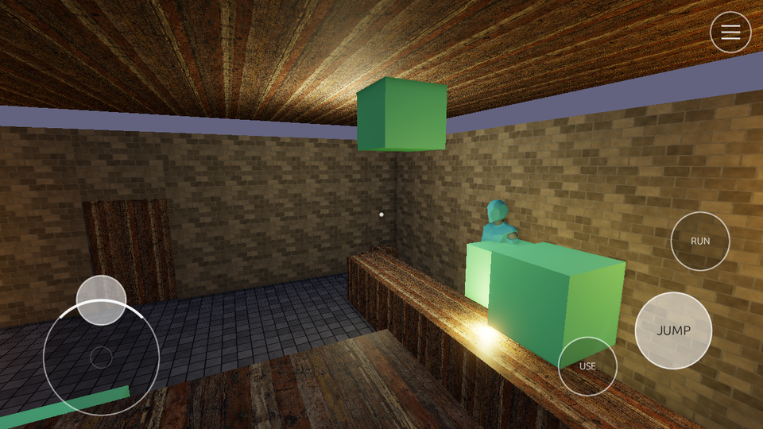

# On-Screen Touch Controls

A phone has no keyboard and no gamepad. A game whose actions are bound only to keys can still be played on one: add a `[touch_controls]` block to its input config and the engine draws a virtual stick, buttons and a menu button, and turns a drag on the screen into mouse-look.



## Why the engine draws them

Flint's game UI is script-driven, so this is a deliberate exception. A stick is an input *device*, not game UI. It has to:

- take a finger before egui and the game's extensions see it, or a panel under the thumb would steal it;
- feed actions that are bound only to keys, in the same frame the finger moves;
- hold each finger by touch id, so a stick and a button work under two thumbs at once.

A script's `on_draw_ui` can do none of those. So the controls are declared in the input config, where they layer like the rest of it (built-in -> game -> user -> CLI; a layer with a `[touch_controls]` block replaces the whole block of the layers before it), the logic lives in `flint-runtime` beside `InputState` (`touch_controls.rs`), and the player paints them. Scripts still compose the HUD; `touch_controls_visible()` tells them when to make room.

## When they show

The controls appear once a real finger touches the screen, and go away when a key is pressed or a gamepad button pressed (or a stick pushed past the noise floor). The next touch brings them back. A desktop player never sees them: the mouse's emulated finger (see [Touch Input](touch-input.md)) never brings them up, and mouse clicks don't hide them.

`flint-player --touch-controls always` shows them from the start and lets the left mouse button drive them, for trying a layout on a desktop. `never` turns them off. On the web, `?touch=always` / `?touch=never` do the same.

While they're up the cursor is never captured (a finger can't look through a captured cursor), so a first-person scene's click-to-capture waits for the keyboard to take over.

## The block

```toml
# config/input.toml (or the scene's input_config, or --input-config)
version = 1

[actions.pause]
bindings = [{ type = "key", code = "KeyP" }]

[touch_controls]
opacity = 0.9                      # 0-1, the whole overlay

[[touch_controls.sticks]]
anchor = "bottom_left"
offset = [130, 130]                # base centre, points in from the anchor
radius = 64                        # points: this far is full tilt
mode = "floating"                  # or "fixed"
deadzone = 0.15                    # fraction of the radius that reads 0
up = "move_forward"                # direction actions read 0..1
down = "move_backward"
left = "move_left"
right = "move_right"
# x = "move_x"                     # or axis1d actions: right / up are +
# y = "move_y"
# region = [0.0, 0.4, 0.5, 0.6]    # floating: where it can be grabbed (normalized x, y, w, h)

[[touch_controls.buttons]]
action = "jump"
anchor = "bottom_right"
offset = [100, 110]
radius = 42
# label = "jump"                   # default: the action's name

[touch_controls.look]
region = [0.5, 0.0, 0.5, 1.0]      # default: the right half
sensitivity = 2.0                  # mouse counts per point of finger travel

[touch_controls.menu]              # stands in for Escape
action = "pause"                   # default
anchor = "top_right"               # default
```

`demo/input_touch.toml` is this block for the first-person demos:

```bash
cargo run --bin flint-player -- demo/phase4_runtime.scene.toml --schemas schemas \
  --input-config demo/input_touch.toml --touch-controls always
```

### Sticks

A stick's deflection is x right and y **up**, each in `[-1, 1]`, with the deadzone cut out and the rest rescaled to start at 0, clamped to the unit circle. Direction actions read their side's share (`up` reads `max(y, 0)`); a `button` action is pressed from 0.5, so a diagonal push presses two. Axis actions (`x`, `y`) add the signed value to the action's other bindings.

A **floating** stick's base jumps to wherever a thumb lands in its region (by default its anchor's side of the screen, below the top 40%) and returns to its rest place when the thumb lifts. A **fixed** stick must be grabbed within 1.5x its radius. A held stick can't be taken by a second finger.

### Buttons and the menu

A button holds its action at 1 while a finger is on it (within 1.15x its radius). The menu is a small three-bar button; its action defaults to `pause`, so a game's own pause menu opens with no Escape key. Every action a control drives should exist in the config, even with no bindings of its own, as in `[actions.pause]` above.

### Look

A drag that starts in the look region, and not on a button or a stick, turns the view: its travel in points, times `sensitivity`, is added to the raw mouse delta (`mouse_delta_x/y` in scripts, and the first-person character controller). Unlike sticks and buttons, a look drag shares its finger: scripts still see it as a touch, and egui gets it first.

## Layout

Offsets and radii are logical points, the space of egui and the `draw_*` functions, measured inward from the anchor's edges and inside the safe-area insets (a phone's notch and home bar; the web page reads `env(safe-area-inset-*)`). For `top`, `bottom`, `left`, `right` and `center`, the offset along the centred axis is signed from the centre. The scene's render scale never matters: the controls are drawn with the HUD at full resolution.

Hit-testing goes menu, buttons, sticks, then look.

## Who gets a finger

```
finger lands ──► on a stick, button or the menu? ──yes──► the control holds it until it lifts:
      │                                                    egui, extensions and scripts never see it
      no
      ▼
egui ──► extensions ──► InputState: in the look region? turn the view; scripts see the touch either way
```

The controls are drawn on their own Foreground egui layer, over the script UI and the game's own egui.

## Scripting

| Function | Returns | Description |
|----------|---------|-------------|
| `touch_controls_visible()` | `bool` | Whether the controls are on screen now |

Actions the controls drive read like any others: `is_action_pressed("jump")`, `action_value("move_x")`.

## Testing with fingers

`--input-script` plays fingers as well as keys (one id per finger, window pixels):

```text
1.0  touch 1 170 600          # left thumb lands: the stick floats there
1.0  drag  1 170 500 0.25     #   and pushes forward over 0.25 s
2.0  touch 2 1130 555         # right thumb on JUMP, the stick still held
2.35 lift  2
4.8  tap   KeyW 0.1           # a key: the controls go
```

The controls' offsets are points, so on a scaled display a button sits at its offset times the scale in pixels.

## Further Reading

- [Touch Input](touch-input.md) --- touch zones, taps, swipes and the raw touch API
- [Cursor Capture and Input Gates](input-gates.md) --- who hears the mouse and keys
