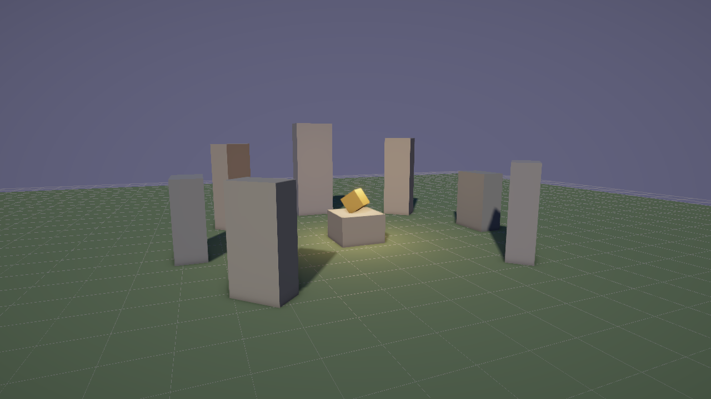

# Your First Project

This guide starts a Flint project with one command, renders and plays what it made, and then builds a second scene using only CLI commands.

## Initialize a Project

```bash
flint init my-tavern
```

This writes a small, complete game project and prints what to do next:

```
Created Flint project `my-tavern` (walk template) in my-tavern

  .gitignore                 what the engine writes while you work
  AGENTS.md                  points other agents at CLAUDE.md
  CLAUDE.md                  the guide to this project, for you and for agents
  bundle.toml                packing rules for the web build
  flint.toml                 the manifest: id, schemas, start scene, input
  config/input.toml          the game's input actions
  renders/                   where renders go
  scenes/main.scene.toml     a lit ring of stones, a [camera], and a player facing it
  schemas/archetypes/        the game's own schemas: empty, the engine's are not copied
  schemas/components/        the game's own schemas: empty, the engine's are not copied
  scripts/hud.rhai           the HUD, drawn by the scene's hud_controller

Next steps:
  cd my-tavern
  flint validate scenes/main.scene.toml
  flint render scenes/main.scene.toml --output renders/main.png
  flint play
```

Run them. `flint render` draws the scene to a PNG with no window:



and `flint play` opens it as a game: WASD to walk, the mouse to look, Space to jump, H to hide the controls panel that `scripts/hud.rhai` draws, Esc to quit.

Three things about what you were given:

- **`flint.toml` is the project.** It names the schema directories, the start scene and the input config, and every `flint` command finds it by walking up from where it runs. That is why none of the commands on this page takes a `--schemas` flag, and why `flint play` needs no scene. See [The Project Manifest](../guides/building-a-game-project.md#the-project-manifest).
- **The game's `schemas/` is empty.** Components such as `transform`, `bounds` and `material` are the engine's, and the manifest names the engine's schema directory instead of copying it. By default that is the Flint checkout your `flint` was built from, named by path, so the project works at once on this machine. [Building a Game Project](../guides/building-a-game-project.md) covers `--engine subtree`, which carries the engine inside the game's own repository.
- **`CLAUDE.md` is the map.** It lists the loop, where each file lives, how to look up a component (`flint schema transform`) and where the script functions are documented. It is written for a coding agent and reads as well for a person.

`flint init my-game --template blank` starts from a lit ground and one box with no player, and `--template 2d` from flat sprites under an orthographic camera.

## Create a Scene

A project holds any number of scenes. From inside the project, make a second one:

```bash
cd my-tavern
flint scene create scenes/tavern.scene.toml --name "The Rusty Flint Tavern"
```

This creates a scene file with no entities:

```toml
[scene]
name = "The Rusty Flint Tavern"
version = "1.0"
```

## Add Rooms

Build out the space with room entities:

```bash
flint entity create --archetype room --name "main_hall" \
    --scene scenes/tavern.scene.toml \
    --props '{"transform":{"position":[0,0,0]},"bounds":{"min":[-7,0,-5],"max":[7,4,5]}}'
```

`--archetype room` names one of the engine's archetypes (`flint schema room` prints it), and `--props` gives the entity's component values. A `bounds` component draws as a box.

Add a kitchen connected to the main hall:

```bash
flint entity create --archetype room --name "kitchen" \
    --parent "main_hall" \
    --scene scenes/tavern.scene.toml \
    --props '{"transform":{"position":[0,0,-9]},"bounds":{"min":[-4,0,-3],"max":[4,3.5,3]}}'
```

The `--parent` flag establishes a hierarchy --- the kitchen is a child of the main hall.

## Add a Door

```bash
flint entity create --archetype door --name "front_entrance" \
    --parent "main_hall" \
    --scene scenes/tavern.scene.toml \
    --props '{"transform":{"position":[0,0,5]},"door":{"style":"hinged","locked":false}}'
```

## Query Your Scene

See what you've built:

```bash
flint query "entities" --scene scenes/tavern.scene.toml
```

Filter for specific archetypes:

```bash
flint query "entities where archetype == 'door'" --scene scenes/tavern.scene.toml
```

```json
[
  {
    "id": 1,
    "name": "front_entrance",
    "archetype": "door",
    "parent": "main_hall",
    "components": [
      "audio_trigger",
      "transform",
      "door"
    ]
  }
]
```

The door has an `audio_trigger` you never wrote: it came from the `door` archetype's defaults.

## Inspect the Scene File

The scene is plain TOML. Open `scenes/tavern.scene.toml` and you'll see your entities (the CLI writes each array one number to a line; they are folded here):

```toml
[scene]
name = "The Rusty Flint Tavern"
version = "1.0"

[entities.main_hall]
archetype = "room"

[entities.main_hall.transform]
position = [0, 0, 0]

[entities.main_hall.bounds]
min = [-7, 0, -5]
max = [7, 4, 5]

[entities.kitchen]
archetype = "room"
parent = "main_hall"

[entities.kitchen.transform]
position = [0, 0, -9]

[entities.kitchen.bounds]
min = [-4, 0, -3]
max = [4, 3.5, 3]

[entities.front_entrance]
archetype = "door"
parent = "main_hall"

[entities.front_entrance.transform]
position = [0, 0, 5]

[entities.front_entrance.door]
locked = false
style = "hinged"

[entities.front_entrance.audio_trigger]
on_interact = "door_open.ogg"
```

Everything is readable, editable, and diffable. You can modify this file directly --- the CLI isn't the only way to edit scenes, and `scenes/main.scene.toml`, which `flint init` wrote by hand, is the better model for a scene you mean to play: it has a `[camera]`, lights, materials and a player.

## View It

Render it, as you did the first scene:

```bash
flint render scenes/tavern.scene.toml --output renders/tavern.png
```

Or launch the hot-reload viewer:

```bash
flint edit scenes/tavern.scene.toml --watch
```

The viewer hot-reloads --- any change to the scene file (from the CLI, a text editor, or an AI agent) updates the view instantly.

**Camera controls:**
| Input | Action |
|-------|--------|
| Left-drag | Orbit |
| Right-drag | Pan |
| Scroll | Zoom |
| Space | Reset camera |
| R | Force reload |
| Escape | Quit |

## What's Next

- [Your First Scene](first-scene.md) dives deeper into scene file structure
- [Querying Entities](first-query.md) covers the query language
- [Building a Game Project](../guides/building-a-game-project.md) covers the manifest, game schemas and carrying the engine as a subtree
- [Building a Tavern](../guides/building-a-tavern.md) walks through a complete scene build
