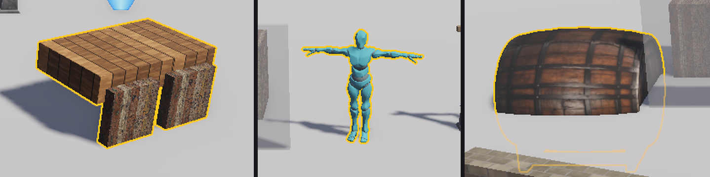

# The Scene Viewer

The Flint viewer is a real-time 3D window for validating scenes. It renders your scene with full PBR shading and shadows, applies the scene's own post-processing, and provides an egui inspector panel for browsing entities and editing component properties.

## Launching the Viewer

```bash
flint edit levels/tavern.scene.toml --watch --schemas schemas
```

The `--watch` flag enables hot-reload: edit the scene TOML file, and the viewer re-parses and re-renders automatically. The entire file is re-parsed on each change (not incremental), which keeps the implementation simple and avoids synchronization issues.

## Camera Controls

The viewer uses an orbit camera that rotates around a focus point. If the scene has a `[camera]` block, the orbit starts from that authored framing.

| Input | Action |
|-------|--------|
| Left-drag | Orbit around focus (or drag gizmo axis when hovering) |
| Right-drag | Pan the view |
| Scroll | Zoom in/out |
| W / A / S / D | Orbit by key (while no entity is selected) |
| Q / E | Zoom out / in by key (while no entity is selected) |
| Space | Return to the scene's authored `[camera]` framing (viewer default if there is none) |
| O | Toggle auto-orbit turntable |
| [ / ] | Slow down / speed up auto-orbit |
| Ctrl+R | Force reload |
| Escape | Quit / cancel gizmo drag |

Any manual orbit input cancels auto-orbit. Start in turntable mode with `--auto-orbit`.

This is the same orbit camera every `flint edit` editor uses, with the same speeds: a model or terrain turns under the mouse just as a scene does. Dragging down tilts the view to look from higher up, and the view cube in the corner turns the same way when you drag it. Click one of its axes and the camera eases round to that side, orthographic; orbit again and it is perspective once more. A press on a gizmo handle moves the entity and never the camera, and a click selects only if the mouse stayed put: a drag to orbit selects nothing.

## The Selection Outline

Whatever you pick, in the viewport or the scene tree, is outlined in selection yellow. The outline goes round the entity and everything under it in the hierarchy, so picking a parent with no mesh of its own (or a glTF model whose nodes were expanded into child entities) outlines the whole of it. It follows what was drawn: a skinned figure in its pose, a woozy prop where it has drifted to, a sprite by its cut-out, glass by its edge rather than filled. Where the selection is hidden behind something, its outline carries on through, fainter, so you can see where it is.



The outline is drawn over the finished image, after tonemapping, post-processing and every style, so it is the same colour and width (2 points) in every scene and on every display. It changes nothing else: with nothing selected the frame is what `flint render` makes. `flint render --select <entity>` draws the same outline headlessly; the colour is `SELECTION_COLOR_SRGB` in `crates/flint-render/src/selection_outline.rs`.

## Transform Gizmo

When you select an entity in the inspector, a gizmo appears at its position with colored axis arrows and plane handles:

- **Red arrow** --- drag to move along X axis
- **Green arrow** --- drag to move along Y axis
- **Blue arrow** --- drag to move along Z axis
- **Plane handles** (small squares at axis intersections) --- drag to move in two axes simultaneously

While an entity is selected, **W**, **E** and **R** switch the gizmo to translate, rotate and scale instead of orbiting the camera.

The gizmo uses constraint-plane dragging: for single-axis movement, it automatically picks the plane most perpendicular to your camera view. Inactive axes dim while dragging to clearly show the active constraint.

### Editing Shortcuts

| Input | Action |
|-------|--------|
| W / E / R | Gizmo mode: translate / rotate / scale (entity selected) |
| Ctrl+S | Save scene to disk: only the fields that differ from the file are written, the rest of the file stays as it is; with nothing changed the file isn't touched |
| Ctrl+Z | Undo the last edit |
| Ctrl+Shift+Z / Ctrl+Y | Redo it |
| Escape | Cancel current gizmo drag |

Every edit, from the gizmo or the inspector, is on an undo/redo stack. The title's `*` and the status bar's **Modified** say the scene differs from its file: an undo after a save marks it again (the next save writes the value it put back), and undoing back to what the file says clears it.

The history outlives a reload. When the file changes on disk (an agent editing it while you work), the viewer reloads it and keeps each undo step whose field still holds what the step left there, finding its entity by name. Undo then puts back your last edit over the agent's file. A field the agent changed itself ends that field's history, so an undo never throws the agent's value away; the terminal says how many steps went.

An entity a prefab instance makes isn't written in the scene file, so its edits go into the instance's overrides, `[prefabs.<instance>.overrides.<entity>.<component>]`, which the loader merges over the template. An edit that can't be written anywhere (an entity the file doesn't have and no instance makes) is named in red in the status bar and keeps the scene marked; the save doesn't say "Saved!".

### What you changed

Each save appends one JSON line per field it wrote to `.flint/viewer-edits.jsonl` under the project root, so an agent can read what was tweaked without diffing the file:

```json
{"component":"transform","entity":"props_barrel","field":"position","new":[-2.0,0.48,3.0],"old":[1.3,0.48,5.6],"saved_at":1794808511,"scene":"scenes/props.scene.toml","table":"prefabs.props.overrides.barrel.transform"}
```

`old` is the value the file had (`null`: the entity didn't have the field), `new` the one written, `table` where it went, and `saved_at` the save's time in Unix seconds; one save's lines share it. `flint init` puts the file in the project's `.gitignore`.

F4's **Commit to scene** is in the list too, a line for each `[post_process]` key it wrote, with `entity` `null`:

```json
{"component":"post_process","entity":null,"field":"cell","new":12,"old":8,"saved_at":1794808530,"scene":"scenes/props.scene.toml","table":"post_process.styles.ascii"}
```

A key the commit took out (back at its default) has `new` `null`.

## The Inspector Panel

The egui-based inspector panel (on the left side of the viewer) provides:

- **Entity tree** --- hierarchical list of all entities in the scene, reflecting parent-child relationships
- **Component editor** --- select an entity to view and edit its component values; position fields are editable via drag-value widgets with color-coded labels (red/green/blue matching the gizmo axes)
- **Constraint overlay** --- validation results from `flint-constraint`, highlighting any rule violations

## Rendering Features

The viewer renders scenes with the same PBR pipeline used by the player:

- Cook-Torrance physically-based shading
- Cascaded shadow mapping from directional lights
- glTF mesh rendering with material support
- The scene's `[post_process]` block, applied on load
- Live particles: `particle_emitter` and `particle_effect` entities simulate in the viewer, so inspector edits show immediately
- Render stats overlay (**F2**), with the [frame-time graph](../guides/profiling.md#the-frame-time-graph) above it
- Normal arrows (**F3**)
- The Rendering & Effects menu (**F4**)
- Fullscreen toggle (**F11**)

### The Rendering & Effects Menu (F4)

F4 opens one window holding every render and post-process control: post-processing on/off, exposure, vignette, SSAO, depth of field, fog, bloom, color grade and film grain, FXAA, Kuwahara, contour lines and the shading boil, render modes, dither and volumetric light, shadows and their resolution, the lighting levers, vertical FOV, and the shading debug mode (PBR, wireframe overlay, wireframe, normals, depth, UV, unlit, metal/rough). Changes apply immediately.

Two controls are specific to the viewer:

- **Authored post vs viewer default** --- swap between the scene's `[post_process]` block and the viewer's neutral look, to check what a scene's grading is actually doing
- **DoF follow** --- the depth-of-field focus plane tracks the last selected entity, so you can pick a focus distance by clicking
- **Particles** --- simulate/draw toggle, pause, speed and restart for the live particle simulation, plus each `particle_effect` entity's asset name

See [Post-Processing](../concepts/post-processing.md#the-rendering--effects-menu-f4) for the full section list.

## Playing a Scene

To experience a scene in first-person with physics, use `play` instead of `edit`:

```bash
flint play levels/tavern.scene.toml
```

See the [CLI Reference](../cli-reference/overview.md) for full `play` command details and controls.

## Headless Rendering

For CI pipelines and automated screenshots, render to PNG without opening a window:

```bash
flint render levels/tavern.scene.toml --output preview.png --width 1920 --height 1080
```
