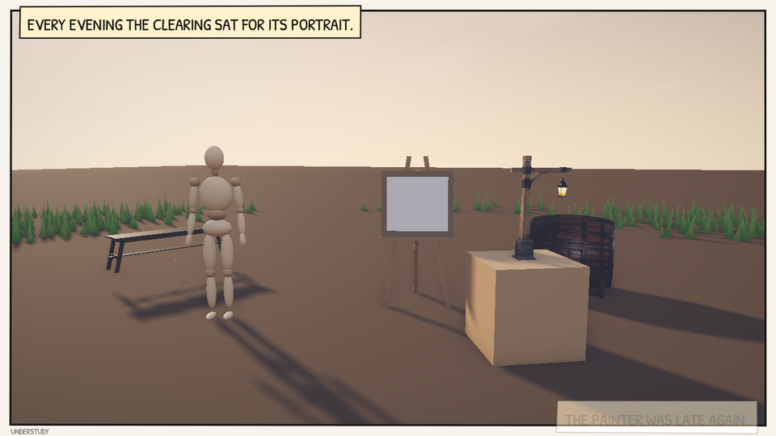
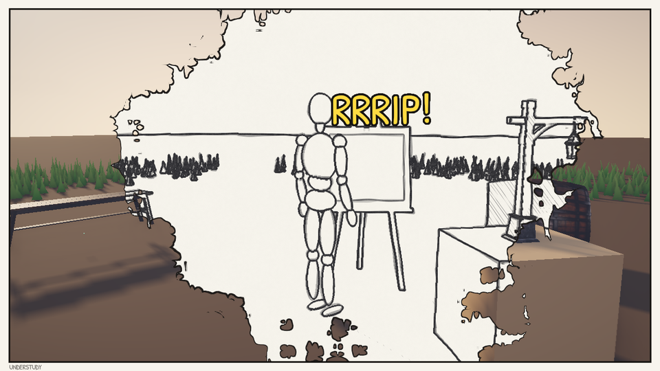
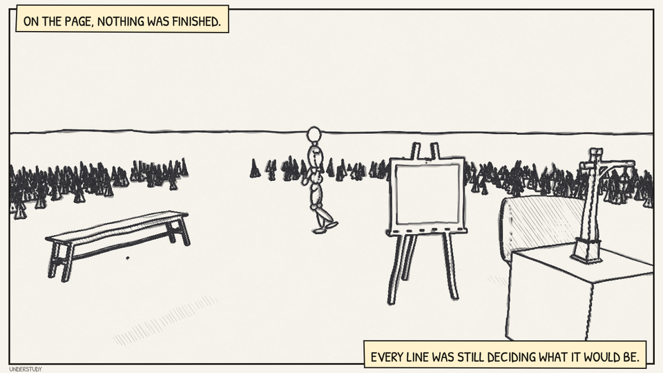
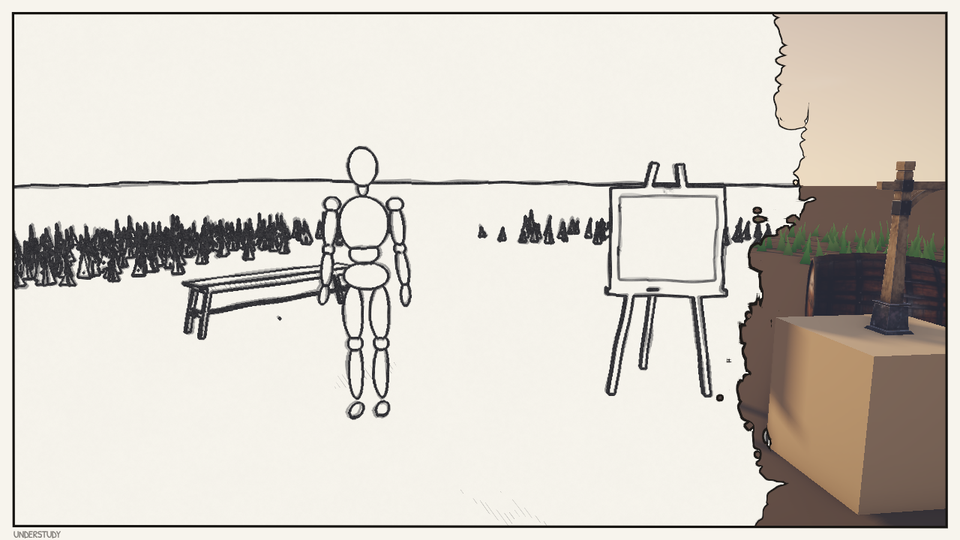
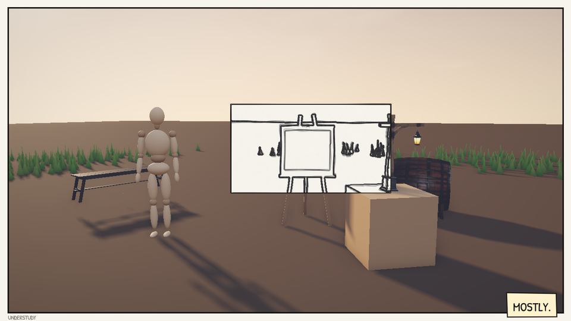

# A Live Scene Pulled into a Drawing

A technique is proved only in motion. *Understudy* is a 28-second film made in Flint to test whether the rotoscoped-sketch pieces work together (epic #402). A wooden drawing mannequin waits in a clearing at dusk beside an easel with a blank page. It walks to the page and touches it, the picture tears open there, and it walks into a world traced in pencil, where it moves on twos as the lines do. Then the live world is wiped back over it, and the page keeps a little of the drawing.

The scene is `examples/understudy.scene.toml`, with two scripts: `scripts/understudy.rhai` (the beats, the walk and the camera) and `scripts/understudy_hud.rhai` (the comic panel and its captions). The engine supplies three pieces, and the rest is scene and script:

| Piece | What it does here | Reference |
|---|---|---|
| The `rotoscope` look (#404) | the drawn world: ink-forward pencil on a blank sheet, lines boiling 12 times a second | [Looks](../concepts/stylize-passes.md#looks-in-scenes-f4-and-scripts) |
| `motion_hold` (#405) | the figure drawn on twos while it is inside the drawing | [Stylize Passes](../concepts/stylize-passes.md) |
| The reveal (#406) | the tear at the page, the wipe back, and the small panel left at the end | [Revealing a whole-frame style](../concepts/stylize-passes.md#revealing-a-whole-frame-style) |

<video controls loop muted playsinline poster="../images/understudy-poster.jpg" width="960">
  <source src="../images/understudy.mp4" type="video/mp4">
</video>

*The whole loop at 960x540. Captured with `flint-player examples/understudy.scene.toml --width 1280 --height 720 --frame-step 0.0416667 --screenshot-every 0.0416667 --screenshot frames/f.png --exit-after 28.05 --pixels-per-point 1` on an RTX 4070, and encoded with ffmpeg. Nothing in it is played by hand.*

## The beats

| | |
|---|---|
|  |  |
| **0 s, live.** The mannequin waits; captions set the scene. | **7 s, the crossing.** It touched the page at 6 s, the tear burst open there, and from 6.6 s it is drawn on twos. |
|  |  |
| **13 s, the drawn world.** It walks round the clearing on paper. | **20 s, pulled back.** A wipe brings the live frame in from the right. |
|  | |
| **25 s, mostly.** A panel reveal at 0.06 leaves the easel drawn. | |

Each beat is one call made on the frame it starts, kept in a beat number on the director's `story` component so it fires once:

```rhai
// The touch: the tear starts where the page is on screen
let s = world_to_screen(page.x, page.y, page.z);
set_post_style_param("pencil", "reveal_x", s.x / screen_width());
set_post_style_param("pencil", "reveal_y", s.y / screen_height());
tween_post_style_param("pencil", "reveal", 1.0, 5.0, "ease_out");

// Inside the drawing it is drawn as the lines are: on twos
set_motion_hold(get_entity("mq"), 12.0);
```

The scene's pencil table starts at `reveal = 0`, so until the touch the frame is the live one, byte for byte. The look is named in `[post_process]` and lies under the scene's own keys, so the live side keeps its bloom, SSAO and vignette while the pencil takes the rotoscope's settings.

## What made it work

- **A rip bursts, then spreads.** With `ease_in_out` nothing showed for a second and a half after the touch. With `ease_out` over 5 s the tear is visible at once and still reaches the corners slowly.
- **A blank page hides its own tear.** The tear starts on the page, and the pencil draws a blank page as blank paper, so its first frames are white on white. The "RRRIP!" lettering marks the moment until the tear passes the page's edge.
- **The figure is spheres.** A drawing mannequin is the right actor for a drawn world, and the examples have no walk clip. It is 23 scaled `Sphere` models hung from 13 joint pivots under one root. The director turns the pivots each frame from the distance walked: hip swing, knee bend through the swing, arms against legs, a pelvis bob twice a stride. The hold sits on the root, so every joint below steps on the same ticks as the boil.
- **Grass has to be sparse.** Pencil inks every blade as a silhouette, so a dense meadow draws as one black band whatever `depth`, `crease` or `detail` say (#883). The scene keeps its grass near the camera (density 14, out to 18 m), which draws as tufts and leaves the sheet blank up to the horizon line.
- **A model takes `base_color_r/g/b`, not `color`.** `material.color` is for entities drawn from their bounds; on a model it is ignored without a warning (#884).

## The page is drawn by the HUD

The panel border, the gutter, the caption boxes and the sound lettering are draw calls in `understudy_hud.rhai`, on the same 28-second clock as the director. There is no engine code. The lettering is Patrick Hand (`examples/fonts/PatrickHand-Regular.ttf`, SIL Open Font License), which the HUD finds by its file stem:

```rhai
draw_text(x, y, "EVERY LINE WAS STILL DECIDING WHAT IT WOULD BE.", 27.0,
    #{ font: "PatrickHand-Regular", color: [0.09, 0.08, 0.07, 1.0], layer: 22 });
```

Each box and the panel's border is a polygon whose corners move a point or so on each of the 12 ticks a second, so the page is redrawn by the same hand as the pencil and the figure. `flint render` runs no HUD, so stills of a beat without captions come from `flint render examples/understudy.scene.toml --scripts --time 13 --no-grid -o drawn.png`. For the captions, capture with `flint-player` as above.

## Making your own

The film keeps to the technique and takes nothing from any existing work: its set is the examples' clearing, its figure and story are original, and it has no music. To make another, start from the scene:

1. Put a whole-frame style on at `reveal = 0`, under a look if you like.
2. Script the beats as one-shot calls: `reveal_shape`, `reveal_x`/`reveal_y` from `world_to_screen`, then `tween_post_style_param` on `reveal`.
3. Hold what crosses over with `set_motion_hold(id, 12.0)`, and clear it when it comes back.
4. Draw the page in an `on_draw_ui`, and capture with `--frame-step` so every run is the same film.
