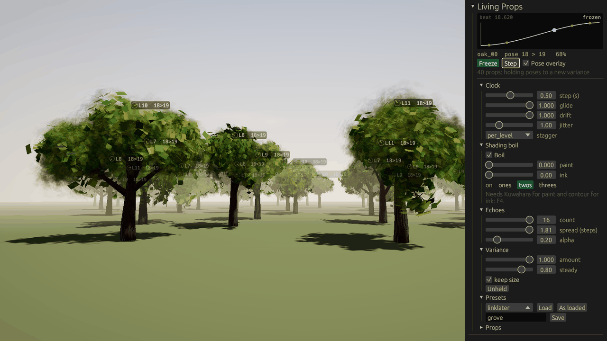
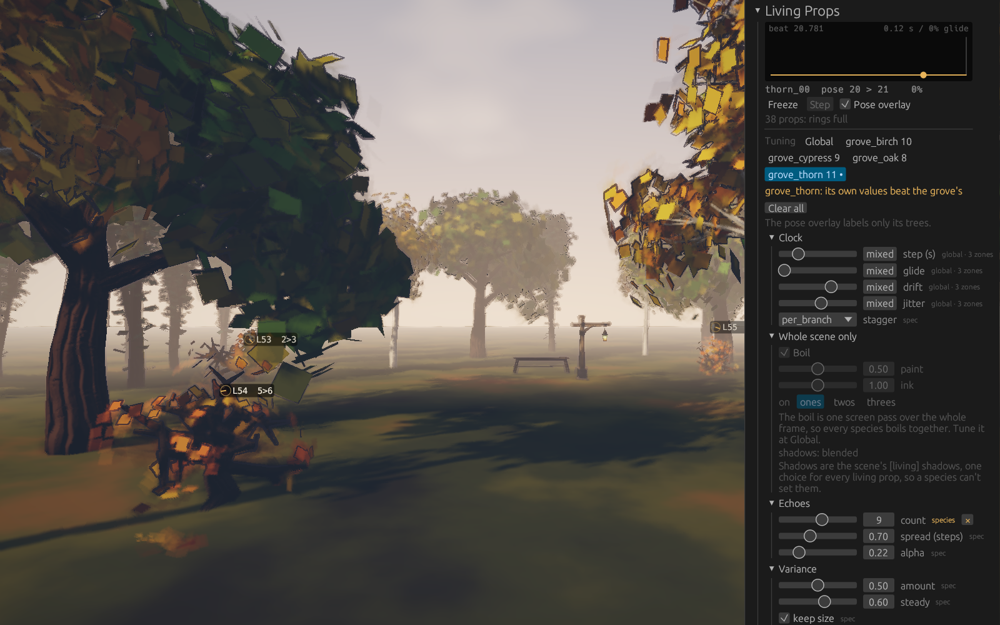
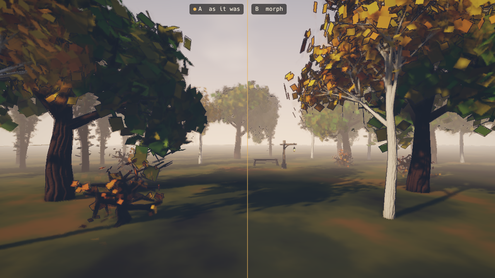

# Debug Panels

Flint's runtime tuning surface is a set of egui **debug panels** that live in the `flint-debug-ui` crate and are hosted by the player and, for one of them, by the scene viewer. They exist so that a tuning session ends as a diff to the scene file rather than as notes: every panel edits live values, and most can write those values back into the scene TOML.

Panels are dev surface. They compile only when the player's `debug-hud` cargo feature is on (it is on by default), and a feature-off build carries zero panel code and must still compile.

## Keys

| Key | What it toggles | Host |
|-----|-----------------|------|
| `F3` | Every scene-component panel the current scene created (ocean, day/time, weather, grass, camera, reality, visitor, dead calm, particles, Living Props), and every panel a game added | player |
| `F4` | The **Rendering & Effects** panel, on its own so it never flips out of phase with F3 | player and scene viewer |
| `` ` `` (backquote) | **Music Guide**, only while a [music session](../concepts/music-sessions.md) runs | player |
| `\` (backslash) | **Manifest Map** timeline strip, same condition | player |
| `F5` | Freeze or unfreeze a scene's [living props](#living-props-f3), as the panel's **Freeze** | player |
| `F6` | Living Props [A/B](#comparing-two-presets-ab): show the other preset, starting a comparison if none is running | player |
| `F7` | Living Props A/B: split the view, A left and B right, or put it back | player |
| `Escape` | Releases the mouse so panels can be clicked; clicking the world recaptures it | player |

Opening any panel releases the cursor; closing the last one recaptures it if the scene has a player entity. When a key has nothing to toggle (no panels in the scene, no music session, no renderer) the player logs a note instead of failing.

The old per-effect function keys (F1 debug-mode cycle, F4 shadows, F5 to F10 per-effect toggles, F12 kuwahara) are gone. Everything they flipped now lives in the Rendering & Effects panel, along with the non-binary parameters those keys could never expose (ADR 0053, consolidated render debug menu). F5 to F7 came back for Living Props, and only do anything in a scene that has some.

## Layout

Side panels are fold-open headers distributed across up to three columns. Column assignment is a greedy lightest-bin pass over a per-panel weight so the tall panels do not all land in one column: Rendering & Effects weighs 60, Ocean Debug 46, Living Props 40, Grass Debug 22, Reality 20, Weather 15, Particles 14, Day / Time 10, and anything else, including every game-supplied panel, 6. The assignment is deterministic and never produces an empty column.

A panel can instead ask for the `Bottom` layout, a full-width strip. The Manifest Map uses it; timeline-shaped panels should.

Columns open 300 points wide. Drag a column's left edge to resize it, between 280 points and half the window. The F2 stats overlay sits just left of the columns. It shows the GPU's time per phase too, where the device can time ([Profiling](profiling.md)).

The panels are the top layer of the player's egui pass. Back to front, it draws script UI (`on_draw_ui`), then a game's own egui (`PlayerExtension::ui`), then the debug panels. The panels float on egui's Foreground order instead of being egui `SidePanel`s. A `SidePanel` always paints on the background layer, under any egui window a game opens, so the panels would end up hidden behind the game's UI.

## The Panel Roster

Scene-component panels are created **only when their driving component is present** on some entity, so a scene with no ocean never sees an ocean panel.

| Panel | Component | What it tunes |
|-------|-----------|---------------|
| Ocean Debug | `ocean` | Wave spectrum, colours, foam, contact foam, cel band edges, clarity and turbidity, grid, CPU/GPU parity probe |
| Day / Time | `time_of_day` | Clock readout, 0 to 24 h scrub, preset hours, natural-advance toggle, day counter, day length, sun path tilt |
| Weather | `weather` | Weather state, with one-shot triggers |
| Camera | `camera_tuning` | Vertical FOV (the same component is applied even without the panel) |
| Grass Debug | `terrain` with `grass.enabled` | Every field of the [grass](../concepts/terrain.md#grass) block |
| Reality | `reality` | Read-only status of a script-scheduled "reality tear" (active render mode, mix, time to next) plus trigger and end-now buttons |
| Visitor | `raft_visitor` | Visitor state |
| Dead Calm | `dead_calm` | Dead-calm state |
| Rendering & Effects | always, when a renderer exists | See below |
| Particles | `particle_emitter` or `particle_effect` | Alive counts per effect instance, play / stop / burst, the global particle budget, and a draw toggle that keeps simulating while hiding the result |
| Living Props | `living_prop` | Every knob of a grove live, the warped clock as a curve, freeze and single-step, a pose overlay, and presets saved as TOML. [Below](#living-props-f3) |
| Music Guide | active music session | Upcoming input windows and per-channel targets |
| Manifest Map | active music session | Suite structure, playhead, this run's history |

`time_of_day`, `weather`, `reality`, `raft_visitor` and `dead_calm` are game-side component conventions; the engine ships the panel, the game ships the schema.

### Rendering & Effects (F4)

One consolidated home for every render and post-effect control. Its groups, top to bottom:

- **Post chain**: "Freeze script post overrides" (player only; see below), post-processing on/off, exposure, vignette on/off, vignette intensity and smoothness, chromatic aberration, radial blur, desaturate.
- **SSAO**: enabled, radius, intensity, bias, samples (1 to 64; 16 is the quality/cost sweet spot).
- **Depth of field**: strength, focus distance, focus range.
- **Fog**: enabled, colour, density, start, end, height fog on/off, height falloff, height origin.
- **Bloom**: enabled, intensity, threshold, soft threshold.
- **Grade / Grain / FXAA**: lift, gamma, gain, a "Neutral grade" reset, film grain, FXAA.
- **Kuwahara**: enabled, radius, sharpness, hardness, anisotropy, boil.
- **Contour**: enabled, width, threshold, strength, luma, ink colour, fade, boil.
- **Shading boil**: hold each drawing on ones, twos or threes, and what the scene's wooze field says now. See [Shading boil](../concepts/post-processing.md#shading-boil).
- **Render mode**: mode combo (none, matrix, blood, drunk, tron, underwater), mix, the four mode params.
- **Dither / Volumetric**: dither on/off and intensity, volumetric on/off, samples, density, decay.
- **Shadows**: enabled, resolution combo (512, 1024, 2048, 4096). Changing resolution rebuilds the shadow pass.
- **Lighting**: ambient sky, ambient ground, diffuse wrap, Oren-Nayar, sheen colour and strength, "Reset lighting". These are the [lighting levers](../concepts/lighting.md).
- **Camera**: vertical FOV.
- **Debug mode**: the shading combo (PBR, wireframe overlay, wireframe only, normals, depth, UV checker, unlit, metallic/roughness).

Every field maps onto a `[post_process]`, `[environment]` or `[camera]` key documented in [Post-Processing](../concepts/post-processing.md) and [File Formats](../formats/overview.md), or onto a `flint render` flag, so a value found in the panel can be authored.

In the scene viewer the same panel gains two extras: a switch between the scene's authored `[post_process]` block and the viewer's own defaults, and **DoF follow**, which keeps the focus plane on the last selected entity.

### Living Props (F3)

Finding the sweet spot between boil and morph means turning knobs while watching. This panel has them all, on a running grove, and keeps a good setting as a file.



At the top is the warped clock, drawn as what it is: one step's worth of hold, then the ease to the next pose, with the prop riding it as a dot and each branch level a little ahead under `per_level` stagger. It follows one prop; pick another in **Props**, which lists all of them with their lineage seed, pose and ring.

| Section | Knobs |
|---------|-------|
| Clock | `step`, `glide`, `drift` (the field's `amplitude`), `jitter`, `stagger` |
| Shading boil | On or off, `paint`, `ink`, and on ones, twos or threes. Paint needs Kuwahara on and ink needs contour on, both in F4, and the panel says so |
| Echoes | `count`, `spread` and `alpha`, with `count = 0` in reach to compare the grove without them |
| Variance | `amount`, `steady` and `keep size`. **Unheld** sets 1, 0 and off: each pose exactly as it grew |

**What a knob does right away.** Nothing here pops except stagger, which can't change without moving a part to its new place on the clock.

- `step` bends the clock from where it stands. `glide` and `drift` reach each part on its next beat, as they do when a script moves them.
- `alpha` applies on the next frame.
- `count` and `spread` can need poses a ring hasn't got: a wider spread wants steps it has already left behind. The ring grows first, and the props keep their old echoes until the new ones have every pose they'd read, which the status line shows as `waiting on poses`. No frame goes without one.
- `amount`, `steady` and `keep size` re-hold what the rings have, from each pose as it grew, so nothing regrows and cached poses change too. The poses in use go first across the whole grove, so a change is on screen long before the last ring is done. With `keep size` off that's a frame. With it on a re-hold costs about what growing a pose does, so the budget sets the pace: the grove of 40 oaks takes about 0.9 s at 60 fps and 4 ms a frame. At a lower frame rate there's less budget a second and the same poses to make, so it can take as long as the rings do to turn over, about 4 s at a 0.5 s step.

**In a grove of several species.** Each species' spec sets its own echoes, stagger and variance, so props can disagree on those knobs. Woozy Grove's four species do on all of them. Where they disagree, the knob reads `mixed` (the slider sits at the first prop's value, the checkbox shows a dash) until you move it.

- Moving a knob sets that one knob on every prop and nothing else. Moving echo `count` gives every prop that count and leaves `spread`, `alpha`, stagger and variance as each species had them. Moving `glide` doesn't touch any of them.
- At **Global** the knobs are the global layer. A species with its own value for a knob, from [`[living.species.<spec>]`](../concepts/procgen.md#species-values), a script or the panel at that species, keeps it whatever the panel does. The knob leaves that species out of what it shows, so it doesn't read `mixed` on its account, and says `1 own` (or `2 own`, and so on) beside it; hover to see which.
- A `mixed` knob counts as moved as soon as you touch it, even if you pick the number it was showing: every prop then has that value, and the knob stops reading `mixed`.
- Variance is held per lineage, so `amount` changes every lineage's amount and each keeps its own `steady` and `keep size`.
- **As loaded** gives back each species' own values, prop by prop and lineage by lineage, and every `[living.species]` value as the scene set it. One a script set or cleared since goes back too.
- **Save** writes only the knobs every prop agrees on and names the ones it left out, so loading the file leaves each species its own of the rest. A preset file or a script that sets a knob still sets it on every prop.
- The clock's four knobs come from the scene's `[wooze]` field, which is one for the whole grove. A scene with no `[wooze]` table runs each species on its spec's clock, and the panel shows those as `mixed` too. Turning any of them gives the scene a field starting from the first prop's clock, which evens out `step` and `glide` across the grove, and the panel says so under the clock. **As loaded** takes the field away again and gives each species its spec's clock back.



**Tuning one species.** Under the clock, **Tuning** picks whose values the knobs turn: **Global**, or one species, each with its count of trees (`grove_thorn 11`). A dot after a name means that species has values of its own. With a species picked:

- The knobs show what its trees run on, and moving one makes it the species' own, the same as `[living.species.<spec>]` would: it beats the grove's value, the field and its zones, and the other species hold. In Woozy Grove, moving echo `count` at `grove_thorn` changes the 11 thorns and nothing else.
- Each knob says where its value comes from, with the label `flint render --report json` gives the layer: `spec`, `entity`, `global`, `zone:<name>` or `species`. A species whose trees stand in different places can read more than one, such as `global · zone:hush`, or `global · 3 zones` once there are several zones, and the knob then reads `mixed` at the first tree's value. Hover a mark for what each layer is.
- A `species` mark has a **×** beside it, which clears that value so its trees take the layers below again. **Clear all** clears every one. Nothing pops when a value clears, apart from stagger, for the same reasons as above: a clock knob reaches each part on its next beat, and the beat count itself carries on.
- The shading boil and the shadows are greyed out under **Whole scene only**, with the reason: the boil is one screen pass over the whole frame, and shadows are the scene's `[living] shadows`, one choice for every living prop.
- The pose overlay labels only that species' trees, so you can see which ones you're changing, and the clock readout follows one of them.

**Props** groups the trees by species, each group folded under its name and count, and a filter narrows them to a name or a species and opens what it finds. A group's **tune** picks that species above. **As loaded** puts every species' own values back as the scene set them, panel edits included. Saving them is a separate ticket (#249): **Save** still writes the global layer only.

**Freeze** stops the clock everything woozy runs on, and nothing else: the game goes on, so you can walk around a held pose. Knobs still work, and echoes and variance show at once. **Step** then moves every prop on by exactly one beat, however long a beat is where it stands, which you can read off the clock: `beat 4.753` becomes `beat 5.753`.

**Pose overlay** labels each prop in the world with its lineage and the two poses it's between (`L8  4>5`), after a dial whose needle goes round once a beat. A label that would land on a nearer one stays quiet.

**Presets** saves every knob the props agree on as `wooze/<name>.wooze.toml`, beside the scene or at its game's root, and says what to write in a scene to load it. **Load** takes one of those or a [built-in](../concepts/procgen.md#the-wooze-field), which holds the clock's knobs only. **As loaded** puts everything back as the scene set it. The file's format is in [Saved presets](../concepts/procgen.md#saved-presets). Scripts can do all of this too: [Living Props API](../concepts/scripting.md#living-props-api).

The status line says how the rings are taking it, and turns red if a frame has ever gone short of a pose. A step far below a frame's worth of poses can outrun any budget, and that's what it would show. The same counts close a run: `--exit-after` prints `frames missing a pose in use` and `kept their last bones`.

#### Comparing two presets (A/B)

Whether one look reads better than another is easier to judge with both in front of you than with one remembered. **A/B** puts two presets on the same grove, from the same camera, at the same moment.



Pick **A** and **B** from the presets on offer, or **as it was** for A: the knobs as they stand when the comparison starts, so a look you've been tuning can be put beside a saved one. Then **Compare**. A preset is laid over the scene as it loaded, each species with its own values, so two presets differ only in what they say, never in what you'd turned before. `F6` and `F7` start a comparison of the picks too, and with nothing picked they compare the knobs as they stand with `linklater`.

- **`F6` (Show B / Show A)** flips the whole view to the other preset. Nothing else moves: same camera, same clock. With the clock frozen (`F5`), what changes on screen is exactly what the two presets differ in. Two copies of one preset flip with 0 pixels changed, and a flip and back is the frame you started from, to the bit.
- **`F7` (Split)** shows both at once, A on the left and B on the right of a hairline seam. Each half is the same pixels as a whole frame of its preset at that moment.
- The knobs above tune the side that's shown, or in a split the side with the dot by its name. **Stop** ends the comparison and keeps that side.

Each side has its own living props (the same trees, forked), its own wooze field and boil clock, its own shallow wooze and its own shading boil. Both run on the same clock, and while compared a **Step** moves both on by one beat of the side that's shown. They share one pose cache, since a pose doesn't depend on any knob. Zones stay with the scene, so both sides have them.

What it costs, on the 40-oak bench with six echoes each, in release, uncapped at 1600 x 900:

| Run (30 s each, two rounds) | Median frame | p90 | Frames over 1.5x the median | Blending and upload |
|---|---|---|---|---|
| No comparison | 5.0, 5.5 ms | 6.5, 7.3 ms | 156, 161 | 2.1, 2.4 ms |
| Comparing, A shown (B kept up to date) | 4.7, 5.2 ms | 7.7, 8.6 ms | 688, 724 | 2.1, 2.3 ms |
| Flipping four times a second | 6.9, 6.2 ms | 13.0, 10.0 ms | 777, 601 | 2.6, 2.5 ms |
| Split | 15.0, 15.8 ms | 21.1, 22.0 ms | 80, 98 | 2.9 + 3.2, 3.1 + 3.3 ms |

The hidden side made almost none of its poses: 2,363 of 2,363 came from the scene's cache in the first round. Keeping it costs little on average and makes the frame less even. A flip writes about what an ordinary frame of this bench already does, since all 40 oaks move every frame (257 bone writes). A later run of three rounds, on a machine that had slowed to an 8 to 12 ms median, found flipping four times a second no slower than holding either side (7.5 to 9.0 ms against 8.0 to 12.3). So the flip row's higher median above is the machine drifting, not the flips. A split takes the frame from about 190 fps to about 62 in those rounds, and from 4.4 to 10.9 ms (about 92 fps) in a later pair on a cooler machine: 2.5 to 3 times the frame. Everything is drawn twice, both sides blend every bone every frame, and the second side is extracted again.

A flip writes every bone of the side it shows once, since the buffers held the other's. A split draws the frame twice, in two submissions: the bones and the boil reach the GPU through the queue's writes, and one submission would show the second side's to both. While split, both sides write every bone every frame, since the buffers change hands twice a frame.

From a script: [`compare_living`](../concepts/scripting.md#living-props-api) and the rest. From the command line, `flint-player <scene> --compare A,B` starts with a comparison and `--split` with it split. `--compare ,linklater` is the knobs as the scene loaded them against `linklater`. With `--exit-after`, the report adds the hidden side's rings and blending.

## Live Mirror and Write-Through

Every panel follows one ownership model:

1. While the panel is **clean** the host refreshes it from live engine state every frame. What you see is the truth about the current value, including values a script is driving.
2. When you **edit** a field the panel becomes dirty. The host applies the panel's state back to the engine, routing expensive work by per-group change flags (a post-config upload is cheap; a shadow-pass rebuild or a debug-mode pipeline swap is not), then clears the dirty flag.
3. Fields a script stamps each frame are visibly **reclaimed** on the next frame. The panel does not pretend to own a value it does not own.

For the render panel the player adds **Freeze script post overrides**: while frozen, script and ladder stamps on the post fields are skipped so panel edits stick. It is a tuning aid, not a way to override a game.

**Commit to File** on a scene-component panel writes its current values back into the scene TOML through the scene document patcher, field by field, keeping the rest of the file untouched. Values a game script owns each frame (a day counter, a published factor) are deliberately never committed.

## Adding a Panel from a Game

A game that wraps the player adds its own panels through its [extension](player-extensions.md) (ADR 0107). Name them in `debug_panels`, and draw each one's contents in `debug_panel_ui`:

```rust
impl PlayerExtension for MyGame {
    fn debug_panels(&self) -> Vec<String> {
        vec!["Net".into(), "Economy".into()]
    }

    fn debug_panel_ui(&mut self, name: &str, ui: &mut egui::Ui) {
        match name {
            "Net" => {
                ui.label(format!("RTT {:.0} ms", self.net.rtt_ms()));
                ui.label(format!("{} msgs/s in", self.net.rate_in()));
            }
            "Economy" => self.economy.debug_ui(ui),
            _ => {}
        }
    }
}
```

They join the engine's panels after them: F3 opens and closes them with the rest, they fold open in the same columns with their names as headings, and opening one frees the cursor. `debug_panel_ui` runs only while its panel is open, after the extension's `ui`, with the game's own state in reach: there's nothing to share through an `Arc`. The player asks for the names when it builds its panels, at each scene load and when the extension is added, and a panel open across a rebuild stays open. Without the `debug-hud` feature neither method is called.

### Inside the engine

An engine panel is any type implementing the `DebugPanel` trait from `flint-debug-ui`:

```rust
pub trait DebugPanel {
    fn name(&self) -> &str;                 // egui id and title
    fn ui(&mut self, ui: &mut egui::Ui);   // draw the contents
    fn is_open(&self) -> bool;
    fn toggle(&mut self);
    fn layout(&self) -> PanelLayout { PanelLayout::SideRight }
    fn is_dirty(&self) -> bool;             // unapplied edits?
    fn clear_dirty(&mut self);
    fn as_any(&self) -> &dyn std::any::Any;
    fn as_any_mut(&mut self) -> &mut dyn std::any::Any;
}
```

The player holds `Vec<Box<dyn DebugPanel>>` and renders them generically. Construction follows one pattern: look for the first entity carrying the driving component, build a config from that component, and push the panel with the scene path and entity name so Commit to File knows where to write. The host then downcasts through `as_any_mut` when it needs the concrete config to apply. Unknown panel names take the default column weight; nothing else needs registering.

The game's panels go through this trait too, on a small panel the player holds for each name, whose contents it draws by calling the extension.

Keep panels out of the felt experience. They are judgment-shaped by design and should never double as a HUD; the script-driven [UI](../concepts/scripting.md) is for that.

## Further Reading

- [Post-Processing](../concepts/post-processing.md): every field in the render panel
- [Lighting](../concepts/lighting.md): the lighting levers group
- [Music Sessions](../concepts/music-sessions.md): the Music Guide and Manifest Map
- [The Scene Viewer](../getting-started/viewing.md): the viewer's F4 extras
- [Profiling](profiling.md): GPU time per phase in F2, and the `profile` feature
