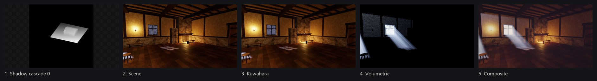
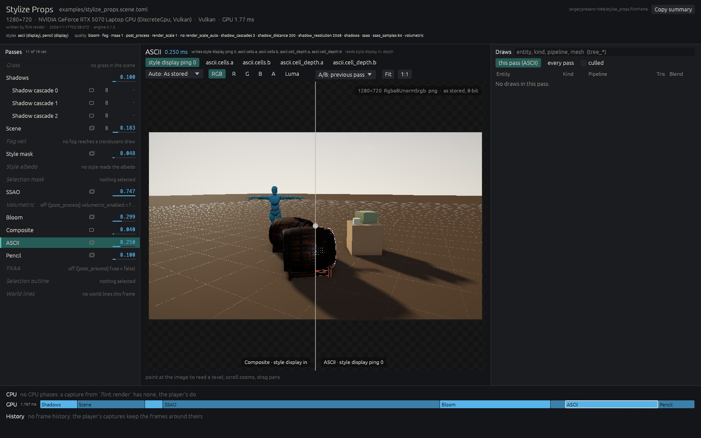
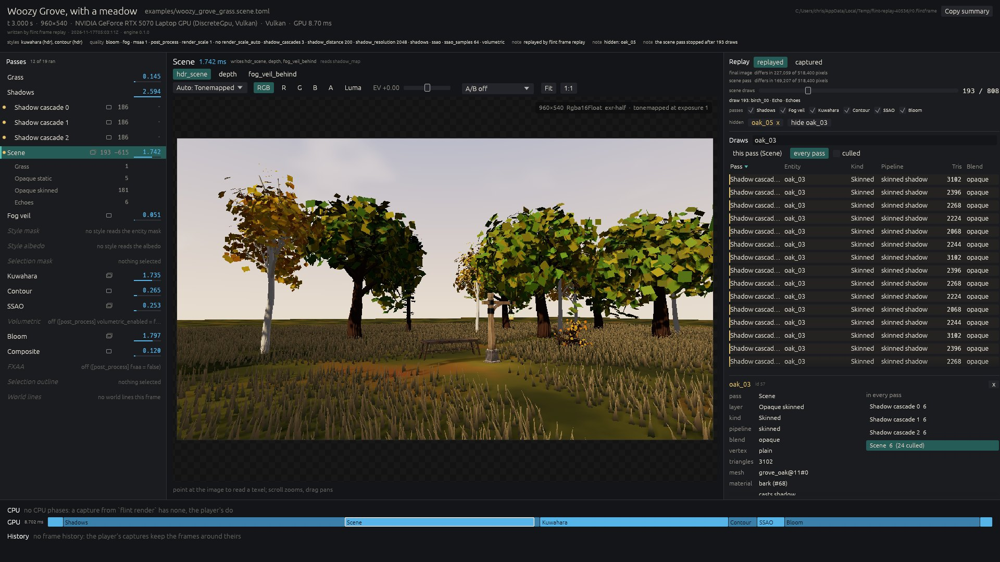

# The Frame Debugger

A frame is usually seen as one picture. Underneath it are a dozen passes or more: shadow maps, the lit scene, a style's own targets, SSAO, bloom's chain of mips, the composite that lays them together. When a frame is slow or wrong, the questions are which passes ran, what each drew, what each left behind and what each cost. `flint frame open` answers them in a window, from a capture, with no game running.


## Opening a capture

A capture is the folder `flint render --frame-capture` writes, or the player's `--capture-frame-at`, Shift+F2 and `--capture-on-hitch` ([Profiling: a frame's images](profiling.md#a-frames-images)). Open one with:

```bash
flint render flint-examples/stylize_props.scene.toml --frame-capture props.flintframe
flint frame open props.flintframe
flint frame open captures/hitch_metronome-t3.101.flintframe --pass Scene --entity weight
```

The window reads only the folder, the way `flint frame show` does: no scene, no schemas. A capture from another machine, an older engine or an issue opens the same. A `--frame-dump` file opens too, as passes and draws with no images. It opens on the finished frame. `--pass <name>` opens on a pass instead (`Bloom (2)` is the second bloom), `--target <id>` on one of its images, `--entity <name>` with an entity selected (any part of its name finds it), and `--wipe previous` or `--wipe final` with a wipe already drawn.

A capture the player took while its scope recorder ran holds `trace.json` too, and opens with a second tab, the **Profiler**: the frames around the captured one as a strip, a flame chart and each scope's statistics. **P** switches between the tabs, and `--profile` opens on the profiler. A trace file opens on its own the same way ([Profiling: the flame view](profiling.md#the-flame-view)).

On its own it shows what the frame did, as captured. A capture that holds its replay inputs can also be drawn again, step by step and with parts left out ([Replaying a frame](#replaying-a-frame)); that needs the scene, its assets and a GPU.

## The window

**The header** says what was captured: the scene and its file, the frame's index and game time, its size (and the scene's own when render scale isn't 1), MSAA, the adapter, backend and present mode, and the GPU frame time. Under that come who wrote the capture and when, the engine's version and the commit the binary was built from (and whether that tree had uncommitted changes; `at an unknown commit` when the build couldn't tell), the game's own commit when the project is in another checkout (`project at ...`), and why it was captured. Then the styles drawn, the quality settings, and what a replay could not match: `replay` lists the manifest's `replay.fresh_only`, the state a replay draws fresh, such as a game's runtime meshes (a style's history is captured since #1136). **Copy summary** puts the text `flint frame show` prints on the clipboard, ready for an issue.

**The passes**, on the left, are a tree in the order the frame recorded them. A shadow map's layers sit under `Shadows`, and a comic page's panels head their own passes. Each row shows the pass's draw count (with `−N` for draws a cull set aside), a small frame where it left an image, and its GPU time over a bar scaled to the slowest pass. A pass that didn't run is greyed, with the reason: `off ([post_process] fxaa = false)`, `no style reads the albedo`. The selected pass opens its draw-list layers (`Opaque static`, `Blended skinned`...), and clicking a layer narrows the draw table to it. Hover a row for its triangles, its targets and its images.

**The image**, in the middle, is the selected pass's output as the GPU held it. HDR targets are float EXRs and depth is f32, so the viewer works on the real values:

- **Mode**: `Auto` is what `flint frame image` makes. That means HDR exposed at the frame's exposure and ACES-tonemapped, depth stretched over the depths the frame drew (near white), integer ids a colour each, and a distance past 1 on a log scale. `Linear`, `As stored`, `Depth`, `Ids`, `Log` and `Signed` force one.
- **Channel**: RGB, one of R, G, B and A in grey, or luma.
- **EV** shifts the exposure in stops over the frame's, and a depth image takes its range by hand (`drawn` puts it back). These change on the GPU, so a slider moves the picture the frame it moves.
- **Zoom and pan**: scroll zooms about the cursor and dragging pans. Double-click or **F** fits the image, and **1** is one texel a pixel. Past twelve pixels a texel a grid appears between texels.
- **The readout** under the image gives the texel under the cursor and its stored values: an 8-bit PNG's 0-255, an EXR's floats, a depth's `Z`. A swatch shows its displayed colour.
- **A pass that wrote no image**, or was skipped, shows the last image an earlier pass left, and says whose. Stepping through the frame never goes blank.

A pass with several images (the scene's `hdr_scene` and `depth`, ASCII's cells and history, bloom's steps) lists them above the image. Left and right step through them.

**The draws**, on the right, are the selected pass's draws as a table: entity, kind, pipeline, triangles, blend, and with **culled** the draws a cull set aside and why (`frustum`, `lod`, `draw distance`). Click a header to sort, and click it again to reverse. The filter finds an entity by any part of its name (`*` patterns work: `tree_*`), or a kind, pipeline or mesh. Typing in it widens the table to **every pass**. Selecting a draw shows everything the capture knows of it (layer, mesh, material, vertex stage, shadow casting, double-sided) and **in every pass**: each pass that drew that entity, with its count. Click one to go there. The tree marks the same passes with a gold dot, and the table edges the entity's rows in gold, so an entity can be followed through the frame. Escape lets it go.

**Time**, along the bottom: the captured frame's CPU phases as one bar (in the F2 graph's colours: scripts orange, physics green, render blue, HUD and present purple), its script callbacks slowest first, and the GPU's passes as a second bar. Click a segment to select its pass. A player's capture also holds the frame history around the captured frame, drawn as the F2 overlay's graph (#1078): each bar is as wide as its frame's wall time, split into the same bands. The captured frame is outlined in teal, and the hitch that asked for the capture is named under it.


A capture without some of this says so instead of drawing an empty pane. `flint render`'s captures have no CPU phases or history, and neither does a replay opened on its own (`flint frame open` of what `flint frame replay --out` wrote). A capture from an adapter without timestamp queries has no GPU times. A description has no images.

## Stepping through a frame

The keys walk the frame in the order it was drawn. Starting at the top and pressing **Down** shows it assemble: the shadow maps, the lit scene, the styles, the light shafts, the finished picture.



| Key | Does |
|---|---|
| Down / Up (or J / K) | The next or previous pass |
| Shift+Down / Shift+Up, Page Down / Page Up | The next or previous pass that left an image of its own |
| Home / End | The first or last pass |
| Left / Right | The pass's other images |
| W | The A/B wipe: off, the previous pass, the finished frame |
| C | The next channel |
| F, 1 | Fit the image; one texel a pixel |
| Esc | Let the selected entity go |

Keys go to the window when no text field has focus, so they don't fire while you type in the filter.

## Comparing: the A/B wipe

**A/B** draws a second image under the first, split by a line you drag: the previous pass's image (what this pass started from) or the finished frame. Both are stretched over the same rect whatever their size, and each is shown with the same mode, channel and exposure. The readout reads whichever side the cursor is on. Below, the ASCII pass is wiped against the composite under it: only the barrel turned to glyphs.



## Replaying a frame

The pass images say where a problem enters the frame. Finding the draw that causes it means watching the pass build one draw at a time, and asking what the frame would look like without an entity or a pass. That means drawing the frame again. Every capture `flint render --frame-capture` and the player write holds what it takes, in `replay/`: the world as it stood, the frame's inputs, the camera, the bone palettes read back from the GPU, the particles, and each asset by its SHA-256.



Press **R** (or **Draw this frame again** above the draws) and the window loads the capture's scene on a worker thread, draws the frame again and shows the replay in its place, with the comparison under the strip's title: the final image and the scene pass's HDR image each `byte-identical`, or `differs in N of M pixels`, and while another pass is stepped, that pass's own images too. Then:

- **The draws slider** stops a pass after its first N draws, counted as the draws table lists them, and selects that pass so its image builds as you drag. **[** and **]** step one draw. The line under it names the last draw. At N = all it is the captured frame, which is how you know the steps before it are the captured frame's own. It steps the scene pass unless the selected pass is one whose draws are the frame's draw items again: a shadow layer (`Shadow cascade 0` to `2`, `Spot shadow`), the `Style mask` or the `Style albedo`. Select one and the slider follows it, so an artefact in a shadow (a caster that shouldn't cast, acne from one mesh) is found by stepping that cascade's casters while the scene reads every other layer whole. One pass is stepped at a time. In the scene pass the sky, water and grid aren't draws and always draw; in a shadow layer the grass it casts isn't counted; the mask's veil isn't a draw of its own. What follows a stepped scene pass (the mask, the albedo, the fog veil) draws only what the scene drew.
- **Passes** lists what can be switched off: the shadows, SSAO, volumetric light, bloom, FXAA, the fog veil and each style that ran. Off, each draws the frame as that switch would (`bloom_enabled = false`, a style off).
- **Hidden** lists entities drawn in no pass, their shadows included. **H**, or the strip's **hide** button, hides the selected entity; its chip shows it again. In the draws table, with **culled** on, a hidden draw is `hidden` and a draw past the slider `past the draw limit`.
- **Outlined** marks one entity's pixels with the selection outline, through whatever is in front of it. **O**, or the strip's **outline** button, outlines the selected entity; its chip takes it off.
- **replayed / captured** switches between the replay and the capture (R does too). The GPU bar is the shown frame's: each replay carries its own GPU times, so hiding an entity shows what it cost. A replay runs no game loop, so the CPU bar, the scripts and the history stay the captured frame's, marked *as captured*: they describe the frame being drawn again.

Each change draws the frame again in a fraction of a second once the scene is loaded (a grove of 38 living trees loads in about 14 s in a debug build, the tavern in 2). From the command line the same replay is `flint frame replay`, which writes the replayed frame as a capture of its own, so `show`, `diff` and `open` read it too:

```bash
flint render flint-examples/woozy_grove_grass.scene.toml --time 3 --frame-capture grove.flintframe
flint frame replay grove.flintframe                          # byte-identical, or how many pixels differ, and why
flint frame replay grove.flintframe --draws 193 --out grove-193.flintframe
flint frame replay grove.flintframe --pass "Shadow cascade 0" --draws 12 --out cascade-12.flintframe
flint frame replay grove.flintframe --hide oak_03 --skip Bloom --out without.flintframe
flint frame diff grove.flintframe without.flintframe         # what the oak cost, pass by pass
flint frame open grove.flintframe --draws 193 --screenshot step.png
```

**How it replays** (ADR 0126 decision 4): the authored scene is loaded the way `flint render` loads it (models, splines, living props, terrain and grass), the captured world is laid over it by entity name, and no game step runs: no scripts, physics, animation or particle simulation. Then the renderer's own state goes back (bone, shadow and echo palettes, part tints, motion holds, the selection), with the camera, the drawn post-process config, the quality and the frame's inputs. A capture the player wrote has its scene's procgen assets resolved as the player resolves them (a render resolves them only for living props), and its final image is compared at the renderer's last pass, since the HUD's `UI` pass is the player's and a replay doesn't draw it. Measured exact: the tavern captured by `flint render` and by the running player at t = 1 s (scripts' torches, particles, an animated patron, a procgen floor), the woozy grove (living trees with echoes, compute grass, shallow wooze), and the fixture scenes. Hiding the lantern of `two_crates` draws every pass image as the same scene written without the lantern does.

**A style's history comes with it** (#1136). ASCII keeps last frame's cells (each cell's tone and depth, its edge length, direction and glyph) to hold a glyph steady from frame to frame, and a user style keeps its `history` targets. A frame read that past and never wrote it, so after the captured frame it still holds the frame before. The capture keeps it under `replay/history/` (`ascii.tone.cells.bin`, `ascii.edges.slots.bin`...; `renderer.style_history` in `inputs.json` names each part, its key and whether the frame drew with it), and the replay hands it back before it draws. A style trusts it only when its own key for the frame is the captured one: the size, the grid and cell, the font and ramp (ASCII), each history target's name, format and size (a user style). Otherwise that part draws fresh, and the replay says why (`history: ascii: the captured tone history was another frame's (cell [9.0,9.0] vs [8.0,8.0]): drawn fresh`, the captured key first); when it takes it, it says that too. Measured on the frozen ASCII motion bench with the camera circling at 0.5 rad/s, the frame at 29/30 s of a 30 fps run at 1280x720: 205,431 of 921,600 pixels off drawn fresh, byte-identical with the history. A capture from before #1136 has no history and its styles draw fresh, as they did.

**What it can't match**, and says so: a game's runtime meshes, grass mask repaints and terrain edits aren't captured. The capture lists these under `replay` in its header, and a replay that differs names them. Each asset is checked against its hash: one that moved, changed or is gone is named (`model card is missing (was models/card.glb)`) and drawn as the load draws any missing asset, and the frame still replays. A capture names the engine commit that drew it: the commit the binary was built from, stamped at compile time, the player's and `flint render`'s alike (since #1290; before it, the HEAD of the checkout the project was in, which in a game's repository was the game's). The replay compares it with the commit the replaying binary was built from, and says whether it draws at that commit or across commits (`captured at engine commit beef94170 and replayed at c798c07fe: the comparison below is across commits`). A capture from another commit replays too, and the comparison says whether this engine draws it the same. A capture with no `replay/` (the frozen fixtures, older writers) opens in every static view and is refused by replay, saying so.

## For agents: `--screenshot`

An agent can't look at a window, so `--screenshot <png>` draws one frame of it into a PNG and exits, with no window opened. It waits for every image it shows to be read first. With `--json` it answers `{"written": [path]}`:

```bash
flint frame open props.flintframe --pass Scene --entity barrel --screenshot scene.png
flint frame open props.flintframe --pass ASCII --wipe previous --screenshot wipe.png --width 1920 --height 1080 --scale 1.5
```

`--width` and `--height` are the picture's pixels, and `--scale` its pixels per point. `--replay`, `--draws N`, `--hide NAME`, `--skip PASS` and `--outline NAME` replay the frame before the picture is drawn, so a step of the replay can be looked at the same way. The pictures on this page were made this way. For numbers rather than pictures, `flint frame show` prints the same capture as text or JSON, and `flint frame image` copies a pass's image out as a PNG ([The `frame` Command](../cli-reference/overview.md#the-frame-command)).

## How it is built

`crates/flint-cli/src/commands/frame/open/`: `model.rs` lays the capture out as rows (the tree, every draw and cull, the images) and holds the stepping, the entity links and the table's filter and sort, with no egui in it. `loader.rs` reads images on worker threads and keeps the 24 most recently asked for. `viewer.rs` and `viewer.wgsl` draw the image through an egui-wgpu paint callback: the stored values go to the GPU once as an `Rgba32Float` texture, and the mode, channel, exposure and depth range are uniforms. `ui.rs` lays the window out, and `host.rs` runs it in a winit window or draws one frame for `--screenshot`. The mapping from stored texels to colour is `frame/display.rs`, which `flint frame image` uses too, and `viewer.wgsl` mirrors it line for line. So the window and the PNG an agent reads show the same picture.
