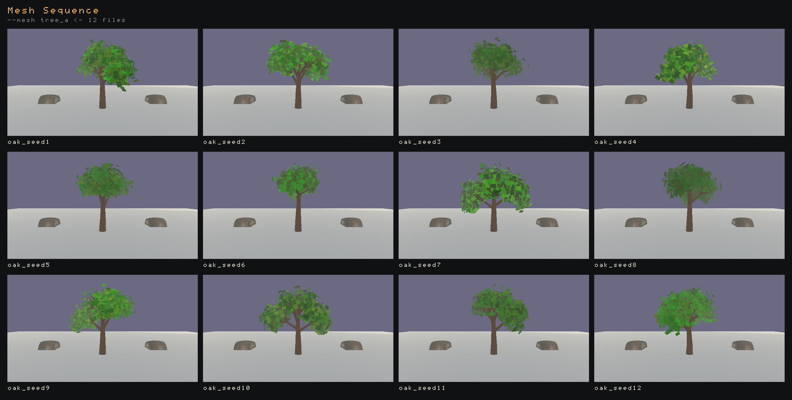
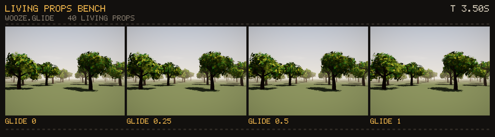

# Headless Rendering

Flint can render scenes to PNG images without opening a window. This enables automated screenshots, visual regression testing, and CI pipeline integration.

## The `flint render` Command

```bash
flint render levels/tavern.scene.toml --output preview.png
```

This loads the scene, renders a single frame with PBR shading and shadows, applies the scene's `[post_process]` block, and writes the result to a PNG file.

## Camera Options

If the scene has a `[camera]` block, the render starts from that authored framing. The orbit-style flags override it:

```bash
flint render levels/tavern.scene.toml \
    --output preview.png \
    --width 1920 --height 1080 \
    --distance 30 \
    --yaw 45 \
    --pitch 30
```

| Flag | Default | Description |
|------|---------|-------------|
| `--output <path>` | `render.png` | Output file path |
| `--width <px>` | 1920 | Image width in pixels (640 per column in a sweep, 960 in a GIF) |
| `--height <px>` | 1080 | Image height in pixels (360 per column in a sweep, 540 in a GIF) |
| `--distance <units>` | scene `[camera]` or auto | Camera distance from the target |
| `--yaw <degrees>` | scene `[camera]` or auto | Horizontal camera angle |
| `--pitch <degrees>` | scene `[camera]` or auto | Vertical camera angle |
| `--target <x,y,z>` | scene `[camera]` or auto | Camera look-at point (comma-separated) |
| `--fov <degrees>` | scene `[camera]` or auto | Field of view in degrees |
| `--no-grid` | `false` | Disable ground grid |
| `--schemas <path>` | `schemas` | Path to schemas directory (repeatable) |
| `--msaa <1\|4>` | `1` | Scene-pass MSAA sample count |
| `--render-scale <f32>` | `1` | Draw the scene at this fraction of the image (0.25--1), upscaled |
| `--gpu-time <frames>` | (none) | Render this many frames with GPU timing and print each pass's ms |
| `--frames <n>` | (none) | Draw a moving sequence of `n` frames ([Frame sequences](#frame-sequences)) |
| `--mesh <entity>=<files>` | (none) | Draw a frame per mesh file on that entity, one renderer for all ([Mesh sequences](#mesh-sequences)) |

## Post-Processing Flags

Every `[post_process]` key has a flag. CLI values win over the scene block:

```bash
# Disable all post-processing (raw shader output)
flint render scene.toml --no-postprocess --output raw.png

# Custom bloom settings
flint render scene.toml --bloom-intensity 0.08 --bloom-threshold 0.8

# Adjust exposure
flint render scene.toml --exposure 1.5

# Cheaper SSAO, depth of field, a warm grade
flint render scene.toml --ssao-samples 16 --dof 0.6 --dof-focus 10 --dof-range 5 \
    --grade-lift 0.03,0.02,0.015 --grade-gain 1.04,1,0.94
```

| Flag | Default | Description |
|------|---------|-------------|
| `--no-postprocess` | `false` | Disable entire post-processing pipeline |
| `--bloom-intensity <f32>` | `0.04` | Bloom mix strength |
| `--bloom-threshold <f32>` | `1.0` | Minimum brightness for bloom |
| `--exposure <f32>` | `1.0` | Exposure multiplier |
| `--ssao-radius <f32>` | `0.5` | SSAO sample radius |
| `--ssao-intensity <f32>` | `1.0` | SSAO strength (0 disables) |
| `--ssao-samples <u32>` | `64` | SSAO samples per pixel, 1--64 |
| `--fog-density <f32>` | `0.02` | Fog density (enables fog; 0 disables) |
| `--fog-color <r,g,b>` | `0.7,0.75,0.82` | Fog color |
| `--fog-height-falloff <f32>` | `0.1` | Enables height fog with this falloff |
| `--volumetric-density <f32>` | `1.0` | Enables god rays with this density |
| `--volumetric-samples <u32>` | `32` | Volumetric ray-march steps |
| `--dither-intensity <f32>` | `0.03` | Enables ordered dither |
| `--desaturate <f32>` | `0` | Desaturation toward ash grey, 0--1 |
| `--dof <f32>` | `0` | Depth-of-field strength |
| `--dof-focus <f32>` | `10.0` | Focus plane distance, world units |
| `--dof-range <f32>` | `5.0` | Focus half-width, world units |
| `--kuwahara-radius <u32>` | `4` | Enables the Kuwahara filter with this radius |
| `--kuwahara-sharpness <f32>` | `8.0` | Kuwahara sector sharpness |
| `--kuwahara-hardness <f32>` | `8.0` | Kuwahara sector hardness |
| `--kuwahara-anisotropy <f32>` | `1.0` | Kuwahara anisotropy, 0--1 |
| `--edge-depth <f32>` / `--edge-normal <f32>` | `0.6` / `2.5` | Shared geometry edges' thresholds (`--style edges_view` shows what they find) |
| `--kuwahara-boil <f32>` | `0.0` | How far each drawing moves the paint |
| `--contour` | off | Enable the contour pass |
| `--contour-width <f32>` | `1.25` | Half a line's width at 1080p (enables contour) |
| `--contour-threshold <f32>` | `0.08` | How strong an edge must be before it inks (enables contour) |
| `--contour-strength <f32>` | `0.9` | How dark the ink goes, 0--1 (enables contour) |
| `--contour-luma <f32>` | `0.5` | How much luminance edges count (enables contour) |
| `--contour-color <R,G,B>` | near black | The ink's colour, linear (enables contour) |
| `--contour-fade <f32>` | `30` | Metres at which a line has faded by half (enables contour) |
| `--contour-boil <f32>` | `0.0` | How far each drawing moves the lines (enables contour) |
| `--boil-on <u32>` | `2` | Film frames each drawing is held: 1, 2 or 3 |
| `--boil-time <f64>` | `0` | Seconds of the wooze field to run, which picks the drawing |
| `--render-mode <0-5>` | `0` | Stylized render mode |
| `--mode-mix <f32>` | `0` | Render mode blend, 0--1 |
| `--mode-params <x,y,z,w>` | `0,0,0,0` | Per-mode parameters |
| `--film-grain <f32>` | `0` | Film grain intensity |
| `--grain-time <f32>` | `0` | Post time driving grain and mode animation |
| `--style <name[:k=v,...]>` | (none) | Turn on any registered style over the scene, e.g. `ascii:cell=12,ramp=blocks`, `invert`, `kuwahara:radius=6`, `ascii:off`; repeatable; `--style help` lists them, `--list-styles [--json]` with stages and ranges ([Stylize Passes](../concepts/stylize-passes.md#using-a-style)) |
| `--style-time <f32>` | `0` | Post time animated styles read (the same clock as `--grain-time`) |
| `--look <name\|path>` | (none) | A preset `[post_process]` block merged over the scene's (and over a look the scene names itself with `look = "<name>"`, which goes under its keys): `ascii_noir`, `matrix`, `ink_wash`, `graphite`, `watercolor`, `coloured_pencil`, `blueprint`, `charcoal`, or a `styles/<name>.look.toml`; other flags apply over it; `--look help` lists them ([Looks and sweeps](../concepts/stylize-passes.md#looks-and-sweeps)) |
| `--sweep <key=v1,v2,...>` | (none) | One labelled contact sheet of the frame at each value: `ascii.cell=6,8,12`, `post.exposure=0.8,1.2`, `look=a,b`, or `wooze.glide=0,1` ([below](#sweeping-a-knob)); cells default to 640x360, and pixel-identical neighbours are warned about. Give it twice for a grid: the first key across, the second down (#358) |
| `--sweep-crop <x,y,w,h>` | (none) | Draw each sweep cell at `--width`x`--height` (default 1920x1080) and keep this region 1:1, so point-sized styles show their final glyph size ([Cells at the final scale](../concepts/stylize-passes.md#cells-at-the-final-scale)) |
| `--sweep-scale <cell\|full>` | `cell` | `full`: draw each sweep cell at the full size and shrink it to 640 wide, so the cell shows the final composition |
| `--report <file.json>` | (none) | Each column's (or the frame's) measures: mean luminance, near-black/white shares, edge density, the ASCII ramp-step histogram, the distance to `--reference` ([Measuring and refining a look](../concepts/stylize-passes.md#measuring-and-refining-a-look)) |
| `--reference <png>` | (none) | A target image: each frame or column's distance to it, printed, on the sheet's labels and in the report |
| `--ai-refine` | off | With `--look` and `--reference`: an agent proposes edits, each rendered and measured, kept while the distance falls; writes `<look>_refined.look.toml`, its `.json` log and a sheet of the rounds. `--refine-rounds 4`, `--refine-candidates 4`, `--refine-out`, `--ai-provider anthropic\|mock`, `--ai-model`, `--max-cost` |
| `--grade-lift <r,g,b>` | `0,0,0` | Color grade lift |
| `--grade-gamma <r,g,b>` | `1,1,1` | Color grade gamma |
| `--grade-gain <r,g,b>` | `1,1,1` | Color grade gain |
| `--fxaa` | `false` | Run the FXAA pass |
| `--ascii` | (off) | The full-screen ASCII style (#265): one glyph per cell on one grid |
| `--ascii-font` / `--ascii-ramp` / `--ascii-color` | `builtin` / the set's / `source` | ASCII style glyph set, ramp and colour mode (`source`, `tint`, `raw`, `mono`, `palette`) |
| `--ascii-palette` / `--ascii-ground` / `--ascii-glow` | `phosphor` / `dim` / `0` | ASCII style palette (`cga`, `cga16`, `amber`... or a `.palette.toml`), ground (`dim`, `black`, `inverse`) and glyph halo |
| `--ascii-tint <r,g,b>` / `--ascii-background <f32>` | phosphor green / `0.15` | ASCII style tint and how much cell colour fills behind glyphs |
| `--ascii-brightness` / `--ascii-contrast` / `--ascii-ink` | `0` / `1` / `1` | ASCII style luminance remap and ink brightness |
| `--ascii-dither` | `0` | ASCII style ordered dither, fixed to the cell grid (#277) |
| `--ascii-exposure` / `--ascii-normalize` | `0` / `0` | ASCII style exposure in stops, and per-style-id tone normalisation so dark props stay legible (#289) |
| `--ascii-text <file>` / `--ascii-text-ansi <file>` | (none) | Also write the ASCII style's character grid as UTF-8 text, or with 24-bit ANSI colours ([Reading a render as text](#reading-a-render-as-text), #317) |

### Reading a render as text

An ASCII render is a real character grid, so it can also be read rather than looked at. `--ascii-text` writes the grid the frame drew: one line per cell row, one character per cell, the same cells as the PNG (part cells at the borders included). A cell the picture passes through, under `scope = "entities"` or where a later style draws its own entity, is a space.

```bash
flint render demo/pbr_test.scene.toml --ascii --ascii-text frame.txt
#   Wrote 240x135 ASCII grid to frame.txt
flint render demo/pbr_test.scene.toml --ascii --ascii-text-ansi frame.ans && cat frame.ans
```

The text fits in a prompt, diffs line by line between two runs, and lets a test say "the box is `#`" without pixel tolerances. The ANSI file paints each glyph in its ink over its ground, for a 24-bit terminal. The grid comes from the GPU: a pass of one fragment a cell records which glyph the glyph pass draws at the cell's centre, and the frame copies it back. It runs only while capture is on (`SceneRenderer::set_style_text_capture` / `style_text`). A cell on a styled entity's silhouette holds that glyph plus the outline ink the entity draws (#288), so there the text names the centre's glyph.
| `--pixels-per-point <f32>` | `1` | High-DPI scale factor for styles sized in points |
| `--ascii-cell <n>` | `8` | ASCII cell width in points |
| `--ascii-levels <n>` / `--ascii-footprint <cells>` | `0` / `1` | ASCII tone bands and tone footprint |
| `--ascii-no-edges` | `false` | No line glyphs on edges |
| `--ascii-edges <f32>` | `1` | ASCII style edge glyph strength (0 off) |
| `--ascii-edge-threshold <f32>` / `--ascii-edge-max <f32>` | `0.5` / `3` | ASCII style: cell widths of edge that make a line glyph, and past which it's texture |
| `--ascii-edge-depth <f32>` / `--ascii-edge-normal <f32>` | `0.6` / `2.5` | Edge sensitivity |

## Lighting Flags

The `[environment]` shading levers can be overridden too; see [Lighting](../concepts/lighting.md).

| Flag | Default | Description |
|------|---------|-------------|
| `--oren-nayar <f32>` | scene or `0` | Lambert to Oren-Nayar diffuse blend, 0--1 |
| `--sheen-strength <f32>` | scene or `0` | Charlie-sheen rim strength (keep at or below about 0.3) |
| `--sheen-color <r,g,b>` | `1,1,1` | Sheen tint |
| `--no-shadows` | `false` | Disable shadow mapping (also disables volumetric light) |
| `--shadow-resolution <px>` | `2048` | Shadow map resolution per cascade |

## Debug Rendering Flags

Render debug visualizations for diagnostics:

```bash
# Wireframe view
flint render scene.toml --debug-mode wireframe --output wireframe.png

# Surface normals
flint render scene.toml --debug-mode normals --output normals.png

# Other modes: depth, uv, unlit, metalrough, style, edges
flint render scene.toml --debug-mode depth --output depth.png

# Wireframe overlay on solid geometry
flint render scene.toml --wireframe-overlay --output overlay.png

# Normal arrows
flint render scene.toml --show-normals --output arrows.png

# Raw linear output (no tonemapping)
flint render scene.toml --no-tonemapping --output linear.png
```

| Flag | Default | Description |
|------|---------|-------------|
| `--debug-mode <mode>` | (none) | `wireframe`, `normals`, `depth`, `uv`, `unlit`, `metalrough`, `style`, `edges` |
| `--wireframe-overlay` | `false` | Draw wireframe edges over solid shading |
| `--show-normals` | `false` | Draw face-normal direction arrows |
| `--no-tonemapping` | `false` | Disable tonemapping for raw linear output |

Both wireframe modes include skinned meshes, drawn in their bind pose.

## Determinism and the Gates

`flint render` is built to be byte-stable so that pixel-diff gates can trust it. Identical scene, flags and GPU driver produce identical PNGs, with these caveats:

- **Time is pinned.** Film grain, render-mode animation and animated styles read a post time that headless render fixes at 0. Pass `--style-time` (or `--grain-time`) to pick a different but equally repeatable frame; two renders at the same value match, different values differ.
- **MSAA and FXAA default off** precisely so the default path stays single-sample and single-pass. Turn them on for hero shots, not for baselines.
- **Animation does not run.** Skinned meshes render at bind pose. For a posed headless frame use the model previewer's render mode instead: `flint edit model.glb --render out.png --anim-time 1.5`, or `--sequence file.sequence.toml --anim-time 2.0` to replay a timed sequence deterministically, or `--pose-bone joint:x,y,z` to turn a joint by hand.
- **Particles start at t = 0**, so emitters appear empty unless you pass `--particle-time <s>`, which steps them deterministically before the capture. `--time` does this too.
- **Cost levers are free to change** without affecting geometry: `--ssao-samples 16` is roughly four times cheaper than the default 64 and usually indistinguishable on matte scenes (ADR 0052), which matters when a CI job renders dozens of frames.

## Frame sequences

One render is one frame, so a style that remembers the frame before (the ASCII style's per-cell history, #277) never gets to use its memory. `--frames <n>` draws a sequence on one renderer instead, `--frame-dt` apart (default 1/60 s), moving the camera between frames. The styles see consecutive frames and their history runs as it does in the player, without a window, a script or a capture tool (#345):

```bash
flint render demo/ascii_motion.scene.toml --schemas schemas --no-grid \
    --width 1280 --height 720 --frames 181 --orbit 6.8755 --output out/seq.png
#   Sequence: 181 frames, 0.016667 s apart, orbiting 6.8755 deg/s
#   Rendered 181 1280x720 frames to out/seq_0000.png .. out/seq_0180.png
```

| Flag | Default | Description |
|------|---------|-------------|
| `--frames <n>` | (none) | Frames to draw, written as `<stem>_0000.png`... beside `--output` (with `--ascii-text`, numbered grids too) |
| `--frame-dt <s>` | `1/60` | Seconds between frames. Post time (`--style-time` is the start), grass wind, `--particle-time` particles and the ASCII history's smoothing (#342) advance by it |
| `--orbit <deg/s>` | (still camera) | Turn the camera about its target, from the scene's `[camera]` or the orbit flags |
| `--camera-path <file>` | (still camera) | Follow keys instead, position and target interpolated linearly |
| `--flip-stats` | `false` | Count the ASCII style's glyph flips and reversals, per frame and in sum |
| `--flip-json <file>` | (none) | Write the counts as JSON (per-frame arrays and the means) |
| `--no-images` | `false` | Skip the PNGs, for a measurement |

A camera path is a TOML list of keys, in seconds from the first frame:

```toml
[[key]]
time = 0.0
position = [3.2, 1.5, 8.5]
target = [0.6, 0.6, 4.2]

[[key]]
time = 3.0
position = [5.4, 1.5, 6.9]
target = [0.6, 0.6, 4.2]
```

### Measuring shimmer

`--flip-stats` reads the character grid the ASCII style drew each frame (the [text capture](#reading-a-render-as-text)), so it counts glyphs exactly, with no thresholds on pixels. It prints two numbers. **Flips** are the cells whose glyph changed since the frame before, and real motion flips glyphs too. **Reversals** are the cells that changed back to the glyph they had two frames ago (A, B, A). Motion rarely does that in two frames, but shimmer does little else, so reversals measure the shimmer itself. Its summary line reads like `tools/ascii_flips.py`'s, and the two agree cell for cell on the same frames.

The #277 bench, with the history on and off and with and without the edge glyphs (#267):

```bash
flint render demo/ascii_motion.scene.toml --schemas schemas --no-grid \
    --width 1280 --height 720 --frames 181 --orbit 6.8755 --no-images --flip-stats \
    --style ascii:temporal=off --style ascii:edges=0
#   Flips: 181 frames, 14400 cells: 321.1 flips/frame (2.23%), 57.8 reversals/frame (0.40%)
```

| `demo/ascii_motion`, 181 frames | flips/frame | reversals/frame |
|---|---|---|
| `temporal = "off"`, `edges = 0` | 321.1 (2.23%) | 57.8 (0.40%) |
| `temporal = "on"`, `edges = 0` | 105.1 (0.73%) | **0.0** |
| `temporal = "off"`, edges on (default) | 389.7 (2.71%) | 69.1 (0.48%) |
| `temporal = "on"`, edges on (default) | 227.7 (1.58%) | 30.3 (0.21%) |

The history removes the tone glyphs' shimmer completely, as the player capture in #277 found (0.1 reversals a frame). The edge glyphs, added after that measurement, are still picked fresh every frame, and they are what's left (#477). The scene's `[camera]` is the first pose of its orbit script, so `--orbit 6.8755` (the script's 0.12 rad/s) follows the same path as the player's capture.

A sequence is byte-identical run to run: the same flags give the same PNGs, which the player's `--frame-step` captures don't quite manage (#341). A debug build draws this bench at about a second a frame; `--no-images` and `--ssao-samples 16` are the cheap ways to make it quicker. A `render-suite` gate on a reversal budget is #478.

### Mesh sequences

A procgen look test often has its frames already, as mesh files: one GLB per seed, per pose or per setting. `--mesh <entity>=<files>` draws a frame per file on one renderer, showing each file in turn on that entity, so twelve files cost one start-up instead of twelve (#222). The files are one GLB, a folder of them, or a wildcard in the file name, taken in natural order (`f2` before `f10`):

```bash
for s in $(seq 1 12); do flint gen specs/oak_tree.procgen.toml --seed $s -o out/oaks/oak_seed$s.glb; done
flint render demo/mesh_sequence.scene.toml --mesh tree_a=out/oaks --sheet -o oaks.png --no-grid
#   Sequence: 12 frames, 0.083333 s apart
#   Rendered 12 640x360 frames as one 2664x1346 sheet to oaks.png
```



| Output | What it writes |
|--------|----------------|
| `-o seq.png` | `seq_0000.png`... as `--frames` numbers them |
| `-o frames/f-%03d.png` | a PNG a frame, numbered as the pattern says |
| `-o oaks.gif` | one GIF at `--fps` (default 12; at most 50) |
| `--sheet -o oaks.png` | one contact sheet, each cell labelled with its file's name (cells 640x360 unless `--width`/`--height`) |

Repeat `--mesh` to move several entities at once, frame for frame: `--mesh tree_a=out/oaks --mesh tree_b='out/willows/w*.glb'` gives frame *n* the *n*th file of each, and refuses lists of different lengths. Frames are 1/`--fps` apart (or `--frame-dt`), so `--orbit`, `--camera-path`, post time and particles move as in any sequence. `demo/mesh_sequence.scene.toml` has three slots (`tree_a` in the middle, `tree_b` and `tree_c` either side) and a bench for scale.

The bound entity's `model` is pointed at an asset of its own (`mesh-seq/<entity>`) and marked `runtime`, so the scene's loader leaves it alone and other entities naming the same asset keep theirs. An entity with no model gets one. A GLB of several mesh nodes, or one moved by its node, is baked into one mesh, so a swap is one upload. Skinned files draw their rest pose. A mesh sequence draws on the still path, so it refuses `--time`, `--scripts`, `--sweep` and scenes with living props or a `[wooze]` table. On a shared machine, release build, 960x540: 12 oaks in one run took 2.05 s, and 12 runs of one file each took 24.2 s (the minimum of three alternating rounds). `crates/flint-cli/tests/render_mesh_cli.rs` checks that the last frame of a sequence is byte-identical to that file rendered alone.
## A Chosen Moment

`--time` captures a scene at a game time, so that two settings can be compared at the same instant:

```bash
flint render demo/living_props.scene.toml --time 3.5 -o at-3.5.png
```

[Living props](../concepts/procgen.md#in-a-scene-the-living_prop-component), shallow wooze, the [shading boil](../concepts/post-processing.md) and the [wooze field](../concepts/procgen.md#the-wooze-field) they all read run from zero to that time, and so do the other clocks the player keeps: grass, ocean and post time (`--grain-time` overrides the post time), particles (`--particle-time` overrides those), and `--boil-time` holds the boil on one drawing. The grid stays off, as it is in the player. The same value gives a byte-identical PNG on the same machine and driver.

It also matches the player. `flint render --time T` and `flint-player --frame-step S --screenshot-at T` at the same window size drew the same pixels on both of Flint's living demo scenes, at four times from 0 to 11.75 s and at steps of 1/16 and 1/60 s: not one pixel of 921,600 differed. Clocks step 1/60 s at a time, or `--frame-step S` if you want to name a player run's step. Scenes whose field doesn't change over time get the same pixels from any step.

Several moments of one run are a list, each later than the one before:

```bash
flint render demo/living_props.scene.toml --time 2,5,9.5 -o at.png
```

That writes a still a moment beside `--output`, numbered as a [`--frames`](#frame-sequences) sequence is (`at_0000.png`, `at_0001.png`, `at_0002.png`). It's one run: the scene loads once and the clocks step through the moments in order, so it simulates to the last moment once, where three renders would simulate to each. A moment that falls on the step (1/60 s, or `--frame-step`) gets the same bytes it gets rendered alone. Between moments off the step, the clocks take one short step to land on each, as a span's frames do. `--report json` has a capture a moment, and a `--sweep` writes a sheet a moment.

Physics and animation clips don't run, and nor do scripts unless you ask (next section). That's where the match ends. `demo/wooze_field.scene.toml` has a script that changes the step at 12 s, so without `--scripts` a capture agrees with the player up to there and not after (about 50,000 pixels differ at 13 s). When a scene has scripts it isn't running, or `animator` components, the render names those entities in a warning. In `demo/shallow_wooze.scene.toml`, whose figure is on an idle clip, everything but the figure matches.

## Scripts and an Expression Timeline

`--scripts` runs the scene's Rhai scripts as the player does, so what they do to the scene is in the capture. `--expression-timeline` feeds them [expression states](../concepts/scripting.md#expression-api) from a file and implies `--scripts`:

```bash
flint render scenes/stage.scene.toml --expression-timeline timelines/one-turn.timeline.json \
  --time 0..12 --fps 12 -o one-turn.gif
```

Scripts start once the models are loaded, as in the player, and tick once per clock step (1/60 s, or `--frame-step`), in the player's frame order: the timeline's states that have come due, `on_expression` then `on_update`, `on_draw_ui`, then what the scripts asked for, then the wooze field and living props. Time 0 is the player's first frame: its `dt` is 0, and a state at `t = 0` is heard before anything is drawn. A state is due once the clock reaches its `t`, to within a microsecond, since 120 steps of 1/60 add up to a hair under 2.

It's deterministic, so a review can diff two renders:

- The clock is the step, and it is the only one: `timestamp()`, Rhai's wall clock, fails and says to use `total_time()`.
- `random()` and `random_range()` draw from a seeded sequence, the same every run. A player run with `--frame-step` draws the same one (#635), unless its `--seed N` picks another.
- Scripts run in the order of their entities' names, here and in the player. That order used to come from ids, which differ run to run.
- There is no input.

What changes the picture runs: everything scripts write to the world (`set_field`, `set_position`, a light's colour, a material), `tune_living` (its `boil` too: `kuwahara`, `contour`, `on`, `enabled`), `freeze_living`, `step_living` (a whole beat for every prop, the boil and shallow wooze, frozen or not), `load_living_preset`, `set_wooze`, `set_wooze_zone`, `remove_wooze_zone`, `fire_event` between scripts, the `set_camera_*` overrides and the post-processing ones (`set_exposure`, `set_vignette`, `set_fog_color`, ...), and particles (#579): `play_effect`, `stop_effect`, `set_effect_param` and `emit_burst` reach the capture's particles, which step on the scripts' clock in the fixed 1/60 s steps `--time` already took. A still with no `--time` or `--particle-time` draws no particles, and says so. Sound is dropped quietly. Everything else a script asks for (physics, a scene change, `compare_living`, the HUD, render modes) is named once on stderr and in the report's `warnings`, so whoever reads the capture knows what it isn't showing. Each capture in `--report json` also says the `expression` state the scripts had then.

`crates/flint-cli/tests/render_scripts_cli.rs` keeps this true: a script tints a light by `expression().state`, each state's colour is on the frames at its time, two renders are byte-identical, a tune, a freeze, a step and a preset reach living props, a script switches the boil off and on, and an effect it plays and stops is drawn only between the two.

A scene with `living_prop` entities draws them in any `flint render`, at time 0 without `--time`. Procgen assets resolve as in the player only in those scenes. Other scenes draw exactly as they did.

## Sweeping a Knob

A wooze key on `--sweep` renders the same moment once per value of a wooze knob, side by side on one image:

```bash
flint render demo/living_props.scene.toml --time 3.5 --sweep wooze.glide=0,0.25,0.5,1 -o glide.png
```



It takes `wooze.amplitude`, `wooze.step`, `wooze.glide`, `wooze.jitter` and `wooze.preset` (`wooze.preset=boil,morph,calm`). Each column is a whole run of its own from time 0, since a prop's state at a moment depends on what the knob was all the way there. `--width` and `--height` are each column's size, 640 x 360 by default, as for every sweep.

A render with clocks (a `--time`, a wooze key, `--scripts`, `--report json`, or a scene with living props or a `[wooze]` table) draws a world and renderer a column like this whatever its key, so `--sweep ascii.cell=6,8 --time 0..1 -o cells.gif` animates a style sweep and `--report json` gives each of its captures a `column`. They take what a still render takes, cell for cell (#596):

- Two `--sweep` flags make a grid, a world and renderer a cell, the first key across and the second down: `--time 3.5 --sweep wooze.glide=0,0.5,1 --sweep wooze.step=0.25,0.5,1` judges the two knobs together on one sheet, with the moment top right. A cell that turns two wooze knobs takes both, and a preset file's knobs go under the other key's, so a `wooze.glide` row turns the glide a preset column set. `--report json` gives each capture a `row` as well as a `column`.
- `--sweep-crop` and `--sweep-scale` draw each cell at the full size and keep a region or shrink it, as in [Cells at the final scale](../concepts/stylize-passes.md#cells-at-the-final-scale).
- `--reference` and a `--report` file measure each cell at one moment, with the labels' distances and the nearest starred; with `--report json`, each capture carries its `distance` too. A span or a `--time` list is refused, since its frames would each measure differently: measure a moment with `--time T`.
- `--ascii-text` / `--ascii-text-ansi` write the grid of a moment, or one file a frame (`grid_0000.txt`...) for a span, a list or `--frames`. A sweep is refused, as on a still.
- `--gpu-time N` times the first cell's last capture, drawn N times more.
- `--frames N` steps the clocks `--frame-dt` a frame (default 1/60 s) and writes `seq_0000.png`..., with `--orbit`, `--camera-path`, `--flip-stats` and `--no-images` as in [frame sequences](#frame-sequences); the camera's move goes over where any script left it. It's refused with `--time` (both draw a span) and with `--sweep`, as on a still.
- `--ai-refine` redraws the one moment under each candidate look, the clocks never rewound, so a look can be tuned on the Woozy Grove at 3.5 s. A span or a list is refused (it refines one frame), and so is `--report json` (the refine writes its own log).

A sweep sets the scene's global value, the same one a `[wooze]` table would, and a scene without a table gets an empty one. Zones still apply on top. If a zone keeps any prop off the value, the column says what the props really read (`PROPS READ 0.25-0.80`). If two neighbouring columns come out pixel-identical, a warning says so: at this moment, nothing on screen is listening to that knob.

## A Span of Time as a GIF

Stills can't show motion. Give `--time` a span and `--output` a `.gif`:

```bash
flint render demo/living_props.scene.toml --time 0..4 --fps 12 -o grove.gif
flint render demo/living_props.scene.toml --time 0..4 --sweep wooze.glide=0,1 -o glide.gif
flint gen specs/examples/oak_living.procgen.toml --strip --frames 48 --fps 24 -o oak.gif
```

The span leaves out its last moment, so that a span one cycle long loops cleanly. `--fps` goes up to 50, which is as fast as browsers will honestly play a GIF. A frame is 960 x 540 by default.

Nothing moves in the file that didn't move in the render. All the frames share one palette with no dithering, and a pixel the render left alone is written as transparent over the last frame. On 24 frames of the bench, in which 75.5% of the pixels never change, this keeps all of them still, where the `image` crate's encoder, with a new palette every frame, shimmers 81% of them by as much as 22 levels. That shimmer would look just like the boil you're trying to judge. It also comes out smaller: 1.8 MB to its 2.5 MB.

### Long spans

A span of any length renders in about the memory of one frame. The palette is learned from every frame, so the GIF can't be encoded until the last one is in, and until then each frame waits on disk beside the output (`x.gif.frames~`, removed when the GIF is written, or if the render fails) as its difference from the frame before, deflated. Footage that is mostly still costs almost nothing there. The GIF comes out the same, byte for byte, as when all the frames were held at once.

To edit the footage, or to encode it yourself, give `--output` a numbered PNG path instead. Each frame is written as it's captured, and nothing waits:

```bash
flint render live.scene.toml --scripts --time 0..900 --fps 8 -o frames/live-%05d.png
ffmpeg -framerate 8 -i frames/live-%05d.png -pix_fmt yuv420p live.mp4
```

`%d` numbers from 0 at its natural width, and `%05d` pads to five digits. A span's clocks, and its scripts, run on to the span's end, though the end itself is never a frame, so a script's log covers all of `0..900` rather than stopping at the last capture.

## What a Prop Was Doing

`--report json` writes one JSON object on stdout, and moves everything else to stderr:

```bash
flint render demo/wooze_field.scene.toml --time 3.5 -o at-3.5.png --report json
```

```json
{
  "scene": "The Wooze Field", "output": "at-3.5.png", "width": 1920, "height": 1080,
  "frame_step": 0.016666666666666666, "wooze_field": true, "wooze_zones": 2,
  "captures": [{
    "time": 3.5,
    "props": [{
      "entity": "oak_00", "asset": "oak_living@7", "lineage_seed": 7,
      "position": [-48.0, 0.0, -30.0], "phase_offset": 0.61965674, "beats": 7.619656741619093,
      "poses": { "index": 7, "weight": 0.13669996, "shape_seed": 11430650338220828881,
                 "lowest": 7, "highest": 8, "gliding_parts": 51, "parts": 243 },
      "wooze": { "amplitude": 1.0, "step": 0.5, "glide": 0.3, "jitter": 1.0 },
      "echoes": 6,
      "species": "oak_living",
      "values": {
        "step": { "value": 0.5, "layer": "global" },
        "glide": { "value": 0.3, "layer": "global" },
        "echoes.count": { "value": 6, "layer": "spec" },
        "stagger": { "value": "per_level", "layer": "spec" },
        "...": "amplitude, jitter, echoes.spread, echoes.alpha and variance.* the same way"
      }
    }]
  }],
  "still_props": [],
  "warnings": ["scripts don't run without --scripts, so what director would do to this scene isn't in it"]
}
```

There's one capture per image in the file: per column in a sweep (each with a `column`, the knob's value), and per frame in a span. Props come in order of name.

`poses` is what was drawn, read from the blend: `index` and `weight` are the first part of the skeleton, the trunk's first segment, leaving that pose toward the next, and `shape_seed` regrows it. `lowest` and `highest` are how far a staggered tree's parts have spread, and `gliding_parts` is how many are between poses instead of holding, so a frozen-looking tree has a number that says why. `wooze` is what the field said where the prop stands. `species` is the prop's spec, and `values` has every value a [species](../concepts/procgen.md#species-values) can set, as the prop runs on it, with the layer that set it: `spec`, `entity` (a `living_prop` stagger), `global` (the scene's `[living]` or `[wooze]`), `zone:<name>` where a zone has the last word, or `species`. A zone's `value` can be part way to its own, inside its falloff. `still_props` lists entities that asked to be living and drew as still models; the reason is in stderr.

Why the runtime values are here and not in `flint query`: query reads scene files, and none of this is in one.

## CI Pipeline Integration

Headless rendering works on machines without a display. On one without a GPU, it needs a software adapter: lavapipe (`mesa-vulkan-drivers`) on Linux, WARP on Windows. [Linux and Headless Setup](../getting-started/installation.md#linux-and-headless-setup) has the packages. Use it in CI to catch visual regressions:

```yaml
# Example GitHub Actions step
- name: Render preview
  run: |
    cargo run --bin flint -- render levels/tavern.scene.toml \
      --output screenshots/tavern.png \
      --width 1920 --height 1080

- name: Upload screenshot
  uses: actions/upload-artifact@v4
  with:
    name: screenshots
    path: screenshots/
```

## Golden Suites

`flint render-suite` given a `*.goldens.toml` renders a list of cases as `flint render` would and compares each with a golden PNG (#271). It exits non-zero when any case moves past its tolerance, so it works as a gate in a script or a test:

```bash
flint render-suite crates/flint-cli/tests/golden/stylize.goldens.toml
#   PASS  ascii-full      0.00% past 48 (limit 2.00%), mean 0.00 (limit 3.00), max 0, 1316 ms
#   ...
flint render-suite my.goldens.toml --case tavern --out-dir out/goldens
flint render-suite my.goldens.toml --bless          # write the renders over the goldens
```

```toml
[suite]
name = "stylize"
root = "../../../.."            # cases run from here; scene paths are relative to it
width = 640                     # default 640 x 360
height = 360
args = ["--schemas", "schemas"] # before every case's own flags

[tolerance]                     # the defaults below; a case may override any
level = 48                      # a pixel differs past this many levels (largest channel, 0-255)
share = 0.02                    # fail when more than this share of pixels differ...
mean = 3.0                      # ...or the mean difference passes this

[[case]]
name = "ascii-full"
scene = "demo/pbr_test.scene.toml"
golden = "ascii_pbr_test.png"   # beside the manifest; default "<name>.png"
args = ["--style", "ascii"]     # any flint render flags
# width, height and tolerance = { ... } override the suite's
text = "ascii_pbr_test.txt"     # optional: the ASCII grid too, compared exactly (#317)
text_cells = 0                  # ...or with at most this many cells different
```

A case with `text` is also a structural golden. It renders with `--ascii-text`, and its character grid must match the checked-in one cell for cell, with the PNG kept as the visual check. When cells move, `<case>.text.diff` lands beside the render. It shows each row that moved, the golden's line over the render's, with a caret under each cell, so a drift can be read without opening an image:

```text
row 4: 2 cell(s)
  golden |-----------------------------=====++++++++++++=====-----------------------------|
  render |-----------------------------=====+=+=++++++++=====-----------------------------|
                                             ^ ^
```

That's `ascii-full` with `brightness=-0.004` added. The PNG check passes it, with 0.19% of pixels moved against a 2% limit. The text check fails it, because 28 cells in 8 rows changed glyph. A structural golden is much stricter than a pixel tolerance, so give a case `text_cells` if its glyphs sit on a tone boundary that another GPU may round the other way.

### Cases that match a second render

Some claims aren't about a picture but about two pictures being the same: "a style that fails to compile draws the frame as if it weren't there". A case with `matches` states that (#417). It has no golden file. It renders the scene with its own `args`, then again with `matches` in their place, and the two must be identical unless the case gives a `tolerance`. Both renders come from one adapter in one run, so the case holds on any GPU and has nothing to bless. The second render is `<case>.reference.png` in the out dir, shown as the golden on the contact sheet.

`error` adds a check on what the render reported: after the case renders, some user style's error must contain that text, which is the message `flint render` prints as a warning (with `--isolate`, the render's whole log is searched).

```toml
[[case]]
name = "user-style-broken"
scene = "crates/flint-cli/tests/golden/fixtures/broken_style.scene.toml"
args = ["--no-grid", "--style", "broken"]   # a style whose WGSL fails
matches = ["--no-grid"]                     # must equal the frame without it
error = "broken.wgsl:9:9"                   # and say where it failed
```

The stylize suite's broken-style case is stricter than it looks. A display-stage user style reads its input through the prelude's sRGB-to-display curve and writes through the inverse, and the passthrough does too. So the frame equals the unstyled one only while the two curves undo each other. With `flint_to_linear`'s exponent changed from 2.4 to 2.2, 98% of the pixels move (mean 7 levels), and the case fails.

### The contact sheet

Every run writes `index.html` to the out dir (#329): one card a case with the golden, the render and the diff side by side, then a meter for each number against its limit (the tick is the limit), the case's scene and flags, and the text diff when its grid moved. Cases that failed come first, then the ones where any pixel moved, then the identical ones, each group in manifest order; the buttons at the top filter by group. **blink** flips a render with its golden in place, which shows a one-pixel shift that a side-by-side hides. The page reads its images beside itself (`<case>.png`, `<case>.diff.png`, and `golden/<case>.png`, a copy of the golden as it was before the run), so the out dir can be zipped or uploaded whole.

A `--bless` still compares before it writes. Its sheet shows each case's old golden as **was** and the diff as what the bless changes: review that page, not the folder.

### Drift

A tolerance lets a case pass when it isn't the golden's exact bytes, and those small differences add up across merges. While #273 was blessed, three cases (`ascii-full-detailed-tint`, `style-mask` and `look-sweep-cell`) were found 0.37% to 1.88% off their goldens, each inside its limit. Some earlier merge had moved them and nobody re-blessed, because they still passed. The next real change then had to be told apart from that old drift (#387).

A case that passes but isn't byte-identical (any pixel or any grid cell moved) now prints a `DRIFT` line under its `PASS`, and its `report.json` entry has `"drift": true`. The run ends with a tally, either way:

```text
  PASS  ascii-full-detailed-tint       0.70% past 48 (limit 2.00%), mean 0.96 (limit 3.00), max 255, 2720 ms
  DRIFT ascii-full-detailed-tint     2150 pixel(s) moved (max 255): inside the tolerance, not byte-identical
  PASS  style-mask                     0.00% past 48 (limit 2.00%), mean 0.00 (limit 3.00), max 0, 1159 ms
...
drift: 36 passing case(s) not byte-identical with their golden: ascii-full-detailed-tint, ascii-full-hidpi, ...
  (--bless-drifted re-blesses only those, for a catch-up commit)
```

or `drift: none, every passing case is byte-identical with its golden`. The contact sheet's chip reads **pass, drifted** and its filter is **drifted**, and CI's summary marks the row and lists the drifted cases at the end. On an adapter with no variant for a case, drift is measured against the plain golden, so on WARP it mostly reports the gap between adapters.

`--bless-drifted` blesses only those cases. It is meant for one catch-up commit with nothing else in it, so that the next change's diff shows only what that change moved. Failing cases are left alone and still fail the run. Look at the sheet first: each re-blessed case shows its old golden as **was**.

### One process

Cases run in the `render-suite` process itself (#329). Each one's flags are parsed as `flint render` parses them and go to the same function, on one GPU device kept for the whole run. Every glTF is decoded once (`flint_import::memoize_imports`) and every texture's mip chain is built once (`flint_render::memoize_mip_chains`). Each case still builds its own renderer, so it shares only the device and those decoded bytes with the case before it. For the 41 stylize cases in a debug build, the run's CPU time went from about 120 s to 55 s. Summing each case's best time over several runs, the suite went from 115 s to 45 s, and a props-scene case from about 3.2 s to 1.1 s.

The cost is crash isolation. A case that panics is run again in its own `flint render` process (the device is dropped and made again for the next case), and its log is the case's message. `--isolate` spawns every case, as before #329.

| Flag | Description |
|------|-------------|
| `--bless` | Write each render (and each `text` grid) over its golden instead of comparing. The contact sheet shows what each replaced. Look at it before committing |
| `--bless-drifted` | Bless only the cases that pass but aren't byte-identical with their golden ([drift](#drift)); failures still fail |
| `--case <name>` | Only this case. A name that is exactly a case's picks that case alone (`--case ascii-silhouette-cell` skips `ascii-silhouette-cell-object`); one that names no case picks every case whose name contains it (`--case ascii-silhouette` runs both). Repeatable: a case runs when any filter picks it |
| `--out-dir <dir>` | Where renders, `<case>.diff.png` (the golden dimmed, amber where a pixel moved, red past the level; written when any pixel moved), `report.json` and the `index.html` contact sheet go; default a folder in the system temp dir |
| `--require-gpu` | Fail instead of skipping when there is no GPU adapter (also `FLINT_REQUIRE_GPU=1`) |
| `--bless-variant` | Write each render as this adapter's variant of its golden, `<stem>.<key>.png` |
| `--isolate` | Run each case as its own `flint render` process: slower, but a crash takes only its case down |

Without a GPU adapter every case is skipped and the suite passes, unless `--require-gpu` or `FLINT_REQUIRE_GPU=1` is given. Under `FLINT_REQUIRE_GPU`, an adapter named by `WGPU_ADAPTER_NAME` that doesn't exist is also a failure; without it, the suite falls back to the default adapter.

### Adapters and golden variants

Two adapters never render exactly alike. The difference is usually small, but a backend can be as far off as a real regression, so a golden can carry a **variant** per adapter beside it: `kuwahara.warp.png` next to `kuwahara.png`. The suite prints the adapter it found and its key: `warp` (WARP, the software DX12 adapter), `lavapipe` (Mesa's software Vulkan), or else the backend's name (`vulkan`, `dx12`, `metal`, `gl`). A case compares with its adapter's variant when there is one, and with the plain golden otherwise. `--bless` rewrites whichever of the two the case compared with, and `--bless-variant` creates the variant. Each case in `report.json` records `adapter`, the `golden` it compared with, and `variant`, the path where this adapter's variant would go.

On CI, the `GPU tests (WARP)` job (`.github/workflows/ci.yml`) runs the stylize GPU tests and the engine goldens on WARP, with `FLINT_REQUIRE_GPU=1` set. Its summary lists every case's margin, and its `stylize-goldens-warp` artifact holds the renders and diffs, with the contact sheet: open its `index.html`. To bless a WARP variant, copy the case's render from that artifact to its report's `variant` path. wgpu hides WARP on a machine that has a GPU, so WARP variants can't be rendered locally. Engine styles are pinned by `crates/flint-cli/tests/golden/stylize.goldens.toml` ([Stylize Passes](../concepts/stylize-passes.md#goldens)).

flint-render's own GPU tests (`stylize`, `runtime_mesh`, `quality`, `shading_boil`) share one device per test binary, made on first use by `tests/shared_gpu`. Each test made its own device until a run hung for hours: on Windows with an NVIDIA card, creating a Vulkan device while a finished test's thread exits can deadlock the driver against the Windows loader lock. A test borrows the shared device alongside the others, or alone when it counts objects across the whole device or catches errors in an error scope (wgpu 23 keeps one stack of scopes per device). A watchdog aborts the binary and names the test once any test has held the device longer than `FLINT_GPU_TEST_TIMEOUT` seconds (300 by default), so a hang ends in minutes with a name, not in hours with none.

## Visual Regression Testing

For a game's own scenes, a golden suite as above is the shortest path. By hand, the same workflow is:

1. **Baseline** --- render a reference image and commit it:
   ```bash
   flint render levels/tavern.scene.toml --output tests/baseline/tavern.png
   ```

2. **Test** --- after changes, render again and compare:
   ```bash
   flint render levels/tavern.scene.toml --output tests/current/tavern.png
   # Compare with your preferred tool (ImageMagick, pixelmatch, etc.)
   ```

3. **Update** --- if the change is intentional, update the baseline:
   ```bash
   cp tests/current/tavern.png tests/baseline/tavern.png
   ```

Keep baselines on the default flags (no `--msaa`, no `--fxaa`, no `--grain-time`) so a lever you added for a hero shot never silently changes the gate.

## Rendering Multiple Views

Script multiple renders for different angles:

```bash
#!/bin/bash
SCENE="levels/tavern.scene.toml"

for angle in 0 90 180 270; do
    flint render "$SCENE" \
        --output "screenshots/view_${angle}.png" \
        --yaw $angle --pitch 25 --distance 25 \
        --width 1920 --height 1080
done
```

## Rendering Pipeline Details

Headless rendering uses the same wgpu PBR pipeline as the interactive viewer:

- **Cook-Torrance BRDF** with roughness/metallic workflow and the `[environment]` shading levers
- **Cascaded shadow mapping** for directional light shadows, with PCSS when the light has an `angular_size`
- **glTF mesh rendering** with full material support
- **Skinned mesh rendering** at bind pose (no animation is evaluated headlessly)
- **The full post-processing chain**, including Kuwahara, contour and FXAA when enabled

The only difference from interactive rendering is that the output goes to a texture-to-buffer copy instead of a swapchain surface.

## Further Reading

- [Rendering](../concepts/rendering.md) --- the PBR rendering pipeline
- [Post-Processing](../concepts/post-processing.md) --- what every flag above controls
- [Lighting](../concepts/lighting.md) --- the light component and shading levers
- [AI Agent Workflow](ai-agent-workflow.md) --- using headless renders for agent verification
- [CLI Reference](../cli-reference/overview.md) --- full command options
