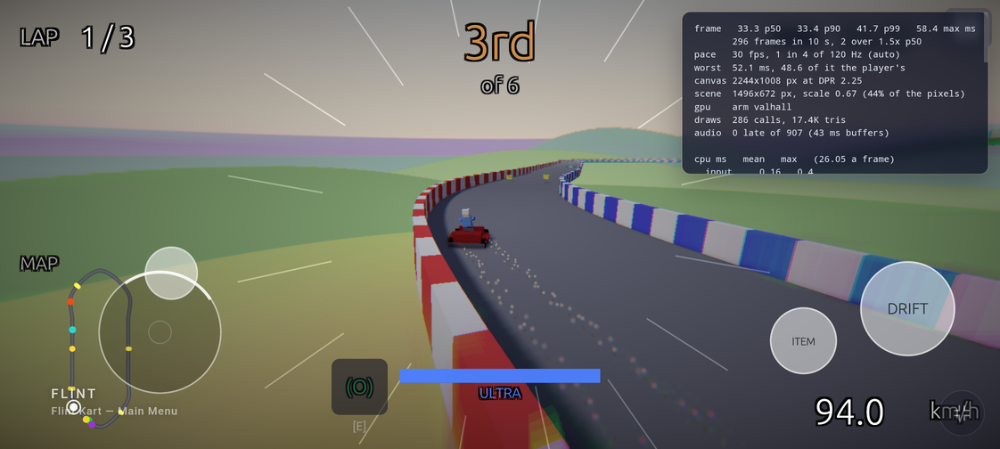
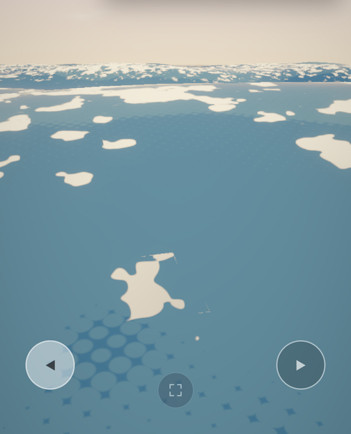

# Playing on Mobile

The games at [play.chaps.dev](https://play.chaps.dev) play on a phone in Chrome (or any browser with WebGPU) with nothing but fingers. This page covers how each shipped game is laid out for touch, how a phone runs them, and what a game of your own needs to do the same.



## On the phone

1. Open play.chaps.dev and tap a game. Each card says how it's played by touch.
2. Tap **Begin**. On Android the gate's *full screen* switch is on for a phone. Full screen keeps the way you hold the phone, and the game turns with it, upright or sideways. On iPhone, add the page to the home screen for the whole screen (the gate says how).
3. Touch the screen. The controls appear at the first touch, and go away again if a key or a paired gamepad is used.

| Game | Touch layout |
|---|---|
| **SET + DRIFT** | drag anywhere to look; hold ◀ or ▶ (bottom corners) to scoot along the raft's edge; a tap lifts the title card |
| **Flint Kart** | left thumb: a stick that lands where the thumb does, pushed up for gas, down to brake or reverse, sideways to steer. Right thumb: hold DRIFT, tap ITEM. The pause button is top right. Menus are tapped: a track card once to choose it, again to race |



## How a phone runs them

On a Pixel 8 Pro (Chrome 156, DPR 2.25) both games draw at an even 30 fps: the page draws one frame every four refreshes of the 120 Hz display ([frame rate on phones](https://github.com/chrischaps/flint/blob/main/docs/design/web.md#frame-rate-on-phones-140)). SET + DRIFT holds 33.3 ms frames through a minute of play. Flint Kart holds 33.3 ms on its first lap and slips to 42–50 ms as the phone warms. Both are limited by the CPU, not the GPU, so a smaller render scale doesn't speed them up. The measured table is in `docs/design/web.md`, under *The shipped games on a phone*.

`?perf=1` shows the same readout on your own phone, with a Copy line button.

## Making your game playable by touch

The controls are declared in the game's input config; see [On-Screen Touch Controls](../concepts/touch-controls.md) for the whole block. The two shipped layouts show the patterns:

- **Keep it to what the game needs.** SET + DRIFT has no stick and no menu: a look region over the whole screen and two buttons. Each button gives its `value` to one axis action, so the same `scoot` axis that A and D drive is driven from its two ends:

  ```toml
  [[touch_controls.buttons]]
  action = "scoot"
  value = 1.0
  label = "◀"
  anchor = "bottom_left"
  offset = [64, 64]
  radius = 30
  ```

- **Put the controls away under a menu.** A floating stick takes any finger in its region, including one meant for a menu row. Call `set_touch_controls(false)` when a menu opens and `set_touch_controls(true)` when play resumes; while they're away, every tap reaches the scripts' `tap_count()` / `touch_count()`.
- **Make room in the HUD.** `touch_controls_visible()` is true while the controls are on screen. Flint Kart's HUD uses it to drop its standings board on a short screen, and to say "ITEM" where a keyboard player sees "[E]".
- **Let a finger press "any key".** `any_input_just_pressed()` counts a finger landing, so a title card that waits for a key lifts on a tap too.
- **Mind the corners.** Offsets are points inside the phone's safe area. The page keeps its own buttons out of the bottom corners once the game is playing.

To try a layout on the desktop, show the controls from the start and drive them with the mouse:

```bash
flint-player levels/demo.scene.toml --schemas engine/schemas --schemas schemas --touch-controls always
```

On the web the same switch is `?touch=always`.
