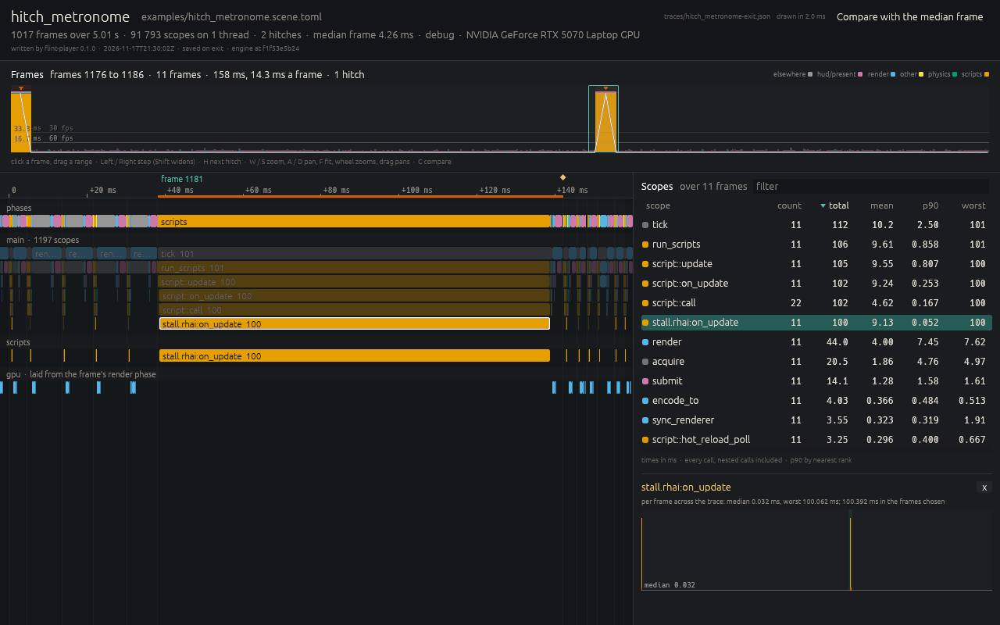
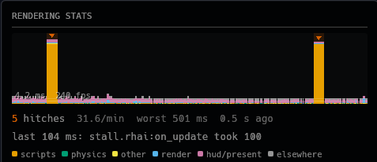
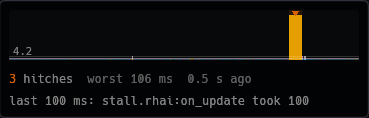
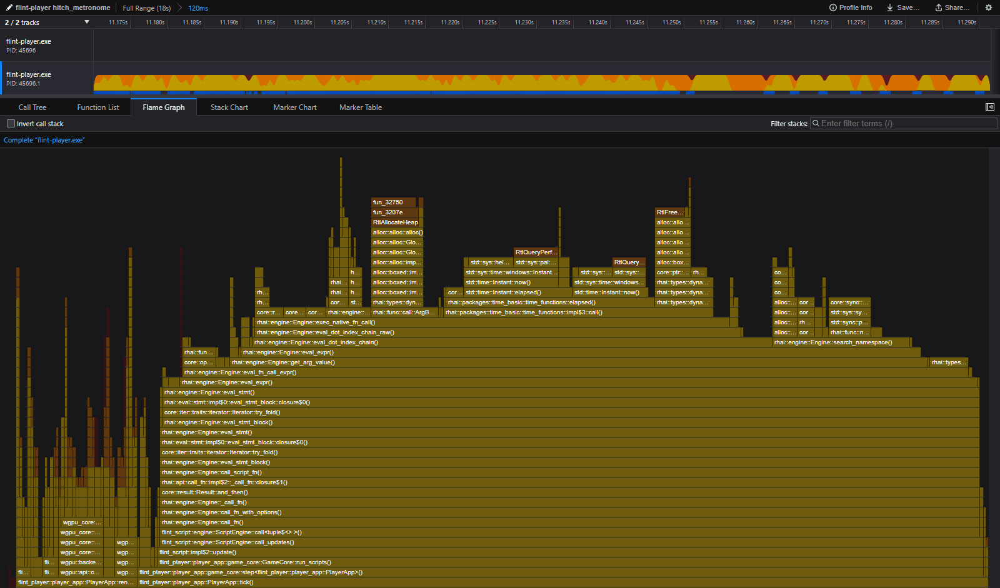

# Profiling

Two tools say where a frame's time goes. **GPU timing** shows how long the GPU spends on each phase of the frame, in the F2 overlay and in `RenderStats`. The **`profile` feature** sends the frame loop's CPU time to [Tracy](https://github.com/wolfpld/tracy), scope by scope. Both are off until asked for, and a build without the feature carries none of the profiler. For what a frame drew and with which GPU state, [capture it in RenderDoc or PIX](#capturing-a-frame-in-renderdoc), where Flint's frames are named part by part. Below the scopes, [a sampling profiler](#when-scopes-arent-enough) sees what no scope covers: wgpu, the driver, Rapier, Rhai. On a phone, start with [the next section](#profiling-on-a-phone): there most GPU times read zero.

## Profiling on a phone

On a phone most of this page reads wrong or not at all, and the two obvious fallbacks measure nothing. This is what works in the web player on a Pixel 8 Pro (Mali-G715, Chrome), learned in #378 and #568. The drivers are in [`tools/phone-perf/`](https://github.com/chrischaps/Flint/blob/main/tools/phone-perf/README.md), which says how to build the site and bundle and reach the phone over adb.

- **The GPU list is empty past `Scene`.** Chrome offers `timestamp-query` on the phone, but Mali reads 0.00 ms for every pass after `Scene`: SSAO, Bloom, Composite and ASCII alike. `?perf=1`, F2 and traces are good there for `Grass`, `Shadows` and `Scene` only.
- **Make the page GPU-bound and count frames.** One frame's time snaps to whole refreshes, so a pass that costs 2 ms reads as nothing or as half the frame rate, depending on where the frame sat. At `?scale=1` (the scene at the canvas's full size) even a no-style control takes about 30 ms on the Pixel. With frames unpaced (`fps=native`) every page is then GPU-bound, and 10 000 / frames in 10 s is the GPU's milliseconds a frame. [`submits.mjs`](https://github.com/chrischaps/Flint/blob/main/tools/phone-perf/submits.mjs) counts the player's submissions in the page (one a frame) and the render passes between them, a round at a time:

  ```bash
  # items split on ';'; 12 s warm-up a page; 5 rounds, each playing every item once
  BASE='&scale=1' node tools/phone-perf/submits.mjs <out> \
    "ascii_none;ascii_none+style=ascii;ascii_none+style=ascii:edges=0" 12 5
  ```

  The readout does the same count itself (#1318): under `?perf=1&fps=native` its `mean` row is the window's span over its frames, marked `GPU-bound` when the page is, with the inputs it judged by ([The mean frame](#the-mean-frame-and-when-it-is-the-gpus)). `submits.mjs` stays the count from outside the player.

- **Bisect by removing one pass.** The wasm holds each shader's WGSL as written, so a copy of the site whose wasm has one shader's text swapped for text of the same length that returns early behind a runtime test (`if in.position.x > -1.0 { return ..; }`) keeps that pass's pipeline and drops its work. An item `dir/scene` plays the copy in `dir/` ([the README](https://github.com/chrischaps/Flint/blob/main/tools/phone-perf/README.md#a-passs-cost-submitsmjs-568) has the details). That is how #568 found the shared edge pass was three quarters of ASCII's cost. Try a shader idea this way before a trunk build: a patch needs no build, and #568's trunk build took sixteen minutes. Skipping a pass by its label, on any GPU and without a patch, is #1317.
- **Heat moves every number.** On the charger the phone reaches thermal status 1--2 within minutes and drops from 120 to 60 Hz. Play five or six rounds, read each page against its own round's control, and keep the thermal state the drivers log with each load.
- **One run at a time.** The phone is shared between sessions: take the pixel lock first (the README says how), check that nobody is using the phone, and close stray localhost tabs. A driver killed by a timeout leaves its page drawing, and two live tabs made #568's control wander from 28 to 41 ms.

What doesn't work, each tried in #568:

- **Perfetto.** `gpu.renderstages` isn't on a user build: `perfetto --query` lists only `android.gpu.memory`, even after `setprop debug.graphics.gpu.profiler.perfetto 1` and a Chrome restart.
- **`onSubmittedWorkDone`.** From `queue.submit` to the promise was about 24 ms on every page, the control included. It measures Chrome's latency, not the GPU's work.
- **Paced frame times.** The phone's default, `fps=auto`, holds a steady rate and hides what a scene costs, and a frame count near the refresh isn't linear in cost.

The measurements are in `docs/design/web.md`: [On a phone (#378)](https://github.com/chrischaps/Flint/blob/main/docs/design/web.md#on-a-phone-378), [The pass: the shared edges (#568)](https://github.com/chrischaps/Flint/blob/main/docs/design/web.md#the-pass-the-shared-edges-568), [Frame rate on phones (#140)](https://github.com/chrischaps/Flint/blob/main/docs/design/web.md#frame-rate-on-phones-140) and [The shipped games on a phone (#134)](https://github.com/chrischaps/Flint/blob/main/docs/design/web.md#the-shipped-games-on-a-phone-134). Getting a game onto the phone at all is [Playing on Mobile](playing-on-mobile.md).

## GPU timing

Open the F2 stats overlay and, on a device that can time, it gains a GPU section:

```
GPU: 1.46ms
  Shadows        0.58
  Scene          0.23
  SSAO           0.45
  Bloom          0.16
  Composite      0.03
  UI             0.00
```

(SET + DRIFT at 1280x720 on an RTX 4070, Vulkan.)

Each line is a **scope**, a stretch of the frame between two timestamps the GPU writes as it reaches them ([ADR 0108](https://github.com/chrischaps/Flint/blob/main/docs/adr/0108-gpu-timing-from-timestamp-queries.md)). The renderer scopes its own phases:
- `Grass`: the compute that scatters blades, when grass is on.
- `Shadows`: every cascade.
- `Scene`: the sky, the opaque and transparent draws, and the water.
- `Kuwahara`, `Contour`, `SSAO`, `Volumetric` and `Bloom`: the post-process chain, one scope per effect that is on, so a slow frame names its pass.
- Each stylize pass under its label, after `Composite` for the display-stage ones: `ASCII` (#265, about 0.15 ms at 1080p on an RTX 4070), `Invert`. The ASCII spike (#261) times its `ASCII mask` and `ASCII` while `--ascii=<mode>` is set. One scope covers all of a style's passes, so turn a part off to see its share. In ASCII the [edge passes](../concepts/stylize-passes.md#edges) are most of it: in a 4K close-up of `flint-examples/ascii_entities.scene.toml`, the scope read 1.6 ms with `edges` on and 0.36--0.45 ms with `edges=0` (#313; their cost is #347).

The ASCII numbers from #313 (RTX 4070 laptop, Vulkan, `flint render --gpu-time 240`, the least of 5 processes per binary with main and the branch taking turns, `edges=0`). The close-up is `--target=-0.2,0.8,4.2 --distance 2.6 --yaw 20 --pitch 10`, so the styled props fill most of the frame:

| Case | Before | After |
|---|---|---|
| Close-up, footprint 2, 4K | 0.449 ms | 0.361 ms |
| Close-up, footprint 2, 4K (an earlier run) | 0.485 ms | 0.405 ms |
| Close-up, footprint 2, 1080p | 0.155 ms | 0.146 ms |
| Close-up, footprint 4, 1080p | 0.151 ms | 0.137 ms |
| Close-up, footprint 4, 4K | 0.393 ms | 0.409 ms |
| Scene camera, footprint 2, 1080p | 0.174 ms | 0.174 ms |
| Scene camera, footprint 2, 4K | 0.274 ms | 0.298 ms |
| Close-up, footprint 1, 4K (the same code in both) | 0.360 ms | 0.389 ms |

The last row is the noise. At footprint 1 neither binary runs the pre-pass, yet they read 8% apart, so only the two 4K footprint-2 close-ups (−16% and −20%, in separate runs) are a measured win. The rest are within noise. Other sessions shared the GPU: take the least of several processes, and check a pass the change doesn't touch.

Whole-frame ASCII over styled props, from #507 (the same GPU, `flint-examples/ascii_entities.scene.toml` at 1080p, `--style ascii:scope=screen,edges=0 --gpu-time 240`, the least of 3 processes per binary, main and the branch taking turns; runs agreed to 1 µs). The four scenes are the demo with no prop styled, every prop's `enabled = false` (only the mask is read), the barrel without `normalize`, and the demo as it is:

| Case | Before | After |
|---|---|---|
| No styled props (the plain case) | 0.055 ms | 0.056 ms |
| Props styled, all off | 0.066 ms | 0.057 ms |
| Props drawn, no `normalize` | 0.090 ms | 0.075 ms |
| Props drawn, barrel normalised | 0.112 ms | 0.088 ms |

The mask is read only near the variants' screen bounds, so a frame of props that are all off costs what the plain one does. What's left of the gap is the four passes the props add (the three tone statistics passes and the variant cell pre-pass), about 2 µs each even when empty, and the props' own pixels: their outline test, their variant row and their cell texel. Stubbing a pass's shader to return at once is how these were measured: it leaves the pass's fixed cost and removes its work.

- `Composite`: that last pass, or `FXAA` when FXAA is on, since then FXAA is what writes the window.
- `World lines`.

The player adds `UI`, the HUD pass. The top line is the scopes' total, the GPU's busy time in the frame. The figures are smoothed over recent frames and come back a frame or two late, because the player never waits for them.

### Timing headless

`flint render --gpu-time <frames>` draws one headless frame that many times, keeps every frame's raw times, and prints each scope's spread instead of a smoothed figure (#292):

```
GPU time over 240 frames at 1920x1080 (scene 1920x1080) on NVIDIA GeForce RTX 4070 (Vulkan):
  240 frames timed, the first 24 dropped as warm-up
  pass             min     p50     p90     max  ms
  Grass          0.030   0.031   0.034   0.035
  Shadows        0.263   0.265   0.294   0.297
  Scene          0.310   0.314   0.792   1.075
  Style mask     0.020   0.022   0.024   0.025
  SSAO           0.734   0.746   1.386   2.156
  Bloom          0.048   0.049   0.054   0.507
  Composite      0.028   0.029   0.032   0.034
  ASCII          0.145   0.148   0.324   0.764
  frame          1.585   1.602   2.869   3.628
```

(`flint-examples/ascii_entities.scene.toml`, release build.) In five processes the p50s agreed to 0.005 ms a pass and 0.024 ms for the frame. The smoothed figure the command used to print, recomputed from the same frames, spread over 0.165--0.219 ms for ASCII and 1.80--1.99 ms for the frame, since it leant on wherever the last slow frames fell. Here Scene, SSAO and ASCII run slow in more than one frame in ten, which is why their p90 is twice their p50.

The first tenth of the frames (at most 30) are dropped while pipelines and the GPU's clocks settle. Percentiles are nearest-rank: p90 is the time nine frames in ten came in under. The `frame` row is the spread of each frame's total, not a sum of the rows above it. The first line names the adapter and backend, so a `WGPU_BACKEND=dx12` run says so.

Read p50 to compare two builds and p90 for how far one run can be trusted: two runs whose p50s are closer than their p90 − p50 haven't shown a difference. A machine whose GPU is shared with other work shows it here: a contended run has a wide p90 and max, and every pass reads high at once, including passes the change doesn't touch. `min` is the closest one run gets to the uncontended cost.

`--gpu-time-json <file>` also writes it as JSON for tools: `format` (`flint-gpu-time`) and `version`, the adapter (`name`, `backend`, `driver`), `build_profile` and `engine_commit`, the sizes, `frames_drawn` / `frames_timed` / `frames_dropped` / `frames_kept`, and for each pass and the `frame` total its `min_ms`, `p50_ms`, `p90_ms`, `max_ms`, `mean_ms` and `samples_ms`, each kept frame's raw time in order. Those pass fields are the ones `flint-player --perf-report` writes too, so `scripts/perf-compare.py` reads both ([Comparing two runs](#comparing-two-runs)). A host can do the same through `GpuTimer::record(true)`, `flush` and `flint_render::gpu_timer::spread`.

A scope covers the GPU's time on the work inside it, plus any time the GPU sat idle inside it waiting for the CPU's next submission. `Shadows` and each post-process effect are several submissions, so on a CPU-bound frame they read a little high. Under vsync the GPU also waits for the window's next image before the first pass that draws into it. That pass is timed inside its own submission, so the wait falls between scopes and is in none of them: with vsync on or off, the figures are the GPU's own.

Timing needs `wgpu::Features::TIMESTAMP_QUERY`. Flint's window and headless contexts ask for it wherever the adapter has it, as most desktop GPUs do. Without it the GPU section just doesn't appear.

With `--exit-after` and `--stats`, the player prints the average GPU frame time beside its other `[perf]` lines, so a change can be compared without watching the overlay:

```text
[perf] avg GPU 2.73 ms/frame over 6692 timed frames no vsync
```

### Costing a part without timestamps

Some GPUs time nothing. On the Pixel 8 Pro's Mali every pass after `Scene` reads 0.00, so `?perf=1`, F2 and traces can't say which pass is slow. There the only way to cost a part is to take it away, or draw it more, and watch the frame time (#1317). Two knobs do that on any GPU. Each names a part by the label the rows above use, ignoring case:

| Where | Skip a part | Draw it N times |
|---|---|---|
| `flint play`, `flint-player`, `flint render` | `--skip-pass "Style edges"` | `--repeat-pass "Style edges:4"` |
| The web page | `?skip_pass=Style%20edges` | `?repeat_pass=Style%20edges:4` |

Each takes several parts, comma separated or given again (`--skip-pass Bloom,SSAO`). A repeat is 1 to 256 times, and a later word for the same part replaces an earlier one. The player logs a `pass knobs:` line at start-up. A label that no part of the frame has gets one warning after the first frame, listing the parts drawn: `skip_pass / repeat_pass: no part of the frame is named `Edges` (yet); the parts drawn: Shadows, Scene, …`.

- **Skip:** the part records no work. Its targets keep what they last held: zero (wgpu clears a texture when it makes it) when the part is skipped from the first frame, or else what it wrote before the skip began. Whatever reads those targets still runs, so the frame time drops by the part's own cost. A skipped part has no `--gpu-time` row and no F2 row, and a frame's description lists it as skipped with `skip_pass names it (#1317)`. A skipped `Style edges` still hands its target to the styles that read it, so ASCII, pencil and contour draw on edges that are empty or stale. That is what #568 did by hand when it stubbed `edges.wgsl` to return early. A skipped `Fog veil` keeps the composite's veiled path, a skipped `Grass` compute leaves the scene drawing the blades the last compute made, and a skipped `Composite` or `UI` leaves the window as it was.
- **Repeat:** the part records its work N times inside its one timer scope and debug group, so its `--gpu-time` row reads N times its cost. The picture comes out the same, and a frame's description lists the part once. Only a part that redraws its targets whole each time can repeat. The rest draw once and print a warning, `repeat_pass: `ASCII` draws once: it keeps history from frame to frame, …`:
  - `Grass` counts blades into draw arguments that reset once a frame.
  - `World lines`, `Selection outline` and the player's `UI` blend over the finished picture.
  - `ASCII`, and a user style with a `history` target, keep state from one frame to the next.

  A style with a `reveal` or a tear blend has 16 uniform slots a frame. Repeated past that, its extra draws show it untorn.

On the desktop the repeats grow in a straight line. The ASCII edges fixture at 1920x1080 on an RTX 4070 (Vulkan, debug build, `flint render tests/fixtures/scenes/ascii_edges.scene.toml --gpu-time 200`, p50 in ms), with `Scene` and `Style edges` repeated together:

| N | `Scene` | `Style edges` | frame |
|---|---|---|---|
| 1 | 0.131 | 0.101 | 1.84 |
| 2 | 0.220 | 0.179 | 1.83 |
| 4 | 0.402 | 0.321 | 2.01 |
| 8 | 0.801 | 0.643 | 2.73 |
| 16 | 1.596 | 1.288 | 5.69 |

That is about 0.10 ms a scene pass and 0.08 ms an edge pass. All five PNGs have the same bytes. The frame column grows more slowly than the two rows at small N because SSAO's spread is wider than what they add.

On a phone the frame time is what changes. Run the page with `fps=native` and `?scale=1` so every frame is GPU-bound, and count frames, as `tools/phone-perf/submits.mjs` does. Each of its items is a scene and its query after a `+`, so spell a space in a label as `%20`:

```bash
BASE='&scale=1' node tools/phone-perf/submits.mjs out \
  "ascii_none+style=ascii;ascii_none+style=ascii&skip_pass=Style%20edges" 12 5
```

The page that skips a part, run against the same page without the skip, gives that part's milliseconds. With `repeat_pass=<label>:4` instead, the page adds three more of the part's milliseconds. #568 needed a hand-patched wasm and a copy of the site for each pass to measure this.

### A frame's description

`--gpu-time` says what each part cost. `--frame-dump <file.json>` says what each part did (#1084): which passes ran in the frame `flint render` drew, in the order they were recorded, and why the others didn't; what each read and wrote; and every draw, by the entity it draws.

```bash
flint render flint-examples/stylize_props.scene.toml --frame-dump frame.json
```

```text
Wrote the frame's description to frame.json: 11 of 19 passes ran, 8 scene draws, GPU-timed
```

A pass, trimmed:

```json
{
  "name": "Scene", "ran": true, "skipped": null, "timed": true, "gpu_ms": 0.204,
  "reads": ["shadow_map"], "writes": ["hdr_scene", "depth"],
  "render_passes": ["Render Pass"], "also": ["Sky", "Grid"],
  "draws": [
    { "entity": "props_barrel", "entity_id": 1, "kind": "Static", "layer": "Opaque static",
      "blend": "opaque", "vertex": "plain", "pipeline": "pbr double-sided",
      "mesh": "barrel#0", "material": "material_0", "material_id": 0,
      "triangles": 17756, "instances": 1, "casts_shadow": true, "culled": null }
  ],
  "culled": [ { "entity": "far_crate", "kind": "Static", "culled": "draw distance" } ],
  "passes": []
}
```

- **Passes** are named by their GPU timer scope, so the `timed` ones, in order, are `--gpu-time`'s rows, and `gpu_ms` is that pass's raw time in this frame, not a smoothed figure. The frame is timed when the adapter has `TIMESTAMP_QUERY`. A pass with no scope of its own has `timed: false`: each shadow map layer (`Shadow cascade 0`, inside `Shadows`, with its casters), the depth upscale, and the composite while FXAA ends the chain.
- **A skipped pass** is listed where it would have run, with why: `no grass in the scene`, `off ([post_process] volumetric_enabled = false)`, `capped by quality (ssao = false)`, `no style reads the albedo`, a style at `blend 0`, `no sun gives light and no spot or point light casts`.
- **Draws** come from the same choices the pass draws with, so the scene pass's `draws` are `RenderStats::draw_calls` exactly. Each names its entity, and `entity_id` is there for display only (ids move between runs, ADR 0126). `mesh` is a model's sub-mesh as `<asset>#<n>`, or `box` for a `bounds` box. Draws with one `material_id` share a material buffer. `culled` lists what this camera set aside: `frustum`, `lod` (another level of detail draws from here) or `draw distance`.
- **The frame**: `frame` (size, scene size, render scale, MSAA, adapter, backend, debug view, every `--quality` setting, the drawn `[post_process]` by key, the styles in chain order), `targets` (every texture the frame drew into or read: its id, format, size, layers, samples and bytes), `memory`, `lights` (which were drawn and which a cap left out) and `stats`, the F2 overlay's totals. A comic page's panels are each a frame drawn again, so each has its own passes under `panels`, and the page's compositor is the top-level `Panels` pass.

The file has `"format": "flintframe"` and `"version": 1`. It is the same type (`flint_render::frame_capture::FrameDescription`) a frame capture's `manifest.json` holds ([below](#a-frames-images)), so `flint frame` reads both with one reader. A host describes a frame with `renderer.describe_next_frame()` before it and `renderer.describe_frame(Some(&world), &FrameHost { .. })` after, then `FrameDescription::lay_gpu_times` with that frame's `GpuTimer::recorded` times once they are read back. A frame nobody asked about keeps no log and draws the same bytes.

With `--time`, the frame described is the span's last. `--report json` names the file as `frame_dump`.

### A frame's images

`--frame-capture <dir>` writes the frame's description and every target each pass wrote, as that pass left it (#1085, [ADR 0126](https://github.com/chrischaps/Flint/blob/main/docs/adr/0126-what-a-frame-capture-holds-and-how-it-replays.md)): the shadow cascades, the HDR scene before post, SSAO, each bloom step, the style mask, each style's output and its own targets.

```bash
flint render flint-examples/stylize_props.scene.toml --frame-capture props.flintframe
```

```text
Captured the frame to props.flintframe: 26 images from 10 passes, 5.1 MB on disk (143.0 MB read back), GPU-timed
```

```text
props.flintframe/
  manifest.json                   the frame's description, each pass with its images; written last
  targets/
    02-shadow_cascade_0.exr       NN is the pass's place in the frame
    05-hdr_scene.exr
    05-depth.exr
    07-style_mask.png
    10-ssao.png
    12-bloom_mip_1-down.exr       a step of a pass that writes one target more than once
    14-style_display_ping_0.png   a style's output, then its own targets (ascii_cells_a ...)
    15-surface.png                the output, byte for byte the -o file
```

- **Each target is kept once, exactly**: 8-bit targets as PNG, 16-bit integers (the style mask) as a 16-bit PNG, half floats (the HDR chain) as OpenEXR half, depth and 32-bit floats as OpenEXR f32 (channel `Z` for depth), the EXRs ZIP-compressed. No viewable copy sits beside an EXR: `flint frame image <capture> <pass> -o x.png` makes one (HDR tonemapped, depth stretched to grey, ids coloured; [The `frame` Command](../cli-reference/overview.md#the-frame-command)). An EXR opens in most image tools too.
- **Read where it's written.** Each copy is made right after the pass, in the frame's own encoder, because the chain reuses its targets: a style stage's two pings, and bloom's mips, which the upsample writes over. So a ping written by two styles is two images, and bloom's are `threshold`, each `down` and each `up`. A multisampled target is read through its resolve (the HDR buffer), each shadow map layer that was drawn is its own image (a sun's cascades, a casting spot's `spot_shadow`), and a style's own targets are whatever it asked the chain's table for while it drew, so a user style's are there too.
- **In the manifest**, each pass's `images` lists `target`, `step`, `layer`, `format`, `size`, `file` and `stored` (`png`, `png16`, `exr-half`, `exr-f32`, `exr-u32`, or `raw` for a format nothing else holds). `frame.capturing` is true. `capture` says what it cost: images, bytes read back and on disk, the targets a pass wrote that weren't read and why (`grass_instances` is a buffer), and the milliseconds spent recording the copies, waiting, copying out and encoding.
- **The last `surface` image is the output.** A pass that writes after it (the depth upscale below render scale 1) still follows it in the folder. A comic page's panels each have their own `surface`, the panel's picture, and the page's is the `Panels` pass's.
- **A folder that holds anything but a capture is refused**, so a wrong path can't empty it; an earlier capture there is replaced.

`flint frame show <capture>` reads it back as text or `--json`: the summary, each pass, each draw by entity, each target. `flint frame diff <a> <b>` names what changed between two, down to each entity's draws and each pass image's pixels ([The `frame` Command](../cli-reference/overview.md#the-frame-command)). `flint frame open <capture>` opens it in a window: the passes as a tree, each pass's image with zoom, exposure and a texel readout, its draws, and the frame's times ([The Frame Debugger](frame-debugger.md)).

The capture costs only the frame that asked: no other frame makes a copy or a buffer, and every golden is byte-identical. The capturing frame does pay: the copies stay on its GPU timeline, and reading them back is the raw size of every target (72 MB for the tavern at 1280 x 720), which a headless render waits for. A host captures with `renderer.capture_next_frame(CaptureTargets { surface, depth })` (its own output and depth, each made with `COPY_SRC`), then after the submit `take_frame_capture()`, `map()` and `poll(&device)` on later frames until it says ready (never waiting), `read()`, `describe_frame(..)`, and `flint_render::frame_capture::write_capture(dir, &mut description, frame)` off the frame thread.

### Capturing from the running player

The frames worth a look happen mid-play, so the player writes the same capture (#1086). It writes one at a game time, from an input script, on a key, or on a hitch:

```bash
flint-player levels/tavern_hub.scene.toml --frame-step 0.0167 --capture-frame-at 2 --exit-after 3
flint-player flint-examples/hitch_metronome.scene.toml --capture-on-hitch --exit-after 7
```

```text
INFO player: [debug] capture: capturing the frame at t=2.00 s to captures/tavern_hub-t2.004.flintframe
INFO player: [capture] wrote captures/tavern_hub-t2.004.flintframe: 18 images from 8 passes, 5.9 MB
```

- **Triggers.** `--capture-frame-at <secs>` (repeatable), **Shift+F2** while playing (the player's `capture_frame` debug key, which `[debug_keys]` can move; the note at the top of the window names the folder), `capture frame` in an `--input-script`, and `--capture-on-hitch[=N]` for the first N hitches past the start. `flint play` takes the same flags. Captures go to `--capture-dir`, or `captures/` at the project's root, which `.gitignore` leaves out: a capture holds renders of a game's content.
- **The folder** is the one `flint render --frame-capture` writes, named `<scene>-t<game time>.flintframe`. The player adds its own `UI` pass at the end, the HUD drawn over the frame, with the presented image. It also adds `trigger` (why), `scene` (path, `[scene] name`, SHA-256), `engine` (version, the commit the binary was built from and whether that tree had changes), `project` (the commit of the checkout the game's project is in, which in a game's repository is the game's own), `captured_at`, `frame.index`, `frame.game_time` and `frame.dt`, and `cpu`: the frame history's record of the frame and the second of frames before it, each with its phases, script callbacks, notes, physics steps and GPU time.
- **A hitch can't be captured itself.** It is over by the time the detector judges it, because its clock comes in on the next tick. So `--capture-on-hitch` captures the frame after it. The manifest's `cpu.hitch` holds the hitch: its frame, ms, the median it stood out from, `player` or `elsewhere`, and the cause line the hitch log writes. Its record in `cpu.window` (`"hitch": true`) shows what it cost by phase. The images show the scene one frame later.
- **Startup hitches are passed over.** The first 2 s of game time are loading's: scripts warming up, physics catching up, the first pipeline compiles. The exit report counts them on their own line, the hitch log marks them `startup` and `--max-hitches` doesn't hold them against a run ([Finding a hitch](#finding-a-hitch)), so `--capture-on-hitch` skips them too, and its N captures go to hitches from t = 2 s on. The first one it skips is said on the console (`[capture] passed over a startup hitch at t=1.32 s ...`). To capture the load itself, add `--capture-on-hitch-startup`.
- **Replay inputs** go under `replay/` (ADR 0126 decision 4), for the replay to come (#1089). `world.toml` is every entity by name in a scene's encoding. `inputs.json` holds every `FrameInputs` field, the whole camera, the drawn config's styles, the quality, MSAA, render scale, debug mode, the selected entity, motion holds' kept matrices and ticks, part tints and softness, and the palette and particle indexes. `skinning.bin` holds every bone, shadow and echo palette, read back from the GPU. `particles.bin` is the packed particle stream as drawn. `history/` holds each style's frame-to-frame history as the frame read it (#1136: ASCII's tone and edge cells, a user style's `history` targets; `inputs.json`'s `renderer.style_history` names each part and its key), so a replay of a moving ASCII frame draws it exactly. The manifest's `replay.assets` lists each model and texture by path and SHA-256, never a copy. `replay.fresh_only` lists what a replay will draw fresh for this frame (runtime meshes, grass and terrain edits, a style's reveal region).
- **Two stepped runs give the same capture.** With `--frame-step`, two runs of the tavern wrote byte-identical images and replay files, and manifests that differ only in their timings.
- **It never waits on the frame.** The capture is armed for one frame, and its copies go into that frame's one submission. The frames after poll the read-back, and a writer thread copies it out, encodes it and writes the folder on a quarter of the machine's cores, manifest last. One capture is in flight at a time, and a request made meanwhile waits for it. The capturing frame and every frame until the writer takes over are marked `capturing` in the frame history, and the hitch detector passes over them, so the capture isn't counted as the hitch it may cause. The writing still shares the machine: in a debug build, small hitches showed in the hot-reload poll while a capture was written to disk.
- **The Living Props split** (#238) draws its other side over part of the frame. The capture keeps the shown side's passes and images and says so in `notes`, and the `UI` image shows both.
- **Desktop only.** The web player declines with a note: it writes no files, and its `image` has no EXR.

### The perf line

`flint-player --perf` prints one line every ten seconds: frame p50, p99 and max, the CPU time of each phase of the frame (input, scripts, physics, script ui, anim/fx, sync, acquire, render, hud, present; mean and worst), the four script callbacks with the worst single frame, each named by file and callback (`hud.rhai:on_draw_ui`, `kart.rhai:on_update`, `door.rhai:on_collision`), and the script system's own steps (`[hot reload]`, `[load]`) without the callbacks they ran, the GPU time of each scope above, draws and triangles. In a browser, `?perf=1` shows the same numbers in a corner of the page and copies them as the same line ([web.md](https://github.com/chrischaps/Flint/blob/main/docs/design/web.md#the-perf-readout-120)).

```text
flint perf · phase4_runtime · t=19s | native · NVIDIA GeForce RTX 4070 (Vulkan) | 1920x1080 DPR 1.5 | scene 1920x1080 scale 1 | frame p50 2.7 p90 3.9 p99 5.0 max 20.6 ms (3463 frames/10s) | cpu 2.78 ms: input 0.01/0.1, scripts 0.43/2.1, … | present immediate | worst scripts: … | gpu 2.82 ms no vsync: Shadows 0.11, Scene 1.29, SSAO 0.56, Volumetric 0.76, Bloom 0.06, FXAA 0.05, UI 0.00 | 92 draws 246.8K tris
```

#### Vsync and idle clocks

Under vsync the GPU finishes a frame and then waits for the display, and a GPU that waits most of each frame clocks down. Its passes then take longer than the same passes at full clocks, so a vsync timing is easy to file as a regression. Each line says which it is: `present` names the swapchain's present mode (`fifo`, `fifo-relaxed`, `mailbox` or `immediate`, as wgpu resolved `FLINT_VSYNC`), the GPU part says `under vsync` or `no vsync`, and when the GPU was busy for less than three quarters of the wall clock under vsync it adds `at idle clocks`. The `--exit-after` line above carries the same words, and `?perf=1`'s panel has a `present` row and a note under its GPU times. The same scene, vsync on:

```text
… | present fifo-relaxed | … | gpu 3.90 ms under vsync at idle clocks (23% busy, reads high; FLINT_VSYNC=0 for pass costs): Shadows 0.17, Scene 1.94, SSAO 0.76, Volumetric 0.89, … | …
```

Here the frame read 3.9 ms against 2.8 unlocked, about 1.4x; in #270 (DX12, 1080p) SSAO read 4.4 ms under vsync against 0.80 without, about 5x. To compare passes, take them with `FLINT_VSYNC=0` or with `flint render --gpu-time`, which presents nothing. The share is the GPU's frame time over the mean time between frames, not the median: under Fifo on a hybrid-GPU laptop frames come in bursts (see Frame pacing below), and the median frame there was 5 ms at a 60 fps mean.

#### The mean frame, and when it is the GPU's

One frame's time snaps to whole refreshes under vsync: a frame whose GPU work takes 38 ms is shown at 33 or 50 ms, and the p50 says 33.4. The line's `mean` part doesn't snap. It is the window's span over its frames, and when the GPU is what holds the frames back, it is the GPU's time a frame. The line then says `GPU-bound`, with what it judged from:

```text
… | frame p50 33.4 p90 50.0 p99 50.1 max 50.1 ms (260 frames/10s) | mean 38.40 ms a frame, GPU-bound (guess: unpaced, player 2.48 ms, refresh 16.67 ms) | …
```

It is a guess from the CPU side, so it names its inputs. All three must hold:

- **unpaced**: the web player has no `?fps=` pacer (`fps=native`). A paced frame waits for the pacer, so `?fps=60` or the phone's default `auto` never says GPU-bound.
- **the player's work**, every phase but the swapchain's `acquire` and `present` waits, is under half the frame. A GPU-bound desktop frame spends its time in `acquire`, waiting for a free image, and that wait isn't counted as work.
- **under vsync, the frames miss the refresh**: the mean is at least 1.15 refreshes. A frame that holds the refresh is the display's, however light its GPU. The refresh is the monitor's on the desktop and the pacer's on the web. An unpaced page reads it from the same frame intervals. With `FLINT_VSYNC=0` nothing holds the frames but the GPU, and the line says `no vsync` instead.

Otherwise the part is just `mean 16.67 ms a frame`. Measured on an RTX 4070 laptop:

| run | frame p50 | mean | GPU timestamps | flag |
|---|---|---|---|---|
| Chrome 157, Float + `style=kuwahara`, 3840x2160, `fps=native` | 33.4 | 38.40–38.78 | 38.2–39.1 | GPU-bound |
| the same page, `fps=60` | 33.4 | 38.40–38.85 | 37.9–38.6 | none (paced) |
| Chrome, Float, 3840x2160, `fps=native` | 16.7 | 16.67–16.75 | 7.5–8.8 | none (holds 60 Hz) |
| `flint-player`, tavern, 3840x2160, vsync | 28.2 | 28.19 | 28.38 | GPU-bound |
| `flint-player`, tavern, 1920x1080, `FLINT_VSYNC=0` | 6.8 | 7.13 | 6.83 | GPU-bound |
| `flint-player`, a script busy 8 ms a frame, `FLINT_VSYNC=0` | 9.2 | 11.94 | 2.37 | none (player 11.6 ms) |

In the browser the page also counted 258 to 261 submissions between two reads 10 s apart, one a frame, which is 38.3 to 38.8 ms a frame. A hitch in the window lengthens the mean: the 1080p tavern's other window held a 389 ms hitch and read 7.79 ms against 6.98. A frame held by the browser's own main thread or the compositor reads as GPU-bound too, so check a flagged window against the GPU times where the adapter has them. Where it doesn't, as on the Pixel 8 Pro whose Mali reads 0 for every pass after Scene, this is the number to read: `?perf=1&fps=native&scale=1` makes every page GPU-bound, and `tools/web-perf/run.mjs --rounds N` (or `tools/phone-perf/submits.mjs` on the phone) plays the pages in turns, so each is read against its own round's control.
#### GPU objects a frame, and memory

A renderer that makes a buffer or a bind group for each entity every frame gets slow on the CPU long before the GPU is busy: removing such allocations took a 270-entity scene from about 17 ms to 4. The renderer counts every GPU object it creates and every byte it uploads (`flint_render::gpu_counts`), so a steady frame can be checked to create nothing. Two parts of the perf line say it, natively and in the browser:

```text
… | gpu/frame create 0.0 (buffer 0.0 bindgroup 0.0 texture 0.0 pipeline 0.0) in 0 frames write 17.0 (27.4 KB) | gpu mem textures 102.1 MB (scene 8.2 style 8.5 shadow 64.0 model 21.3 glyph 0.0) meshes 6.3 MB device 9.2/114.6 MB | …
```

`gpu/frame` is the window's mean a frame: objects created (buffers, bind groups, textures, and pipelines with shader modules), how many frames of the window created any, and the buffer and texture writes with their bytes. Writes are expected every frame (uniforms, bones); objects are not. `gpu mem` is the texture memory the renderer knows it holds, by class: the frame's own targets (HDR, SSAO, bloom, MSAA, render scale, the water's grab), the style chain's, the shadow maps, model and material textures and glyph atlases, then mesh buffers. `device` is the device's own live buffer and texture memory, as wgpu tracks it on Vulkan and DX12 (it includes egui's and the player's targets, and drivers pad); the web has no such total, so the part ends at `meshes`. In the browser the same line also carries the page's `webgpu/frame` part, which wraps WebGPU's calls in JavaScript: two counts of the same frames, which should agree.

F2's overlay shows the same under the draw counts, for the frame just ended (the overlay draws before its own frame is submitted): `Alloc/frame: 0` in grey on a steady frame and in amber with what was made (`Alloc/frame: 5 (3 buffers, 2 bind groups)`, a box spawned by a script) on one that created anything, a dim `last 1.2s ago:` row with what it made for ten seconds after, the frame's writes, and `GPU memory` by class with the device's totals. `--exit-after`'s report adds two lines:

```text
[perf] GPU objects a frame: 0.00 (0.00 buffers, 0.00 bind groups, 0.00 textures, 0.00 pipelines), in 0 of 600 frames; 17.0 writes (27.4 KB)
[perf] GPU memory at exit: textures 102.1 MB (scene 8.2 style 8.5 shadow 64.0 model 21.3 glyph 0.0) meshes 6.3 MB device 9.2/114.6 MB
```

A frame that creates objects also leaves a `gpu objects` frame note (`2 buffers, 1 bind group`), so a hitch's line names it beside its cause (`render +60.0 ms (also: gpu objects)`). A count is evidence, not a measured time, so it never takes the blame by itself. A host reads the frame's count with `SceneRenderer::frame_gpu_calls()` and the memory with `SceneRenderer::gpu_memory()`; `RenderStats` carries both as `gpu_calls` and `gpu_memory`.

#### When the adapter's timestamps read zero

Some GPUs write timestamps that carry no time. On the Pixel 8 Pro (Mali-G715, Chrome) every scope after `Scene` reads exactly zero ticks, frame after frame, and a list of `0.00`s looks like an answer: #378 lost a run reading one. So the timer checks its raw read-backs, a window of 60 frames at a time (`GpuTimer::timestamps`, `RenderStats::gpu_timestamps`): when at least two scopes, and at least half of them, read exactly zero ticks in every frame of a window, the times are called unusable, and each reader says so in place of the list. The F2 overlay's GPU section, `?perf=1`'s panel and the copied line say `GPU pass times unavailable on this adapter` with the count behind it:

```text
… | worst scripts: … | GPU pass times unavailable on this adapter (5 of 7 scopes read 0 ticks for 60 frames) | 8 draws 90.9K tris
```

A trace's `gpu` track then holds one mark of that name instead of the zero spans, and its header a `gpu_pass_times` line; `--exit-after` adds a warning under its `[perf] avg GPU` line, since that total counts only the scopes that read. A real pass is never exactly zero ticks for a whole window: an empty one is about 2 µs, and a browser that rounds timestamps to 100 µs still reads a small pass as a step on some frames, so desktop GPUs and browsers keep their lists. Each window is judged afresh. To cost passes on such a GPU, count GPU-bound frames instead: the perf line's `GPU-bound` mean ([The mean frame](#the-mean-frame-and-when-it-is-the-gpus)), or `tools/phone-perf/submits.mjs` at `?scale=1` (#568).

### From a game

Timing belongs to the renderer, which an extension reaches through `ExtensionCtx::gpu`:

```rust
fn pre_update(&mut self, ctx: &mut ExtensionCtx) {
    if let Some(gpu) = &mut ctx.gpu {
        if self.overlay_open && !gpu.renderer.gpu_timing() {
            gpu.renderer.set_gpu_timing(gpu.device, gpu.queue, true);
        }
        let stats = gpu.renderer.collect_stats();
        self.graph.push(stats.gpu_frame_ms);
    }
}
```

`set_gpu_timing(device, queue, on)` returns whether timing is on, false where the device can't time. While F2 is open the player times the frame itself, and it stops again when F2 closes, unless the game had already turned it on.

A host that drives `SceneRenderer` itself can time its own work in the same frame. It scopes it with the timer and ends each frame once:

```rust
let timer = renderer.gpu_timer_mut().unwrap();
let scope = timer.begin(&mut encoder, "My pass");
// ... passes on `encoder` ...
timer.end(&mut encoder, scope);
queue.submit([encoder.finish()]);

renderer.finish_gpu_timings(&device, &queue); // after the frame's last timed submission
```

`begin_submit` and `end_submit` put the timestamps in submissions of their own, for work that makes its own encoders. A frame holds up to 32 scopes; past that, scopes time nothing.

To have the scope show up in a GPU debugger too, open it with `flint_render::gpu_labels::begin(renderer.gpu_timer_mut(), &mut encoder, "My pass")` and close it with `gpu_labels::end`. Each call opens a debug group of the same name (next section) and, when the renderer is timing, the timer's scope inside it. Without timing, they open only the group.

## Comparing two runs

The `[perf]` lines are prose. To ask "did this change make the frame slower" of a script rather than by eye, write the same numbers as data and compare two files (#1093).

`--perf-report <file.json>` beside `--exit-after` writes, when the run ends, what the `[perf]` lines print: the run's frames and mean (`run`), the present-to-present spread (`frame`) and the clock's (`dt`), each as `p50_ms`, `p90_ms`, `p99_ms`, `max_ms`, `mean_ms` and `frames`; the draws; each phase's and script callback's mean and max over every frame after the first 2 s (`cpu`); the GPU's passes as spreads (`gpu`, each pass with the fields `--gpu-time-json` gives it, above); the hitch counts; and the machine: adapter, backend, driver, present mode, window and scene size, render scale, build profile and opt-level, engine commit. The lines are printed from the same numbers the file is written from, so the two can't disagree. A report records every frame, times every script callback and turns GPU timing on where the adapter has it, as `--hitch-log` and `--perf` do, so a run with a report is a run that measures itself a little: compare reports with reports.

```bash
flint play flint-examples/phase4_runtime.scene.toml --exit-after 12 --perf-report a.json
```

`scripts/perf-run.sh` is the method below as one command: it runs the release player N times (default 5) with `FLINT_VSYNC=0`, each a fresh process, and keeps the run with the least frame p50, since noise on a busy machine only ever adds time. It writes every run's numbers beside it, so the compare can measure each metric's run-to-run range. Flags after `--` go to the player.

```bash
bash scripts/perf-run.sh tests/fixtures/scenes/ascii_entities.scene.toml --out base.json -- --width 1280 --height 720
bash scripts/perf-run.sh tests/fixtures/scenes/ascii_entities.scene.toml --out ascii.json -- --width 1280 --height 720 --style ascii:scope=screen
python scripts/perf-compare.py base.json ascii.json --metric gpu.frame.p50_ms --metric gpu.passes.ASCII.p50_ms
```

`scripts/perf-compare.py` prints a row for each metric that changed past the noise floor, and exits 1 when a gated metric (`--metric`, by default `frame.p50_ms`) is worse by more than `--tolerance` (default 10%) and by more than the floor. The run above, on the RTX 4070 laptop (Vulkan, release):

```text
noise floor: the largest of 5% (--noise), 0.01 ms or one hitch, each metric's run-to-run range
  metric                               base        new     change        %
  gpu.frame.p50_ms                    1.096      1.166     +0.071    +6.4%  slower *
  gpu.passes.Style edges.p50_ms       0.023      0.041     +0.018   +81.8%  slower
  gpu.passes.ASCII.p50_ms             0.166      0.218     +0.052   +31.5%  slower *
  ... and 78 within noise or a single worst frame (--all shows them)

ok gpu.frame.p50_ms: slower +6.4%, within the 10% tolerance
REGRESSION gpu.passes.ASCII.p50_ms: 0.166 -> 0.218 (+31.5%), past the 10% tolerance and the 0.010 noise floor
```

At 600 fps that scene's frame is the CPU's, so `frame.p50_ms` didn't move (`within noise`): a GPU change is gated on a GPU metric. A whole-screen Kuwahara in the same place took the frame from 1.25 to 3.18 ms p50 and failed the default gate.

**The noise floor** is the largest of `--noise` (5%), 0.01 ms (or one hitch, for a count), each metric's run-to-run range over the quieter half of a set's runs, and the change of `--control <metric>`, a metric the change can't touch (a pass it doesn't draw): a change under it is said `within noise`. The 5% is measured: two sets of five runs of one binary on that scene read frame p50 1.254 and 1.318 ms, 5.1% apart, while each set's quiet runs agreed to 0.04 ms. A set drifts more than a run does, so take the base and the change in turns (base, change, base) when the difference you're after is small. A run whose pick metric reads 1.5x its set's least was disturbed (another build, a sleep): it is left out of every metric and named in a warning. A worst frame (`max_ms`) is one frame, listed only with `--all`. Each value is the least of its set's runs (the most, for fps), metric by metric, as the method below takes the least of five.

It refuses (exit 2) reports whose adapter, backend, resolution or build profile differ, and a player report against a `--gpu-time-json` file, which time different frames; `--force` compares them anyway. It reads `--gpu-time-json` files too, so two headless timings compare the same way (the run above read +6.7% for the frame and +48% for ASCII that way, in a debug build). `--json` prints one document. It is not a CI gate: CI has only WARP, and wall-clock numbers there are noise.

## Capturing a frame in RenderDoc

[RenderDoc](https://renderdoc.org) on Vulkan or DX12, and [PIX](https://devblogs.microsoft.com/pix/) on DX12, capture one of Flint's frames as wgpu recorded it. Every draw, bind and resource is there, down to the GPU state of each draw. Flint names the frame for them (#1083). Each part the F2 overlay times is a **debug group** of the same name, so the event list starts with the same rows as F2's GPU section. Inside the scene and shadow passes, the draws are grouped by layer. With draw markers on, each draw is named by its entity and kind:

```text
Shadows
  Shadow cascade 0
    Terrain
      ground · Terrain chunk 0
    Grass
    Opaque static
      barrel · Static
    Opaque skinned
      bartender · Skinned
  Shadow cascade 1
  Shadow cascade 2
  Spot shadow
Scene
  Render Pass
    Sky
    Terrain
    Grass
    Water
    Opaque static
      barrel · Static
    Billboards
    2D sprites
    Blended static
    Echoes
    Particles
      Particles · draw 0
SSAO
Bloom
Composite
UI
```

Other groups are `Grass` (the compute, ahead of the shadows), `Fog veil`, `Style mask`, `Style albedo`, `Selection mask`, each effect and style (`Kuwahara`, `Volumetric`, `ASCII`, ...), `FXAA`, `Selection outline` and `World lines`. Debug views add `Wireframe`, `Wireframe overlay`, `Normal arrows`, `Skeletons`, `Gizmos` and `Editor grid` inside the scene pass. Only what the frame draws appears: a layer with nothing in view has no group. While F2 is open, each group also holds the timer's `GPU Timestamp` compute passes. Passes and resources keep the names they are made with (`Composite Pass`, `HDR Scene Texture`, `barrel Vertex Buffer`, each texture by the name it was loaded under), so the resource list reads the same way.

### What is named, and when

`FLINT_GPU_LABELS` sets how much of the frame is named:

| `FLINT_GPU_LABELS` | Groups | Draw markers |
|---|---|---|
| unset, no capture tool | yes (native), no (web) | no |
| unset, launched from RenderDoc or PIX | yes | yes |
| `groups` | yes | no |
| `1`, `on` or `draws` | yes | yes |
| `0` or `off` | no | no |

Another word warns once and is taken as unset.

Flint notices a capture tool at start-up. RenderDoc gives itself away through its Vulkan layer's switch (`ENABLE_VULKAN_RENDERDOC_CAPTURE=1`, set in the program it launches) or through `renderdoc.dll` (`librenderdoc.so` on Linux) loaded into the process, and PIX through `WinPixGpuCapturer.dll`. A tool attached to a program that is already running isn't seen. Set `FLINT_GPU_LABELS=1` for that, or for Nsight Graphics.

Groups name parts of the frame, not draws, so they cost a few dozen calls a frame and Flint formats nothing for them (wgpu copies each name into its command list). Natively they are always on. A draw marker writes the entity's name into a buffer kept for the pass, so draw markers are off unless asked for. With them off, a frame formats no string for a draw. With them on, the instance is also made with wgpu's `InstanceFlags::DEBUG`. Without that flag, Vulkan passes no label to the driver in a release build. With it, shaders carry their debug information, so RenderDoc can show their source. Labels change no pixel: every example and golden renders the same bytes at all three levels.

### RenderDoc

1. In RenderDoc's **Launch Application** tab, set **Executable Path** to the player (`target/release/flint-player.exe`, or `target/debug/`). Set **Working Directory** to the game's folder and **Command-line Arguments** to the scene, e.g. [`flint-examples/phase4_runtime.scene.toml`](https://github.com/chrischaps/flint-examples/blob/main/phase4_runtime.scene.toml). A game binary that embeds `PlayerApp` is launched the same way.
2. Under **Environment Variables**, add `WGPU_BACKEND=vulkan` or `WGPU_BACKEND=dx12`. Both backends work, but Vulkan's captures are what RenderDoc reads best. Without it, wgpu picks the backend.
3. **Launch**, play to the moment you want, and press **F12** or **Print Screen** in the game window. The capture shows up in RenderDoc's list. Open it and the **Event Browser** holds the groups above.

Capture the player rather than `flint render`: RenderDoc ends a frame at a present, and a headless render never presents. Use a release build to judge timings. A debug build runs wgpu's validation, which adds its own work to each call.

### PIX

PIX reads DX12 only. In **Launch Win32**, set the player, its working directory and the scene as above, add `WGPU_BACKEND=dx12` to the environment, and launch it for GPU capture. Then take a capture with **Print Screen** or PIX's capture button. The **Events** view shows the groups as PIX events, nested the same way.

### On the web

The browser's WebGPU makes each debug group a call of its own, so the web player adds none unless the page asks: `?gpu_labels=1` (or `groups`) names the frame as `FLINT_GPU_LABELS` does natively. Without it, `?perf=1`'s WebGPU call counts are what they were before groups existed.

## The `profile` feature

Build the player with `--features profile` (a game binary passes it on: `profile = ["flint-player/profile"]`) and run [Tracy's viewer](https://github.com/wolfpld/tracy/releases) beside it. The viewer finds the game on this machine and shows each frame as a stack of scopes on a timeline ([ADR 0109](https://github.com/chrischaps/Flint/blob/main/docs/adr/0109-tracy-frame-profiler.md)):

- `tick`, the game's step, with each [phase](#the-perf-line)'s systems beneath it ([#1096](https://github.com/chrischaps/Flint/issues/1096)):
  - input: `poll_devices`, `frame_history`, `input_script`, `collect_game_events`, `advance_transition` (with `scene_transition`, by the scene it goes to, when one runs) and `run_extension_pre_updates`;
  - scripts: `run_scripts` holds `publish_style_reader` and `script::update`, which holds `script::hot_reload_poll` (`script::poll_scripts`, with its steps `script::poll_take_finished`, `script::poll_failed_at_load`, `script::poll_scan_libs` and `script::poll_each_script`; then `script::poll_ui`), `script::discover`, `script::events` and one scope a callback kind (`script::on_init`, `script::on_update`...), each with a `script::call` for each script it calls, named by its file;
  - physics: `tick_fixed_physics`, with `physics::character` and a `physics::fixed_update` for each fixed step, holding `physics::sync_in`, `physics::step` (Rapier's, its detail the body count) and `physics::sync_out`;
  - script UI: `dispatch_commands`, `call_draw_uis` (`script::on_draw_ui`) and `collect_script_ui` (`script::ui_layout`);
  - anim/fx: `sound` (`audio::decode_queue`, `audio::triggers`, `audio::update` with `audio::sync_sources` and `audio::pan`), `animate` (`animation::update`, a scope for each of its tiers, `animation::sample_and_skin` inside `animation::skeletal`), `upload_bones` and `after_animation` (`publish_bone_probes`, `animation::ik`, `particles::sync`, `particles::simulate`);
  - sync: `tick_procgen` (`procgen::queue`, `procgen::generate` by spec), `subsystems` by stage (living props' `living::tick` with `living::fill_rings`, then `living::blend_props` and `living::blend_echoes`), and `sync_renderer`: `poll_user_styles`, `particles::pack` and the renderer's `prepare` with `update_from_world` inside it, a scope a step of the extraction (`extract::entities` is the walk, with the entity count) and `particles::upload`;
- `render`, the drawing: `sync_debug_panels`, `acquire` (the wait for the swapchain's image), the renderer's `encode_to` (`cull_lod`, `upload_lights`, `grass_compute`, `render_shadow_pass`, `cull_frustum`, `update_per_frame_uniforms` with `sort_blended` and `upload_transforms`, `render_main_pass`, `encode_fog_veil`, `encode_style_mask`, `encode_style_albedo`, `render_postprocess` with an `encode_part` for each effect and style part by its label, `render_world_lines`), then `render_hud` (`egui_run`, `egui_tessellate`, `egui_upload`, `egui_encode`), `submit`, `frame_submitted` and `present`;
- whenever they happen, the loads, each named by its file or asset: `enter_scene`, `load_chunk`, `load_models`, `import_model`, `upload_model`, `load_texture` (`decode_image`, `mip_chain`, `upload_texture`), `script::compile`, `audio::decode`, `load_terrain` (`terrain::heightmap`, `terrain::generate`), and `build_pipeline` by its label;
- wgpu's own scopes, from the same `profiling` crate.

A loop gets one scope, never one an entity or a draw, and where it helps the count is its detail. In the Overgrown Ruins a frame holds about 110 scopes.

Each `RedrawRequested` ends a frame for Tracy, so its frame graph is the player's.

The client listens on loopback only, so there's no firewall prompt, and it keeps nothing until a viewer connects, so a profile build run without one doesn't grow. Without the feature, the scopes' Tracy half compiles to nothing.

### One scope, two profilers

The engine marks a scope with `flint_core::scope!` ([ADR 0128](https://github.com/chrischaps/Flint/blob/main/docs/adr/0128-one-scope-macro-two-sinks.md)). One line reaches Tracy, under the `profile` feature, and Flint's own recorder, a ring of the last few thousand scopes per thread that a run can save after a hitch has already happened. The recorder is compiled into every debug build and into a release build with the **`trace`** feature (`trace = ["flint-player/trace"]` in a game's binary); a default release build has none of it. Compiled in, it records nothing until something turns it on, and until then a scope costs about a nanosecond in release and 6 ns in a debug build. Recording, a scope costs about 35 ns in release, and 55 ns with a file name as its detail (`cargo test -p flint-core --release --features trace --lib scope_cost -- --ignored --nocapture` measures it). At the Ruins' 110 scopes a frame that is about 5 µs.

Three names sit close together, so to keep them apart:

| Name | What it is |
|---|---|
| `profile` | a Cargo feature: stream scopes to Tracy's viewer, live |
| `trace` | a Cargo feature: Flint's own recorder in a release build |
| `profiling` | the crate under both, which wgpu uses too |

To scope a game's own code, use the same macro. Its name is a string literal, and it can carry a detail, a count or a file name:

```rust
fn rebuild_houses(&mut self) {
    flint_core::scope!("rebuild_houses");
    for street in &self.streets {
        flint_core::scope!("street", street.houses.len()); // a count: cheap
        // ...
    }
}

fn pre_update(&mut self, ctx: &mut ExtensionCtx) {
    flint_core::scope!("net");
    self.session.poll();
}
```

A text detail (`flint_core::scope!("load_level", path)`, a `&str`, a `String` or a `&Path`) is copied into the recording, so keep it to scopes that run rarely, not to loops. A `&Path` is turned into text only while the scope records. A game's older `profiling::scope!` and `#[profiling::function]` still reach Tracy, but not the recorder.

### Recording a trace

A hitch is over by the time anyone notices it, and Tracy has to be attached before it happens. The recorder always holds the last few seconds instead, so the slow frame can be saved after the fact, scopes and all:

```bash
flint-player flint-examples/hitch_metronome.scene.toml --trace out.json --exit-after 10   # the last 5 s, at exit
flint-player flint-examples/hitch_metronome.scene.toml --trace-on-hitch                   # 8 frames after the first hitch
flint-player flint-examples/hitch_metronome.scene.toml --trace-seconds 10                 # record; Shift+F3 saves
```

`flint play` takes the same flags. Each needs a build with the recorder: every debug build has one, and a release build has one with the `trace` feature (`cargo run --release -p flint-player --features trace -- ...`). A build without it refuses the flags with a line saying so.

- **`--trace <file>`** writes the last `--trace-seconds` (default 5) when the run ends, however it ends.
- **`--trace-on-hitch[=N]`** writes a trace eight frames after each of the first N hitches past the start (default 1), so the file shows what followed too. It passes over the first 2 s of game time, as the exit report does. Its files go beside `--trace`'s (`out-hitch-t3.000.json`), or into `traces/` at the project's root (`hitch_metronome-hitch-t3.000.json`).
- **Shift+F3** (the `save_trace` debug key) saves the look-back mid-play, into the same place, and the note at the top names the file. With no flag, the first press starts the recorder and the next one saves.
- **A frame capture** taken while the recorder runs ([Capturing from the running player](#capturing-from-the-running-player)) gets `trace.json` in its folder, and its manifest names it.
- **`--trace-seconds 0`** keeps the whole session. That grows without bound: the tavern's trace came to about 180 bytes of JSON a scope with the other tracks, 1.6 MB a second at 270 fps. A script-heavy game makes far more: Float records about 375 scopes a frame, and its 5 s at 295 fps came to 70 MB (134 bytes a scope), 14 MB a second. The run prints the size it wrote.

Open the file in [Perfetto](https://ui.perfetto.dev) (Open trace file) or `chrome://tracing`. It is Chrome trace-event JSON, one process with these tracks:

| Track | What it holds |
|---|---|
| a thread (`main`, ...) | every `flint_core::scope!` that closed on it, nested, each with its `frame`, `depth` and detail. Each script callback is a scope of its own while recording, named as `--perf` names its time (`scripts/stall.rhai:on_update`), inside the `script::call` that carries its file as detail, and each function it calls is inside it: a script function's call as a scope, an engine function's calls as one summed record (`calls`, `worst_us`; [Inside a script](#inside-a-script)) |
| `frames` | each frame, from one `RedrawRequested` to the next, with its `ms` |
| `phases` | the player's ten phases (`input`, `scripts`, `physics`, ..., `acquire`, `present`) between their marks |
| `gpu` | each pass the GPU timer measured. The GPU's clock isn't the CPU's, so a frame's passes are laid from its render phase's start, with the GPU's own durations |
| `hitches` | each hitch the detector found, spanning its frame, with the cause line the hitch log writes |
| `notes` | the engine's frame notes (a model load, a pipeline build, a reload poll), at their frame's start |

The header (Perfetto's **Info and stats**, or `otherData` in the file) names the reason, the scene, the adapter and backend, the build, the engine's commit, the look-back, each ring's size and which rings wrapped.

The engine's commit is `engine_commit`: the commit the binary was built from, stamped when it was compiled, so a player built from one engine and run in a game's repository still names the engine it is. `engine_dirty` says whether that tree has uncommitted changes, asked of the build's own source folder while it is still at that commit (a binary run on another machine leaves it out). A player a game builds from its `engine/` subtree names the game's commit, which pins the engine's sources, and `engine_subdir` says `engine/`. A build that couldn't tell (no git, sources unpacked from an archive) writes no `engine_commit`, and the profiler tab says `engine at an unknown commit`. The checkout the run's project is in is `project_commit` and `project_dirty`: a game's own HEAD. `--trace` turns the GPU timer on, as F2 does, to fill the `gpu` track.

**When a ring wraps inside the look-back**, a game recorded more scopes than even a grown ring holds (below, What it costs), and the oldest frames of the window have lost theirs. The header then says where every frame is whole (`covered_from_ms`, and the rings in `cut_threads`, which is empty when nothing was cut), and the run's `[trace] wrote` line ends with how much the scopes cover. For a 5 s look-back whose ring held only its last second:

```text
the main ring wrapped: scopes cover the last 0.99 s of 5 s (frames 141..149 of 100..149); --trace-seconds 26 would hold 5 s
```

A ring's size is in proportion to the look-back, so that `--trace-seconds` is the one whose ring would hold the whole window at the rate this game records. `flint profile` and the flame view read only the frames the scopes cover, and say so.

The stall in `hitch_metronome` reads like this: a 100 ms `stall.rhai:on_update` inside that frame's `tick`, the `scripts` phase as long, and the frame and its hitch mark spanning both. Inside the callback is `stall.rhai:hold()`, the helper whose busy wait took the 100 ms.

#### Inside a script

A callback's time names the file, not the cause: a 12 ms `on_update` could be one slow loop or one engine function called 400 times. While a callback is timed (`--perf`, F2, `--hitch-log`, `--trace-on-hitch`) or the recorder records, every function it calls is timed as well (#1100):

- **Engine functions** by name, every overload one record: `clamp()`, `raycast()`. In a trace their calls are **summed**: one bar a function in each scope that called it, laid from the first call for their total, with the count and the longest call in its args (`calls`, `worst_us`). So 400 raycasts in `on_update` are one bar, `raycast() x400` in the flame view, and `flint profile` counts them as 400 calls. The bar may overlap a sibling, since its length is the calls' and not the stretch they ran in. A call that recorded a scope inside it (an engine function with scopes of its own, or one that called back into the script) is a bar of its own instead, so what ran under it stays nested.
- **The script's own functions** as `<source>:<name>()`: `stall.rhai:hold()`. A function's time includes the engine calls it makes. Every level of a recursion counts as a call, but only the outermost call's time is added, so nothing is counted twice.
- **Not timed, so their time stays with their caller's:** closures (`|x| x + 1`), functions that read `this`, the callbacks themselves (which have their own scope) and functions of an imported module (`import "menu"`).

`--perf`'s worst-scripts list names each callback's slowest function in one frame of the window: `worst scripts: stall.rhai:on_update 0.33/100.1 (hold() 100.0)`, or `(raycast() x400 3.1)` when it was many calls. A host reads the same numbers from `ScriptSystem::take_function_times()`: one `FnTime` for each callback and function, with `calls`, `total_ms` and `worst_ms`.

**What it costs.** With timing off, a script runs as it did before, and every engine function pays one thread-local flag read. In a release build, a script function call measured 387 to 392 ns with this change and 391 to 398 ns before it, and an engine call 246 to 250 ns against 251 to 256. With timing on, an engine call costs about 45 ns more (two clock reads) and a call of the script's own function about 0.48 µs more. While the recorder records, an engine call costs about 67 ns more, summed into its scope's record. When each call was a scope of its own it was 86 to 92 ns. A script called while timing runs on a copy of its functions in which each `fn f(a, b)` is a small wrapper that opens the timer and then calls the original body, so each call costs a second Rhai call. A helper called 400 times a frame therefore adds about 0.2 ms to that frame while it is timed, and the wrapper's share shows inside the callback's time, not the helper's. The wrapper also takes a call level, so a timed call runs with twice Rhai's call-level limit, and a deep recursion fails at the same depth either way (`cargo test -p flint-script --release --lib fn_call_cost -- --ignored --nocapture` measures it).

**What it costs.** Each thread's ring is sized for its seconds at 32 768 scopes a second: 163 840 records, 6.6 MB a thread for the default 5 s, taken at the thread's first scope. A game that records faster grows its ring: each time a lap of the ring spans less than 1.25 times the look-back, it doubles, up to 8 times its first size (1 310 720 records, 52 MB a thread for 5 s). The growth copies the ring on the thread that recorded (6.2 ms for 327 680 to 655 360 records), which the frame notes name as `trace ring` and the hitch detector counts as the tools' cost, not the game's. The header's `ring_grown_to` says how large a ring got. Float, with 16 scripts making about 375 records a frame, holds its 5 s: at 60 fps with vsync the ring never grew (112 266 scopes, 15 MB), and uncapped at 295 fps it grew to the most and held 525 366 scopes. Before engine calls were summed it made about 800 records a frame, and a 5 s trace at 240 fps held 0.85 s of scopes. Recording, a scope costs about 40 ns in a release build ([ADR 0128](https://github.com/chrischaps/Flint/blob/main/docs/adr/0128-one-scope-macro-two-sinks.md)), and the player's own tracks about 0.65 µs a frame. The tavern's 38 scopes a frame come to about 2 µs. A run with and without `--trace` on that scene couldn't tell the two apart: identical runs on a busy machine differed by more (3.6 to 4.5 ms a frame). Saving copies the window on the frame thread, about 1.8 ms for 24 000 scopes in release, then writes the JSON on a thread of its own. The GPU timer `--trace` turns on may cost more than the recorder: `--perf`, which turns on the same timing, read 0.3 to 0.6 ms a frame over plain runs on the tavern at 300 fps, inside that same noise. A default release build has none of it.

**What a trace says about a game.** A trace holds names, never contents: scope names, script paths, asset and scene names, the adapter. That is still a description of a game. Before attaching one to a public issue, check it doesn't name what isn't public yet. `traces/` is in `.gitignore`.

**On the web**, with the recorder in the build, `?perf=1`'s panel has a **Save trace** button that downloads the look-back. The site's release build has no recorder, so the button isn't shown there. In a browser that isn't cross-origin isolated, `performance.now()` is coarsened, so short scopes read as 0 (docs/design/web.md).

### Reading a trace from the CLI

Perfetto shows a trace; `flint profile` answers questions of one in text, which is what an agent can read ([The `profile` Command](../cli-reference/overview.md#the-profile-command)):

```bash
flint profile explain traces/hitch_metronome-hitch-t3.000.json
```

```text
frame 525 took 107.28 ms (median 4.57): stall.rhai:on_update 100.09 ms against its median 0.032, +100.06 of the frame's +102.71 ms excess
  inside tick > run_scripts > script::update > script::on_update > script::call (flint-examples/scripts/stall.rhai) on main
  the hitch detector: script stall.rhai:on_update 100.1 ms (judged 108.33 ms against 4.17)
```

`explain` holds the slow frame against the trace's normal ones and names the deepest scope that carries its excess, or the phase when no scope does (a wait in `acquire`). On a trace whose ring wrapped, every view reads only the frames the scopes cover and says so under its first line (`scopes cover frames 5729..5932 (0.85 s of 5 s): the main ring wrapped, so the 994 frames before them are left out`): `worst` and `hitch` choose among them, `top`'s ms/frame divides by them, and a frame asked for by number before them is refused with that line. `flint profile frame <trace> hitch` prints that frame's scope tree, `top` the scopes over the whole trace, and `diff <a> <b>` two traces' per-scope means and p90s with the deltas their frames' own spread can explain marked. Each reads only the file, so a trace attached to an issue reads the same anywhere, and each answers `--json`.

### The flame view

Perfetto opens any trace, but it doesn't know what a Flint frame is. `flint frame open` does. It opens the frame debugger's window on a trace file, or on a capture that holds one, with a **Profiler** tab:

```bash
flint frame open traces/hitch_metronome-hitch-t3.000.json          # a trace alone: the profiler
flint frame open captures/hitch_metronome-t3.106.flintframe        # a capture with trace.json: both tabs, P switches
flint frame open out.json --compare --scope stall                  # the stall's path tinted, its calls marked
flint frame open out.json --trace-frame 1150..1200 --screenshot p.png
```


It opens on the frame the file is about. A capture opens on the frame it holds, so P switches between two views of one frame, or on its hitch when it was taken on one (`--capture-on-hitch`). A trace `--trace-on-hitch` saved opens on the hitch it was saved for, the one its header names, which is the frame `flint profile explain <trace> hitch` answers. Any other trace opens on its worst hitch, else its longest frame. `--trace-frame` takes a frame number, `A..B`, `hitch` or `worst` instead. On a trace whose ring wrapped, it chooses only among the frames the scopes cover, veils the strip before them ("no scopes: the ring wrapped") and says under the header where they begin.

- **The strip**, along the top, is every frame of the trace as the F2 graph draws it, each frame's phases in the overlay's bands and each hitch marked in vermillion. Click a frame, or drag across a range. Left and Right step a frame, Shift widens the range, H jumps to the next hitch and Shift+H to the one before.
- **The flame chart**, in the middle, is the chosen frames as an icicle: first the player's phases, then each thread's scopes nested under their parents, then the script callbacks on a row of their own, then the GPU's passes, laid from the frame's render phase as Perfetto's `gpu` track is. A bar is coloured by the phase it ran inside, in the overlay's colours, so the two tools read alike: scripts orange, physics green, render blue, HUD and present purple. A bar that spans phases, such as `tick`, is grey. The wheel zooms about the pointer and dragging pans. W and S zoom, A and D pan, and F fits the chosen frames again. Hover a bar for its name, detail, time, share of the frame, self time and path. Click it to choose its scope, and double-click it to zoom to it. Hitches run along the ruler's foot, and the frame notes (a model load, a pipeline build) are gold diamonds on it.
- **The statistics**, on the right, are every scope over the chosen frames: count, total, mean, p90 (by nearest rank) and worst, in ms, each call counted, nested calls included. Click a header to sort, and type to filter. Choosing a scope, here or in the chart, dims every other bar, outlines each of its calls, and plots its time in every frame of the trace under the table and as a white line over the strip. A cost that grows slowly shows as a line that climbs.

**Compare with the median frame** (C, or `--compare`) tints each bar by how much longer its path took in its frame than in the trace's median frame. A path is the scope's thread and the names above it (`tick / run_scripts / script::update / ... / stall.rhai:on_update`), so a name called from two places is compared with itself. A bar that took what it usually takes is greyed. One that took longer turns vermillion, in proportion to how far the whole frame ran over the median. A hitch's cause is then the one red line down the chart, its parents red above it, everything else quiet. It is the picture of what `flint profile explain` prints ([Reading a trace from the CLI](#reading-a-trace-from-the-cli)).




**What it costs to look.** The header says how long the tab took to lay out its last frame. On a 5 s trace at 60 fps (45 300 scopes, `profiler_cost` in `commands/frame/open/profile.rs`), with flint-cli and egui optimized, it takes 1.1 ms a frame with one frame chosen, 2.4 ms with all 300, and 3.4 ms with all 300 under Compare. In a debug build those are 1.5, 4.6 and 9.2 ms. Reading the file is the slow part: 68 ms optimized for its 5.6 MB, 150 ms in debug. The metronome's own 5 s trace with vsync off (140 743 scopes over 1567 frames, 19.5 MB) draws all of its frames in 15 ms in a debug build.

`--screenshot` draws the tab with no window, as it does the frame debugger's (`--hover X,Y` puts the pointer down for a card). The flags are under **Profiler (a trace)** in `flint frame open --help`.

## Frame pacing

A mean frame time hides uneven frames. `--exit-after N` prints two spreads beside the mean, both taken after the first 2 s:

```
[perf] 480 frames over 8.00 s after t=2: avg 16.67 ms/frame (60.0 fps)
[perf] dt: p50 16.7 p90 16.7 p99 16.7 max 16.7 ms, 0 of 480 over 1.5x p50
[perf] present to present: p50 6.2 p90 29.6 p99 51.7 max 52.1 ms, 226 of 479 over 1.5x p50
```

`dt` is what the game steps by. `present to present` is the wall time between one `present()` returning and the next, which is when the swapchain let the CPU through.

With vsync (Fifo), every shown frame stays on screen for a whole number of refreshes. But the CPU can be let through in bursts: on a hybrid-GPU laptop (the dGPU renders and the iGPU drives the panel), frames came 6, 6, 6, then 45 ms apart at a 60 Hz mean. Stepping by those makes each shown frame move 6, 6, 6, then 45 ms of game time, which is judder. So under Fifo the player paces the clock: it passes the window's monitor refresh to `GameClock::set_vsync_period`, and each frame's `delta_time` is a whole number of refresh periods, as many as keep game time on the wall clock and at least one. Game time can run up to 100 ms ahead of the wall clock inside a burst. A stall over 250 ms passes through as one clamped step, as it would unpaced. Frames that come faster on average than that refresh (the wrong monitor, or not really vsynced) fall back to the raw time. `GameClock::raw_delta_time` always has the unpaced wall time.

Switches: `FLINT_PACING=0` turns pacing off, `FLINT_FRAME_LATENCY=1..3` sets the swapchain's frame latency (default 2), and `FLINT_VSYNC=0|mailbox` picks the present mode. A value a switch doesn't take warns and leaves the default, and `flint env` lists every switch with its value in your shell ([Environment Switches](../cli-reference/environment.md)). A game that samples its own clock (interpolating snapshots at `Instant::now()`, say) should advance that clock by `delta_time` too, or it will still step in bursts.

### Hitches

A hitch is one frame, and an average hides it. The player keeps its last 600 frames whether or not `--perf` is on: each frame's phases, script times (when they're timed), the clock's raw and paced time, the time from one `present()` to the next, the physics steps that ran and the GPU time. Recording costs about 0.65 µs a frame in an optimized build and allocates nothing once the 600 slots are full.

Each frame is judged as the next one begins. It is a hitch when its time is over both twice the median of the 120 frames before it and that median plus 24 ms. The factor alone would flag a 4 ms frame among 2 ms ones, and the floor alone a 100 ms frame among 70 ms ones.

The floor is a time, not a number of refreshes, because what a player sees is how long the picture held. On a 60 Hz display a frame one refresh late (16.7 ms) is no hitch and one two refreshes late (33.3 ms) is. 24 ms lies between them. A faster display has to hold the picture as long, not miss as many refreshes:

| Display | Refresh | Shortest hitch |
|---|---|---|
| 60 Hz | 16.7 ms | 3 refreshes, 50 ms |
| 120 Hz | 8.3 ms | 4 refreshes, 33.3 ms |
| 144 Hz | 6.9 ms | 5 refreshes, 34.7 ms |
| 240 Hz | 4.2 ms | 7 refreshes, 29.2 ms |

A frame that stood three refreshes at 240 Hz (12.5 ms against a 4.2 ms median) is two missed refreshes that nobody sees. With the floor at 8 ms it counted as a hitch, and on a busy machine those frames were half of any count. The time judged is the one the frame stood on screen. Under vsync pacing that is the paced time, so the 6, 6, 6, 45 ms bursts above count as one refresh each and are not hitches, while a real 100 ms stall paces to six refreshes and is one. Unpaced, it is the wall time. The first 30 frames of a run aren't judged. Under vsync each frame also counts the refreshes it ran past its one.

A hitch is the player's when the player's own work (every phase but `acquire` and `present`) grew by at least half the frame's excess over the median, and it names the phase that grew most and the slowest script callback. Otherwise the time went **elsewhere**: the compositor, the driver, the swapchain's waits, the OS.

The swapchain has two waits, and neither is the player's. **`acquire`** is the wait for the next image to draw into, taken just before the renderer encodes (#1123). It is where a compositor that holds the presentation engine shows up: on one machine a single acquire took 515 ms while the frame's encoding took under 30. It is also where a full swapchain waits for a free image, under `FLINT_VSYNC=0` or when the GPU is behind, so a GPU-heavy look reads as `elsewhere` there and not as `render`. **`present`** is the wait handing the finished image back. An `elsewhere` hitch names the longer of the two (`elsewhere, acquire 515.6 ms`). Before #1123 the acquire was counted in `render`, so such a frame read as the renderer's work. The counts run over the session and over the frames kept: hitches, hitches a minute, the worst frame, the time since the last hitch and the longest stretch without one.

Whose time it was doesn't say why. Each frame also keeps **notes**: what the engine did on it, said by the code that did it, with how long it took. A hitch keeps the notes of its own frame and of the frame before (the GPU's share of a frame's work lands a frame late), and names them as its likely cause, or says `no engine event`. A transition that loaded a model reads:

```text
scene transition b.scene.toml, 21.5 ms
  model load game/scenes/models/card.glb, 3.6 ms
```

A note made inside another, such as a model inside a transition or a pipeline inside a style's build, is kept beneath it, and its time is also counted in the outer note's. The notes cover:

| Note | When |
|---|---|
| `model load` | a glTF file read, decoded and uploaded: at a scene's load, a chunk's (inside its `chunk load`), the end of the frame a script spawned an entity with a model the scene hadn't loaded, or a procgen fallback |
| `texture load` | a texture file decoded and uploaded the first time its name is asked for |
| `pipeline build` | a pipeline built, by its label (the scene's at start, a style's on its first draw) |
| `style build` | a post-process style's passes built, a user style marked so |
| `scene transition` | a scene left and the next one entered |
| `chunk load` | a chunk's entities spawned, with their models, colliders and scripts |
| `script load`, `script reload` | a script compiled at load, or a changed one swapped in |
| `reload poll` | the hot-reload poll itself, when it took 1 ms or more |
| `procgen` | procedural assets made at a scene's load or by the frame's queue |
| `audio decode` | a sound decoded on the frame, whole or the queue's share |
| `surface reconfigure` | the window's swapchain made again (a resize) |
| `physics steps` | a frame that ran more than one fixed step |
| `clock stall` | a frame over 250 ms, which pacing passed through as it was |
| `save` | the `persist_*` store written to its save file, by why (`debounce`, `persist_save`, `scene transition`, `exit`) |
| `screenshot` | a `--screenshot` frame read back and written as a PNG, by its file |
| `stats overlay` | the HUD pass of the first frame F2 shows a view on (`opened`, `opened (graph)`) |
| `trace ring` | the scope recorder's ring grew to hold its look-back (`main ring grew to 655360 records`; [Recording a trace](#recording-a-trace)) |

The last three are the player's own tools at work. A hitch they account for (their times cover at least half its excess) is the tools' cost, not the game's. It is classed **`tooling`**, named by the tool (`screenshot shots/look_0003.png, 92.5 ms`, `stats overlay opened, 12.0 ms`) and counted apart from the game's hitches: the graph's counters, the perf line, the exit report's counts and every `--max-hitches` gate leave it out, and `--capture-on-hitch` doesn't capture it. A screenshot's read-back and write land in `present`, so before #1129 every `--screenshot-every` frame read as a 60 to 200 ms hitch `elsewhere, present`, which an agent validating with screenshots and the hitch log would take for the compositor.

A `clock stall` is the long frame itself, so it is kept on the hitch but is no cause. Neither is `physics steps`: extra fixed steps are the clock paying back the game time a long frame before owed, and their own cost is the `physics` phase's, which the hitch names by phase.

The notes are named as a hitch's cause only when their times together cover at least half of its excess over the median, the rule a script callback is blamed by. Otherwise whose time it was comes first, and the notes follow it by kind and time:

```text
scene transition b.scene.toml, 151.2 ms
sync +9.1 ms (also: reload poll 1.2 ms)
render +40.0 ms (also: pipeline build 3.0 ms the frame before)
```

A note with no time (none of the engine's today) can't be weighed, so it is named. Notes are made only on the player's frame thread and only while the history records. Otherwise each call site costs a flag read, about 1 ns. Collecting a frame's notes costs 2 to 3 ns. The F2 graph and the hitch log are what show them.

`FLINT_HITCH_FACTOR` (at least 1, default 2) and `FLINT_HITCH_FLOOR_MS` (default 24) change the thresholds.

### The frame-time graph

F2 shows the history as it happens. The overlay opens with a graph of the last four seconds above the rendering stats:



Each pixel column is a slice of time, and its bar is the worst frame in that slice: one frame a column at 60 Hz, the worst of four at 240 Hz. A frame longer than a slice takes as many columns as it lasted, so a 100 ms stall is a block six columns wide, not a one-pixel line. A bar is as tall as its frame stood on screen. That is the time the hitch detector judges: whole refreshes under vsync pacing, so the 6, 6, 6, 45 ms bursts draw as an even row of single refreshes.

A bar is split into the frame's phases, grouped into six bands, bottom up:

| Band | Colour | Phases |
|---|---|---|
| scripts | orange | `scripts`, `script ui` |
| physics | bluish green | `physics` |
| other | yellow | `input`, `anim/fx` |
| render | sky blue | `sync`, `render` |
| hud/present | reddish purple | `hud`, `present` (under vsync, mostly the wait for the display) |
| elsewhere | grey | `acquire`, the wait for a swapchain image, and the time no phase accounts for: the OS, the driver, the compositor |

The colours are Okabe and Ito's palette, which stays distinguishable under the common colour-vision deficiencies. Vermillion is kept for hitches. The line across the graph is the display's refresh period, labelled in ms and fps, and the fainter one is twice that. The top of the graph eases to fit the tallest bar and falls back slowly once a spike has scrolled off. It never sits below about twice the budget, and it stops at 250 ms, so a scene load doesn't flatten everything for seconds.

The graph is quiet when nothing is wrong. A bar within its refresh is drawn dim, a bar past it brightens as it gets later, and a hitch is drawn at full colour with a vermillion mark over it and a faint band behind it. Under the graph are the session's hitches, hitches a minute, the worst frame, and how long since the last hitch. The count turns vermillion for a couple of seconds after a hitch, then fades back to grey. The line below says what the last hitch was, in the same words as the hitch log, the exit report and `--perf` (see [Finding a hitch](#finding-a-hitch)): `last 269 ms: style build ascii, 255.2 ms` when the engine noted what it was doing, `last 117 ms: script stall.rhai:on_update 100.0 ms` when a script took it, `last 30 ms: render +14.0 ms` for another phase of the player's work, and `last 42 ms: elsewhere, present 1.0 ms` (or `acquire`, whichever wait was longer) when it wasn't the player's. A hitch of the player's own tools reads `last 113 ms: screenshot shot_0001.png, 107.7 ms, not counted`: its bar has no mark, and the counters above it leave it out. Scripts are timed while F2 is open, as under `--perf`, so a script hitch names its callback.

Press F2 again for the graph alone, in a corner, small enough to leave on while playing:



A third press closes it. `flint-player --stats` opens the full overlay from the first frame, and `--stats=graph` the compact one, so a capture shows either. [`flint-examples/hitch_metronome.scene.toml`](https://github.com/chrischaps/flint-examples/blob/main/hitch_metronome.scene.toml) is a scene to try it on: a metronome whose `stall.rhai` holds the frame for 100 ms every three seconds.

```bash
flint-player flint-examples/hitch_metronome.scene.toml --stats=graph
```

The overlay draws every bar into one mesh, which it keeps and refills from frame to frame, and it reads the history only while it is open. Closed, it costs nothing: a test counts no allocations for a frame with F2 closed, and none once it is warm with F2 open. Open, it is part of the `hud` phase it measures. These are means over 10 s, from `--perf` on the metronome scene with `FLINT_VSYNC=0`, on an RTX 5070 laptop:

| F2 shows | `hud`, release build | `hud`, debug build |
|---|---|---|
| nothing | 0.37–0.42 ms | 1.40–1.55 ms |
| the graph alone | 0.54–0.61 ms | 2.07–2.15 ms |
| the full overlay | 0.56–0.63 ms | 2.89–2.94 ms |

The full overlay's figures include the rendering stats rows. Its first frame costs more, since its text at five sizes is laid out and each glyph drawn once: in a debug build 12 ms on the looks tour and 8 to 44 ms on the metronome, 3.6 ms for the graph alone. That is a debug build with egui's text stack optimized (the root `Cargo.toml`, #1129). Unoptimized it was 108 to 121 ms, a hitch on the graph it had just opened. A first frame that still crosses the threshold is a `tooling` hitch, not the game's. While the graph shows, the history keeps at least four and a half seconds of frames, which at 240 Hz is more than its 600.

The scene viewer's F2 (`flint edit <scene>`) has the same graph and counters above its rendering stats. It times fewer phases, so its bars use four bands: `update` (yellow: the viewer's own frame, from the reload poll and the camera to the particles and the renderer's inputs), `render` (sky blue: the scene drawn and submitted), `egui` (reddish purple: the panels built, tessellated, painted and submitted) and `elsewhere` (grey: the waits for a swapchain image and for present, and what no phase holds). A hitch is the player's rule without its detector: over twice the median of the 120 frames before it and over that median plus 24 ms, judged on vsync-paced time as the player's are. Its line names the phase that grew, `last 120 ms: render +98.0 ms`, or the longer wait, `last 48 ms: elsewhere, acquire 30.1 ms`. The counters count from when F2 opened and, the overlay being as narrow as it was before the graph, leave out the rate a minute, as the player's compact form does. The bar is how long the frame stood on screen and the line says what grew on the CPU, so a reload that took 65 ms more of `update` can stand 50 ms when frames already queued for the display hid part of it. The viewer has no compact form, and with F2 closed it times nothing: its host reads the clock for a phase only while the viewer asks (`Editor::times_frames`).

The history is flint-player's `frame-history` Cargo feature, on by default. A shipped game that wants none of it builds flint-player without it (`default-features = false` and the features it does want). The player then records frames only while `--perf` is on, as it did before, and each call the frame makes costs a branch (measured at nothing beside the `Instant::now` the player takes anyway). `FLINT_FRAME_HISTORY=0` turns the history off in a build that has it, and `FLINT_FRAME_HISTORY=1` turns it on in one that doesn't. `--hitch-log` and `--max-hitches` (next section) turn it on whatever the build says.

### Finding a hitch

A hitch is found in four steps: see it, record it, gate it, then look inside it.

**See it.** Play the game with F2's frame-time graph open (above; `--stats=graph` opens it from the first frame), or with `--perf`, whose ten-second line counts the hitches in its window and in the run and names the worst one's cause. `?perf=1` in a browser shows the same in its corner and copies it in the same line, so `tools/web-perf/run.mjs` keeps it with the rest:

```text
… | frame p50 4.2 p90 4.8 p99 5.6 max 153.8 ms (2232 frames/10s) | hitches 5 in 10s (5 in run), worst 153.8 ms: script stall2.rhai:on_update 150.1 ms | cpu 4.36 ms: … | …
```

The perf line's count includes the start's hitches; the exit report below sets them apart.

**Record it.** `--hitch-log FILE` writes one JSON line a hitch as the run goes. Each line waits for the eight frames after its hitch, so it can show them (about 130 ms at 60 fps), and is flushed as it's written, so a run that crashes keeps every line before the crash. The fields:

| Field | What |
|---|---|
| `frame` | the frame's number since recording began |
| `game_time` | the game time it ran at, what its scripts read as `total_time()` |
| `wall_time` | when it began, seconds since recording began |
| `ms`, `judged_ms`, `median_ms` | its wall time, the time it was judged by (paced under vsync) and the median it stood out from |
| `missed_refreshes` | under vsync, the refreshes it ran past its one; `null` without vsync |
| `class` | `player`, `elsewhere`, `tooling` (the player's own screenshot or F2 overlay; see the notes above), or `loading` (a scene loaded behind a script's fade; below) |
| `startup` | it came in the first two seconds of game time |
| `player_ms` | the player's own work in it, every phase but `acquire` and `present` |
| `phase`, `phase_ms` | the phase that grew most, and by how much (`player` only) |
| `script`, `script_ms` | the script callback that took longest (`player` only) |
| `acquire_ms`, `present_ms` | the swapchain's two waits: for an image, and handing it back (`elsewhere` only) |
| `gpu_ms` | the GPU's busy time on the hitch frame's own work (its read-back comes a frame or two later, before the line is written), or `null` while the GPU isn't timed: a long `acquire_ms` beside a long `gpu_ms` waited on the GPU, one beside a short `gpu_ms` on the compositor |
| `cause` | the line the report and the perf line name it by: the engine's notes when they cover half the hitch, else the script, the phase or `elsewhere`, with the notes after it as `(also: ..)` |
| `notes` | the frame notes of its frame and the frame before, each with `kind`, `detail`, `ms`, `depth` and `frame_before` |
| `before_ms`, `after_ms` | the eight frames either side, oldest first |

```text
{"frame":681,"game_time":3.013,"wall_time":4.36,"ms":166.44,"judged_ms":154.17,"median_ms":4.17,"missed_refreshes":36,"class":"player","startup":false,"player_ms":153.68,"phase":"scripts","phase_ms":150.26,"script":"stall.rhai:on_update","script_ms":150.26,"acquire_ms":null,"present_ms":null,"gpu_ms":null,"cause":"script stall.rhai:on_update 150.3 ms","notes":[],"before_ms":[3.68,3.51,4.93,3.25,6.45,3.01,4.11,4.94],"after_ms":[3.66,6.41,4.15,2.39,2.65,1.99,2.01,2.06]}
```

That is a script that stalls 150 ms at t = 1, 3, 4 and 5 s, on a 240 Hz display (a 4.17 ms refresh, so the frame ran 36 refreshes past its one). The log times every script callback, as `--perf` does, so a `player` hitch names its script, but only when the script took at least half of what its phase grew by: a render stall in a frame whose slowest callback took 0.3 ms reads `render +21.1 ms`. `--exit-after` totals the run on stderr beside its other `[perf]` lines:

```text
[perf] hitches: 3 (35.9/min over 5.0 s after t=2 s; 3 player, 0 elsewhere), worst 166.4 ms at t=3.01 s (script stall.rhai:on_update 150.3 ms); causes: 3 script stall.rhai:on_update
[perf] startup hitches (before t=2 s, not gated): 1, worst 154.4 ms at t=1.01 s (script stall.rhai:on_update 150.2 ms); causes: 1 script stall.rhai:on_update
[perf] hitch log: hitches.jsonl (4 lines)
```

Hitches in the first two seconds of game time (loading's last uploads, the first pipeline compiles) are counted apart as **startup**. They're the same two seconds the `[perf]` averages leave out. The tools' own hitches get a line of their own when there were any, start or not:

```text
[perf] tooling hitches (screenshots, the F2 overlay, the trace ring; never gated): 4, worst 219.8 ms at t=9.62 s (screenshot shots/look_0003.png, 192.4 ms); causes: 4 screenshot
```

**How loads are counted.** A scene transition takes its whole load in one frame: 40 to 150 ms in a release build, more on a fresh procgen cache. A game that covers it draws a fade during the transition's exiting phase and calls `complete_transition()` once the screen is black, as the showcase's zone doors do after 1.5 s. The load's long frame then stands behind the fade, and the player sees none of it. Such a hitch, on the load's frame or the frame after it (the new scene's first draws, still under the fade), is classed **`loading`**. It keeps its cause, usually `scene transition <scene>, 151.2 ms`, and is logged like any other. It is counted apart from the game's hitches: the graph's count, the perf line, the exit report's counts and `--capture-on-hitch` leave it out, and so do `--max-hitches` and `--max-hitches-startup` unless `--max-hitches-of loading` names it. A chunk loaded or a model built on that frame is part of the same covered frame. The graph's counters add `+N loading` and its last line ends `, behind a cover`. The exit report gives loads a line of their own when there were any. This one is from a scene whose next scene's `on_init` takes 150 ms:

```text
[perf] loading hitches (scene loads behind a script's cover, not gated): 1, worst 159.6 ms at t=3.05 s (scene transition b.scene.toml, 159.0 ms); causes: 1 scene transition
```

A transition no script covers is the game's hitch, since the player sees the stall. That is a scene whose scripts never call `complete_transition()`, so the load runs on the next frame, or a fade that hit the ten-second timeout without saying it was drawn. A game that wants its loads gated as gameplay leaves out the cover call, or gates them by name.

**Gate it.** `--max-hitches N` makes the run exit non-zero when it had more than N hitches after the start, the way `--strict-scripts` does for script errors, so a scripted run can fail:

```sh
flint-player levels/demo.scene.toml --frame-step 0.0166667 --input-script route.txt \
  --exit-after 30 --hitch-log hitches.jsonl --max-hitches 0
```

Startup hitches never count against `--max-hitches`, and `tooling` hitches count against no gate, so a run validated with `--screenshot-every` isn't failed by its own screenshots. `--max-hitches-startup N` gives them a limit of their own. `--max-hitches-of player` counts only the engine's own work, `--max-hitches-of elsewhere` only the time spent outside it, and `--max-hitches-of loading` only the scene loads drawn behind a fade, which the other three leave out. The failure line's worst hitch and causes are that class's too. A hitch fix is then provable: the same input script, fewer lines. `flint play` takes the same four flags. The gate reads the wall clock, so a machine busy with other work hitches too. Keep it out of CI, and gate `player` hitches when the machine is shared. Pass `--no-hot-reload` to a gated run as to any capture: in a debug build the reload poll can itself take 14 ms, which the log names as `reload poll`. A debug build's own spikes can still cross the 24 ms floor. `FLINT_HITCH_FLOOR_MS` raises it for a gate.

**Look inside it.** The log says which phase and which script, and what the engine was doing. To see what happened inside a slow phase, build with the `profile` feature and open the frame in Tracy (above). To see inside a scope, sample it ([When scopes aren't enough](#when-scopes-arent-enough)).

## Load time

The longest hitch in a game is usually a load: the start-up, a scene transition, a chunk streaming in. `--load-report` (and `--perf`, and the web page's `?perf=1`, which print it to the console) gives each load a table of where its time went:

```bash
flint play levels/tavern_hub.scene.toml --load-report --exit-after 1
```

```text
load (transition) showcase_game/levels/tavern_hub.scene.toml: 1272.5 ms to the first frame
  stage              ms   share  count
  procgen        1088.7   85.6%      4
  scripts          75.3    5.9%     15
  models           39.0    3.1%      1
  scene read       26.8    2.1%      1
  first frame      10.1    0.8%      1
  on_init           6.2    0.5%      1
  ...
  not named        21.8    1.7%
  slowest:    466.8 ms  procgen asset tavern_wood_plank
              458.7 ms  procgen asset tavern_stone
              116.2 ms  procgen asset cracked_plaster
               39.0 ms  model showcase_game/models/YBotWithIdle.glb
               26.8 ms  scene read tavern_hub.scene.toml
```

A start-up runs from the process's start to its first frame on screen. A transition runs from the frame that asked for it to the new scene's first frame, and a chunk from its load to the next frame. The stages are what the engine already notes for hitches ([frame notes](#hitches)): every model, texture, pipeline, style and script load, plus the bring-up's own steps (scene read, window, GPU device, audio device, renderer, HUD, teardown, procgen, physics, audio, animation, particles, `on_init`). The first frame is what ran after the bring-up, less what it built on first sight: a pipeline built on its first draw counts as a pipeline. Each stage counts its own time **less what ran inside it**, so a model's row leaves out its textures and the rows add up to the measured time. What no stage named is a row of its own, `not named`. On the desktop it is usually under 2%. On the web it holds the page's fetches and the device's promise, which nothing times. The slowest list is by each item's whole time, so a model there includes its textures.

`flint render` takes the flag too, for a load with no window: its table runs to the first capture, and `--report json` carries it as `load` (`kind`, `name`, `total_ms`, `stages` of `stage`/`ms`/`count`, `unnamed_ms`, `slowest` of `kind`/`name`/`ms`):

```bash
flint render levels/tavern_hub.scene.toml -o shot.png --load-report --report json
```

A headless render loads less than the player. It resolves procgen only for living props, opens no sound device and starts no scripts unless `--scripts` is given. So use it to measure what the renderer loads (models, textures, pipelines), and the player for a game's whole start-up. Time in other threads (a hot reload's compile, the frame-capture writer) never shows in a table: a load report is the frame thread's.

## When scopes aren't enough

The overlay, the hitch log and Tracy see only what Flint timed: a phase, a scope, a script callback. When the slow part is inside one of those, in wgpu, the driver, Rapier, Rhai or a loop nobody scoped, a **sampling profiler** can see it. It stops the program thousands of times a second and records where each thread was. Flint doesn't ship one. It builds for the ones that already exist ([#1101](https://github.com/chrischaps/Flint/issues/1101)).

### Which tool answers which question

| The question | The tool |
|---|---|
| Was a frame slow, and which phase or script took the time? | the F2 graph, `--perf`, `--hitch-log` ([Finding a hitch](#finding-a-hitch)) |
| Which scope inside that phase? | the `profile` feature and Tracy ([above](#the-profile-feature)) |
| Which function inside that scope, in Flint or below it? | a sampling profiler (this section) |
| What did the GPU draw, with what state, and for how long? | [GPU timing](#gpu-timing), the [frame debugger](frame-debugger.md), [RenderDoc or PIX](#capturing-a-frame-in-renderdoc) |

Work down the table. Each step costs more to set up and tells you more about less.

### The `profiling` build

```sh
cargo build --profile profiling -p flint-player
```

The profile (in the root `Cargo.toml`) is release's code with line tables in every crate, dependencies included. A plain release build already names each function that wasn't inlined: on Windows it writes a PDB, and on Linux it keeps the symbol table. But optimized Rust inlines most small functions into their callers, and without line tables they drop out of the stack. Sampling the same 100 ms script stall in both builds ([below](#lining-a-sample-up-with-a-hitch)):

- each stack held about 45 frames in both builds;
- release named 55 functions on an average stack and the profiling build 86: the 31 more were inlined into the frames around them;
- 68% of the profiling build's frames named a file and line, against 5% of release's (only Windows' own);
- across the stall's samples, the profiling build named 1306 distinct functions and release 434.

It writes `target/profiling/`, beside `target/release/` and sharing nothing with it. A cold build took 3 min 46 s and 2.7 GB on a 24-thread machine. `flint-player.exe` is 73 MB of that and its PDB 187 MB (release's PDB is 30 MB). Delete `target/profiling` when you're done with it.

**Frame pointers** are not a profile setting on stable Cargo, and none of the samplers here needs them. On Windows, every sampler walks the stack from the unwind tables every x64 binary carries: the screenshot below was taken without frame pointers. samply on Linux unwinds from `.eh_frame`, which Rust always emits. `perf record --call-graph fp` is the exception. For it, build on Linux with `RUSTFLAGS="-C force-frame-pointers=yes" cargo build --profile profiling -p flint-player`. There `.cargo/config.toml` sets no flags for the variable to replace. Changing the variable rebuilds the whole profile.

**A game binary** in its own workspace gets the profile only from its own root `Cargo.toml`. Cargo reads `[profile.*]` only from the root of the workspace it builds, as it does `[patch]` ([Upgrading the Engine](upgrading-the-engine.md#cargo)). Copy the three lines:

```toml
[profile.profiling]
inherits = "release"
debug = "line-tables-only"
```

Then `cargo build --profile profiling` writes `target/profiling/<your-game>`.

### On Windows

Windows' samplers read the kernel's sampling events (ETW), and only an Administrator, or a service running as one, can start those. Each sampler finds `flint_player.pdb` beside the exe.

- **Superluminal** (commercial, made for games): launch `target\profiling\flint-player.exe` from it, with the game's folder as the working directory and the scene as the argument. It shows each thread's waits beside its samples, which a CPU sampler alone can't ([below](#lining-a-sample-up-with-a-hitch)).
- **samply** (free, `cargo install --locked samply`), from an Administrator terminal:

  ```powershell
  samply record target\profiling\flint-player.exe examples\hitch_metronome.scene.toml --exit-after 12 --hitch-log hitches.jsonl
  ```

  When the player exits, samply opens the profile in the [Firefox Profiler](https://profiler.firefox.com) in your browser and serves its symbols from your machine. Started from a terminal that isn't elevated, it printed nothing and waited.
- **Without Administrator**, Visual Studio 2022's collector samples, because its service already runs elevated. Any edition works if its profiling tools are installed; replace `Community` in the path with yours. From the project's folder in PowerShell (the `/launchArgs` paths can't hold spaces):

  ```powershell
  $vsd = "C:\Program Files\Microsoft Visual Studio\2022\Community\Team Tools\DiagnosticsHub\Collector"
  & "$vsd\VSDiagnostics.exe" start 7 "/launch:$PWD\target\profiling\flint-player.exe" "/launchArgs:$PWD\examples\hitch_metronome.scene.toml --exit-after 12 --hitch-log $PWD\hitches.jsonl" "/loadConfig:$vsd\AgentConfigs\CpuUsageHigh.json"
  # when the player has exited:
  & "$vsd\VSDiagnostics.exe" stop 7 "/output:$PWD\metronome.diagsession"
  & "$vsd\VSDiagnostics.exe" expandDiagSession "$PWD\metronome.diagsession"
  samply import --main-thread-only (Get-ChildItem metronome -Recurse -Filter *.etl).FullName
  ```

  `metronome.diagsession` opens in Visual Studio's CPU Usage view. `samply import` opens the trace inside it in the Firefox Profiler, as above, and writes the profile to `profile.json.gz` in the folder it runs in (`-o` names another file). WPA reads the trace too. The collector records every process on the machine, so pick `flint-player.exe`'s track. The Firefox Profiler's **Upload** button publishes a profile: don't upload one that carries your machine's process list.

### On Linux

samply records through perf events, which need `kernel.perf_event_paranoid` at 1 or lower (`sudo sysctl kernel.perf_event_paranoid=1`). samply tells you when it's higher.

```sh
cargo build --profile profiling -p flint-player
samply record ./target/profiling/flint-player flint-examples/hitch_metronome.scene.toml --exit-after 12 --hitch-log hitches.jsonl
```

`perf record --call-graph dwarf` and [Hotspot](https://github.com/KDAB/hotspot) read the same build.

### Lining a sample up with a hitch

The hitch log's `wall_time` counts from when the player began recording frames, as it starts up, before its window opens and the scene loads. A sampler's timeline counts from when the sampler began recording. The offset between the two changes from run to run. In the run below it was 5.06 s, which took in the collector's own start, the launch and the load. Once you place one hitch, the offset holds for the whole run:

1. Run with `--hitch-log` under the sampler, as above.
2. Find a hitch whose shape the sampler shows. A `player` hitch is a stretch of solid CPU on the main thread, as long as its `ms`. In [`flint-examples/hitch_metronome.scene.toml`](https://github.com/chrischaps/flint-examples/blob/main/hitch_metronome.scene.toml), `stall.rhai` holds the frame for 100 ms of solid Rhai every 3 s of game time.
3. Match the gaps. The log's three script hitches came at `wall_time` 6.122, 9.715 and 13.188 s, 3.59 and 3.47 s apart. The sampler's 100 ms stretches inside `flint_script` came at 11.18, 14.78 and 18.25 s, the same gaps apart. The offset is 11.18 − 6.122 = 5.06 s.
4. Select from `wall_time` plus the offset, for `ms`: that is the frame. Here that's 11.18 to 11.28 s, the range in the screenshot.



*The 100 ms script hitch in the profiling build, sampled by Visual Studio's collector and opened with `samply import`. Under `PlayerApp::tick` and `GameCore::run_scripts`, `ScriptEngine::call_updates` runs the script through Rhai's evaluator down to `time_functions::elapsed`: `stall.rhai`'s busy wait, reading the clock. A flame graph's width is time spent, not order.*

**An `elsewhere` hitch shows almost nothing.** A sampler records running threads, and a frame lost to `acquire` is a thread waiting. In the same run, a 515 ms acquire hitch held 5 samples. The question there is what the thread waited on, and that takes a context-switch trace: Superluminal records one by default, and WPA's **CPU Usage (Precise)** reads one from a WPR trace. The hitch log's `gpu_ms` already says whether the wait was for the GPU.

## Further Reading

- [Debug Panels](debug-panels.md): F2, F3 and F4, and a game's own panels
- [Player Extensions](player-extensions.md): reaching the renderer from a game
- [Rendering](../concepts/rendering.md): the passes the scopes cover
