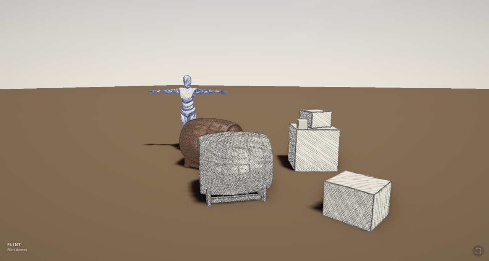

# Publishing to the Web

A Flint game can be put on the web with one command, whether it's a finished game, a FlintBench run, or a scene an agent wrote this afternoon:

```bash
flint export web examples/
python -m http.server -d examples/dist/web      # any static server will do
# open http://localhost:8000/
```



The folder it writes plays in any browser with WebGPU (Chrome and Edge 113+, Safari 26+, Firefox on Windows). It has no server code and needs no special headers, so GitHub Pages, Netlify, an S3 bucket or `python -m http.server` can all serve it. [play.chaps.dev](https://play.chaps.dev) is built with this same command.

## What's in the folder

```text
dist/web/
  index.html                    the page: gate, doorway, film fallback
  flint-web-<hash>.js, flint-web-<hash>_bg.wasm
                                the player, the same for every game (11.3 MB, 4.4 MB gzipped)
  flint_audio_worklet.wasm      the sound mixer, on the audio thread
  manifest.webmanifest, icons/  for adding the page to a home screen
  scenes/                       First Light, what a page with no game plays
  games.json                    the games here, with the words the page shows
  games/examples/
    demo.flintpack              the game: scenes, models, scripts, schemas
    demo.audio.flintpack        its sound, fetched once play has begun
```

A folder holding one game plays it at its bare address. A folder holding several shows a chooser there, and `?game=<id>` plays one of them. Other packed scenes are a query away: `?scene=pencil_sketch.scene.toml`. The [web design notes](https://github.com/chrischaps/flint/blob/main/docs/design/web.md#try-it) list every query key.

## The three steps

1. **The player.** Without `--player`, the command builds the web player with [trunk](https://trunkrs.dev) (`trunk build --release --cargo-profile web-release`) from the Flint tree the CLI was built from, into `target/web-player/`. Because the packer and the player come from one tree, they agree on the bundle format. A player and bundle that disagree say so at load (`bundle format N; this build reads format M`) instead of showing a blank page. To skip the build, pass `--player <dir>` with a trunk build you already have, or use `--engine <dir>` to build from a different Flint checkout.
2. **The bundle.** `flint bundle` packs the game into `games/<id>/`. It follows the game's `bundle.toml` rules and checks the bundle before it writes anything, with the checks [`flint check`](../cli-reference/overview.md#the-check-command) runs on the disk, here run over the packed files: every scene must load from the bundle with its archetypes known, every asset and file a scene, prefab, script, particle effect, glyph set or user style names must be packed, and the user styles and looks must load. Anything else stops the export, and the error lists each problem with its file, its entity and the paths tried. Run `flint check` first: it finds the same holes without packing, and it also reports what a bundle lets through because the game still plays (a field of the wrong type, a constraint).
3. **The listing.** This game's entry goes into `games.json`. It replaces any entry with the same id and keeps every other game, so several exports into one `--out` folder make one site:

```bash
flint export web ../Float     --out site --player play-dist
flint export web ../FlintKart --out site --player play-dist --name kart
```

The command writes only into an empty folder or an earlier export (one with a `games.json`), and never into the game's own folder. `--clean` empties an earlier export first.

## What gets packed: `bundle.toml`

Every key is optional. `bundle.toml` holds the packing rules; what the project's [manifest](building-a-game-project.md#the-project-manifest) already says it need not repeat: `name`, `scene` and `schemas` default to `flint.toml`'s `[project] id`, `scene` and `schemas`. With neither file, the folder's name (lowercased) is the id, the single scene is the start scene, and tooling, docs, source art and the engine's source tree are left out. `flint.toml` is packed with the game, so the player finds the same project in the bundle.

```toml
name = "demo"                              # the id: games/<id>/, ?game=<id>
scene = "phase4_runtime.scene.toml"        # where play starts
exclude = ["film/**", "**/*.tiff"]         # added to the defaults
include = []                               # wins over any exclude
[late]                                     # parts fetched after the first frame
audio = ["**/*.ogg", "**/*.wav"]

[mount]                                    # a folder outside the game, packed inside it
"engine/schemas" = "../schemas"

[web]                                      # what the page says about the game
title = "Flint demos"
line = "One sentence under the title."
controls = "sound on · WASD to walk · Esc frees the pointer"
touch = "how it's played by finger"
orientation = "landscape"                  # held sideways on a phone
page = "https://example.com/my-game/"
video = "web/film.mp4"                     # for browsers without WebGPU; a URL or a path in the game
poster = "web/poster.jpg"
film = "A line under the film."
```

A game with no `engine/schemas` folder of its own (no engine subtree) and no `[mount]` for one gets the engine's schemas packed for it, so a lone scene in an empty folder exports as it plays. When `video` or `poster` is a path in the game rather than a URL, the file is copied next to the bundle. `--meta key=value` overrides any `[web]` key for a single export, and an empty value clears it.

## One scene: `flint bundle <scene>`

Give `flint bundle` a `.scene.toml` instead of a folder and it packs that scene alone, with only what it reaches. This is how to check one engine feature in the browser without packing the whole `examples/` folder:

```bash
flint bundle examples/ascii_entities.scene.toml   # examples/dist/ascii_entities.flintpack
# serve a web player build with the pack beside it, then open
#   http://localhost:8000/?bundle=ascii_entities.flintpack
```

The bundle's paths are the scene's project's: `flint.toml`'s folder, or the checkout itself for a scene in the engine repository. A scene plays from the pack exactly as it does from the disk, and `examples/`' showcase scenes, which name files by paths from the repository root, pack this way too. The pack is named after the scene, starts there, and is written to `dist/` beside it (`--name` and `--out-dir` change both). For `ascii_entities`, it holds the scene, its four models, `mesh_meadow/mask.png` and the schemas: 46.6 MB, against 110 MB for the whole demo pack.

What goes in:

- the scene, the project's `flint.toml` and input config, and the schema directories the scene resolves by. A directory outside the project (a game naming the engine's schemas by path) goes in at `engine/schemas`;
- the small kinds, as the scene's search sees them: what is loaded whole or found by a bare name the check can't follow (animations, sequences, user styles, looks, palettes, glyph sets, fonts, papers, strokes, wooze presets, procgen specs, particle effects) and the `scripts/lib/` modules a script may `import`;
- then every model, texture, sound, script, prefab, scene and file the scene reaches. The bundle's own check runs over what has been gathered, and each missing file it reports is added from the first path it tried. That check is the player's search, so what it finds missing is what the player would read. A prefab, a script, or a scene a script loads gets checked in the next round, so the chain is followed to its end: scene, script, the scene it loads, that scene's models, their textures.

A project-root `bundle.toml` still applies: its `exclude` keeps a file out even when the scene reaches it, and `[late]` splits the parts. A music suite's stems stay in the main bundle, because a music session checks them as the scene loads, before a late part has arrived. `--scene` is refused, since the argument is the scene already.

## Flags

| Flag | Default | |
|---|---|---|
| `<game>` | `.` | the game's root folder |
| `--out <dir>` | `<game>/dist/web` | the folder to write |
| `--player <dir>` | build one | a trunk build of `crates/flint-player` to copy |
| `--engine <dir>` | the CLI's own tree | the Flint checkout trunk builds the player from |
| `--name <id>` | `bundle.toml`'s, else `flint.toml`'s `id`, else the folder's | lowercase letters, digits, `-` and `_` |
| `--scene <file>` | `bundle.toml`'s, else `flint.toml`'s `scene` | the start scene |
| `--meta key=value` | | a `[web]` key, repeatable |
| `--clean` | | empty an earlier export first |

Building the player requires trunk (`cargo install trunk --locked`) and the wasm target (`rustup target add wasm32-unknown-unknown`).
