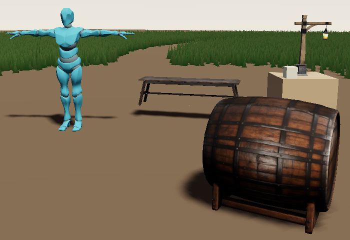
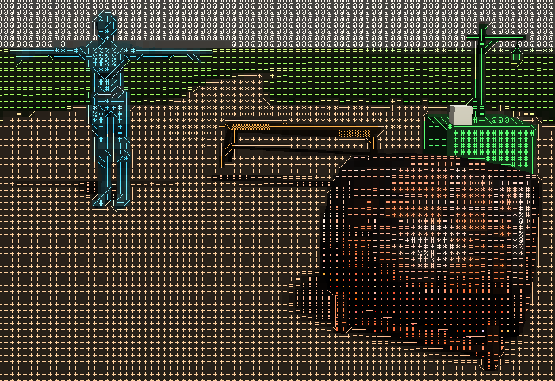
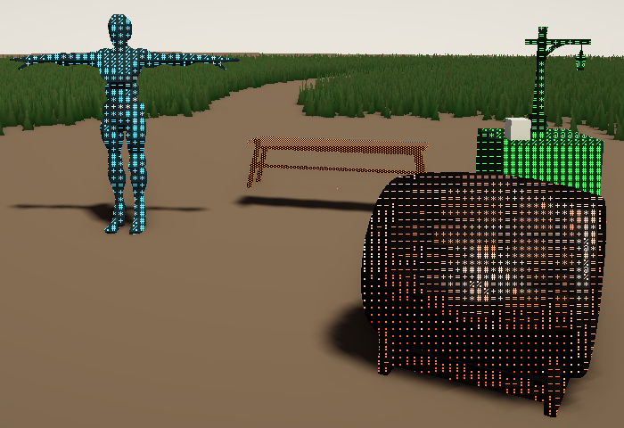
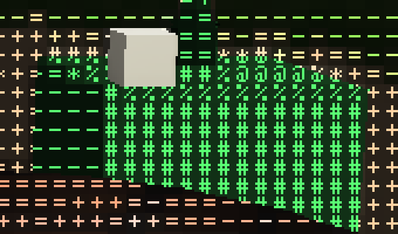
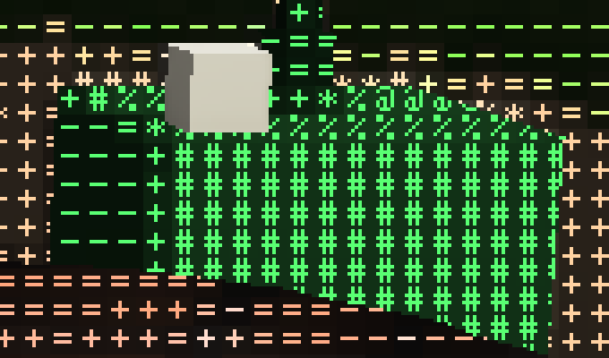
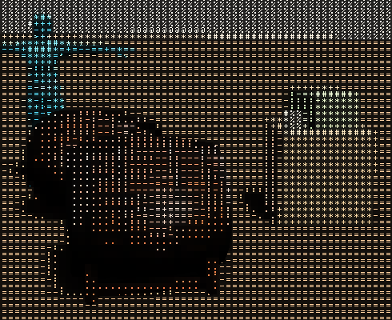
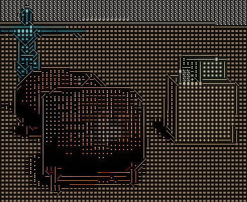
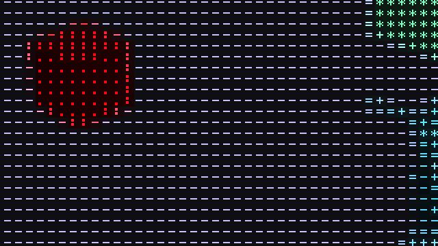
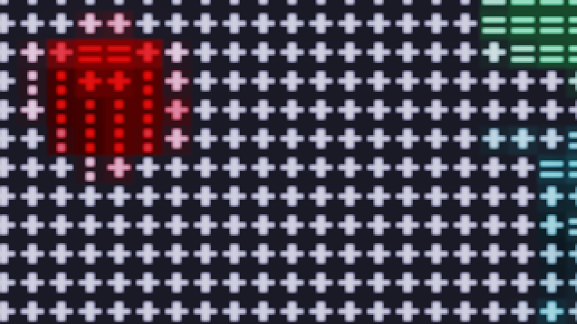

# Stylized Rendering

Flint can draw some or all of a scene in a style of its own: ASCII glyphs, the pencil sketch (#273) and watercolor (#272) today, with user-written shaders (#274) to come on the same framework. This guide is about choosing. Should a style cover the whole frame or only chosen entities? Which grid should glyphs sit on? Where in the frame does a style run? It shows the captures the decision was made from. The keys and flags are in the reference, [Stylize Passes](../concepts/stylize-passes.md). The decision record is [ADR 0111](https://github.com/chrischaps/flint/blob/main/docs/adr/0111-stylized-rendering.md).

Every image here was made with `flint render` from the commands beside it, at 1280x720 on an RTX 4070, and cropped at 1:1 unless it says it was zoomed.

## Three ways to style one frame

The frame is `examples/ascii_entities.scene.toml`, a meadow clearing with a bench, a skinned YBot, a barrel, and a crate with a lantern on it. The camera is the same for each:

```bash
CAM="--no-grid --target 0.7,0.7,4.2 --distance 5.2 --yaw 29 --pitch 10 --width 1280 --height 720"
```

| | |
|---|---|
|  |  |
| **Smooth.** `--no-postprocess` (see #376) | **The whole frame.** `--ascii-scope screen` |
|  | |
| **Per entity.** The scene as authored: each prop's `ascii_style`, scope `entities` | |

- **The whole frame** is one glyph field. Sky, grass and ground all turn into texture, and the props stand out by their own tone and hue and by edge lines along their outlines. The barrel has none, because it asks for its own grid (below). The lantern's glass box (`enabled = false`) stays smooth even here.
- **Per entity** leaves the world smooth and draws only the props in glyphs, so the eye goes straight to them. Each prop can take its own settings: the bench is amber blocks, the crate phosphor green, the YBot the scene's preset.

Neither is "the" ASCII mode. They are the same pass: per entity chooses *which pixels* the pass touches, and the whole frame is its "everything" case. Mix them: with a whole-frame table on, an entity's `ascii_style` still changes its own settings, and `enabled = false` keeps it smooth.

```toml
[post_process.styles.ascii]   # the preset; scope = "screen" would cover the frame
scope = "entities"

[entities.bench.ascii_style]
ramp = "blocks"
color = "tint"
tint = [1.0, 0.70, 0.30]
```

## One grid, unless a prop asks for its own

The worry about per-entity glyphs was that they would not line up on one grid. They do by default. Every styled entity shares the screen's grid, so a prop's cells continue the field around it. The zoom below is the crate and its lantern at 4x, nearest-neighbour, with the whole frame on:

|  |  |
|---|---|
| `--ascii-scope screen`: one grid | `--ascii-scope screen --ascii-grid object`: each prop on its own |

On the left, the crate's `#` columns sit exactly under the ground's `+` columns. On the right, the crate's grid is pinned to its projected origin. Its rows and columns start a few pixels off the field's, and wherever the two meet, cells are cut in half. The crate also loses its outline: [edge glyphs](../concepts/stylize-passes.md#edges) lie on the screen grid, so a variant on its own grid keeps only its tone glyphs. That seam is what the spike (#261) found, and it is why `grid = "object"` is opt-in per entity rather than the default.

What the object grid buys: a prop's glyphs hold still while it *slides* across the screen. They still swim when it turns or comes closer, because an anchor point can't follow rotation or depth. For a prop that moves sideways and nothing else (a sign on a train, a card dealt across a table), set it on that one entity:

```toml
[entities.barrel.ascii_style]
grid = "object"
```

For everything else, temporal stability (#277: per-cell history and hysteresis) is what stops the shimmer. It works on the screen grid.

## Edges give an object its shape

Glyphs alone define an object only by tone, so a prop close to the ground's brightness blurs into it. Without edges, the crate on the right of `examples/stylize_props.scene.toml` is only a patch of brighter glyphs, and the barrel's top runs into the ground behind it. With geometry edges (depth steps, creases and mask changes, never colour), the crate becomes a drawn box with a lid:

|  |  |
|---|---|
| `--style ascii:edges=0` | `--style ascii` (edges are on by default, #267) |

Edges, not the mask, are what give a styled object definition. They are also what a pencil style will draw its contours from.

## Where in the frame a style runs

A style runs at one of two stages (the reference's [Where styles run](../concepts/stylize-passes.md#where-styles-run)):

- **HDR**, in linear light at the scene's render scale, before fog, bloom and tonemapping. Painterly filters (Kuwahara) belong here: the fog fades them and the grade tints them like the rest of the scene.
- **Display**, on the finished picture at output resolution. Glyphs, lines and hatching belong here.

The difference shows under a render scale. Here is `examples/pbr_test.scene.toml` at `--render-scale 0.5`, zoomed 2x:

|  |  |
|---|---|
| `--style ascii:edges=0 --render-scale 0.5`: Display (shipped; edges off to match the spike) | `--ascii=full --render-scale 0.5`: the spike's HDR placement (captured before #293 removed the spike) |

At the HDR stage the glyphs are drawn at half resolution and upscaled: each 8 px cell becomes a soft 16 px glyph, and bloom haloes the bright ones. At the Display stage the cells are drawn after the upscale, so they stay 8 px and sharp at any render scale. Cells are sized in points, so they keep their size on a high-DPI display too.

## Choosing, in short

| You want | Use |
|---|---|
| The whole game in a look | `[post_process.styles.<name>]`, or a [look](../concepts/stylize-passes.md#looks-in-scenes-f4-and-scripts): `look = "ascii_noir"` in the scene's `[post_process]`, `--look ascii_noir` to try one, `set_look` from a script |
| A few things in a style, the world smooth | an `ascii_style` (or `style_mask`) on those entities, scope `entities` |
| One thing to stay smooth under a whole-frame style | `enabled = false` on it (descendants follow) |
| Glyphs that don't crawl as a prop slides | `grid = "object"` on that prop only |
| Glyphs that don't shimmer as the camera moves | leave `temporal` on (the default) |
| A painterly look that the fog and grade should touch | an HDR-stage style |
| Marks that stay crisp under `--render-scale` | a Display-stage style |

Today the mask covers static glTF meshes, procedural boxes and skinned meshes. Terrain, grass, particles, sprites and water can only be styled by the whole frame (#290, #310). A frame holds up to 8 glyph sets, one per entity if you like (#335), and up to 4095 per-entity variants (#336).

## A style in a story

A whole-frame style can arrive partway through a scene rather than be there from the start: torn open at a point, wiped across, held to a panel. [A Live Scene Pulled into a Drawing](a-live-scene-pulled-into-a-drawing.md) is a 28-second film built that way (`examples/understudy.scene.toml`). A mannequin walks out of a live clearing through a torn page into the `rotoscope` look, is drawn on twos while it's there, and is wiped back to life, with comic captions drawn by the HUD.

## Tuning a look

Tune by sweeping, not by guessing. A sweep renders one frame per value side by side:

```bash
flint render examples/ascii_entities.scene.toml --sweep ascii.cell=6,8,12 -o cells.png
flint render examples/stylize_props.scene.toml --sweep look=ascii_noir,matrix,ink_wash,graphite -o looks.png
```

Then confirm the winner with one render at the final size, since cells are in points. In the player or viewer, **F4 → Styles** tunes the same keys live. Its **Copy TOML** puts the block that reproduces the picture on the clipboard, and **Commit to scene** writes it into the scene file. See [Looks and sweeps](../concepts/stylize-passes.md#looks-and-sweeps) and the reference's advice on [cell size and ramps](../concepts/stylize-passes.md#choosing-cell-size-and-ramp).

## Adding a style

A style is a module in `crates/flint-render/src/stylize/` exporting a `StyleDescriptor` and a `StylePass`, plus its name in `register_styles!`. The scene table, the F4 editor, `--style`, `--sweep` and the goldens all come from the descriptor. A style that should apply per entity names a component and reads `frame.variants()`. The walkthrough is the reference's [Writing a style](../concepts/stylize-passes.md#writing-a-style). Start from `invert`, the 140-line template. Add a golden case to `crates/flint-cli/tests/golden/stylize.goldens.toml`, and a capture here.
