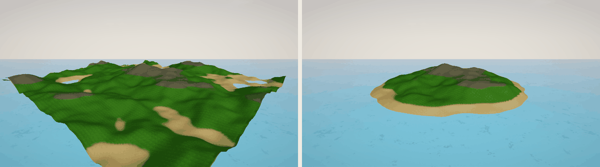

# Terrain

> **Package:** `terrain`: standard, so every game has it unless its `flint.toml` writes `terrain = false` under `[packages]` ([Packages](packages.md)). Without it a scene's `terrain` is `unlisted-package`, and neither launcher links the `flint-terrain` crate.

Flint's terrain system provides heightmap-based outdoor environments via the `flint-terrain` crate. Rolling hills, mountains, valleys, and open landscapes are defined by a grayscale heightmap image and textured with up to four blended surface layers controlled by an RGBA splat map.

## How It Works

A single `terrain` component on an entity defines the entire terrain surface:

```
Heightmap PNG          flint-terrain              flint-render
  grayscale    ──►  Chunked mesh generation  ──►  TerrainPipeline
  257x257           positions/normals/UVs          PBR lighting
                    triangle indices               splat-map blending
                                                   cascaded shadows

Splat Map PNG                                    flint-physics
  RGBA channels  ──►  4-layer texture blend      Rapier heightfield
  R=grass G=dirt       tiled from world pos       collision collider
  B=rock  A=sand
```

The heightmap is a grayscale PNG (8-bit or 16-bit) where black is the lowest point and white is the highest. The terrain is divided into chunks for efficient rendering --- each chunk is an independent draw call with its own vertex and index buffers.

## Adding Terrain to a Scene

Create an entity with the `terrain` archetype:

```toml
[entities.ground]
archetype = "terrain"

[entities.ground.transform]
position = [-128, 0, -128]

[entities.ground.terrain]
heightmap = "terrain/heightmap.png"
splat_map = "terrain/splatmap.png"
layer0_texture = "terrain/grass.png"
layer1_texture = "terrain/dirt.png"
layer2_texture = "terrain/rock.png"
layer3_texture = "terrain/sand.png"
width = 256.0
depth = 256.0
height_scale = 50.0
texture_tile = 16.0
```

The `transform.position` sets the world-space origin of the terrain. The heightmap is placed starting at that position, extending `width` units along X and `depth` units along Z. Heights range from 0 to `height_scale` units along Y.

## Heightmap

The heightmap is a grayscale PNG image. Each pixel encodes a height value:

- **8-bit** grayscale --- 256 height levels
- **16-bit** grayscale --- 65,536 height levels (recommended for large terrains)

The heightmap resolution determines mesh detail. A 257x257 image with `chunk_resolution = 64` produces a 4x4 grid of chunks, each with 65x65 vertices (16,641 vertices per chunk, 24,576 triangles per chunk).

Heights are sampled with **bilinear interpolation** for smooth surfaces, even with lower-resolution heightmaps.

### Creating Heightmaps

Any image editor that outputs grayscale PNGs works. Common approaches:

- **Photoshop/GIMP** --- paint or use noise filters, export as grayscale PNG
- **World Machine / Gaea** --- procedural terrain generation tools
- **Python + Pillow** --- generate programmatically with noise functions
- **Real-world data** --- USGS elevation data converted to grayscale

The dimensions should ideally be `(N * chunk_resolution) + 1` for clean chunk boundaries (e.g., 257, 513, 1025).

## Splat Map

The splat map is an RGBA PNG that controls how four texture layers blend across the terrain surface:

| Channel | Layer | Typical Use |
|---------|-------|-------------|
| **R** (red) | Layer 0 | Grass |
| **G** (green) | Layer 1 | Dirt |
| **B** (blue) | Layer 2 | Rock |
| **A** (alpha) | Layer 3 | Sand |

At each pixel, the RGBA weights are normalized so they always sum to 1.0. A pixel with `(255, 0, 0, 0)` shows pure grass; `(128, 128, 0, 0)` shows a 50/50 grass-dirt blend.

If no splat map is provided, the terrain uses the default white texture uniformly.

### Creating Splat Maps

Splat maps can be painted manually in any image editor that supports RGBA channels, or generated algorithmically based on height and slope:

- **Low flat areas** --- grass (red channel)
- **Mid elevations** --- dirt (green channel)
- **Steep slopes / high peaks** --- rock (blue channel)
- **Very low areas** --- sand (alpha channel)

## Generating Terrain From a Spec

A `.terrain.toml` spec describes both maps as a recipe: `[geometry]` (size, height and resolution), a list of `[[height_layers]]` run in order (`op = "noise"`, `"flatten"`, `"erosion"` or `"falloff"`), and `[[splat_rules]]` that paint each layer by height, slope and noise. [`flint-examples/rolling_meadow.terrain.toml`](https://github.com/chrischaps/flint-examples/blob/main/rolling_meadow.terrain.toml) is one. Shape it by eye in the terrain editor (`flint edit x.terrain.toml`), or bake it from the command line:

```bash
flint gen flint-examples/rolling_meadow.terrain.toml -o terrain/meadow.png   # terrain/meadow_height.png + meadow_splat.png
flint gen flint-examples/rolling_meadow.terrain.toml -o terrain/             # terrain/output_height.png + output_splat.png
flint gen flint-examples/rolling_meadow.terrain.toml --seed 12 --dry-run     # what it would write, and the cost
flint gen flint-examples/rolling_meadow.terrain.toml -o terrain/meadow.png --register   # kept in the project's store, reused
flint gen --describe terrain_v1                                              # every key, its default and range
```

A terrain spec is a procgen spec for the `terrain_v1` generator (Flint#1168). `flint gen` reads a `.terrain.toml` as one: `[meta]` and `[seed]` stay where they are, and the other tables are its `[params]`, so `--print-spec` writes the same recipe as a `*.procgen.toml` (`generator = "terrain_v1"`, `[params.geometry]`, `[[params.height_layers]]`), which bakes the same maps. Everything a procgen spec has, a terrain spec has: `--register` keeps both maps in the project's store and hands them back while the spec, seed and generator are unchanged; `--batch` makes variants by seed; `--validate` reads the written maps back; and the AI steps write and refine recipes (`flint gen --ai-create "rolling hills with a river valley" --ai-generator terrain_v1 -o terrain/`, where a word such as hills, mountains or valley picks `terrain_v1` without the flag).

### Erosion

An `op = "erosion"` layer wears the heights so far, in one of two ways:

- **`kind = "thermal"`** (the default) slumps every slope steeper than `talus_angle`, `iterations` passes over the whole map, each moving `strength` of the excess downhill. It softens; it doesn't carve.
- **`kind = "hydraulic"`** rains seeded droplets that roll downhill with a little inertia, pick soil up over a `radius`-texel brush (3 by default) while they speed up, and set it down as they slow, climb or dry out (Flint#1693). Droplets that follow one another deepen one path, so the slopes come out cut by branching gullies, with fans of soil at their feet. **`rainfall`** is droplets for each texel of the map, so one value wears a 256² map and a 2048² one alike: 0.3 is light wear, 1 (the default) clear gullies, 3 badlands. `strength` (0.3) is how fast a droplet picks soil up. **`rain_min_height`** starts droplets only where the height is at least that, in the heights' units so far (as `flatten`'s `height`), so a map that is mostly sea floor spends its rain on the land; the bake is faster for it. The map's edge is the base level: droplets run off there carrying their soil, and its texels are never worn lower.

```toml
[[height_layers]]
op = "erosion"
kind = "hydraulic"
rainfall = 1.0          # droplets per texel; the bake's cost grows with it
radius = 3.0            # texels; wider is broader, softer gullies
rain_min_height = 0.15  # optional: no rain on the sea floor
```

A 513² hydraulic layer at the default rainfall bakes in about 0.4 s in a release build. A key that only the other kind reads (`iterations` or `talus_angle` on a hydraulic layer, `rainfall` on a thermal one) is a warning naming the keys the layer does read: before Flint#1693, hydraulic's `iterations` counted single raindrops, and a recipe that still sets it gets the default rainfall.

### Splat rules

Each `[[splat_rules]]` entry paints one `layer` (0 to 3) wherever the ground fits its bands, and a texel takes every rule it fits, their weights normalized:

```toml
# Grass on the gentle ground: full on the flat, gone at 45 degrees
[[splat_rules]]
layer = 0
height_max = 0.8
slope_max = 1.0

# Rock on every cliff and gully wall: from 45 degrees up, at any height
[[splat_rules]]
layer = 2
slope_min = 1.0

# The sea bed is no rule's: leave it unpainted, so no grass grows there
[splat]
fallback = "none"
```

- **Height** is the normalized height, 0 to 1: `height_min` and `height_max`, with the weight fading in over the band's outer tenth. A band that reaches 0 or 1 doesn't fade there, so the lowest texel and the summit are painted.
- **Slope** is rise over run: 0 is flat, 1 is 45 degrees, 2 is about 63. `slope_max` is a ceiling, the weight fading out as `1 - slope / slope_max`; `slope_min` is a floor, the weight fading in as `1 - slope_min / slope`. Leave either out and the rule has no limit that way. Two rules that meet at one slope (grass's `slope_max = 1.0`, rock's `slope_min = 1.0`) split the ground there sharply; overlap them (rock from 0.8, grass to 1.3) and they blend. Until Flint#1696 the bake measured the sine of the angle, so a slope never passed 1 and `slope_max = 1.0` was no limit at all; a recipe written before then paints steep ground differently now.
- **Noise** (`noise_amount`, `noise_scale`) breaks up a rule's edges.
- **`[splat] fallback`** is what a texel no rule covers gets: a layer at full weight (`fallback = 2`; layer 0 when the table is left out), or `"none"`, weights of 0. Grass reads no weight as no grass, and the terrain draws it black, so keep `"none"` for ground nobody sees, such as a sea bed. `flint gen` says how much of the map no rule covered and what it got: `coverage: layer 0 5.5%, layer 2 4.5%, ...; no rule covers 83.8%, left unpainted ([splat] fallback = "none")`.

The heightmap is a 16-bit greyscale PNG and the splat map an RGBA8 PNG at the same resolution, written as `<stem>_height.png` and `<stem>_splat.png`; point the `terrain` component's `heightmap` and `splat_map` at them. Both are the bytes the editor's Ctrl+E export writes (the one bake, `flint_terrain::bake`, makes both), and the same spec and seed bake the same bytes every run. The summary says how much of the ground each layer covers.

The spec is checked against `terrain_v1`'s schema before anything is baked, by path. A key nothing reads is a warning with the key it was probably meant to be (``warning: `height_layers[1].octave` is not a parameter of the noise layer (did you mean `octaves`?)``), and `--strict` makes it an error. A value the bake can't use is an error that stops the run: a splat rule for a layer past 3, a `noise_type` that isn't one, a resolution over 4096. The terrain editor lists the same lines under its Save buttons while the file has them.

### Noise has a sign

A noise layer's raw values are signed: perlin, simplex and value lie in -1..1, ridged in 0..1 (`flint gen --describe terrain_v1` gives each type's range). `blend = "add"` doesn't mind, since the heights are normalized after the last layer. `multiply`, `min`, `max` and `overlay` do. Multiplying the hills by a slow perlin swell, to gather the mountains on one side, turns the land upside down wherever the swell is negative, and for some seeds that is the whole map: the hills sink under a `flatten` floor and erosion's per-texel speckle is all that normalizes (Flint#1695). `range = [from, to]` maps a layer's raw range onto `from..to` and holds it there before `amplitude` scales it, so a multiplier is never negative:

```toml
[[height_layers]]
op = "noise"
noise_type = "perlin"
octaves = 2
frequency = 0.55
blend = "multiply"
range = [0.0, 1.0]    # -1..1 onto 0..1: the swell scales the land, never flips it
```

`[1.0, 0.0]` inverts. A layer without `range` blends its raw values, as before. In the terrain editor it is the **Range** box under Amplitude, which shows the raw range while it's off.

### Saying where the land is

Noise is the same everywhere, so on its own a recipe can't ask for an island or for mountains in the north, and its hills run up to the map's edge and end there in a cut cliff. A `falloff` layer says where the land is: a shape over the map that keeps the heights so far where it is 1 and sinks them where it is 0. Put it after the noise and before any erosion, so the shore it leaves is worn too; a noise layer after it would bring land back to the border.

```toml
[[height_layers]]
op = "noise"
octaves = 6
frequency = 3.0

[[height_layers]]
op = "falloff"
shape = "island"     # "island", "edge", "radial" or "gradient"
center = [0.5, 0.5]  # map coordinates: u along +X, v along +Z, 0 to 1
radius = 0.25        # whole this far from the center...
width = 0.2          # ...and gone this much further out

[[height_layers]]
op = "erosion"
kind = "thermal"
iterations = 30
```



That is [`tests/fixtures/scenes/terrain/island.terrain.toml`](https://github.com/chrischaps/Flint/blob/main/tests/fixtures/scenes/terrain/island.terrain.toml)'s recipe. With the falloff, every seed is an island: its border bakes to height 0 (`an_island_falloff_keeps_every_seeds_border_under_the_sea` checks 20 seeds). Without it, no seed's border was under the sea in 40 tried.

| Key | Default | What it does |
|-----|---------|--------------|
| `shape` | `"island"` | `island`: a disc that also fades out at the map's border, so the land never reaches the edge wherever the disc is. `edge`: only the border fades; the land fills the map but stops short of its edge. `radial`: a disc that may cross the border (a mountain in a corner). `gradient`: the land rises toward `direction` from the line through `center` (a coast along one side, mountains in the north) |
| `center` | `[0.5, 0.5]` | The disc's middle, or the line the gradient rises from |
| `radius` | `0.25` | How far from `center` the land is kept whole (`island`, `radial`) |
| `width` | `0.2` | How far the shape fades out: past `radius`, in from the border (`island`, `edge`), or past the line (`gradient`) |
| `curve` | `1.0` | The fade's exponent: above 1 shrinks the land toward where it is whole (steeper shores), below 1 widens it |
| `direction` | `[0, -1]` | Which way a `gradient` rises, as `[u, v]`; `[0, -1]` is toward -Z |
| `invert` | `false` | Keep the land outside the shape instead: a crater, a lake, a bay |
| `blend` | `"sink"` | `sink` pulls the heights toward the lowest of them where the shape is 0, so the border lands on the map's floor whatever the noise's sign. `multiply` scales the heights by the shape, which leaves the border mid-height where the noise around it is below 0. `add` raises the heights by the shape times `amplitude`: a plateau |
| `amplitude` | `1.0` | What `add` raises the shape by |

The terrain editor's generate mode has a **+ Falloff** button, which puts the layer before the first erosion, and shows each field only for the shapes that read it (the gradient's direction as a compass angle).

## Texture Tiling

Layer textures are **tiled** across the terrain surface based on world position, not the terrain UV. The `texture_tile` field controls how many times the texture repeats per 100 world units:

| `texture_tile` | Repetitions per 100 units | Good for |
|----------------|--------------------------|----------|
| 4.0 | 4x | Large rock formations |
| 12.0 | 12x | General ground cover |
| 24.0 | 24x | Fine detail (grass blades) |

Higher values produce finer detail but may show visible tiling at a distance. Future updates will add detail textures and triplanar mapping to mitigate this.

## Component Schema

| Field | Type | Default | Description |
|-------|------|---------|-------------|
| `heightmap` | string | | Path to grayscale PNG, from the scene's directory or any directory above it up to the project root ([where the engine looks](assets.md#where-the-engine-looks-for-a-file)) |
| `width` | f32 | 256.0 | World-space extent along X axis |
| `depth` | f32 | 256.0 | World-space extent along Z axis |
| `height_scale` | f32 | 50.0 | Maximum height in world units |
| `chunk_resolution` | i32 | 64 | Vertices per chunk edge (higher = more detail) |
| `texture_tile` | f32 | 16.0 | Texture tiling factor per 100 world units |
| `splat_map` | string | "" | Path to RGBA splat map PNG |
| `layer0_texture` | string | "" | Layer 0 texture (splat R channel) |
| `layer1_texture` | string | "" | Layer 1 texture (splat G channel) |
| `layer2_texture` | string | "" | Layer 2 texture (splat B channel) |
| `layer3_texture` | string | "" | Layer 3 texture (splat A channel) |
| `metallic` | f32 | 0.0 | PBR metallic value for terrain surface |
| `roughness` | f32 | 0.85 | PBR roughness value for terrain surface |

## Grass

Terrain can carry a GPU-instanced grass layer. Blades are scattered by a compute shader, drawn as crossed quads with wind sway and bend-on-contact, and cast into the two nearest shadow cascades. Nothing is authored by hand: density comes from the splat map, so grass grows exactly where the grass layer is painted.


*The Rolling Meadow demo: stylised grass driven by the splat map's red channel, with golden-hour lighting.*

Grass is a block of dotted keys on the same `terrain` component:

```toml
[entities.ground.terrain]
heightmap = "terrain/heightmap.png"
splat_map = "terrain/splatmap.png"
width = 384.0
depth = 384.0
"grass.enabled" = true
"grass.density" = 50.0
"grass.max_distance" = 100.0
"grass.fade_start" = 70.0
"grass.blade_height" = 0.43
"grass.color_base" = [0.12, 0.42, 0.08]
"grass.color_tip" = [0.35, 0.72, 0.18]
"grass.wind_direction" = [0.8, 0.0, 0.6]
"grass.wind_strength" = 0.09
```

| Field | Type | Default | Description |
|-------|------|---------|-------------|
| `grass.enabled` | bool | false | Turn the grass layer on |
| `grass.density` | f32 | 8.0 | Blades per square metre |
| `grass.max_distance` | f32 | 80.0 | Distance from the camera at which grass stops |
| `grass.fade_start` | f32 | 60.0 | Distance where probabilistic thinning begins |
| `grass.blade_width` | f32 | 0.08 | Blade width in metres |
| `grass.blade_height` | f32 | 0.4 | Base blade height in metres |
| `grass.height_variation` | f32 | 0.3 | Random height scale, 0 to 1 |
| `grass.color_base` | vec3 | [0.15, 0.45, 0.1] | Colour at the root, linear RGB |
| `grass.color_tip` | vec3 | [0.3, 0.7, 0.15] | Colour at the tip |
| `grass.color_dry` | vec3 | [0.55, 0.5, 0.2] | Dry tint mixed in per blade |
| `grass.dry_amount` | f32 | 0.15 | How much of the field is dry, 0 to 1 |
| `grass.wind_direction` | vec3 | [1.0, 0.0, 0.3] | Wind direction in the XZ plane |
| `grass.wind_speed` | f32 | 1.0 | Sway frequency multiplier |
| `grass.wind_strength` | f32 | 0.15 | Maximum sway displacement in metres |
| `grass.bend_radius` | f32 | 2.0 | Radius around an entity within which blades bend away |
| `grass.bend_strength` | f32 | 0.8 | How far they bend, 0 to 1 |
| `grass.density_source` | string | "splat" | `splat` reads the splat map; `map` is reserved for a dedicated density texture |
| `grass.density_layer` | i32 | 0 | Which splat channel drives density (0 = R, 1 = G, 2 = B, 3 = A) |
| `grass.density_threshold` | f32 | 0.1 | Minimum splat weight before a blade may spawn |
| `grass.wooze` | bool | false | Sway on the scene's `[wooze]` field instead of the wall clock, and comb the tips each beat. See [Woozy grass](procgen.md#woozy-grass) |
| `grass.wooze_amplitude` | f32 | 0.12 | Metres a woozy blade's tip leans at full swing, times the field's amplitude. 0 keeps only the clock |
| `grass.wooze_wavelength` | f32 | 2.5 | Metres from one combed patch to the next |

How it works, per frame:

1. A **compute pass** walks the cells within `max_distance` of the camera on a grid whose spacing is `1 / sqrt(density)`, samples the splat map's `density_layer` at each cell, skips cells under `density_threshold`, applies a probabilistic falloff between `fade_start` and `max_distance`, and writes a 32-byte instance (position on the heightmap, rotation, height scale, packed tint) into a storage buffer, in grid order, so the buffer is the same every run (a count, a scan and a write; see [Grass on Any Ground](grass-ground.md)). A blade's root takes the heightmap's bilinear blend at its spot, the same blend `sample_height` makes, so the blades stand on the terrain's surface ([ADR 0098](https://github.com/chrischaps/Flint/blob/main/docs/adr/0098-grass-stands-on-blended-heights.md)).
2. A **render pass** draws one shared blade mesh per instance. The vertex shader sways blades by a time-driven wind term (on the wall clock, or the wooze field's with `grass.wooze`) and pushes them away from up to eight entity positions within `bend_radius`; the fragment shader blends `color_base` to `color_tip` along the blade, mixes in `color_dry`, and shades with the same lighting levers and PCSS shadows as other geometry. The player feeds the camera position as the bend entity.
3. The **shadow pass** renders the instances into the nearest two cascades, so grass darkens the ground under it.

The pipeline participates in MSAA when the player runs with `--msaa 4`, and grass appears in `flint render` snapshots at time zero, so the wind is frozen but the field is fully populated. `--time` sways it as the player would at that moment.

The grass isn't tied to a terrain. A game with mesh ground gives it a density mask and a height instead: see [Grass on Any Ground](grass-ground.md).

The **Grass Debug** panel (`F3` in the player, see [Debug Panels](../guides/debug-panels.md)) exposes every field above live and can commit them back to the scene file, which is how the meadow demo's numbers were found.

### Changing the grass and the ground while the game runs

A script changes the terrain's grass and material the way it changes a light: with `set_field`, or eased over time with `tween`. The terrain package reads the fields again after every frame's scripts and hands the renderer what moved, so the next frame draws it. `terrain_live_fields()` lists them: every `grass.*` key above, `texture_tile`, `metallic` and `roughness`.

```rust
fn on_update() {
    let island = get_entity("island");
    // A gust: wind that rises over three seconds and swings round
    if total_time() > 10.0 && total_time() < 10.1 {
        tween(island, "terrain.grass.wind_strength", 0.6, 3.0);
        tween(island, "terrain.grass.wind_direction", [0.2, 0.0, 1.0], 3.0);
    }
    // Dusk: the dry tint rises as the sun goes down
    set_field(island, "terrain", "grass.dry_amount", 0.15 + 0.5 * (total_time() / 60.0).min(1.0));
}
```

`grass.enabled = false` stops the blades and `true` brings them back. A scene whose grass was off when it loaded grows its field the first time a script turns it on. A denser field or a longer `max_distance` remakes the blades' buffer before the next frame, which is a moment's work, so change those rarely and the colours and wind as often as you like. A `grass_ground` holds the scene's grass when there is one, and then the terrain's `grass.*` changes nothing (the player says so once).

## Physics Collision

Terrain automatically gets a **heightfield physics collider** via Rapier: the chunks' vertex grid as one grid of heights, on a fixed (immovable) rigid body. This means:

- Characters walk on the terrain surface naturally
- Objects collide with the terrain
- Raycasts hit the terrain for line-of-sight checks

The collider is the rendered mesh triangle for triangle: each cell is split along the same diagonal the chunks use, so what you see is what you collide with. A heightfield is Rapier's own shape for a grid of heights. It holds one number a vertex rather than a mesh's points and triangles, and it knows its cells' neighbours, so the edges between cells and the seams between chunks are smooth to anything rolling or walking over them: a ball rolling across them no longer hops (until #1219 the collider was the chunks' triangles as one trimesh, and a ball rolling down a slope could be thrown 0.19 m into the air at a cell edge).

The terrain's collider takes its entity's `collider.layer` and `mask` like any other, and `get_collider_extents` on it answers `shape: "heightfield"` with its box.

## Height Sampling from Scripts

A game that makes its own ground rather than loading a `terrain` registers it as a `GroundField` instead, and scripts read it with `ground_height(x, z)` and pick it with `screen_to_heightfield(x, y)` (see [Player extensions](../guides/player-extensions.md#picking-a-ground-that-isnt-flat)).


The `terrain_height(x, z)` function is available in [Rhai scripts](scripting.md) to query the terrain height at any world position:

```rust
fn on_update() {
    let me = self_entity();
    let pos = get_position(me);

    // Get terrain height at entity's XZ position
    let ground_y = terrain_height(pos.x, pos.z);

    // Snap entity to terrain surface
    set_position(me, pos.x, ground_y + 0.5, pos.z);
}
```

This is useful for:

- **NPC placement** --- keep characters on the ground
- **Projectile impact** --- detect when a projectile hits terrain
- **Camera clamping** --- prevent the camera from going below ground
- **Vegetation scattering** --- place objects at correct heights

The function uses bilinear interpolation on the heightmap data, matching the rendered surface exactly wherever the terrain entity's `transform.position` puts it: a terrain centred at `[-128, 0, -128]` answers for world (0, 0) with the height at the middle of its map, and one sunk to y = -51 answers 51 m lower. A point off the map reads the nearest edge's height. It returns 0.0 if no terrain is loaded.

## Rendering

Terrain uses its own `TerrainPipeline` with full PBR lighting --- the same Cook-Torrance BRDF, cascaded shadow maps, point lights, and spot lights as regular scene geometry. Terrain both **casts** and **receives** shadows.

The rendering order places terrain early in the pass (after the skybox, before entity geometry) to fill the depth buffer for efficient occlusion culling of objects behind hills.

When [post-processing](post-processing.md) is active, the terrain outputs linear HDR values like all other scene geometry. The composite pass handles tonemapping, bloom, fog, and other effects.

The renderer's [debug views](rendering.md#debug-visualization) draw the terrain as they draw meshes. The wireframe shows every triangle, with each chunk's border in amber, which makes it the view to use for tuning `chunk_resolution`, chasing a seam, or seeing which chunks the camera culled:

```bash
flint render levels/island.scene.toml --debug-mode wireframe --output chunks.png --no-grid
flint render levels/island.scene.toml --debug-mode normals --output normals.png --no-grid
```

Normals, depth, UV, unlit (the splat's blend of the layers, unlit) and metal/rough work as well. These views use pipelines of their own, built the first time one is asked for, so a game that never opens them builds none of them, and its normal frame is drawn exactly as before.

## Scene Transitions

Terrain is fully cleared and reloaded during [scene transitions](scripting.md). When `load_scene()` is called:

1. Current terrain draw calls and physics collider are removed
2. New scene is loaded
3. New terrain (if any) is generated, uploaded to GPU, and registered with physics
4. `terrain_height()` reads the new heightmap

## Architecture

Terrain is the `terrain` package (`packages/terrain/`), its one crate `flint-terrain`. The engine names no terrain code: the package registers its parts, and the plain data on either side is the kernel's.

- **`flint-terrain`** --- the package's crate. With no feature it is pure data (no GPU dependency): heightmap reading, the spec format and its bake, chunked mesh geometry (positions, normals, UVs, indices). Its `render` part builds a scene's terrain into the renderer; its `player` part registers that as a *scene binder*, which every host runs right after binding a scene (the player, the scene viewer and `flint render`), and the `terrain` script module; its `cli` part is the terrain editor.
- **`flint-geometry`** --- the kernel's plain data: the chunk mesh (`TerrainChunk`), the grass settings (`GrassConfig`), the height grid and `GroundField`, and the `SceneGround` the binder hands back to the host.
- **`flint-render`** --- `TerrainPipeline` and `terrain_shader.wgsl`. Assembles GPU vertex buffers from terrain data and handles splat-map texture blending; its lighting is the meshes' own (`direct_light.wgsl`, #738). `GrassPipeline` with `grass_compute.wgsl` and `grass_render.wgsl` owns the grass layer; `flint-terrain` only holds its `GrassConfig`.
- **`flint-physics`** --- `register_static_heightfield()` takes the ground's grid (the chunks' vertices as one grid) for collision; the player registers it from the `SceneGround`, so physics reads no terrain files and the terrain names no physics crate.
- **`terrain_height(x, z)`** --- the package's `terrain` script module, which reads the ground the player kept for the scene.
- **`flint-procgen`** --- `terrain_v1`, which `flint gen x.terrain.toml` runs, is the procgen package's part *with* terrain: a game that lists both has it.

This separation means `flint-terrain` can be used independently for tools, CLI commands, or headless processing without pulling in the GPU stack, and a game with no terrain (`terrain = false`) builds without it.

## Limitations

- **One terrain per scene** --- currently only the first terrain entity is loaded
- **No mesh LOD** --- all chunks render at full resolution regardless of distance (chunks outside the camera frustum are culled; grass thins with distance)
- **No runtime deformation** --- terrain is static after loading
- **CPU-side simulation** --- no GPU compute for terrain generation
- **Fixed PBR parameters** --- metallic and roughness are uniform across the entire terrain surface

See the [Terrain Roadmap](https://github.com/chrischaps/Flint/blob/main/docs/TERRAIN_ROADMAP.md) for planned features: chunk LOD, per-layer normal maps, triplanar mapping, several terrains a scene, and more.

## Further Reading

- [Rendering](rendering.md) --- the PBR pipeline that terrain builds on
- [Post-Processing](post-processing.md) --- bloom, fog, and SSAO that apply to terrain
- [Physics and Runtime](physics-and-runtime.md) --- the collision system terrain integrates with
- [Scripting](scripting.md) --- `terrain_height()` and other script APIs
- [Schemas](schemas.md) --- component and archetype definitions
